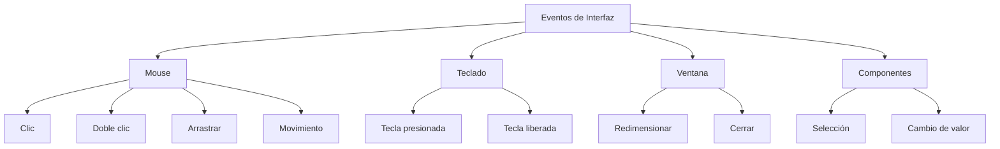
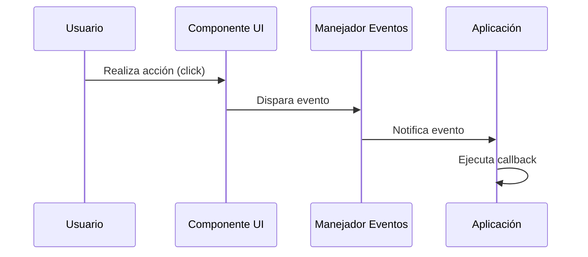
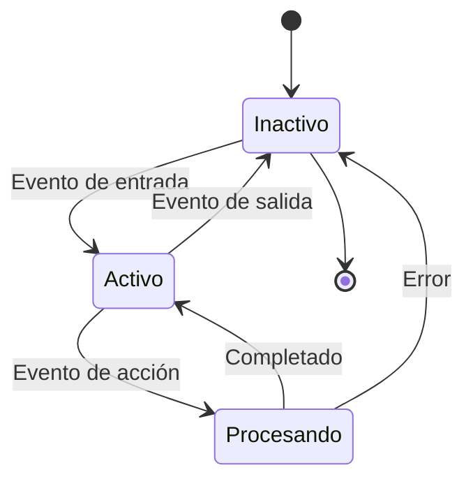

# Modelado y Programación - Interfaces hombre/máquina

## 4.1 Eventos

---

Los **eventos** son acciones o sucesos que ocurren en el sistema, generalmente iniciados por el usuario o por el propio sistema, que pueden ser detectados y manejados por el programa.

#### Definición Formal

Un **evento** es una representación de una acción significativa que puede ser detectada por un programa, típicamente resultante de la interacción del usuario con los componentes de la interfaz.

### Tipos de Eventos

#### 1. Eventos de Interfaz Gráfica



#### 2. Eventos de Modelo de Datos

- Cambios en estructuras de datos
- Actualizaciones de base de datos
- Modificaciones de estado

### El Ciclo de Eventos

Un programa con interfaz gráfica no sigue un flujo fijo de principio a fin: es **dirigido por eventos**. El sistema operativo coloca cada acción del usuario en una **cola de eventos**, y el programa ejecuta un **ciclo de eventos** (*event loop*) que, en esencia, hace lo siguiente:

```text
mientras la aplicación esté abierta:
    evento = cola.esperar_siguiente()      # bloquea hasta que llegue un evento
    para cada manejador registrado para ese evento:
        manejador(evento)                  # se ejecuta hasta terminar
    redibujar lo que haya cambiado
```

Consecuencias importantes:

- Los manejadores se ejecutan **uno a la vez** en el mismo hilo (el *Event Dispatch Thread* en Swing, el hilo principal en el navegador o en Tkinter). Si un manejador tarda varios segundos, por ejemplo al descargar un archivo, la interfaz se congela, porque el ciclo no puede atender otros eventos ni redibujar. Las tareas largas se mandan a otro hilo o se hacen de forma asíncrona.
- El programador no llama a los manejadores: los **registra** y el sistema los invoca. Esto se conoce como **inversión de control**.

### Arquitectura de Manejo de Eventos

#### Modelo de Publicador-Suscriptor (Observer Pattern)



### Implementación en Diferentes Lenguajes

#### JavaScript (Web)

```javascript
// Método 1: addEventListener
const button = document.getElementById('myButton');
button.addEventListener('click', function (event) {
  console.log('Botón clickeado', event.target);
  event.preventDefault(); // Prevenir comportamiento por defecto
});

// Método 2: Propiedades de evento
button.onclick = function (e) {
  console.log('Manejador onclick');
};

// Evento personalizado: primero se registra el manejador, luego se dispara
button.addEventListener('miEvento', (e) => console.log(e.detail.mensaje));
const customEvent = new CustomEvent('miEvento', {
  detail: { mensaje: 'Evento personalizado' },
});
button.dispatchEvent(customEvent);
```

`addEventListener` permite registrar varios manejadores para el mismo evento; asignar `onclick` reemplaza al anterior.

**Propagación.** En el navegador, un evento sobre un elemento recorre el árbol del documento: primero baja desde la raíz (fase de **captura**) y luego sube desde el elemento hasta la raíz (fase de **burbujeo**). Por eso basta un solo manejador en un contenedor para atender a todos sus hijos, técnica llamada **delegación de eventos**:

```javascript
// Un solo manejador para todos los <li> de la lista, incluso los que se agreguen después
document.getElementById('lista').addEventListener('click', (event) => {
  const item = event.target.closest('li');
  if (item) {
    console.log('Elegiste', item.textContent);
  }
});
```

`event.stopPropagation()` detiene el recorrido y `event.preventDefault()` cancela la acción predeterminada del navegador, como seguir un enlace o enviar un formulario.

#### Java (Swing)

```java
import javax.swing.*;
import java.awt.event.*;

public class EventExample {
    public static void main(String[] args) {
        // La interfaz se crea en el hilo de eventos de Swing
        SwingUtilities.invokeLater(() -> {
            JFrame frame = new JFrame("Ejemplo Eventos");
            frame.setDefaultCloseOperation(JFrame.EXIT_ON_CLOSE);
            JButton button = new JButton("Haz clic");

            // Clase anónima que implementa la interfaz ActionListener
            button.addActionListener(new ActionListener() {
                @Override
                public void actionPerformed(ActionEvent e) {
                    System.out.println("Botón presionado");
                }
            });

            // Desde Java 8, lo mismo con una expresión lambda
            button.addActionListener(e -> System.out.println("Otro manejador"));

            frame.add(button);
            frame.setSize(300, 200);
            frame.setVisible(true);
        });
    }
}
```

En Swing, cada tipo de evento tiene una interfaz *listener* (`ActionListener`, `MouseListener`, `KeyListener`, `WindowListener`) y el componente mantiene la lista de oyentes registrados: es el patrón Observer. Los componentes de Swing solo deben modificarse desde el hilo de eventos, de ahí el uso de `invokeLater`.

#### Python (Tkinter)

```python
import tkinter as tk

def manejar_click(evento):
    print(f"Clic en posición: {evento.x}, {evento.y}")

ventana = tk.Tk()
boton = tk.Button(ventana, text="Haz clic")
boton.bind("<Button-1>", manejar_click)  # Button-1 = clic izquierdo
boton.pack()

ventana.mainloop()   # inicia el ciclo de eventos; no regresa hasta cerrar la ventana
```

`bind` registra un manejador para un evento descrito con una cadena: `<Button-1>` es el clic izquierdo, `<Key>` cualquier tecla, `<Return>` la tecla Enter. Para botones también se puede usar `command=funcion`, que no recibe el objeto evento.

### Análisis Cuantitativo de Eventos

#### Frecuencia Relativa de Eventos

Registrar los eventos que genera el usuario sirve para estudiar cómo se usa una interfaz. La proporción de interacciones que corresponden a un tipo de evento $E$ se estima con su frecuencia relativa:

$$P(E) = \frac{N(E)}{N(T)}$$

Donde:

- $P(E)$ = Probabilidad del evento
- $N(E)$ = Número de veces que ocurre el evento
- $N(T)$ = Número total de interacciones

#### Tasa de Eventos

La frecuencia de eventos por unidad de tiempo:

$$\lambda = \frac{\Delta N}{\Delta t}$$

Donde $\lambda$ es la tasa de eventos. Si los eventos llegan muy rápido, como `mousemove` o `scroll`, que pueden dispararse decenas de veces por segundo, se limita la frecuencia con que se ejecuta el manejador: con **throttling**, a lo más una vez por intervalo; con **debouncing**, solo cuando los eventos dejan de llegar durante cierto tiempo, por ejemplo al terminar de escribir en un buscador.

### Patrones de Diseño para Manejo de Eventos

#### 1. Observer Pattern

```java
import java.util.ArrayList;
import java.util.HashMap;
import java.util.List;
import java.util.Map;

// Interfaz Observador
interface OyenteEvento {
    void actualizar(String tipoEvento, Object datos);
}

// Sujeto observable: un bus de eventos con varios tipos
class GestorEventos {
    private final Map<String, List<OyenteEvento>> oyentes = new HashMap<>();

    public void suscribir(String tipoEvento, OyenteEvento oyente) {
        oyentes.computeIfAbsent(tipoEvento, k -> new ArrayList<>()).add(oyente);
    }

    public void desuscribir(String tipoEvento, OyenteEvento oyente) {
        oyentes.getOrDefault(tipoEvento, List.of()).remove(oyente);
    }

    public void publicar(String tipoEvento, Object datos) {
        for (OyenteEvento oyente : oyentes.getOrDefault(tipoEvento, List.of())) {
            oyente.actualizar(tipoEvento, datos);
        }
    }
}

public class DemoEventos {
    public static void main(String[] args) {
        GestorEventos gestor = new GestorEventos();
        OyenteEvento registro = (tipo, datos) -> System.out.println("[registro] " + tipo + ": " + datos);
        gestor.suscribir("guardar", registro);
        gestor.suscribir("guardar", (tipo, datos) -> System.out.println("Mostrando aviso de guardado"));
        gestor.publicar("guardar", "documento.txt");
        gestor.desuscribir("guardar", registro);
        gestor.publicar("guardar", "otro.txt");   // solo responde el segundo oyente
    }
}
```

El nombre `OyenteEvento` evita confusiones con la interfaz `java.util.EventListener` de la biblioteca estándar.

#### 2. Command Pattern para Manejo de Eventos

```javascript
class Command {
  execute() {}
  undo() {}
}

class ClickCommand extends Command {
  constructor(element) {
    super();
    this.element = element;
    this.previousState = element.style.backgroundColor;
  }

  execute() {
    this.element.style.backgroundColor = 'blue';
  }

  undo() {
    this.element.style.backgroundColor = this.previousState;
  }
}

// Uso: el manejador crea un comando y lo guarda en un historial para poder deshacerlo
const historial = [];
button.addEventListener('click', () => {
  const command = new ClickCommand(button);
  command.execute();
  historial.push(command);
});
// Ctrl+Z: deshacer el último comando
document.addEventListener('keydown', (e) => {
  if (e.ctrlKey && e.key === 'z' && historial.length > 0) {
    historial.pop().undo();
  }
});
```

### Diagrama de Estados para Manejo de Eventos



### Ejercicios Propuestos

#### Ejercicio 1: Sistema de Eventos Básico

Crea un sistema que maneje los siguientes eventos:

- `click`: Cambia el color de fondo
- `dblclick`: Cambia el color del texto
- `mouseover`: Muestra información en tooltip

**Requisitos:**

- Usar el patrón Observer
- Permitir múltiples suscriptores por evento
- Implementar remoción de listeners

#### Ejercicio 2: Calculadora de Probabilidades

Desarrolla una aplicación que:

1. Registre la frecuencia de diferentes eventos de UI
2. Calcule probabilidades usando $P(E) = \frac{N(E)}{N(T)}$
3. Muestre estadísticas en tiempo real

#### Ejercicio 3: Sistema de Gestión de Eventos

Implementa un sistema que:

- Permita crear eventos personalizados
- Gestione prioridades de eventos
- Implemente colas de eventos para procesamiento asíncrono

### Ejemplo Avanzado: Sistema de Eventos con Prioridades

```javascript
class PriorityEventSystem {
  constructor() {
    this.events = new Map();   // nombre del evento -> lista de { callback, priority }
  }

  addEvent(eventName, callback, priority = 0) {
    if (!this.events.has(eventName)) {
      this.events.set(eventName, []);
    }
    this.events.get(eventName).push({ callback, priority });
  }

  triggerEvent(eventName, data) {
    if (this.events.has(eventName)) {
      const handlers = this.events.get(eventName).sort((a, b) => b.priority - a.priority);

      handlers.forEach((handler) => {
        try {
          handler.callback(data);
        } catch (error) {
          console.error(`Error en manejador de ${eventName}:`, error);
        }
      });
    }
  }
}

// Uso: los manejadores de mayor prioridad se ejecutan primero
const eventSystem = new PriorityEventSystem();
eventSystem.addEvent('userLogin', (u) => console.log('registrar acceso de', u), 5);
eventSystem.addEvent('userLogin', (u) => console.log('validar sesión de', u), 10);
eventSystem.triggerEvent('userLogin', 'ana');
// validar sesión de ana
// registrar acceso de ana
```

El bloque `try`/`catch` evita que un manejador defectuoso impida que se ejecuten los demás.

### Referencias y Buenas Prácticas

#### Mejores Prácticas

1. **Desacoplamiento**: Mantener los manejadores de eventos independientes de la lógica de UI
2. **Rendimiento**: Usar delegación de eventos para múltiples elementos similares
3. **Mantenibilidad**: Un manejador por evento, que delegue a funciones especializadas

#### Anti-patrones a Evitar

```javascript
// Mala práctica: lógica compleja en manejador [X]
button.onclick = function () {
  // 100 líneas de código...
  // Mezcla de lógica de UI, negocio y persistencia
};

// Buena práctica: manejador delgado (✓)
button.onclick = function () {
  handleButtonClick();
};

function handleButtonClick() {
  updateUI();
  processBusinessLogic();
  saveData();
}
```

### Ejercicio de Evaluación

**Problema:** Diseña un sistema de eventos para una aplicación de dibujo que debe manejar:

- Eventos de mouse (click, drag, move)
- Eventos de teclado (atajos)
- Eventos táctiles (para dispositivos móviles)
- Eventos personalizados (guardado automático, cambio de herramienta)

**Entrega:**

1. Diagrama de arquitectura (Mermaid)
2. Implementación en el lenguaje de tu preferencia
3. Tests que verifiquen el funcionamiento correcto

### Recursos Adicionales

#### Lecturas Recomendadas

1. "Design Patterns: Elements of Reusable Object-Oriented Software" - Gamma et al.
2. "Human-Computer Interaction" - Dix, Finlay, Abowd, Beale
3. "JavaScript: The Good Parts" - Douglas Crockford

#### Herramientas

- **Debugging**: Herramientas de desarrollador del navegador
- **Profiling**: Chrome DevTools Performance tab
- **Testing**: Jest, Mocha, Jasmine para pruebas de eventos
