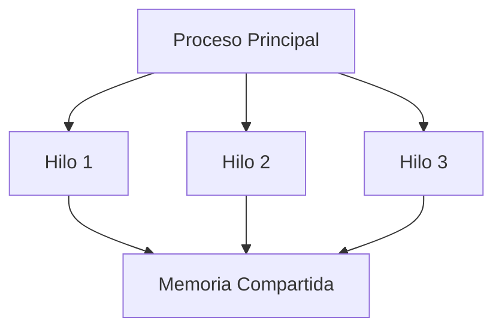
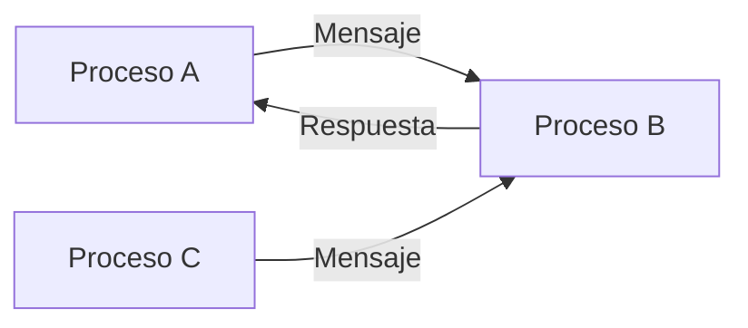
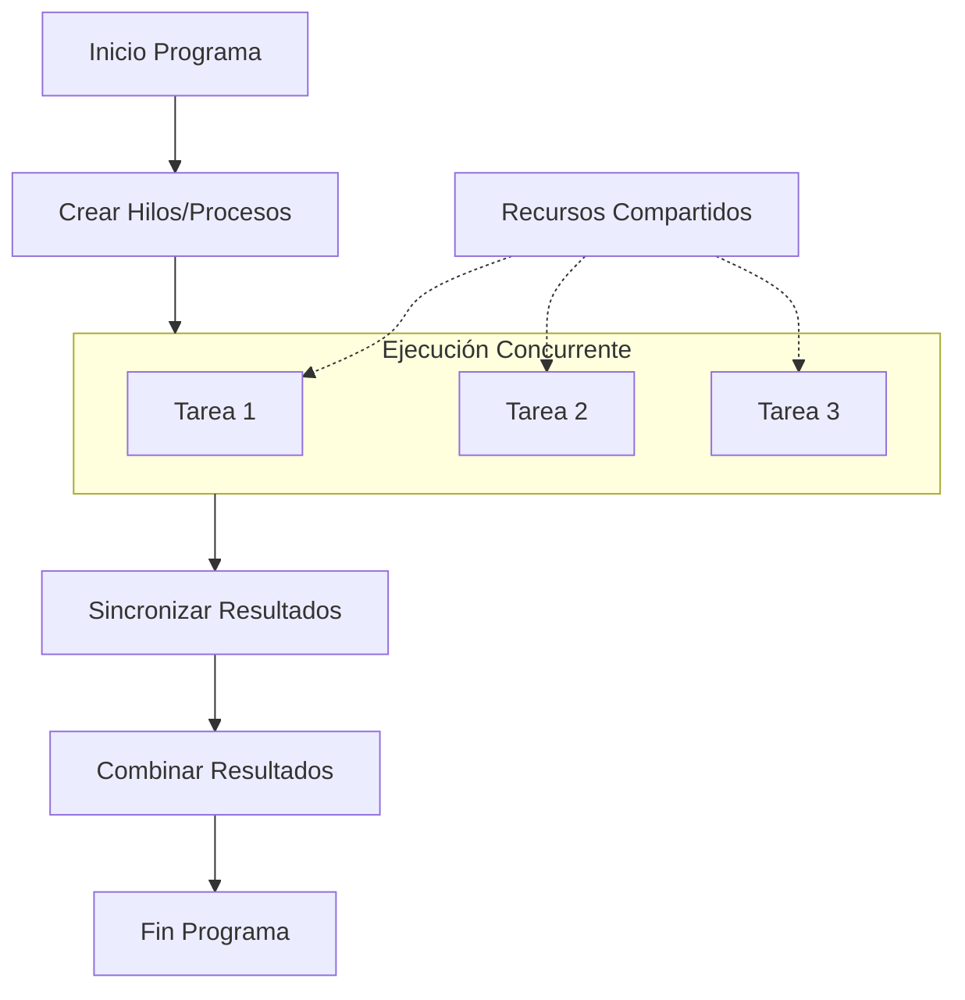

# Modelado y Programación - Programación concurrente

## 5.1 Introducción y contexto.

---

### 1. Definición y Conceptos Fundamentales

#### 1.1 ¿Qué es la Programación Concurrente?

La **programación concurrente** es un paradigma de programación que permite la ejecución de múltiples tareas aparentemente simultáneas dentro de un mismo programa. Estas tareas pueden ejecutarse en:

- **Procesadores múltiples** (paralelismo real)
- **Un solo procesador** mediante time-sharing (concurrencia)

**Fórmula básica de concurrencia:**
$$ T_{total} = \sum_{i=1}^{n} T_{cpu_i} + T_{espera} $$

#### 1.2 Términos Clave

- **Proceso**: Instancia de un programa en ejecución con su propio espacio de memoria
- **Hilo (Thread)**: Unidad básica de ejecución dentro de un proceso
- **Sección crítica**: Porción de código que accede a recursos compartidos
- **Race condition**: Condición donde el resultado depende del orden de ejecución
- **Deadlock**: Situación donde dos o más procesos se bloquean mutuamente

### 2. Modelos de Concurrencia

#### 2.1 Modelo de Memoria Compartida



#### 2.2 Modelo de Paso de Mensajes



### 3. Conceptos Matemáticos Fundamentales

#### 3.1 Ley de Amdahl

Define la mejora máxima de velocidad mediante paralelización:

$$ S(n) = \frac{1}{(1 - p) + \frac{p}{n}} $$

Donde:

- $S(n)$: Speedup con n procesadores
- $p$: Porción paralelizable del programa
- $n$: Número de procesadores

#### 3.2 Notación Big O para Operaciones Concurrentes

- **Tiempo constante**: $O(1)$
- **Logarítmico**: $O(\log n)$
- **Lineal**: $O(n)$
- **Cuadrático**: $O(n^2)$

### 4. Ejemplos de Código

#### 4.1 Ejemplo Básico en Python (threading)

```python
import threading
import time

def tarea_imprimir(nombre, delay):
    """Función que simula una tarea concurrente"""
    for i in range(5):
        time.sleep(delay)
        print(f"{nombre}: Iteración {i}")

# Crear hilos
hilo1 = threading.Thread(target=tarea_imprimir, args=("Hilo-A", 0.5))
hilo2 = threading.Thread(target=tarea_imprimir, args=("Hilo-B", 0.3))

# Iniciar hilos
hilo1.start()
hilo2.start()

# Esperar a que terminen
hilo1.join()
hilo2.join()

print("Todos los hilos han terminado")
```

#### 4.2 Ejemplo en Java

```java
public class EjemploConcurrencia {
    public static void main(String[] args) {
        // Crear dos hilos
        Thread hilo1 = new Thread(new TareaRunnable("Hilo-1"));
        Thread hilo2 = new Thread(new TareaRunnable("Hilo-2"));

        // Iniciar hilos
        hilo1.start();
        hilo2.start();

        try {
            // Esperar a que terminen
            hilo1.join();
            hilo2.join();
        } catch (InterruptedException e) {
            e.printStackTrace();
        }

        System.out.println("Programa principal terminado");
    }
}

class TareaRunnable implements Runnable {
    private String nombre;

    public TareaRunnable(String nombre) {
        this.nombre = nombre;
    }

    @Override
    public void run() {
        for (int i = 0; i < 5; i++) {
            System.out.println(nombre + ": " + i);
            try {
                Thread.sleep(100); // Simular trabajo
            } catch (InterruptedException e) {
                e.printStackTrace();
            }
        }
    }
}
```

### 5. Problemas Comunes en Programación Concurrente

#### 5.1 Condición de Carrera (Race Condition)

```python
import threading

contador = 0

def incrementar():
    global contador
    for _ in range(100000):
        contador += 1  # Operación no atómica

# Crear hilos
hilo1 = threading.Thread(target=incrementar)
hilo2 = threading.Thread(target=incrementar)

hilo1.start()
hilo2.start()

hilo1.join()
hilo2.join()

print(f"Valor final del contador: {contador}")
# ¡El resultado puede ser inconsistente!
```

#### 5.2 Deadlock (Interbloqueo)

```python
import threading

recurso_a = threading.Lock()
recurso_b = threading.Lock()

def proceso1():
    with recurso_a:
        print("Proceso1 adquirió recurso A")
        with recurso_b:
            print("Proceso1 adquirió recurso B")

def proceso2():
    with recurso_b:
        print("Proceso2 adquirió recurso B")
        with recurso_a:  # ¡Peligro de deadlock!
            print("Proceso2 adquirió recurso A")
```

### 6. Ejercicios Propuestos

#### Ejercicio 1: Análisis de Speedup

Calcula el speedup máximo teórico para un programa que es 70% paralelizable usando:
a) 4 procesadores
b) 8 procesadores
c) 16 procesadores

#### Ejercicio 2: Detección de Problemas

Identifica los problemas en el siguiente código:

```python
import threading

total = 0

def sumar():
    global total
    for i in range(1000):
        total += i

def restar():
    global total
    for i in range(1000):
        total -= i

hilos = []
for _ in range(10):
    hilos.append(threading.Thread(target=sumar))
    hilos.append(threading.Thread(target=restar))

for hilo in hilos:
    hilo.start()

for hilo in hilos:
    hilo.join()

print(f"Total final: {total}")
```

#### Ejercicio 3: Diseño de Sistema Concurrente

Diseña un sistema concurrente para procesar 1000 imágenes donde cada imagen necesita:

- 0.1s para cargar
- 0.5s para procesar
- 0.2s para guardar

Calcula el tiempo teórico con 1, 4 y 8 hilos.

### 7. Soluciones a Ejercicios

#### Solución Ejercicio 1:

a) $S(4) = \frac{1}{(1 - 0.7) + \frac{0.7}{4}} = \frac{1}{0.3 + 0.175} = \frac{1}{0.475} ≈ 2.10$

b) $S(8) = \frac{1}{0.3 + \frac{0.7}{8}} = \frac{1}{0.3 + 0.0875} = \frac{1}{0.3875} ≈ 2.58$

c) $S(16) = \frac{1}{0.3 + \frac{0.7}{16}} = \frac{1}{0.3 + 0.04375} = \frac{1}{0.34375} ≈ 2.91$

#### Solución Ejercicio 2:

El código tiene una **condición de carrera** porque múltiples hilos acceden y modifican la variable `total` sin sincronización.

#### Solución Ejercicio 3:

**Tiempo secuencial**: $1000 × (0.1 + 0.5 + 0.2) = 800s$

**Con n hilos**: $T(n) = \frac{800}{n} + T_{overhead}$

### 8. Referencias y Bibliografía

#### Libros Recomendados:

1. "The Art of Multiprocessor Programming" - Maurice Herlihy
2. "Java Concurrency in Practice" - Brian Goetz
3. "Introduction to Parallel Computing" - Ananth Grama

#### Recursos Online:

- [Python threading documentation](https://docs.python.org/3/library/threading.html)
- [Java Concurrency Tutorial](https://docs.oracle.com/javase/tutorial/essential/concurrency/)
- [POSIX Threads Programming](https://computing.llnl.gov/tutorials/pthreads/)

### 9. Diagrama de Flujo de Programación Concurrente



### 10. Buenas Prácticas

1. **Minimizar el estado compartido**
2. **Usar primitivas de sincronización adecuadas**
3. **Evitar deadlocks mediante ordenamiento de recursos**
4. **Considerar modelos de actores para sistemas distribuidos**
5. **Implementar timeouts para operaciones bloqueantes**

Esta guía proporciona una base sólida para entender los conceptos fundamentales de programación concurrente. En los siguientes temas se profundizará en mecanismos de sincronización, patrones de diseño y técnicas avanzadas.
