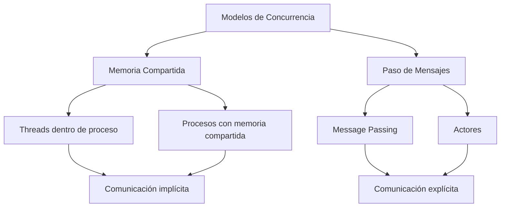
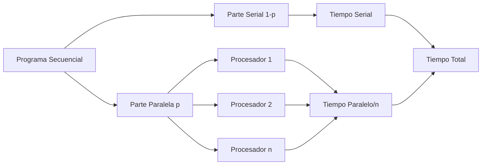
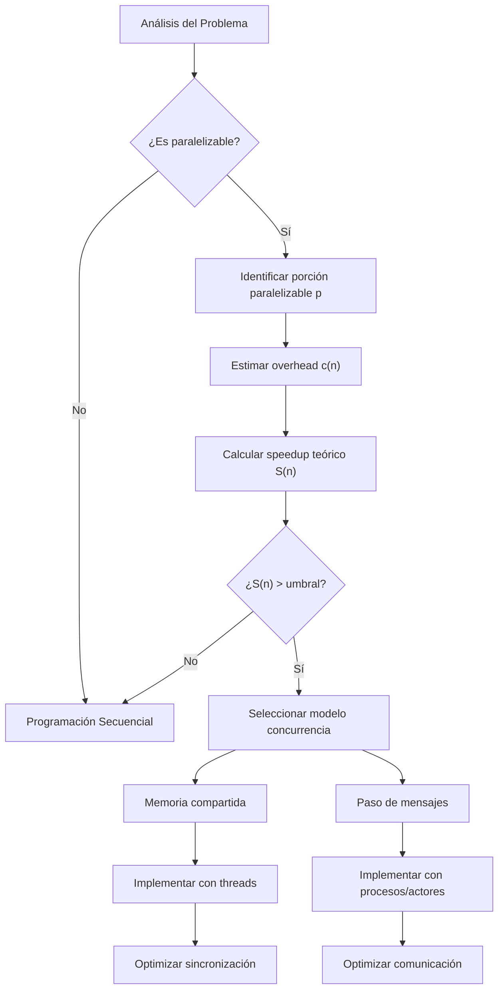

# Modelado y Programación - Programación concurrente

## 5.2 Conceptos básicos y Ley de Amdahl.

---

### 1. Conceptos Fundamentales de Concurrencia

#### 1.1 Definición de Programación Concurrente

La **programación concurrente** es un paradigma que permite la ejecución de múltiples tareas que progresan simultáneamente mediante la intercalación de sus ejecuciones en el tiempo, ya sea en un único procesador (concurrencia) o en múltiples procesadores (paralelismo).

Al ejecutar tareas de forma concurrente, el tiempo total se reduce en la parte del trabajo que se logra **solapar**, pero aumenta por el **costo adicional** (*overhead*) de crear hilos, sincronizarlos y comunicarlos:

$$ T_{concurrente} = T_{secuencial} - T_{solapado} + T_{overhead} $$

La concurrencia solo conviene si lo que se gana al solapar supera ese costo adicional.

#### 1.2 Terminología Esencial

- **Proceso**: Instancia de programa en ejecución con espacio de memoria independiente
- **Hilo (Thread)**: Unidad de ejecución dentro de un proceso que comparte memoria
- **Sección crítica**: Porción de código que accede a recursos compartidos
- **Race condition**: Situación donde el resultado depende del orden de ejecución
- **Deadlock**: Bloqueo mutuo entre dos o más procesos
- **Starvation**: Situación donde un proceso no puede acceder a recursos necesarios

### 2. Modelos de Concurrencia

#### 2.1 Memoria Compartida vs. Paso de Mensajes



#### 2.2 Ventajas y Desventajas

**Memoria Compartida:**

- ✓ Comunicación muy rápida: basta leer y escribir variables
- ✓ Modelo natural en una sola máquina con varios núcleos
- ✗ Hay que sincronizar cada acceso compartido para evitar condiciones de carrera
- ✗ Escala mal a muchas máquinas, que no comparten memoria

**Paso de Mensajes:**

- ✓ Mejor aislamiento: cada proceso o actor solo modifica su propio estado
- ✓ Funciona igual en una máquina o en un sistema distribuido
- ✓ Más fácil de razonar, porque no hay datos compartidos
- ✗ Costo de copiar y enviar mensajes
- ✗ Siguen existiendo interbloqueos si dos procesos se esperan mutuamente

Ejemplos: los hilos de Java o Python usan memoria compartida; MPI, los procesos de Erlang/Elixir, los canales de Go y el modelo de actores de Akka usan paso de mensajes.

### 3. Ley de Amdahl

#### 3.1 Formulación de la Ley

La **Ley de Amdahl** establece la mejora máxima de velocidad que se puede obtener al paralelizar un programa:

$$ S(n) = \frac{1}{(1 - p) + \frac{p}{n}} $$

Donde:

- $S(n):$ Speedup con n procesadores
- $p:$ Fracción paralelizable del programa (0 ≤ p ≤ 1)
- $n:$ Número de procesadores

**Deducción.** Si un programa tarda $T$ en un procesador, la parte serial tarda $(1 - p)T$ y la paralelizable $pT.$ Con $n$ procesadores, en el mejor caso, la parte paralela se reparte perfectamente:

$$ T(n) = (1 - p)T + \frac{pT}{n}, \qquad S(n) = \frac{T}{T(n)} = \frac{1}{(1 - p) + \frac{p}{n}} $$

#### 3.2 Limitaciones y Consideraciones

**Límite teórico cuando n → ∞:**

$$ S(\infty) = \frac{1}{1 - p} $$

Si 10% del programa es serial, nunca se superará un speedup de 10, aunque se usen miles de procesadores.

**Ejemplo visual de la Ley de Amdahl:**



#### 3.3 Eficiencia Paralela

La eficiencia se define como:

$$ E(n) = \frac{S(n)}{n} = \frac{1}{n(1 - p) + p} $$

### 4. Ejemplos Prácticos y Cálculos

#### 4.1 Ejemplo de Cálculo de Speedup

Para un programa con 80% de código paralelizable (p = 0.8):

| Procesadores (n) | Speedup S(n) | Eficiencia E(n) |
| ---------------- | ------------ | --------------- |
| 1                | 1.00         | 1.00            |
| 2                | 1.67         | 0.83            |
| 4                | 2.50         | 0.63            |
| 8                | 3.33         | 0.42            |
| 16               | 4.00         | 0.25            |
| ∞                | 5.00         | 0.00            |

Cada vez que se duplica el número de procesadores, el speedup aumenta menos: con $p = 0.8$ pasar de 8 a 16 procesadores solo lleva el speedup de 3.33 a 4.00, mientras la eficiencia baja de 0.42 a 0.25.

#### 3.4 Ley de Gustafson

Amdahl supone que el **tamaño del problema es fijo**. En la práctica, con más procesadores se suelen resolver problemas más grandes, donde la parte paralela crece y la serial casi no. Si $s$ es la fracción serial medida **en la ejecución paralela**, el speedup escalado es

$$ S(n) = s + (1 - s)\,n = n - s(n - 1) $$

Con $s = 0.2$ y $n = 16,$ $S = 16 - 0.2 \cdot 15 = 13,$ muy por encima del 4 que predice Amdahl. Las dos leyes no se contradicen: responden preguntas distintas, cuánto se acelera un problema fijo y cuánto más trabajo cabe en el mismo tiempo.

#### 4.2 Implementación Básica en Python

```python
import threading
import time

def calcular_speedup(p, n):
    """Calcula el speedup según la Ley de Amdahl"""
    return 1 / ((1 - p) + (p / n))

def tarea_paralela(id_tarea, resultados):
    """Simula una tarea paralelizable"""
    time.sleep(0.1)  # Simula trabajo
    resultados[id_tarea] = id_tarea * 2

# Ejemplo de ejecución concurrente
def ejecutar_concurrentemente(n_tareas):
    resultados = {}
    hilos = []

    for i in range(n_tareas):
        hilo = threading.Thread(target=tarea_paralela, args=(i, resultados))
        hilos.append(hilo)
        hilo.start()

    for hilo in hilos:
        hilo.join()

    return resultados

# Calcular speedup para diferentes valores
p = 0.8  # 80% paralelizable
for n in [1, 2, 4, 8, 16]:
    speedup = calcular_speedup(p, n)
    print(f"Procesadores: {n}, Speedup: {speedup:.2f}")
```

#### 4.3 Visualización de Resultados

```python
import matplotlib.pyplot as plt
import numpy as np

# Generar gráfico de la Ley de Amdahl
def graficar_ley_amdahl():
    p_valores = [0.5, 0.7, 0.9, 0.95]  # Diferentes porcentajes paralelizables
    n_valores = range(1, 33)  # De 1 a 32 procesadores

    plt.figure(figsize=(10, 6))

    for p in p_valores:
        speedups = [calcular_speedup(p, n) for n in n_valores]
        plt.plot(n_valores, speedups, label=f'p = {p}')

    plt.xlabel('Número de procesadores (n)')
    plt.ylabel('Speedup (S(n))')
    plt.title('Ley de Amdahl: Speedup vs. Número de procesadores')
    plt.legend()
    plt.grid(True)
    plt.show()

graficar_ley_amdahl()
```

### 5. Ejercicios Propuestos

#### Ejercicio 1: Cálculos de Speedup

Calcula el speedup y eficiencia para los siguientes casos:

1. p = 0.6, n = 4 procesadores
2. p = 0.9, n = 8 procesadores
3. p = 0.95, n = 16 procesadores
4. ¿Cuántos procesadores se necesitan para alcanzar un speedup de 4 cuando p = 0.8?

#### Ejercicio 2: Análisis de Programa

Un programa tarda 100 segundos en ejecutarse secuencialmente. Se identifica que:

- 25 segundos son gastados en E/S (serial)
- 60 segundos en cálculo (paralelizable)
- 15 segundos en inicialización (serial)

- a) Calcula el porcentaje paralelizable $p.$
- b) ¿Cuál es el speedup máximo teórico?
- c) ¿Cuál sería el tiempo de ejecución con 4 procesadores?

#### Ejercicio 3: Implementación Práctica

Escribe un programa que simule el cálculo de π usando el método Monte Carlo de forma concurrente. Mide el speedup obtenido al aumentar el número de hilos.

### 6. Soluciones a Ejercicios

#### Solución Ejercicio 1:

1. $S(4) = \frac{1}{(1-0.6) + \frac{0.6}{4}} = \frac{1}{0.4 + 0.15} = 1.82,$ $E(4) = 1.82/4 = 0.455$
2. $S(8) = \frac{1}{0.1 + \frac{0.9}{8}} = \frac{1}{0.1 + 0.1125} = 4.71,$ $E(8) = 4.71/8 = 0.589$
3. $S(16) = \frac{1}{0.05 + \frac{0.95}{16}} = \frac{1}{0.05 + 0.059375} ≈ 9.14,$ $E(16) ≈ 9.14/16 ≈ 0.571$
4. De $4 = \frac{1}{0.2 + \frac{0.8}{n}}$ se obtiene $0.2 + \frac{0.8}{n} = 0.25,$ es decir $\frac{0.8}{n} = 0.05$ y $n = 16.$ Con $p = 0.8$ el límite es 5, así que acercarse a ese límite cuesta cada vez más procesadores.

#### Solución Ejercicio 2:

- a) Solo el cálculo es paralelizable: $p = \frac{60}{100} = 0.6.$
- b) $S(\infty) = \frac{1}{1 - 0.6} = 2.5.$
- c) Directamente, la parte serial sigue tardando 40 s y la paralela se reparte: $T(4) = 40 + \frac{60}{4} = 55$ segundos, que corresponde a $S(4) = \frac{100}{55} ≈ 1.82.$

#### Solución Ejercicio 3 (Esquema):

En CPython, los hilos que ejecutan código Python puro **no** se aceleran por el GIL, así que este programa no mostrará speedup con hilos; sí lo hará con procesos, cambiando `threading.Thread` por `multiprocessing.Process` (o usando `multiprocessing.Pool`), porque cada proceso tiene su propio intérprete.

```python
import threading
import random
import math

def monte_carlo_pi(num_puntos, resultados, id_hilo):
    dentro_circulo = 0
    for _ in range(num_puntos):
        x, y = random.random(), random.random()
        if x**2 + y**2 <= 1:          # no hace falta la raíz: se compara con 1² = 1
            dentro_circulo += 1
    resultados[id_hilo] = dentro_circulo

def calcular_pi_concurrente(total_puntos, num_hilos):
    puntos_por_hilo = total_puntos // num_hilos
    resultados = {}
    hilos = []

    for i in range(num_hilos):
        hilo = threading.Thread(target=monte_carlo_pi,
                               args=(puntos_por_hilo, resultados, i))
        hilos.append(hilo)
        hilo.start()

    for hilo in hilos:
        hilo.join()

    total_dentro = sum(resultados.values())
    return (4 * total_dentro) / (puntos_por_hilo * num_hilos)

print(calcular_pi_concurrente(200_000, 4))   # aproximadamente 3.14
```

El cuarto de círculo de radio 1 ocupa $\frac{\pi}{4}$ del cuadrado unitario, así que la proporción de puntos que caen dentro aproxima $\frac{\pi}{4}.$ Se divide entre el número de puntos realmente generados, porque `total_puntos // num_hilos` puede descartar algunos.

### 7. Consideraciones Prácticas

#### 7.1 Overhead de la Concurrencia

La Ley de Amdahl asume overhead cero, pero en la práctica:

$$ S_{real}(n) = \frac{1}{(1 - p) + \frac{p}{n} + c(n)} $$

donde $c(n)$ es el costo de coordinación, como fracción del tiempo secuencial, y suele **crecer** con $n.$ Por eso, a partir de cierto número de procesadores, agregar más puede hacer el programa **más lento**.

#### 7.2 Escalabilidad

La **escalabilidad** depende de:

- Granularidad de las tareas
- Patrones de comunicación
- Balance de carga
- Localidad de datos

### 8. Referencias y Bibliografía

#### Libros Recomendados:

1. "Introduction to Parallel Computing" - Ananth Grama
2. "The Art of Multiprocessor Programming" - Maurice Herlihy
3. "Structured Parallel Programming" - McCool, Robison y Reinders

#### Artículos Fundamentales:

- Amdahl, G. M. (1967). "Validity of the single processor approach to achieving large scale computing capabilities"
- Gustafson, J. L. (1988). "Reevaluating Amdahl's Law"

#### Recursos Online:

- [Ley de Amdahl en Wikipedia](https://es.wikipedia.org/wiki/Ley_de_Amdahl)
- [Tutorial de programación concurrente en Python](https://docs.python.org/3/library/threading.html)
- [Visualizador interactivo de la Ley de Amdahl](https://www.desmos.com/calculator)

### 9. Diagrama de Decisiones de Diseño Concurrente



Esta guía proporciona una base sólida para comprender los conceptos fundamentales de programación concurrente y la importancia de la Ley de Amdahl en el diseño de sistemas paralelos.
