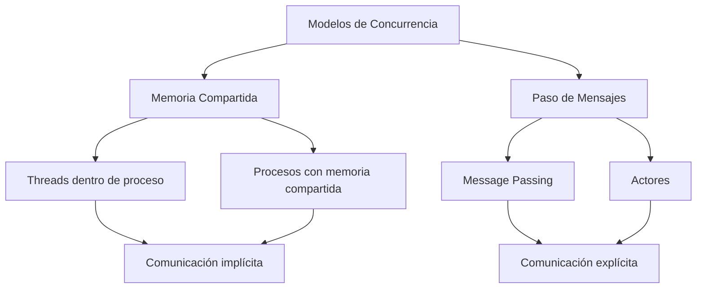
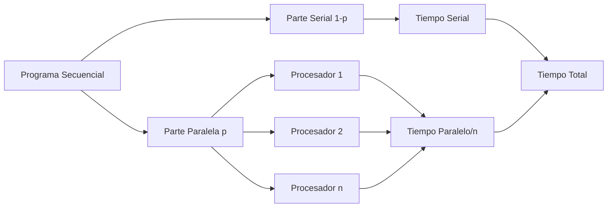
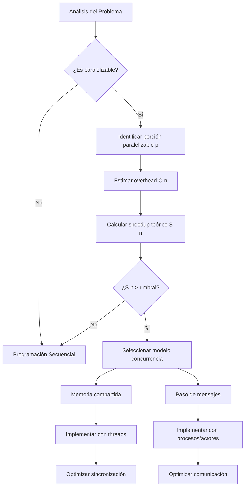

# Modelado y Programación - Programación concurrente

## 5.2 Conceptos básicos y Ley de Amdahl.

---

### 1. Conceptos Fundamentales de Concurrencia

#### 1.1 Definición de Programación Concurrente

La **programación concurrente** es un paradigma que permite la ejecución de múltiples tareas que progresan simultáneamente mediante la intercalación de sus ejecuciones en el tiempo, ya sea en un único procesador (concurrencia) o en múltiples procesadores (paralelismo).

**Fórmula de concurrencia básica:**
$$ T_{concurrente} = T_{secuencial} - T_{solapado} + T_{overhead} $$

#### 1.2 Terminología Esencial

- **Proceso**: Instancia de programa en ejecución con espacio de memoria independiente
- **Hilo (Thread)**: Unidad de ejecución dentro de un proceso que comparte memoria
- **Sección crítica**: Porción de código que accede a recursos compartidos
- **Race condition**: Situación donde el resultado depende del orden de ejecución
- **Deadlock**: Bloqueo mutuo entre dos o más procesos
- **Starvation**: Situación donde un proceso no puede acceder a recursos necesarios

### 2. Modelos de Concurrencia

#### 2.1 Memoria Compartida vs. Paso de Mensajes



#### 2.2 Ventajas y Desventajas

**Memoria Compartida:**

- (✓) Comunicación más rápida
- (✓) Sincronización más simple
  -(X)Dificultad para evitar condiciones de carrera
  -(X)Problemas de escalabilidad

**Paso de Mensajes:**

- (✓) Mejor aislamiento
- (✓) Más escalable
- (✓) Más fácil de razonar
  -(X)Overhead de comunicación
  -(X)Mayor complejidad de implementación

### 3. Ley de Amdahl

#### 3.1 Formulación de la Ley

La **Ley de Amdahl** establece la mejora máxima de velocidad que se puede obtener al paralelizar un programa:

$$ S(n) = \frac{1}{(1 - p) + \frac{p}{n}} $$

Donde:

- $S(n)$: Speedup con n procesadores
- $p$: Fracción paralelizable del programa (0 ≤ p ≤ 1)
- $n$: Número de procesadores

#### 3.2 Limitaciones y Consideraciones

**Límite teórico cuando n → ∞:**
$$ S(\infty) = \frac{1}{1 - p} $$

**Ejemplo visual de la Ley de Amdahl:**



#### 3.3 Eficiencia Paralela

La eficiencia se define como:

$$ E(n) = \frac{S(n)}{n} = \frac{1}{n(1 - p) + p} $$

### 4. Ejemplos Prácticos y Cálculos

#### 4.1 Ejemplo de Cálculo de Speedup

Para un programa con 80% de código paralelizable (p = 0.8):

| Procesadores (n) | Speedup S(n) | Eficiencia E(n) |
| ---------------- | ------------ | --------------- |
| 1                | 1.00         | 1.00            |
| 2                | 1.67         | 0.83            |
| 4                | 2.50         | 0.63            |
| 8                | 3.33         | 0.42            |
| 16               | 3.81         | 0.24            |
| ∞                | 5.00         | 0.00            |

#### 4.2 Implementación Básica en Python

```python
import threading
import time

def calcular_speedup(p, n):
    """Calcula el speedup según la Ley de Amdahl"""
    return 1 / ((1 - p) + (p / n))

def tarea_paralela(id_tarea, resultados):
    """Simula una tarea paralelizable"""
    time.sleep(0.1)  # Simula trabajo
    resultados[id_tarea] = id_tarea * 2

# Ejemplo de ejecución concurrente
def ejecutar_concurrentemente(n_tareas):
    resultados = {}
    hilos = []

    for i in range(n_tareas):
        hilo = threading.Thread(target=tarea_paralela, args=(i, resultados))
        hilos.append(hilo)
        hilo.start()

    for hilo in hilos:
        hilo.join()

    return resultados

# Calcular speedup para diferentes valores
p = 0.8  # 80% paralelizable
for n in [1, 2, 4, 8, 16]:
    speedup = calcular_speedup(p, n)
    print(f"Procesadores: {n}, Speedup: {speedup:.2f}")
```

#### 4.3 Visualización de Resultados

```python
import matplotlib.pyplot as plt
import numpy as np

# Generar gráfico de la Ley de Amdahl
def graficar_ley_amdahl():
    p_valores = [0.5, 0.7, 0.9, 0.95]  # Diferentes porcentajes paralelizables
    n_valores = range(1, 33)  # De 1 a 32 procesadores

    plt.figure(figsize=(10, 6))

    for p in p_valores:
        speedups = [calcular_speedup(p, n) for n in n_valores]
        plt.plot(n_valores, speedups, label=f'p = {p}')

    plt.xlabel('Número de procesadores (n)')
    plt.ylabel('Speedup (S(n))')
    plt.title('Ley de Amdahl: Speedup vs. Número de procesadores')
    plt.legend()
    plt.grid(True)
    plt.show()

graficar_ley_amdahl()
```

### 5. Ejercicios Propuestos

#### Ejercicio 1: Cálculos de Speedup

Calcula el speedup y eficiencia para los siguientes casos:

1. p = 0.6, n = 4 procesadores
2. p = 0.9, n = 8 procesadores
3. p = 0.95, n = 16 procesadores
4. ¿Cuántos procesadores se necesitan para alcanzar un speedup de 4 cuando p = 0.8?

#### Ejercicio 2: Análisis de Programa

Un programa tarda 100 segundos en ejecutarse secuencialmente. Se identifica que:

- 25 segundos son gastados en E/S (serial)
- 60 segundos en cálculo (paralelizable)
- 15 segundos en inicialización (serial)

a) Calcula el porcentaje paralelizable (p)
b) ¿Cuál es el speedup máximo teórico?
c) ¿Cuál sería el tiempo de ejecución con 4 procesadores?

#### Ejercicio 3: Implementación Práctica

Escribe un programa que simule el cálculo de π usando el método Monte Carlo de forma concurrente. Mide el speedup obtenido al aumentar el número de hilos.

### 6. Soluciones a Ejercicios

#### Solución Ejercicio 1:

1. $S(4) = \frac{1}{(1-0.6) + \frac{0.6}{4}} = \frac{1}{0.4 + 0.15} = 1.82$, $E(4) = 1.82/4 = 0.455$
2. $S(8) = \frac{1}{0.1 + \frac{0.9}{8}} = \frac{1}{0.1 + 0.1125} = 4.71$, $E(8) = 4.71/8 = 0.589$
3. $S(16) = \frac{1}{0.05 + \frac{0.95}{16}} = \frac{1}{0.05 + 0.0594} = 9.15$, $E(16) = 9.15/16 = 0.572$
4. $4 = \frac{1}{0.2 + \frac{0.8}{n}}$ → Resolviendo: $n = 16$

#### Solución Ejercicio 2:

a) $p = \frac{60}{100} = 0.6$
b) $S(\infty) = \frac{1}{1-0.6} = 2.5$
c) $S(4) = \frac{1}{0.4 + \frac{0.6}{4}} = 1.82$, $T(4) = 100/1.82 ≈ 54.95$ segundos

#### Solución Ejercicio 3 (Esquema):

```python
import threading
import random
import math

def monte_carlo_pi(num_puntos, resultados, id_hilo):
    dentro_circulo = 0
    for _ in range(num_puntos):
        x, y = random.random(), random.random()
        if math.sqrt(x**2 + y**2) <= 1:
            dentro_circulo += 1
    resultados[id_hilo] = dentro_circulo

def calcular_pi_concurrente(total_puntos, num_hilos):
    puntos_por_hilo = total_puntos // num_hilos
    resultados = {}
    hilos = []

    for i in range(num_hilos):
        hilo = threading.Thread(target=monte_carlo_pi,
                               args=(puntos_por_hilo, resultados, i))
        hilos.append(hilo)
        hilo.start()

    for hilo in hilos:
        hilo.join()

    total_dentro = sum(resultados.values())
    return (4 * total_dentro) / total_puntos
```

### 7. Consideraciones Prácticas

#### 7.1 Overhead de la Concurrencia

La Ley de Amdahl asume overhead cero, pero en la práctica:

$$ S_{real}(n) = \frac{1}{(1 - p) + \frac{p}{n} + O(n)} $$

#### 7.2 Escalabilidad

La **escalabilidad** depende de:

- Granularidad de las tareas
- Patrones de comunicación
- Balance de carga
- Localidad de datos

### 8. Referencias y Bibliografía

#### Libros Recomendados:

1. "Introduction to Parallel Computing" - Ananth Grama
2. "The Art of Multiprocessor Programming" - Maurice Herlihy
3. "Structured Parallel Programming" - McCool, Robison y Reinders

#### Artículos Fundamentales:

- Amdahl, G. M. (1967). "Validity of the single processor approach to achieving large scale computing capabilities"
- Gustafson, J. L. (1988). "Reevaluating Amdahl's Law"

#### Recursos Online:

- [Ley de Amdahl en Wikipedia](https://es.wikipedia.org/wiki/Ley_de_Amdahl)
- [Tutorial de programación concurrente en Python](https://docs.python.org/3/library/threading.html)
- [Visualizador interactivo de la Ley de Amdahl](https://www.desmos.com/calculator)

### 9. Diagrama de Decisiones de Diseño Concurrente



Esta guía proporciona una base sólida para comprender los conceptos fundamentales de programación concurrente y la importancia de la Ley de Amdahl en el diseño de sistemas paralelos.
