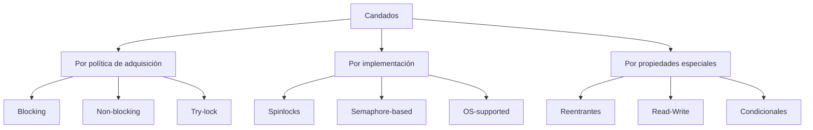
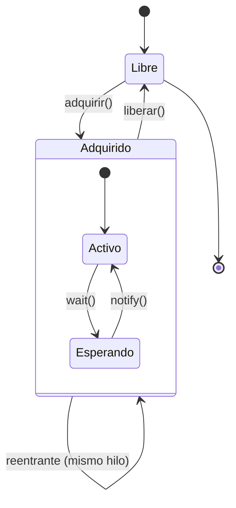

# Modelado y Programación - Programación concurrente

## 5.3 Candados.

---

### 1. Introducción a los Candados

#### 1.1 Definición y Concepto Fundamental

Un **candado** (lock) o **mutex** (mutual exclusion) es un mecanismo de sincronización que permite garantizar la exclusión mutua en el acceso a recursos compartidos. Un candado asegura que solo un hilo pueda acceder a una sección crítica a la vez.

**Propiedades esenciales:**

- **Exclusión mutua**: Solo un hilo puede poseer el candado a la vez
- **Progress**: Si ningún hilo está en la sección crítica, un hilo que solicite entrar podrá hacerlo
- **Espera acotada**: El tiempo de espera para adquirir el candado debe ser finito

#### 1.2 Operaciones Básicas

Las operaciones fundamentales de un candado son:

- `adquirir()` o `lock()`: Solicita la posesión del candado
- `liberar()` o `unlock()`: Libera el candado para que otros hilos puedan adquirirlo

**Representación matemática:**
$$ \text{CS} = \{ \text{Operaciones sobre recurso compartido} \} $$
$$ \text{Candado}(L) = \{ \text{adquirir}(L), \text{liberar}(L) \} $$
$$ \text{Sección crítica protegida} = \text{adquirir}(L); \text{CS}; \text{liberar}(L) $$

### 2. Implementación de Candados

#### 2.1 Candados con Espera Activa (Spinlocks)

```python
import threading
import time

class SpinLock:
    def __init__(self):
        self.locked = False

    def adquirir(self):
        # Espera activa (busy waiting)
        while True:
            if not self.locked:
                self.locked = True
                return
            time.sleep(0.001)  # Pequeña pausa para evitar sobrecarga CPU

    def liberar(self):
        self.locked = False

# Ejemplo de uso
contador_compartido = 0
candado = SpinLock()

def incrementar():
    global contador_compartido
    for _ in range(1000):
        candado.adquirir()
        contador_compartido += 1
        candado.liberar()

# Crear y ejecutar hilos
hilos = []
for _ in range(10):
    hilo = threading.Thread(target=incrementar)
    hilos.append(hilo)
    hilo.start()

for hilo in hilos:
    hilo.join()

print(f"Valor final: {contador_compartido}")
```

#### 2.2 Candados con Bloqueo (Usando Primitivas del Sistema)

```python
import threading

class Candado:
    def __init__(self):
        self._candado = threading.Lock()

    def adquirir(self):
        self._candado.acquire()

    def liberar(self):
        self._candado.release()

# Uso con context manager (recomendado)
def proceso_seguro(recurso_compartido):
    candado = threading.Lock()

    with candado:  # Adquiere y libera automáticamente
        # Sección crítica
        recurso_compartido['valor'] += 1
```

### 3. Tipos de Candados

#### 3.1 Clasificación de Candados



#### 3.2 Candados Reentrantes

Un candado reentrante permite que el mismo hilo pueda adquirirlo múltiples veces sin bloquearse.

```python
import threading

class CandadoReentrante:
    def __init__(self):
        self._candado = threading.RLock()  # Reentrant Lock
        self._propietario = None
        self._contador = 0

    def adquirir(self):
        hilo_actual = threading.get_ident()
        if self._propietario == hilo_actual:
            self._contador += 1
        else:
            self._candado.acquire()
            self._propietario = hilo_actual
            self._contador = 1

    def liberar(self):
        if self._propietario != threading.get_ident():
            raise RuntimeError("Solo el propietario puede liberar el candado")

        self._contador -= 1
        if self._contador == 0:
            self._propietario = None
            self._candado.release()

# Ejemplo de uso
candado_reentrante = CandadoReentrante()

def funcion_recursiva(nivel):
    candado_reentrante.adquirir()
    print(f"Nivel {nivel} - Hilo: {threading.get_ident()}")

    if nivel > 0:
        funcion_recursiva(nivel - 1)

    candado_reentrante.liberar()
```

#### 3.3 Candados de Lectura-Escritura

Permiten múltiples lectores o un único escritor.

```python
import threading

class CandadoLecturaEscritura:
    def __init__(self):
        self._lectores = 0
        self._candado = threading.Lock()
        self._cond_escritor = threading.Condition(self._candado)

    def adquirir_lectura(self):
        with self._candado:
            while self._escritores_esperando > 0:
                self._cond_escritor.wait()
            self._lectores += 1

    def liberar_lectura(self):
        with self._candado:
            self._lectores -= 1
            if self._lectores == 0:
                self._cond_escritor.notify_all()

    def adquirir_escritura(self):
        with self._candado:
            self._escritores_esperando += 1
            while self._lectores > 0:
                self._cond_escritor.wait()
            self._escritores_esperando -= 1
            self._escritor_activo = True

    def liberar_escritura(self):
        with self._candado:
            self._escritor_activo = False
            self._cond_escritor.notify_all()
```

### 4. Algoritmos de Implementación

#### 4.1 Algoritmo de Peterson

Solución software para exclusión mutua entre dos procesos:

```python
class PetersonLock:
    def __init__(self):
        self.flag = [False, False]  # Interés en entrar
        self.turn = 0                # Turno

    def adquirir(self, id_proceso):
        otro = 1 - id_proceso
        self.flag[id_proceso] = True  # Estoy interesado
        self.turn = id_proceso        # Cedo el turno

        # Espera mientras el otro está interesado y es su turno
        while self.flag[otro] and self.turn == id_proceso:
            pass  # Espera activa

    def liberar(self, id_proceso):
        self.flag[id_proceso] = False
```

#### 4.2 Test-and-Set Lock

Implementación hardware-assisted:

```python
import threading

class TASLock:
    def __init__(self):
        self._estado = threading.Atomic()  # Operación atómica

    def adquirir(self):
        while self._estado.test_and_set():
            pass  # Espera activa

    def liberar(self):
        self._estado.clear()
```

### 5. Consideraciones de Rendimiento

#### 5.1 Overhead de los Candados

El overhead de un candado puede modelarse como:

$$ T_{\text{total}} = T_{\text{trabajo}} + T_{\text{overhead}} $$

$$ T_{\text{overhead}} = N \times (T_{\text{adquirir}} + T_{\text{liberar}}) + T_{\text{contención}} $$

Donde:

- $N$: Número de operaciones de candado
- $T_{\text{adquirir}}$: Tiempo para adquirir el candado
- $T_{\text{liberar}}$: Tiempo para liberar el candado
- $T_{\text{contención}}$: Tiempo perdido en espera por contención

#### 5.2 Análisis de Contención

La probabilidad de contención sigue aproximadamente una distribución:

$$ P(\text{contención}) = 1 - (1 - p)^n $$

Donde:

- $p$: Probabilidad que un hilo necesite el candado
- $n$: Número de hilos

### 6. Ejercicios Propuestos

#### Ejercicio 1: Implementación de Candado

Implementa un candado usando el algoritmo de bakery para N procesos.

#### Ejercicio 2: Análisis de Desempeño

Dado un programa con:

- 80% de código paralelizable
- 20 operaciones de candado por milisegundo de trabajo
- Tiempo de adquisición: 0.1μs
- Tiempo de liberación: 0.1μs

Calcula el overhead para 1, 4, 8 y 16 hilos.

#### Ejercicio 3: Detección de Problemas

Identifica los problemas en este código:

```python
import threading

candado = threading.Lock()
recurso = []

def productor():
    for i in range(100):
        candado.acquire()
        recurso.append(i)
        # Falta liberar el candado

def consumidor():
    for i in range(100):
        candado.acquire()
        if recurso:
            item = recurso.pop()
            print(item)
        candado.release()
```

#### Ejercicio 4: Candado Reentrante

Extiende el candado reentrante para que soporte un máximo de 5 adquisiciones por el mismo hilo.

### 7. Buenas Prácticas y Patrones

#### 7.1 RAII (Resource Acquisition Is Initialization)

```python
class ScopedLock:
    def __init__(self, candado):
        self.candado = candado

    def __enter__(self):
        self.candado.adquirir()
        return self

    def __exit__(self, exc_type, exc_val, exc_tb):
        self.candado.liberar()

# Uso seguro
with ScopedLock(mi_candado):
    # Sección crítica
    operacion_peligrosa()
```

#### 7.2 Try-Lock Pattern

```python
def operacion_intentable():
    if mi_candado.adquirir(timeout=0.1):  # Intenta por 100ms
        try:
            # Operación crítica
            return realizar_operacion()
        finally:
            mi_candado.liberar()
    else:
        # Fallback o reintento
        return operacion_alternativa()
```

### 8. Referencias y Bibliografía

#### Libros Recomendados:

1. "The Art of Multiprocessor Programming" - Maurice Herlihy
2. "Java Concurrency in Practice" - Brian Goetz
3. "Operating Systems: Three Easy Pieces" - Remzi Arpaci-Dusseau

#### Artículos Fundamentales:

- Dijkstra, E. W. (1965). "Solution of a problem in concurrent programming control"
- Lamport, L. (1974). "A new solution of Dijkstra's concurrent programming problem"
- Peterson, G. L. (1981). "Myths About the Mutual Exclusion Problem"

#### Recursos Online:

- [Python threading documentation](https://docs.python.org/3/library/threading.html)
- [Java Concurrent Programming](https://docs.oracle.com/javase/tutorial/essential/concurrency/)
- [POSIX Threads Programming](https://computing.llnl.gov/tutorials/pthreads/)

### 9. Diagrama de Estados de un Candado



Esta guía proporciona una base sólida para comprender los candados en programación concurrente, desde conceptos fundamentales hasta implementaciones prácticas y consideraciones de rendimiento.
