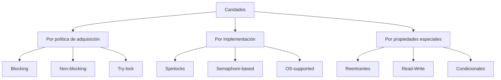
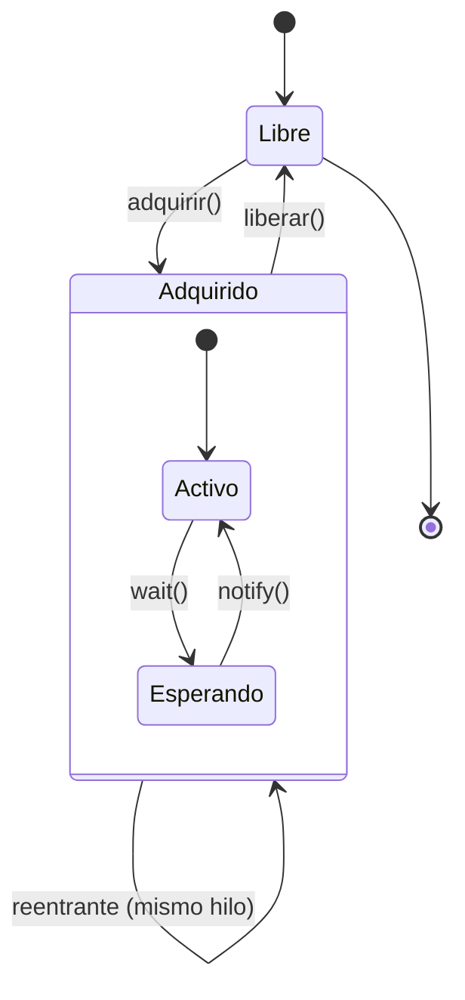

# Modelado y Programación - Programación concurrente

## 5.3 Candados.

---

### 1. Introducción a los Candados

#### 1.1 Definición y Concepto Fundamental

Un **candado** (lock) o **mutex** (mutual exclusion) es un mecanismo de sincronización que permite garantizar la exclusión mutua en el acceso a recursos compartidos. Un candado asegura que solo un hilo pueda acceder a una sección crítica a la vez.

**Propiedades esenciales:**

- **Exclusión mutua**: Solo un hilo puede poseer el candado a la vez
- **Progreso** (*progress*): si ningún hilo está en la sección crítica y alguno quiere entrar, la decisión de quién entra no puede posponerse indefinidamente
- **Espera acotada**: después de que un hilo pide entrar, hay un límite en el número de veces que otros hilos pueden entrar antes que él; esto evita la inanición

La exclusión mutua es una propiedad de **seguridad** (nunca pasa algo malo); el progreso y la espera acotada son propiedades de **vivacidad** (*liveness*: algo bueno termina por pasar).

#### 1.2 Operaciones Básicas

Las operaciones fundamentales de un candado son:

- `adquirir()` o `lock()`: Solicita la posesión del candado
- `liberar()` o `unlock()`: Libera el candado para que otros hilos puedan adquirirlo

Todo hilo que use el recurso sigue el mismo **protocolo**:

```text
adquirir(L)
    sección crítica: solo aquí se lee o modifica el recurso compartido
liberar(L)
```

Si se escriben $a_i$ y $\ell_i$ para el par número $i$ de adquirir/liberar y $\to$ para "ocurre antes", la exclusión mutua dice que, para dos secciones críticas distintas, siempre $\ell_i \to a_j$ o $\ell_j \to a_i,$ es decir, los intervalos de las secciones críticas nunca se traslapan.

Un candado solo protege si **todos** los accesos al recurso pasan por él; basta un hilo que lea o escriba sin adquirirlo para que vuelvan las condiciones de carrera.

### 2. Implementación de Candados

#### 2.1 Candados con Espera Activa (Spinlocks)

Un *spinlock* hace que el hilo repita un ciclo (*gira*) hasta que el candado quede libre. El primer intento natural es **incorrecto**:

```python
class SpinLockIncorrecto:
    def __init__(self):
        self.locked = False

    def adquirir(self):
        while True:
            if not self.locked:      # 1. leer
                self.locked = True   # 2. escribir
                return

    def liberar(self):
        self.locked = False
```

Entre la lectura del paso 1 y la escritura del paso 2 el planificador puede cambiar de hilo: dos hilos ven `locked == False` y ambos entran. Es el mismo problema de `contador += 1`: **leer y luego escribir no es atómico**. Por eso los spinlocks reales usan una instrucción atómica del procesador, como *test-and-set* (sección 4.2).

En Python, `Lock.acquire(blocking=False)` se comporta como un test-and-set: intenta tomar el candado en un solo paso atómico y devuelve `True` si lo logró. Con ella se puede escribir un spinlock correcto:

```python
import threading
import time

class SpinLock:
    def __init__(self):
        self._bandera = threading.Lock()

    def adquirir(self):
        # Espera activa (busy waiting): reintenta hasta lograrlo
        while not self._bandera.acquire(blocking=False):
            time.sleep(0)  # cede el procesador para no desperdiciarlo

    def liberar(self):
        self._bandera.release()

# Ejemplo de uso
contador_compartido = 0
candado = SpinLock()

def incrementar():
    global contador_compartido
    for _ in range(1000):
        candado.adquirir()
        contador_compartido += 1
        candado.liberar()

# Crear y ejecutar hilos
hilos = []
for _ in range(10):
    hilo = threading.Thread(target=incrementar)
    hilos.append(hilo)
    hilo.start()

for hilo in hilos:
    hilo.join()

print(f"Valor final: {contador_compartido}")   # siempre 10000
```

Los spinlocks solo convienen cuando la sección crítica es **muy corta** y hay varios núcleos: esperar girando cuesta menos que dormir al hilo y despertarlo. Si la sección crítica es larga, el hilo que gira desperdicia el procesador.

#### 2.2 Candados con Bloqueo (Usando Primitivas del Sistema)

```python
import threading

class Candado:
    def __init__(self):
        self._candado = threading.Lock()

    def adquirir(self):
        self._candado.acquire()

    def liberar(self):
        self._candado.release()

# Uso con context manager (recomendado)
candado_recurso = threading.Lock()   # UN candado compartido por todos los hilos

def proceso_seguro(recurso_compartido):
    with candado_recurso:  # Adquiere y libera automáticamente, aun si hay excepción
        # Sección crítica
        recurso_compartido['valor'] += 1
```

Un error común es crear el candado **dentro** de la función: cada llamada tendría su propio candado y ninguna excluiría a las demás. El candado debe ser el mismo objeto para todos los hilos que acceden al recurso.

Un **candado bloqueante** pone al hilo a dormir mientras espera, y el sistema operativo lo despierta cuando el candado se libera; no consume procesador mientras espera, pero dormir y despertar tiene un costo.

### 3. Tipos de Candados

#### 3.1 Clasificación de Candados



#### 3.2 Candados Reentrantes

Un candado reentrante permite que el mismo hilo pueda adquirirlo múltiples veces sin bloquearse.

```python
import threading

class CandadoReentrante:
    def __init__(self):
        self._candado = threading.Lock()   # candado simple, NO reentrante
        self._propietario = None
        self._contador = 0

    def adquirir(self):
        hilo_actual = threading.get_ident()
        if self._propietario == hilo_actual:
            self._contador += 1
        else:
            self._candado.acquire()
            self._propietario = hilo_actual
            self._contador = 1

    def liberar(self):
        if self._propietario != threading.get_ident():
            raise RuntimeError("Solo el propietario puede liberar el candado")

        self._contador -= 1
        if self._contador == 0:
            self._propietario = None
            self._candado.release()

# Ejemplo de uso
candado_reentrante = CandadoReentrante()

def funcion_recursiva(nivel):
    candado_reentrante.adquirir()
    print(f"Nivel {nivel} - Hilo: {threading.get_ident()}")

    if nivel > 0:
        funcion_recursiva(nivel - 1)

    candado_reentrante.liberar()

funcion_recursiva(3)   # con un Lock simple se bloquearía en el nivel 2
```

El candado guarda quién es su **propietario** y cuántas veces lo ha adquirido; solo se libera de verdad cuando el contador vuelve a 0. Comparar `self._propietario` con el hilo actual sin tomar el candado es seguro, porque ese campo solo puede ser igual al hilo actual si este mismo lo escribió. En la práctica se usa directamente `threading.RLock` en Python o `ReentrantLock` en Java; `synchronized` en Java ya es reentrante.

#### 3.3 Candados de Lectura-Escritura

Permiten **varios lectores a la vez** o **un único escritor**, pero no ambos. Convienen cuando las lecturas son mucho más frecuentes que las escrituras, por ejemplo en una caché o una tabla de configuración.

```python
import threading

class CandadoLecturaEscritura:
    """Da preferencia a los escritores para que no sufran inanición."""

    def __init__(self):
        self._lectores = 0                 # lectores dentro
        self._escritor_activo = False      # ¿hay un escritor dentro?
        self._escritores_esperando = 0
        self._candado = threading.Lock()
        self._cond = threading.Condition(self._candado)

    def adquirir_lectura(self):
        with self._cond:
            # Un lector espera si hay escritor dentro o escritores en fila
            while self._escritor_activo or self._escritores_esperando > 0:
                self._cond.wait()
            self._lectores += 1

    def liberar_lectura(self):
        with self._cond:
            self._lectores -= 1
            if self._lectores == 0:
                self._cond.notify_all()

    def adquirir_escritura(self):
        with self._cond:
            self._escritores_esperando += 1
            while self._escritor_activo or self._lectores > 0:
                self._cond.wait()
            self._escritores_esperando -= 1
            self._escritor_activo = True

    def liberar_escritura(self):
        with self._cond:
            self._escritor_activo = False
            self._cond.notify_all()

# Prueba: 5 lectores y 2 escritores sobre un diccionario compartido
rw = CandadoLecturaEscritura()
datos = {"x": 0}

def lector():
    for _ in range(100):
        rw.adquirir_lectura()
        _ = datos["x"]
        rw.liberar_lectura()

def escritor():
    for _ in range(100):
        rw.adquirir_escritura()
        datos["x"] += 1
        rw.liberar_escritura()

hilos = [threading.Thread(target=lector) for _ in range(5)]
hilos += [threading.Thread(target=escritor) for _ in range(2)]
for h in hilos: h.start()
for h in hilos: h.join()
print(datos["x"])   # 200
```

Las invariantes que se mantienen son: si `_escritor_activo` es verdadero entonces `_lectores == 0`, y nunca hay dos escritores dentro. Si los lectores no esperaran a los escritores en fila, un flujo constante de lectores podría dejar a un escritor esperando para siempre.

### 4. Algoritmos de Implementación

#### 4.1 Algoritmo de Peterson

Solución por software para la exclusión mutua entre **dos** hilos, que solo usa lecturas y escrituras de variables compartidas:

```python
class PetersonLock:
    def __init__(self):
        self.flag = [False, False]  # flag[i]: el hilo i quiere entrar
        self.victima = 0            # quién cede si ambos quieren entrar

    def adquirir(self, i):
        otro = 1 - i
        self.flag[i] = True    # quiero entrar
        self.victima = i       # pero cedo: si ambos queremos, que pase el otro

        # Espero mientras el otro quiera entrar y yo siga siendo quien cede
        while self.flag[otro] and self.victima == i:
            pass  # espera activa

    def liberar(self, i):
        self.flag[i] = False
```

**Por qué funciona.** Supongamos que ambos hilos están en la sección crítica. Cada uno escribió `flag = True` y luego `victima` con su propio número; sea $j$ el último que escribió `victima`, de modo que su valor final es $j.$ Cuando $j$ evaluó la condición del ciclo, `flag[otro]` ya era verdadero y `victima == j`, así que $j$ no pudo salir del ciclo: contradicción. Tampoco hay espera indefinida: si el hilo $i$ espera, es porque el otro está interesado y $i$ es la víctima; en cuanto el otro sale pone `flag[otro] = False`, y si vuelve a pedir entrar se vuelve él la víctima y deja pasar a $i.$

En hardware moderno, el compilador y el procesador pueden **reordenar** lecturas y escrituras, y el algoritmo de Peterson deja de funcionar si no se usan barreras de memoria (*memory fences*) o variables atómicas. Su valor actual es didáctico: muestra que la exclusión mutua puede razonarse y demostrarse.

#### 4.2 Test-and-Set Lock

Los procesadores ofrecen instrucciones **atómicas** que leen y escriben una posición de memoria en un solo paso indivisible. La más simple es *test-and-set*: pone la bandera en verdadero y devuelve el valor **anterior**.

```text
test_and_set(bandera):      // se ejecuta atómicamente, en hardware
    anterior = bandera
    bandera  = verdadero
    return anterior
```

Si devuelve falso, la bandera estaba libre y el hilo acaba de tomarla; si devuelve verdadero, otro la tenía. Python no expone esta instrucción, así que en el siguiente ejemplo se simula con una clase cuyo método es atómico gracias a un candado interno; lo importante es la estructura del `TASLock`:

```python
import threading

class BanderaAtomica:
    """Simula una bandera con test-and-set atómico."""
    def __init__(self):
        self._valor = False
        self._interno = threading.Lock()

    def test_and_set(self):
        with self._interno:
            anterior = self._valor
            self._valor = True
            return anterior

    def clear(self):
        self._valor = False

class TASLock:
    def __init__(self):
        self._estado = BanderaAtomica()

    def adquirir(self):
        while self._estado.test_and_set():
            pass  # espera activa

    def liberar(self):
        self._estado.clear()

tas = TASLock()
cuenta = 0

def trabajar():
    global cuenta
    for _ in range(1000):
        tas.adquirir()
        cuenta += 1
        tas.liberar()

hs = [threading.Thread(target=trabajar) for _ in range(4)]
for h in hs: h.start()
for h in hs: h.join()
print(cuenta)   # 4000
```

En Java la misma idea se escribe con `AtomicBoolean.getAndSet(true)`, y en C++ con `std::atomic_flag::test_and_set()`. Otra instrucción común es *compare-and-swap* (CAS), que escribe un valor nuevo solo si el actual es el esperado; es la base de las estructuras de datos sin candados (*lock-free*).

### 5. Consideraciones de Rendimiento

#### 5.1 Overhead de los Candados

El overhead de un candado puede modelarse como:

$$ T_{\text{total}} = T_{\text{trabajo}} + T_{\text{overhead}} $$

$$ T_{\text{overhead}} = N \times (T_{\text{adquirir}} + T_{\text{liberar}}) + T_{\text{contención}} $$

Donde:

- $N:$ Número de operaciones de candado
- $T_{\text{adquirir}}:$ Tiempo para adquirir el candado
- $T_{\text{liberar}}:$ Tiempo para liberar el candado
- $T_{\text{contención}}:$ Tiempo perdido en espera por contención

#### 5.2 Análisis de Contención

Un modelo sencillo: cada uno de los $n$ hilos pasa una fracción $p$ de su tiempo dentro de la sección crítica, de forma independiente. Cuando un hilo quiere entrar, encuentra el candado ocupado si alguno de los otros $n - 1$ hilos está dentro:

$$ P(\text{contención}) = 1 - (1 - p)^{n - 1} $$

Donde:

- $p:$ Fracción del tiempo que cada hilo pasa con el candado
- $n:$ Número de hilos

Con $p = 0.05$ y $n = 16,$ la probabilidad es $1 - 0.95^{15} ≈ 0.54:$ más de la mitad de los intentos encuentran el candado ocupado, aunque cada hilo lo use solo el 5% del tiempo. Por eso conviene que las secciones críticas sean **cortas** y, cuando se pueda, dividir un candado global en varios candados de grano fino. Además, si $np \geq 1,$ la sección crítica está ocupada todo el tiempo y agregar hilos ya no acelera nada.

### 6. Ejercicios Propuestos

#### Ejercicio 1: Implementación de Candado

Implementa un candado usando el algoritmo de bakery para N procesos.

#### Ejercicio 2: Análisis de Desempeño

Dado un programa con:

- 80% de código paralelizable
- 20 operaciones de candado por milisegundo de trabajo
- Tiempo de adquisición sin contención: 0.1 μs
- Tiempo de liberación: 0.1 μs

Calcula el overhead de los candados por milisegundo de trabajo y el speedup esperado con 1, 4, 8 y 16 hilos, suponiendo que no hay contención.

#### Ejercicio 3: Detección de Problemas

Identifica los problemas en este código:

```python
import threading

candado = threading.Lock()
recurso = []

def productor():
    for i in range(100):
        candado.acquire()
        recurso.append(i)
        # Falta liberar el candado

def consumidor():
    for i in range(100):
        candado.acquire()
        if recurso:
            item = recurso.pop()
            print(item)
        candado.release()
```

#### Ejercicio 4: Candado Reentrante

Extiende el candado reentrante para que soporte un máximo de 5 adquisiciones por el mismo hilo.

### 7. Buenas Prácticas y Patrones

#### 7.1 RAII (Resource Acquisition Is Initialization)

```python
class ScopedLock:
    def __init__(self, candado):
        self.candado = candado

    def __enter__(self):
        self.candado.adquirir()
        return self

    def __exit__(self, exc_type, exc_val, exc_tb):
        self.candado.liberar()

# Uso seguro
mi_candado = SpinLock()          # cualquier candado con adquirir/liberar
saldo = {"valor": 100}

with ScopedLock(mi_candado):
    # Sección crítica: si aquí ocurre una excepción, __exit__ libera igual
    saldo["valor"] -= 30
print(saldo["valor"])   # 70
```

El nombre RAII viene de C++, donde el destructor de un objeto `std::lock_guard` libera el candado al salir del bloque. En Python `with` cumple el mismo papel y en Java se usa `try { ... } finally { lock.unlock(); }`.

#### 7.2 Try-Lock Pattern

```python
import threading

candado_cache = threading.Lock()

def operacion_intentable():
    if candado_cache.acquire(timeout=0.1):  # espera como máximo 100 ms
        try:
            return "operación crítica realizada"
        finally:
            candado_cache.release()
    else:
        # No se obtuvo el candado: usar otra estrategia o reintentar después
        return "operación alternativa"

print(operacion_intentable())
```

Intentar con un tiempo límite evita quedarse bloqueado para siempre y es una forma de romper la condición de **retener y esperar** de los interbloqueos: si no se obtiene el segundo candado, se libera el primero y se reintenta más tarde.

### 8. Referencias y Bibliografía

#### Libros Recomendados:

1. "The Art of Multiprocessor Programming" - Maurice Herlihy
2. "Java Concurrency in Practice" - Brian Goetz
3. "Operating Systems: Three Easy Pieces" - Remzi Arpaci-Dusseau

#### Artículos Fundamentales:

- Dijkstra, E. W. (1965). "Solution of a problem in concurrent programming control"
- Lamport, L. (1974). "A new solution of Dijkstra's concurrent programming problem"
- Peterson, G. L. (1981). "Myths About the Mutual Exclusion Problem"

#### Recursos Online:

- [Python threading documentation](https://docs.python.org/3/library/threading.html)
- [Java Concurrent Programming](https://docs.oracle.com/javase/tutorial/essential/concurrency/)
- [POSIX Threads Programming](https://computing.llnl.gov/tutorials/pthreads/)

### 9. Diagrama de Estados de un Candado



El estado interno `Esperando` corresponde a un hilo que, dentro de la sección crítica, llama a `wait()` sobre una variable de condición: libera el candado mientras espera y lo vuelve a adquirir al ser notificado (tema 5.6).

### 10. Soluciones a Ejercicios

#### Solución Ejercicio 1: Algoritmo de la panadería de Lamport

Como en una panadería, cada hilo que quiere entrar toma un **número** mayor que todos los que ve; entra el de número más pequeño. Si dos hilos toman el mismo número, se desempata por identificador, comparando las parejas $(\text{numero}_i, i)$ en orden lexicográfico.

```python
import threading

class BakeryLock:
    def __init__(self, n):
        self.n = n
        self.eligiendo = [False] * n
        self.numero = [0] * n

    def adquirir(self, i):
        self.eligiendo[i] = True
        self.numero[i] = 1 + max(self.numero)
        self.eligiendo[i] = False
        for j in range(self.n):
            if j == i:
                continue
            while self.eligiendo[j]:          # esperar a que j termine de elegir
                pass
            while self.numero[j] != 0 and (self.numero[j], j) < (self.numero[i], i):
                pass                          # j tiene prioridad

    def liberar(self, i):
        self.numero[i] = 0

N = 3
panaderia = BakeryLock(N)
total = 0

def trabajador(i):
    global total
    for _ in range(200):
        panaderia.adquirir(i)
        total += 1
        panaderia.liberar(i)

hs = [threading.Thread(target=trabajador, args=(i,)) for i in range(N)]
for h in hs: h.start()
for h in hs: h.join()
print(total)   # 600
```

El arreglo `eligiendo` es necesario: sin él, un hilo podría comparar contra el número de otro que todavía está calculando el suyo. El algoritmo garantiza exclusión mutua y orden de llegada (FIFO), sin necesitar instrucciones atómicas; su desventaja es que usa $O(n)$ variables y los números crecen sin límite. Como Peterson, en hardware real necesita barreras de memoria; en CPython funciona porque el GIL serializa los accesos.

#### Solución Ejercicio 2: Análisis de Desempeño

Por cada milisegundo de trabajo se hacen 20 pares adquirir/liberar de $0.2$ μs cada uno:

$$ T_{\text{overhead}} = 20 \times (0.1 + 0.1) \,\mu\text{s} = 4\,\mu\text{s por ms} = 0.4\% $$

Sin contención, este costo no depende del número de hilos, porque cada hilo paga el suyo en paralelo. Aplicando Amdahl con $p = 0.8$ y multiplicando el tiempo por $1.004:$

| Hilos | Speedup ideal | Speedup con overhead |
| --- | --- | --- |
| 1 | 1.00 | 0.996 |
| 4 | 2.50 | 2.49 |
| 8 | 3.33 | 3.32 |
| 16 | 4.00 | 3.98 |

El overhead de adquirir y liberar es despreciable; lo que realmente afecta es la **contención**, cuando los hilos se forman a esperar el candado, que crece con el número de hilos según la sección 5.2.

#### Solución Ejercicio 3: Detección de Problemas

1. El productor nunca libera el candado. Después de su primer `acquire()`, su segunda iteración intenta adquirirlo otra vez y, como `Lock` no es reentrante, se bloquea **a sí mismo** para siempre; el consumidor también queda bloqueado.
2. Aunque se liberara, usar `acquire()` y `release()` a mano es frágil: si `print` o `pop` lanzaran una excepción, el candado quedaría tomado. Debe usarse `with candado:`.
3. El consumidor hace solo 100 intentos y, si la lista está vacía, simplemente no consume, así que puede terminar sin procesar todos los elementos. Para esperar a que haya datos se necesita una variable de condición o, más simple, `queue.Queue`, que ya es segura entre hilos (temas 5.4 y 5.6).

```python
import threading, queue

cola = queue.Queue()

def productor():
    for i in range(100):
        cola.put(i)

def consumidor():
    for _ in range(100):
        item = cola.get()     # espera si la cola está vacía
        _ = item

p = threading.Thread(target=productor)
c = threading.Thread(target=consumidor)
p.start(); c.start(); p.join(); c.join()
print("consumidos:", 100 - cola.qsize())   # consumidos: 100
```

#### Solución Ejercicio 4: Candado Reentrante con límite

```python
import threading

class CandadoReentranteLimitado:
    MAXIMO = 5

    def __init__(self):
        self._candado = threading.Lock()
        self._propietario = None
        self._contador = 0

    def adquirir(self):
        actual = threading.get_ident()
        if self._propietario == actual:
            if self._contador == self.MAXIMO:
                raise RuntimeError("Se superó el máximo de 5 adquisiciones")
            self._contador += 1
        else:
            self._candado.acquire()
            self._propietario = actual
            self._contador = 1

    def liberar(self):
        if self._propietario != threading.get_ident():
            raise RuntimeError("Solo el propietario puede liberar el candado")
        self._contador -= 1
        if self._contador == 0:
            self._propietario = None
            self._candado.release()

c = CandadoReentranteLimitado()
for _ in range(5):
    c.adquirir()
try:
    c.adquirir()
except RuntimeError as e:
    print(e)                 # Se superó el máximo de 5 adquisiciones
for _ in range(5):
    c.liberar()
print(c._propietario)        # None
```

Esta guía proporciona una base sólida para comprender los candados en programación concurrente, desde conceptos fundamentales hasta implementaciones prácticas y consideraciones de rendimiento.
