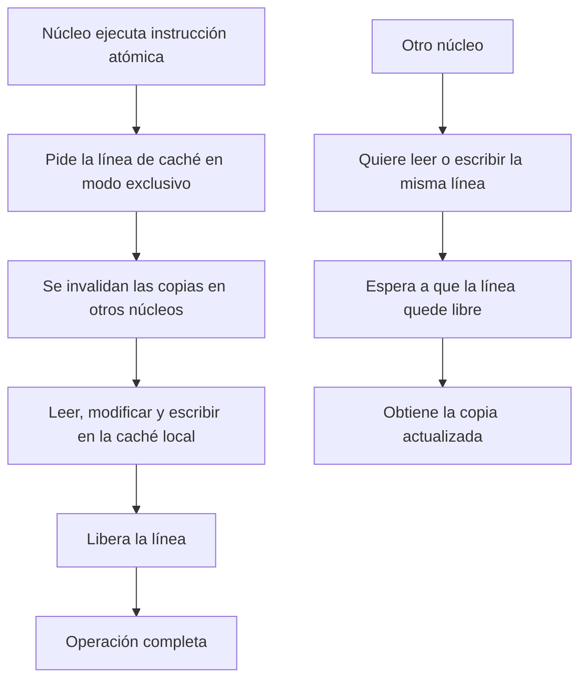
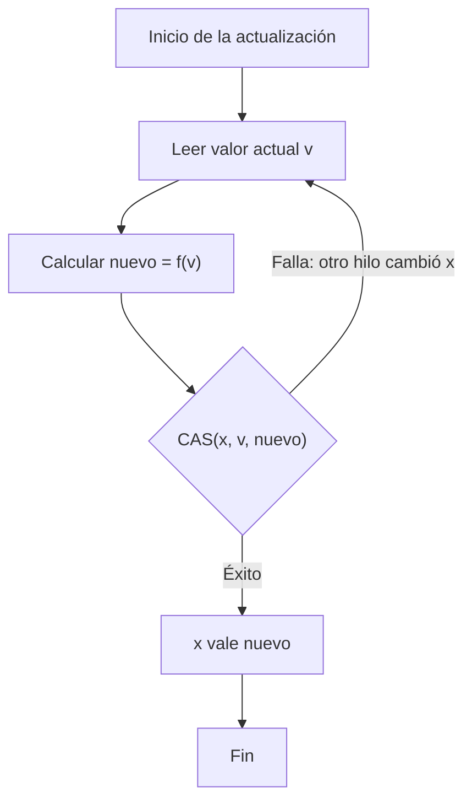

# Modelado y Programación - Programación concurrente

## 5.4 Primitivas de sincronización por hardware.

---

### 1. Introducción a las Primitivas Hardware

#### 1.1 Concepto Fundamental

Las **primitivas de sincronización por hardware** son instrucciones especiales proporcionadas por el procesador que permiten realizar operaciones atómicas sobre memoria compartida. Estas instrucciones son la base para implementar mecanismos de sincronización de alto nivel: candados, semáforos, monitores y estructuras de datos concurrentes.

**Propiedades clave:**

- **Atomicidad**: la operación se ejecuta de forma indivisible; ningún otro núcleo puede observar un estado intermedio.
- **Visibilidad**: una vez completada, el nuevo valor es visible para los demás núcleos.
- **Ordenamiento**: acompañadas de las barreras adecuadas, impiden que el compilador o el procesador reordenen accesos a memoria de manera que rompa la sincronización.

#### 1.2 Necesidad de Atomicidad

Una instrucción como `contador++` se traduce, en la mayoría de los procesadores, a tres pasos: cargar el valor en un registro, sumarle uno y guardarlo. Si dos núcleos ejecutan esos pasos intercalados, ambos pueden cargar el mismo valor y uno de los incrementos se pierde: el resultado **depende del orden de ejecución**.

| Paso | Núcleo 1 | Núcleo 2 | `contador` en memoria |
| --- | --- | --- | --- |
| 1 | carga 5 | | 5 |
| 2 | | carga 5 | 5 |
| 3 | suma: 6 | | 5 |
| 4 | | suma: 6 | 5 |
| 5 | guarda 6 | | 6 |
| 6 | | guarda 6 | 6 |

Una instrucción atómica realiza leer-modificar-escribir como **un solo paso**, de modo que el resultado ya no depende de la intercalación: dos incrementos atómicos siempre producen 7.

Los algoritmos de software como Peterson o la panadería (tema 5.3) logran exclusión mutua solo con lecturas y escrituras, pero necesitan $O(n)$ variables para $n$ hilos y barreras de memoria. Con una primitiva de hardware basta **una** variable.

### 2. Primitivas Hardware Fundamentales

#### 2.1 Test-and-Set (TAS)

La instrucción **Test-and-Set** escribe `true` en una posición de memoria y devuelve el valor que había antes, todo en un solo paso atómico:

```text
test_and_set(x):         // atómico
    anterior = x
    x = true
    return anterior
```

Como función de estado, si $x$ es el valor antes de la instrucción:

$$ \text{TAS}(x) \text{ devuelve } x \quad \text{y deja} \quad x \leftarrow \text{true} $$

En C++ esta primitiva es `std::atomic_flag`. Un spinlock basado en TAS:

```cpp
#include <atomic>
#include <iostream>
#include <thread>
#include <vector>

class TASLock {
    std::atomic_flag ocupado = ATOMIC_FLAG_INIT;
public:
    void lock() {
        // test_and_set devuelve el valor anterior: si era true, otro lo tiene
        while (ocupado.test_and_set(std::memory_order_acquire)) {
            // espera activa (spin)
        }
    }
    void unlock() {
        ocupado.clear(std::memory_order_release);
    }
};

int main() {
    TASLock candado;
    long contador = 0;
    std::vector<std::thread> hilos;
    for (int t = 0; t < 4; ++t)
        hilos.emplace_back([&] {
            for (int i = 0; i < 100000; ++i) {
                candado.lock();
                ++contador;          // sección crítica
                candado.unlock();
            }
        });
    for (auto& h : hilos) h.join();
    std::cout << contador << "\n";   // 400000
}
```

Si `test_and_set` devuelve `false`, el candado estaba libre y este hilo acaba de tomarlo; ningún otro hilo puede haber visto `false` al mismo tiempo, porque la lectura y la escritura son indivisibles.

#### 2.2 Compare-and-Swap (CAS)

**Compare-and-Swap** es una primitiva más poderosa y flexible: escribe un valor nuevo **solo si** el valor actual es el esperado.

```text
compare_and_swap(x, esperado, nuevo):   // atómico
    if x == esperado:
        x = nuevo
        return true
    return false
```

$$ \text{CAS}(x, e, n) = \begin{cases} \text{true y } x \leftarrow n, & \text{si } x = e \\ \text{false, sin modificar } x, & \text{en otro caso} \end{cases} $$

El patrón de uso típico es un **ciclo de reintento**: leer el valor, calcular el nuevo y publicarlo con CAS; si otro hilo lo cambió mientras tanto, el CAS falla y se repite. En C++ CAS es `compare_exchange_weak` o `compare_exchange_strong`; cuando falla, actualiza `esperado` con el valor actual.

```cpp
#include <atomic>
#include <iostream>
#include <thread>
#include <vector>

std::atomic<int> contador{0};

void incrementar() {
    int esperado = contador.load();
    // Si otro hilo cambió el contador, compare_exchange_weak falla,
    // copia el valor actual en 'esperado' y se reintenta.
    while (!contador.compare_exchange_weak(esperado, esperado + 1)) {
    }
}

// CAS permite cualquier actualización, no solo sumar: por ejemplo, un máximo atómico
void actualizar_maximo(std::atomic<int>& maximo, int valor) {
    int actual = maximo.load();
    while (valor > actual && !maximo.compare_exchange_weak(actual, valor)) {
    }
}

int main() {
    std::atomic<int> maximo{0};
    std::vector<std::thread> hilos;
    for (int t = 0; t < 4; ++t)
        hilos.emplace_back([&maximo, t] {
            for (int i = 0; i < 50000; ++i) {
                incrementar();
                actualizar_maximo(maximo, t * 1000 + i % 1000);
            }
        });
    for (auto& h : hilos) h.join();
    std::cout << contador << " " << maximo << "\n";   // 200000 3999
}
```

CAS es **universal**: Herlihy (1991) demostró que con CAS se puede construir una implementación sin esperas (*wait-free*) de cualquier objeto concurrente, mientras que TAS o FAA no alcanzan para más de dos hilos.

**El problema ABA.** CAS solo compara valores. Si un hilo lee $A,$ otro cambia el valor a $B$ y luego de regreso a $A,$ el CAS del primero tiene éxito aunque el estado sí cambió. En una pila con punteros esto puede corromper la estructura, porque un nodo liberado y reutilizado vuelve a tener la misma dirección. Se evita con **contadores de versión** junto al puntero (CAS de doble ancho), con *hazard pointers* o con recolección de basura.

#### 2.3 Fetch-and-Add (FAA)

**Fetch-and-Add** suma una cantidad y devuelve el valor **anterior**, de forma atómica:

```text
fetch_and_add(x, d):    // atómico
    anterior = x
    x = x + d
    return anterior
```

$$ \text{FAA}(x, \Delta) \text{ devuelve } x \quad \text{y deja} \quad x \leftarrow x + \Delta $$

A diferencia de un ciclo de CAS, FAA **nunca falla**: cada hilo termina en un número acotado de pasos. En x86 es la instrucción `lock xadd`, y en C++ es `fetch_add`.

Una aplicación elegante es el **candado de tickets**, que implementa el orden de llegada de la panadería con solo dos contadores:

```cpp
#include <atomic>
#include <iostream>
#include <thread>
#include <vector>

class TicketLock {
    std::atomic<unsigned> siguiente{0};   // próximo ticket a repartir
    std::atomic<unsigned> atendiendo{0};  // ticket que puede entrar
public:
    void lock() {
        unsigned mi_ticket = siguiente.fetch_add(1);  // tomar un turno
        while (atendiendo.load(std::memory_order_acquire) != mi_ticket) {
        }
    }
    void unlock() {
        atendiendo.fetch_add(1, std::memory_order_release);  // pasa el siguiente
    }
};

int main() {
    TicketLock candado;
    long total = 0;
    std::vector<std::thread> hilos;
    for (int t = 0; t < 2; ++t)
        hilos.emplace_back([&] {
            for (int i = 0; i < 100000; ++i) {
                candado.lock();
                ++total;
                candado.unlock();
            }
        });
    for (auto& h : hilos) h.join();
    std::cout << total << "\n";   // 200000
}
```

Cada hilo entra en el orden en que tomó su ticket, así que no hay inanición: es un candado **justo** (FIFO).

#### 2.4 Load-Linked / Store-Conditional (LL/SC)

Las arquitecturas ARM, RISC-V y POWER no tienen una instrucción CAS clásica, sino un par: *load-linked* lee un valor y "vigila" esa dirección; *store-conditional* escribe solo si nadie escribió en la dirección desde el *load-linked*. Con LL/SC se implementan CAS, FAA y TAS, y no sufre del problema ABA, porque detecta cualquier escritura y no solo cambios de valor. Los compiladores traducen `std::atomic` a la instrucción adecuada de cada arquitectura.

### 3. Implementaciones a Nivel de Hardware

#### 3.1 Arquitectura de Primitivas Atómicas

En un multiprocesador moderno cada núcleo tiene su propia caché y un **protocolo de coherencia** (como MESI) garantiza que todos vean un mismo valor por dirección. Para ejecutar una instrucción atómica, el núcleo obtiene la línea de caché en estado **exclusivo**, invalidando las copias de los demás, y no la suelta hasta terminar la operación:



Por eso las operaciones atómicas sobre una variable muy disputada son lentas: la línea de caché viaja constantemente de un núcleo a otro.

#### 3.2 Modelo de Memoria y Ordenamiento

Para ganar velocidad, compiladores y procesadores **reordenan** accesos a memoria que, vistos desde un solo hilo, son independientes. El **modelo de memoria** de la arquitectura dice qué reordenamientos pueden observar los demás núcleos:

| Reordenamiento | x86 (TSO) | ARM / POWER |
| --- | --- | --- |
| lectura seguida de lectura | No | Sí |
| escritura seguida de escritura | No | Sí |
| lectura seguida de escritura | No | Sí |
| escritura seguida de lectura (de otra dirección) | **Sí** | Sí |

Incluso x86 puede adelantar una lectura a una escritura anterior, porque las escrituras esperan en un *store buffer*. Eso basta para romper el algoritmo de Peterson. Las **barreras** (*fences*) y los órdenes de memoria de C++ limitan estos reordenamientos:

- `memory_order_seq_cst`: el orden por defecto. Todas las operaciones atómicas parecen ocurrir en un único orden global, consistente con el orden de cada hilo (consistencia secuencial, Lamport 1979).
- `memory_order_acquire`, en una lectura: ningún acceso posterior se adelanta a ella. Se usa al **adquirir** un candado.
- `memory_order_release`, en una escritura: ningún acceso anterior se retrasa después de ella. Se usa al **liberar**. Si un hilo lee con *acquire* el valor que otro escribió con *release*, ve todo lo que este escribió antes.
- `memory_order_relaxed`: solo garantiza atomicidad, no orden. Sirve para contadores estadísticos, pero no para sincronizar.

### 4. Ejemplos Prácticos Implementados

#### 4.1 Spinlock con Backoff Exponencial

Con mucha contención, un spinlock TAS genera tráfico de coherencia constante: cada `test_and_set` fallido invalida la línea en todos los núcleos. Dos mejoras clásicas:

- **Test-and-test-and-set (TTAS)**: girar con lecturas normales, que se sirven de la caché local sin generar tráfico, y solo intentar el TAS cuando el candado parece libre.
- **Backoff exponencial**: tras un intento fallido, esperar un tiempo aleatorio que se duplica en cada fallo, hasta un máximo, para que los hilos no compitan todos al mismo tiempo.

```cpp
#include <atomic>
#include <chrono>
#include <iostream>
#include <random>
#include <thread>
#include <vector>

class BackoffLock {
    std::atomic<bool> ocupado{false};
    static constexpr int MIN_US = 1, MAX_US = 256;
public:
    void lock() {
        thread_local std::mt19937 rng(std::random_device{}());
        int limite = MIN_US;
        while (true) {
            while (ocupado.load(std::memory_order_relaxed)) {
                // test: girar leyendo la copia en caché
            }
            if (!ocupado.exchange(true, std::memory_order_acquire))
                return;                                  // test-and-set exitoso
            std::uniform_int_distribution<int> espera(0, limite);
            std::this_thread::sleep_for(std::chrono::microseconds(espera(rng)));
            limite = std::min(2 * limite, MAX_US);       // backoff exponencial
        }
    }
    void unlock() { ocupado.store(false, std::memory_order_release); }
};

int main() {
    BackoffLock candado;
    long contador = 0;
    std::vector<std::thread> hilos;
    for (int t = 0; t < 4; ++t)
        hilos.emplace_back([&] {
            for (int i = 0; i < 50000; ++i) {
                candado.lock();
                ++contador;
                candado.unlock();
            }
        });
    for (auto& h : hilos) h.join();
    std::cout << contador << "\n";   // 200000
}
```

En `exchange(true)` la operación es exactamente un test-and-set sobre un `std::atomic<bool>`.

Python no expone instrucciones atómicas, pero se puede **simular** una celda atómica con un candado interno para estudiar los algoritmos. La clase `CeldaAtomica` se usará en los demás ejemplos en Python:

```python
import random
import threading
import time

class CeldaAtomica:
    """Simula una variable con operaciones atómicas de hardware."""
    def __init__(self, valor=0):
        self._valor = valor
        self._interno = threading.Lock()

    def load(self):
        return self._valor

    def store(self, valor):
        self._valor = valor

    def compare_and_swap(self, esperado, nuevo):
        with self._interno:
            if self._valor == esperado:
                self._valor = nuevo
                return True
            return False

    def fetch_and_add(self, delta):
        with self._interno:
            anterior = self._valor
            self._valor += delta
            return anterior

class ExponentialBackoffLock:
    def __init__(self, min_delay=1e-6, max_delay=1e-3):
        self._locked = CeldaAtomica(0)
        self._min_delay = min_delay   # segundos
        self._max_delay = max_delay

    def acquire(self):
        delay = self._min_delay
        while True:
            if self._locked.load() == 0 and self._locked.compare_and_swap(0, 1):
                return  # Adquirido
            time.sleep(random.uniform(0, delay))         # espera aleatoria
            delay = min(delay * 2, self._max_delay)      # backoff exponencial

    def release(self):
        self._locked.store(0)

lock = ExponentialBackoffLock()
shared_counter = 0

def worker():
    global shared_counter
    for _ in range(1000):
        lock.acquire()
        try:
            shared_counter += 1
        finally:
            lock.release()

hilos = [threading.Thread(target=worker) for _ in range(4)]
for h in hilos: h.start()
for h in hilos: h.join()
print(shared_counter)   # 4000
```

La espera es **aleatoria** a propósito: si todos los hilos esperaran exactamente lo mismo, volverían a chocar al mismo tiempo.

#### 4.2 Pila sin Candados con CAS (pila de Treiber)

Una estructura **sin candados** (*lock-free*) garantiza que, aunque un hilo se detenga en cualquier punto, los demás siguen avanzando: algún hilo siempre completa su operación. La pila de Treiber (1986) solo usa CAS sobre el puntero a la cima:

```cpp
#include <atomic>
#include <iostream>
#include <optional>
#include <thread>
#include <vector>

template <typename T>
class PilaTreiber {
    struct Nodo {
        T valor;
        Nodo* siguiente;
    };
    std::atomic<Nodo*> cima{nullptr};

public:
    void push(T valor) {
        Nodo* nuevo = new Nodo{valor, cima.load()};
        // Si otro hilo cambió la cima, nuevo->siguiente se actualiza y se reintenta
        while (!cima.compare_exchange_weak(nuevo->siguiente, nuevo)) {
        }
    }

    // Didáctico: no libera los nodos, para evitar el problema ABA y el uso de
    // memoria liberada; una versión real usa hazard pointers o contadores de versión.
    std::optional<T> pop() {
        Nodo* viejo = cima.load();
        while (viejo && !cima.compare_exchange_weak(viejo, viejo->siguiente)) {
        }
        if (!viejo) return std::nullopt;
        return viejo->valor;
    }
};

int main() {
    PilaTreiber<int> pila;
    std::vector<std::thread> hilos;
    for (int t = 0; t < 4; ++t)
        hilos.emplace_back([&pila, t] {
            for (int i = 0; i < 1000; ++i) pila.push(t * 1000 + i);
        });
    for (auto& h : hilos) h.join();

    long suma = 0;
    int cuantos = 0;
    while (auto v = pila.pop()) { suma += *v; ++cuantos; }
    std::cout << cuantos << " " << suma << "\n";   // 4000 7998000
}
```

La suma esperada es $\sum_{k=0}^{3999} k = \frac{3999 \cdot 4000}{2} = 7\,998\,000,$ lo que confirma que ningún `push` se perdió.

### 5. Algoritmos Avanzados Basados en Hardware

#### 5.1 Algoritmo de Peterson con Primitivas Hardware

El algoritmo de Peterson del tema 5.3 solo es correcto si la escritura de `victima` no se reordena **después** de la lectura de `flag[otro]`. Con `memory_order_relaxed`, o incluso con *acquire/release*, ese reordenamiento de escritura seguida de lectura está permitido y ambos hilos pueden entrar. Hay que usar consistencia secuencial, el orden por defecto:

```cpp
#include <atomic>
#include <iostream>
#include <thread>

class PetersonLock {
    std::atomic<bool> flag[2] = {false, false};
    std::atomic<int> victima{0};
public:
    void lock(int id) {
        int otro = 1 - id;
        flag[id].store(true);      // seq_cst por defecto
        victima.store(id);         // seq_cst: no se reordena con la lectura siguiente
        while (flag[otro].load() && victima.load() == id) {
            // espera activa
        }
    }
    void unlock(int id) {
        flag[id].store(false, std::memory_order_release);
    }
};

int main() {
    PetersonLock candado;
    long contador = 0;
    auto trabajo = [&](int id) {
        for (int i = 0; i < 100000; ++i) {
            candado.lock(id);
            ++contador;
            candado.unlock(id);
        }
    };
    std::thread a(trabajo, 0), b(trabajo, 1);
    a.join(); b.join();
    std::cout << contador << "\n";   // 200000
}
```

En x86 el compilador implementa el `store` con consistencia secuencial con una instrucción `xchg` o con `mov` seguido de `mfence`, que vacía el *store buffer*.

#### 5.2 Barrera con Inversión de Sentido

Una **barrera** hace que $n$ hilos esperen hasta que **todos** lleguen a cierto punto, por ejemplo al final de cada iteración de una simulación. La barrera con inversión de sentido (*sense-reversing barrier*) usa un contador con FAA y una bandera que cambia de valor en cada fase, de modo que se puede reutilizar sin reiniciarla:

```cpp
#include <atomic>
#include <iostream>
#include <thread>
#include <vector>

class BarreraSentido {
    const int n;
    std::atomic<int> llegados{0};
    std::atomic<bool> sentido{false};
public:
    explicit BarreraSentido(int n) : n(n) {}

    void esperar(bool& sentido_local) {
        sentido_local = !sentido_local;               // sentido de esta fase
        if (llegados.fetch_add(1) == n - 1) {         // soy el último en llegar
            llegados.store(0);
            sentido.store(sentido_local);             // libera a todos
        } else {
            while (sentido.load() != sentido_local) {
            }
        }
    }
};

int main() {
    const int N = 4, FASES = 3;
    BarreraSentido barrera(N);
    std::atomic<int> completados[FASES] = {};
    std::atomic<bool> error{false};
    std::vector<std::thread> hilos;
    for (int t = 0; t < N; ++t)
        hilos.emplace_back([&] {
            bool sentido_local = false;
            for (int f = 0; f < FASES; ++f) {
                completados[f].fetch_add(1);
                barrera.esperar(sentido_local);
                if (completados[f].load() != N) error = true;  // todos terminaron la fase f
            }
        });
    for (auto& h : hilos) h.join();
    std::cout << (error ? "falla" : "barrera correcta") << "\n";
}
```

El último hilo en llegar reinicia el contador **antes** de invertir la bandera; como los demás no pueden salir hasta ver la bandera invertida, nadie empieza la fase siguiente con el contador sucio. En la práctica se usa `std::barrier` (C++20) o `threading.Barrier` en Python.

### 6. Consideraciones de Rendimiento y Arquitectura

#### 6.1 Costo de las Primitivas Hardware

Una operación atómica sobre una línea que ya está en la caché local en modo exclusivo cuesta del orden de decenas de ciclos. Si la línea está en la caché de otro núcleo, hay que traerla, lo que cuesta del orden de cien ciclos o más, y cuando $k$ núcleos compiten por la misma variable las transferencias se forman en fila. Un modelo simple para el tiempo esperado de una operación es

$$ T_{\text{atómica}} ≈ T_{\text{base}} + P_{\text{fallo}} \cdot T_{\text{transferencia}} $$

donde $P_{\text{fallo}}$ es la probabilidad de que la línea no esté en la caché local, que crece con el número de núcleos que escriben en ella. La lección práctica es que **escribir** frecuentemente en una misma variable desde varios núcleos no escala, sea con candados o sin ellos; conviene que cada hilo acumule en una variable propia y combine al final.

#### 6.2 False Sharing y Alineamiento

La coherencia trabaja por **líneas de caché**, típicamente de 64 bytes, no por variables. Si dos variables independientes que escriben hilos distintos quedan en la misma línea, cada escritura invalida la línea en el otro núcleo, aunque los hilos nunca compartan datos: es el **falso compartimiento** (*false sharing*).

La solución es alinear cada variable a su propia línea:

```cpp
#include <atomic>
#include <chrono>
#include <iostream>
#include <thread>

struct Juntos {                       // a y b comparten línea de caché
    std::atomic<long> a{0};
    std::atomic<long> b{0};
};

struct Separados {                    // cada contador en su propia línea
    alignas(64) std::atomic<long> a{0};
    alignas(64) std::atomic<long> b{0};
};

template <typename S>
double medir() {
    S s;
    auto inicio = std::chrono::steady_clock::now();
    std::thread t1([&] { for (int i = 0; i < 20000000; ++i) s.a.fetch_add(1, std::memory_order_relaxed); });
    std::thread t2([&] { for (int i = 0; i < 20000000; ++i) s.b.fetch_add(1, std::memory_order_relaxed); });
    t1.join(); t2.join();
    return std::chrono::duration<double>(std::chrono::steady_clock::now() - inicio).count();
}

int main() {
    std::cout << "sizeof: " << sizeof(Juntos) << " vs " << sizeof(Separados) << " bytes\n";
    std::cout << "misma línea:     " << medir<Juntos>() << " s\n";
    std::cout << "líneas distintas: " << medir<Separados>() << " s\n";
}
```

En una máquina con varios núcleos la versión con `alignas(64)` suele ser varias veces más rápida, aunque ambas hacen exactamente el mismo trabajo. C++17 ofrece la constante `std::hardware_destructive_interference_size` para no escribir 64 a mano.

### 7. Ejercicios Propuestos

#### Ejercicio 1: Implementación de CAS

Implementa una función `compare_and_swap` genérica sobre `std::atomic<T>` que devuelva si tuvo éxito, y úsala para escribir una función `multiplicar_atomico(x, k)`.

#### Ejercicio 2: Spinlock con Backoff

Crea un spinlock que use backoff exponencial y compara su rendimiento contra un spinlock TAS simple.

#### Ejercicio 3: Contador Atómico

Implementa un contador atómico usando Fetch-and-Add y compara con una implementación basada en un ciclo de CAS.

#### Ejercicio 4: Análisis de Rendimiento

Para un sistema con:

- Tiempo de CAS: 50 ns
- Tiempo de *cache miss*: 100 ns
- Probabilidad de contención con cada uno de los otros núcleos: 0.3

Calcula el tiempo esperado para una operación atómica con 4 núcleos, suponiendo que cada núcleo con el que hay contención añade un *cache miss*.

### 8. Soluciones a Ejercicios

#### Solución Ejercicio 1:

```cpp
#include <atomic>
#include <iostream>
#include <thread>
#include <vector>

template <typename T>
bool compare_and_swap(std::atomic<T>& x, T esperado, T nuevo) {
    // compare_exchange_strong no falla espuriamente; recibe 'esperado' por
    // referencia, así que se trabaja sobre una copia local.
    return x.compare_exchange_strong(esperado, nuevo);
}

template <typename T>
void multiplicar_atomico(std::atomic<T>& x, T k) {
    T actual;
    do {
        actual = x.load();
    } while (!compare_and_swap(x, actual, actual * k));
}

int main() {
    std::atomic<long long> x{1};
    std::vector<std::thread> hilos;
    for (int t = 0; t < 4; ++t)
        hilos.emplace_back([&] { for (int i = 0; i < 5; ++i) multiplicar_atomico(x, 2LL); });
    for (auto& h : hilos) h.join();
    std::cout << x << "\n";   // 2^20 = 1048576
}
```

`compare_exchange_weak` puede fallar aunque el valor sea el esperado (en arquitecturas LL/SC), lo que no importa dentro de un ciclo de reintento y a veces es más rápido; fuera de un ciclo se usa `strong`. En compiladores GCC y Clang la misma operación existe como el *builtin* `__atomic_compare_exchange_n`, que es lo que usa internamente `std::atomic`.

#### Solución Ejercicio 2:

```cpp
#include <atomic>
#include <chrono>
#include <iostream>
#include <random>
#include <thread>
#include <vector>

struct SpinTAS {
    std::atomic<bool> ocupado{false};
    void lock() { while (ocupado.exchange(true, std::memory_order_acquire)) {} }
    void unlock() { ocupado.store(false, std::memory_order_release); }
};

struct SpinBackoff {
    std::atomic<bool> ocupado{false};
    void lock() {
        thread_local std::minstd_rand rng(std::random_device{}());
        int limite = 1;
        while (true) {
            while (ocupado.load(std::memory_order_relaxed)) {}
            if (!ocupado.exchange(true, std::memory_order_acquire)) return;
            for (int i = rng() % limite; i > 0; --i) std::this_thread::yield();
            if (limite < 1024) limite *= 2;
        }
    }
    void unlock() { ocupado.store(false, std::memory_order_release); }
};

template <typename L>
double medir(int hilos, int ops) {
    L candado;
    long contador = 0;
    auto inicio = std::chrono::steady_clock::now();
    std::vector<std::thread> v;
    for (int t = 0; t < hilos; ++t)
        v.emplace_back([&] {
            for (int i = 0; i < ops; ++i) { candado.lock(); ++contador; candado.unlock(); }
        });
    for (auto& h : v) h.join();
    if (contador != (long)hilos * ops) std::cout << "ERROR\n";
    return std::chrono::duration<double>(std::chrono::steady_clock::now() - inicio).count();
}

int main() {
    for (int h : {1, 2, 4, 8})
        std::cout << h << " hilos  TAS: " << medir<SpinTAS>(h, 200000)
                  << " s  backoff: " << medir<SpinBackoff>(h, 200000) << " s\n";
}
```

Con un solo hilo ambos cuestan lo mismo. En una máquina con muchos núcleos, al aumentar los hilos el TAS simple se degrada porque cada intento fallido invalida la línea de caché en todos los núcleos, mientras que con TTAS y backoff los hilos esperan leyendo su copia local y compiten menos. Los números dependen mucho de la máquina: con solo dos núcleos la diferencia puede ser nula o incluso favorecer al TAS, porque el costo de la coherencia es pequeño; si hay más hilos que núcleos, ambos sufren porque un hilo puede girar mientras el dueño del candado está suspendido, y conviene un candado bloqueante.

#### Solución Ejercicio 3:

```cpp
#include <atomic>
#include <chrono>
#include <iostream>
#include <thread>
#include <vector>

std::atomic<long> c_faa{0}, c_cas{0};

void con_faa(int n) { for (int i = 0; i < n; ++i) c_faa.fetch_add(1); }

std::atomic<long> fallos{0};

void con_cas(int n) {
    long mis_fallos = 0;
    for (int i = 0; i < n; ++i) {
        long v = c_cas.load();
        while (!c_cas.compare_exchange_weak(v, v + 1)) ++mis_fallos;
    }
    fallos += mis_fallos;
}

template <typename F>
double medir(F f, int hilos, int n) {
    auto inicio = std::chrono::steady_clock::now();
    std::vector<std::thread> v;
    for (int t = 0; t < hilos; ++t) v.emplace_back(f, n);
    for (auto& h : v) h.join();
    return std::chrono::duration<double>(std::chrono::steady_clock::now() - inicio).count();
}

int main() {
    const int H = 4, N = 1000000;
    double t1 = medir(con_faa, H, N);
    double t2 = medir(con_cas, H, N);
    std::cout << "FAA: " << c_faa << " en " << t1 << " s\n";
    std::cout << "CAS: " << c_cas << " en " << t2 << " s, CAS fallidos: " << fallos << "\n";
}
```

Ambos contadores terminan en 4 000 000. El de FAA suele ser más rápido con contención porque cada incremento es una sola instrucción que siempre tiene éxito; con CAS, cuando otro hilo modifica el contador entre la lectura y el CAS, el intento falla y se repite, y el número de fallos crece con el número de hilos. CAS sigue siendo necesario cuando la actualización no es una suma, como en el máximo atómico de la sección 2.2.

#### Solución Ejercicio 4:

Con el modelo del enunciado, cada uno de los $N - 1 = 3$ otros núcleos provoca un *cache miss* con probabilidad 0.3, así que el número esperado de *cache misses* es $3 \cdot 0.3 = 0.9$ y

$$ T_{\text{total}} = T_{\text{CAS}} + (N - 1) \cdot P_{\text{contención}} \cdot T_{\text{miss}} = 50 + 3 \cdot 0.3 \cdot 100 = 140 \text{ ns} $$

Con 16 núcleos el mismo modelo da $50 + 15 \cdot 0.3 \cdot 100 = 500$ ns: el costo crece linealmente con el número de núcleos que compiten, y además cada CAS fallido obliga a repetir la operación.

### 9. Referencias y Bibliografía

#### Libros Recomendados:

1. "The Art of Multiprocessor Programming" - Maurice Herlihy, Nir Shavit
2. "Computer Architecture: A Quantitative Approach" - Hennessy and Patterson
3. "C++ Concurrency in Action" - Anthony Williams
4. "A Primer on Memory Consistency and Cache Coherence" - Sorin, Hill y Wood

#### Artículos Fundamentales:

- Herlihy, M. (1991). "Wait-Free Synchronization". *ACM TOPLAS*, 13(1).
- Lamport, L. (1979). "How to Make a Multiprocessor Computer That Correctly Executes Multiprocess Programs". *IEEE Transactions on Computers*, C-28(9).
- Mellor-Crummey, J. M., & Scott, M. L. (1991). "Algorithms for Scalable Synchronization on Shared-Memory Multiprocessors". *ACM TOCS*, 9(1).
- Treiber, R. K. (1986). "Systems Programming: Coping with Parallelism". IBM Research Report RJ 5118.

#### Recursos Online:

- [Intel 64 and IA-32 Architectures Software Developer's Manual](https://www.intel.com/content/www/us/en/developer/articles/technical/intel-sdm.html)
- [ARM Memory Model](https://developer.arm.com/documentation/102336/latest/)
- [C++ Atomic Operations](https://en.cppreference.com/w/cpp/atomic)

### 10. Diagrama de Flujo de Operación CAS



La caja de decisión es una sola instrucción atómica: comparar y escribir ocurren juntos. El ciclo de regreso es el que hace que un algoritmo con CAS sea *lock-free* pero no necesariamente *wait-free*: el sistema siempre avanza, pero un hilo con mala suerte puede reintentar muchas veces.
