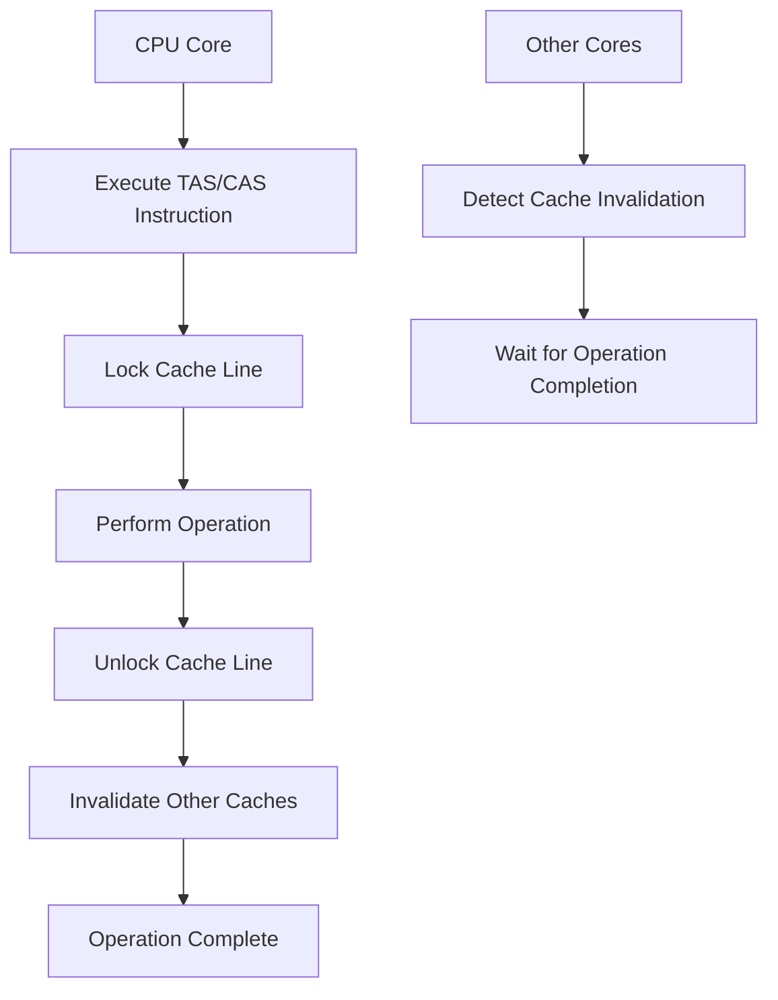
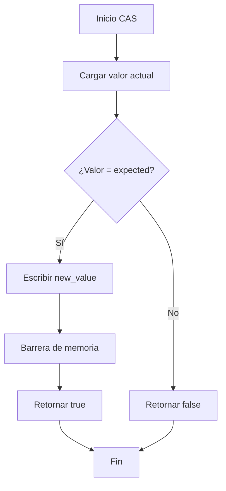

# Modelado y Programación - Programación concurrente

## 5.4 Primitivas de sincronización por hardware.

---

### 1. Introducción a las Primitivas Hardware

#### 1.1 Concepto Fundamental

Las **primitivas de sincronización por hardware** son instrucciones especiales proporcionadas por el procesador que permiten realizar operaciones atómicas sobre memoria compartida. Estas instrucciones son la base para implementar mecanismos de sincronización de alto nivel.

**Propiedades clave:**

- **Atomicidad**: La operación se ejecuta indivisiblemente
- **Visibilidad**: Los cambios son inmediatamente visibles para otros procesadores
- **Ordenamiento**: Previenen reordenamientos de instrucciones problemáticos

#### 1.2 Necesidad de Atomicidad

Sin atomicidad, ocurren condiciones de carrera:

$$ \text{Resultado} = f(\text{orden de ejecución}) $$

Con atomicidad:

$$ \text{Resultado} = f(\text{operación atómica}) $$

### 2. Primitivas Hardware Fundamentales

#### 2.1 Test-and-Set (TAS)

La instrucción **Test-and-Set** es una de las primitivas más básicas:

```cpp
// Pseudocódigo de Test-and-Set
bool test_and_set(bool *lock) {
    bool old_value = *lock;
    *lock = true;
    return old_value;
}

// Implementación de spinlock usando TAS
class TASLock {
private:
    atomic<bool> locked = false;

public:
    void acquire() {
        while (test_and_set(&locked)) {
            // Espera activa (spin)
        }
    }

    void release() {
        locked = false;
    }
};
```

**Matemáticamente:**
$$ \text{TAS}(x) = (\text{old}, \text{true}) \quad \text{donde} \quad \text{old} = x $$
$$ x \leftarrow \text{true} $$

#### 2.2 Compare-and-Swap (CAS)

**Compare-and-Swap** es una primitiva más poderosa y flexible:

```cpp
template<typename T>
bool compare_and_swap(T *ptr, T expected, T new_value) {
    if (*ptr == expected) {
        *ptr = new_value;
        return true;
    }
    return false;
}

// Uso para incremento atómico
atomic_int counter = 0;

void increment() {
    int old_value;
    do {
        old_value = counter;
    } while (!compare_and_swap(&counter, old_value, old_value + 1));
}
```

**Formalización CAS:**

$$ \text{CAS}(addr, expected, new) = \begin{cases} \text{true}, & \text{si } addr = expected \\\ \text{false}, & \text{en otro caso} \end{cases} $$

$$ \text{Si éxito: } addr \leftarrow new $$

#### 2.3 Fetch-and-Add (FAA)

**Fetch-and-Add** es útil para operaciones aritméticas atómicas:

```cpp
int fetch_and_add(int *value, int increment) {
    int old_value = *value;
    *value = old_value + increment;
    return old_value;
}

// Implementación de contador atómico
class AtomicCounter {
private:
    atomic<int> count = 0;

public:
    int increment(int delta = 1) {
        return fetch_and_add(&count, delta);
    }

    int get() {
        return count;
    }
};
```

**Matemáticamente:**
$$ \text{FAA}(x, \Delta) = (\text{old}, x + \Delta) $$
$$ x \leftarrow x + \Delta $$

### 3. Implementaciones a Nivel de Hardware

#### 3.1 Arquitectura de Primitivas Atómicas



#### 3.2 Modelo de Memoria y Ordenamiento

Las primitivas hardware garantizan órdenes de memoria específicos:

**Modelo de consistencia:**
$$ \text{Read}(x) \rightarrow \text{Write}(y) \quad \text{no se reordena} $$
$$ \text{AtomicOp}(x) \rightarrow \text{AnyOp}(y) \quad \text{no se reordena} $$

### 4. Ejemplos Prácticos Implementados

#### 4.1 Spinlock con Backoff Exponencial

```python
import threading
import time
import random

class ExponentialBackoffLock:
    def __init__(self):
        self._locked = threading.Atomic(0)
        self._max_delay = 1000  # ms
        self._min_delay = 1     # ms

    def acquire(self):
        delay = self._min_delay
        while True:
            if self._locked.compare_and_swap(0, 1):
                return  # Adquirido

            # Backoff exponencial
            time.sleep(delay / 1000)
            delay = min(delay * 2, self._max_delay)

    def release(self):
        self._locked.value = 0

# Ejemplo de uso
lock = ExponentialBackoffLock()
shared_counter = 0

def worker(worker_id):
    global shared_counter
    for i in range(1000):
        lock.acquire()
        try:
            shared_counter += 1
            # Operación crítica
            print(f"Worker {worker_id}: {shared_counter}")
        finally:
            lock.release()
```

#### 4.2 Lista Enlazada Concurrente con CAS

```python
import threading
from typing import Optional, Any

class Node:
    __slots__ = ['value', 'next']

    def __init__(self, value: Any):
        self.value = value
        self.next: Optional[Node] = None

class ConcurrentLinkedList:
    def __init__(self):
        self.head: Optional[Node] = None
        self._lock = threading.RLock()

    def insert_with_cas(self, value: Any) -> bool:
        new_node = Node(value)
        while True:
            current_head = self.head
            new_node.next = current_head

            # Intentar CAS
            if threading.cas(id(self), 'head', current_head, new_node):
                return True

    def search(self, value: Any) -> bool:
        current = self.head
        while current is not None:
            if current.value == value:
                return True
            current = current.next
        return False
```

### 5. Algoritmos Avanzados Basados en Hardware

#### 5.1 Algoritmo de Peterson con Primitivas Hardware

```cpp
class PetersonLock {
private:
    atomic<bool> flag[2] = {false, false};
    atomic<int> turn = 0;

public:
    void lock(int id) {
        int other = 1 - id;
        flag[id].store(true, memory_order_relaxed);
        turn.store(id, memory_order_relaxed);

        // Espera con barrera de memoria
        while (flag[other].load(memory_order_acquire) &&
               turn.load(memory_order_relaxed) == id) {
            // Spin with backoff or yield
        }
    }

    void unlock(int id) {
        flag[id].store(false, memory_order_release);
    }
};
```

#### 5.2 Barrera de Memoria con Primitivas Atómicas

```python
import threading

class MemoryBarrier:
    def __init__(self, n_threads):
        self.n_threads = n_threads
        self.count = threading.Atomic(0)
        self.sense = False
        self.thread_sense = [False] * n_threads

    def wait(self, thread_id):
        local_sense = not self.thread_sense[thread_id]
        self.thread_sense[thread_id] = local_sense

        if self.count.fetch_and_add(1) == self.n_threads - 1:
            self.count.value = 0
            self.sense = local_sense
        else:
            while self.sense != local_sense:
                pass  # Spin wait
```

### 6. Consideraciones de Rendimiento y Arquitectura

#### 6.1 Costo de las Primitivas Hardware

El costo de las operaciones atómicas sigue aproximadamente:

$$ T_{\text{atomic}} = T_{\text{base}} + T_{\text{cache}} \times N_{\text{cores}} $$

Donde:
- $T_{\text{base}}$: Tiempo base de la instrucción
- $T_{\text{cache}}$: Tiempo de invalidación de cache
- $N_{\text{cores}}$: Número de cores afectados

#### 6.2 False Sharing y Alineamiento

**Problema de false sharing:**
$$ \text{CacheLine} = 64\text{bytes} $$
$$ \text{Variables frecuentemente accedidas} \in \text{misma línea} $$

**Solución con padding:**
```cpp
struct PaddedAtomic {
    atomic<int> value;
    char padding[64 - sizeof(atomic<int>)];
};
```

### 7. Ejercicios Propuestos

#### Ejercicio 1: Implementación de CAS
Implementa la función `compare_and_swap` para un tipo genérico usando primitivas de hardware.

#### Ejercicio 2: Spinlock con Backoff
Crea un spinlock que use backoff exponencial y compara su rendimiento contra un spinlock simple.

#### Ejercicio 3: Contador Atómico
Implementa un contador atómico usando Fetch-and-Add y compara con implementación basada en CAS.

#### Ejercicio 4: Análisis de Rendimiento
Para un sistema con:
- Tiempo de CAS: 50ns
- Tiempo de cache miss: 100ns
- Probabilidad de contención: 0.3

Calcula el tiempo esperado para una operación atómica con 4 cores.

### 8. Soluciones a Ejercicios

#### Solución Ejercicio 1:
```cpp
template<typename T>
bool compare_and_swap(T* ptr, T expected, T new_value) {
    // Implementación para x86-64
    return __sync_bool_compare_and_swap(ptr, expected, new_value);
}

// Especialización para enteros
template<>
bool compare_and_swap<int>(int* ptr, int expected, int new_value) {
    return __sync_bool_compare_and_swap_4(ptr, expected, new_value);
}
```

#### Solución Ejercicio 4:
$$ T_{\text{total}} = T_{\text{CAS}} + P_{\text{contención}} \times T_{\text{cache-miss}} \times (N-1) $$
$$ T_{\text{total}} = 50 + 0.3 \times 100 \times 3 = 50 + 90 = 140\text{ns} $$

### 9. Referencias y Bibliografía

#### Libros Recomendados:
1. "The Art of Multiprocessor Programming" - Maurice Herlihy
2. "Computer Architecture: A Quantitative Approach" - Hennessy and Patterson
3. "C++ Concurrency in Action" - Anthony Williams

#### Artículos Fundamentales:
- Herlihy, M. (1991). "Wait-Free Synchronization"
- Lamport, L. (1979). "How to Make a Multiprocessor Computer That Correctly Executes Multiprocess Programs"
- Mellor-Crummey, J. M., & Scott, M. L. (1991). "Algorithms for Scalable Synchronization on Shared-Memory Multiprocessors"

#### Recursos Online:
- [Intel x86 Memory Ordering](https://www.intel.com/content/www/us/en/architecture-and-technology/64-ia-32-architectures-software-developer-vol-3a-part-1-manual.html)
- [ARM Memory Model](https://developer.arm.com/documentation/102316/0100/)
- [C++ Atomic Operations](https://en.cppreference.com/w/cpp/atomic)

### 10. Diagrama de Flujo de Operación CAS



Esta guía proporciona una comprensión profunda de las primitivas de sincronización por hardware, fundamentales para implementar mecanismos de concurrencia eficientes y correctos.
