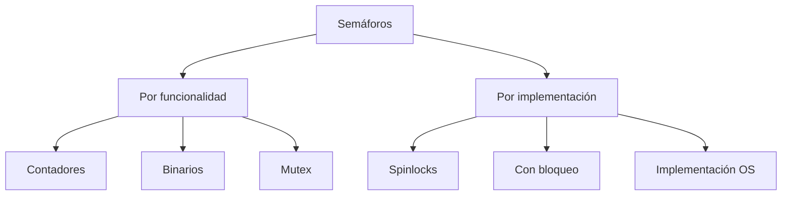
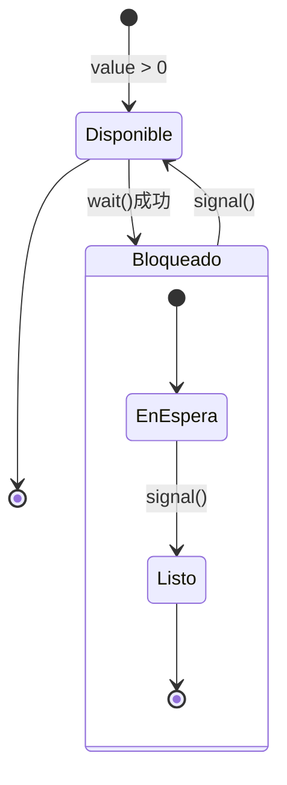

# Modelado y Programación - Programación concurrente

## 5.5 Semáforos.

---

### 1. Introducción a los Semáforos

#### 1.1 Definición y Concepto Fundamental

Un **semáforo** es una variable especial o tipo abstracto de datos utilizado para controlar el acceso a recursos compartidos en un entorno de programación concurrente. Fue propuesto por Edsger Dijkstra en 1965.

**Definición formal:**
Un semáforo $S$ es una tupla $(v, q)$ donde:

- $v$ es un valor entero no negativo que representa el número de recursos disponibles
- $q$ es una cola de procesos bloqueados esperando el recurso

**Operaciones fundamentales:**

- `wait(S)` o `P(S)`: Solicita acceso al recurso (proberen en holandés)
- `signal(S)` o `V(S)`: Libera el recurso (verhogen en holandés)

#### 1.2 Tipos de Semáforos



### 2. Implementación de Semáforos

#### 2.1 Semáforo con Espera Activa (Busy Waiting)

```python
import threading
import time

class SemaphoreBusyWait:
    def __init__(self, initial=1):
        self.value = initial

    def wait(self):
        while self.value <= 0:
            # Espera activa - consume CPU
            time.sleep(0.001)  # Pequeña pausa para evitar sobrecarga
        self.value -= 1

    def signal(self):
        self.value += 1

# Ejemplo de uso - Control de acceso a recurso
recurso_compartido = []
semaphore = SemaphoreBusyWait(3)  # Permite 3 accesos simultáneos

def worker(worker_id):
    semaphore.wait()
    try:
        recurso_compartido.append(f"Worker {worker_id} accedió")
        time.sleep(0.1)  # Simular trabajo
        print(f"Worker {worker_id} completó")
    finally:
        semaphore.signal()
```

#### 2.2 Semáforo con Bloqueo (Sleep/Wakeup)

```python
import threading

class Semaphore:
    def __init__(self, initial=1):
        self.value = initial
        self.lock = threading.Lock()
        self.condition = threading.Condition(self.lock)
        self.waiting_count = 0

    def wait(self, timeout=None):
        with self.lock:
            self.waiting_count += 1
            while self.value <= 0:
                if timeout is not None:
                    result = self.condition.wait(timeout)
                    if not result:  # Timeout expired
                        self.waiting_count -= 1
                        return False
                else:
                    self.condition.wait()
            self.value -= 1
            self.waiting_count -= 1
            return True

    def signal(self):
        with self.lock:
            self.value += 1
            if self.waiting_count > 0:
                self.condition.notify()

    def get_waiting_count(self):
        with self.lock:
            return self.waiting_count

# Ejemplo de uso con timeout
def worker_with_timeout(worker_id, semaphore):
    if semaphore.wait(timeout=2.0):  # Espera máximo 2 segundos
        try:
            print(f"Worker {worker_id} obtuvo el semáforo")
            time.sleep(1)
        finally:
            semaphore.signal()
    else:
        print(f"Worker {worker_id} timeout esperando semáforo")
```

### 3. Semáforos Binarios y de Conteo

#### 3.1 Semáforo Binario (Mutex)

```python
class BinarySemaphore:
    def __init__(self, initial=1):
        if initial not in (0, 1):
            raise ValueError("Binary semaphore must be initialized with 0 or 1")
        self.semaphore = Semaphore(initial)

    def wait(self):
        self.semaphore.wait()

    def signal(self):
        self.semaphore.signal()

    def try_wait(self):
        """Intenta adquirir sin bloquear"""
        return self.semaphore.wait(timeout=0)

# Uso como mutex
mutex = BinarySemaphore(1)  # Inicialmente disponible

def seccion_critica():
    mutex.wait()
    try:
        # Operaciones críticas
        pass
    finally:
        mutex.signal()
```

#### 3.2 Semáforo de Conteo

```python
class CountingSemaphore:
    def __init__(self, initial=1, max_value=None):
        self.initial = initial
        self.max_value = max_value
        self.value = initial
        self.lock = threading.Lock()
        self.condition = threading.Condition(self.lock)

    def wait(self):
        with self.lock:
            while self.value <= 0:
                self.condition.wait()
            self.value -= 1

    def signal(self):
        with self.lock:
            if self.max_value is not None and self.value >= self.max_value:
                raise ValueError("Maximum semaphore value exceeded")
            self.value += 1
            self.condition.notify()

    def reset(self):
        """Restablece el semáforo a su valor inicial"""
        with self.lock:
            self.value = self.initial
            self.condition.notify_all()
```

### 4. Patrones de Uso de Semáforos

#### 4.1 Productor-Consumidor

```python
import collections

class BoundedBuffer:
    def __init__(self, capacity):
        self.buffer = collections.deque(maxlen=capacity)
        self.mutex = Semaphore(1)  # Para exclusión mutua
        self.empty = Semaphore(capacity)  # Espacios vacíos
        self.full = Semaphore(0)  # Espacios llenos

    def put(self, item):
        self.empty.wait()  # Esperar espacio disponible
        self.mutex.wait()
        try:
            self.buffer.append(item)
        finally:
            self.mutex.signal()
        self.full.signal()  # Anunciar nuevo item disponible

    def get(self):
        self.full.wait()  # Esperar item disponible
        self.mutex.wait()
        try:
            return self.buffer.popleft()
        finally:
            self.mutex.signal()
        self.empty.signal()  # Anunciar espacio disponible

# Ejemplo de uso
buffer = BoundedBuffer(5)

def producer():
    for i in range(10):
        buffer.put(i)
        print(f"Producido: {i}")

def consumer():
    for i in range(10):
        item = buffer.get()
        print(f"Consumido: {item}")
```

#### 4.2 Barrera de Sincronización

```python
class Barrier:
    def __init__(self, n):
        self.n = n  # Número de hilos requeridos
        self.count = 0  # Contador de hilos que han llegado
        self.mutex = Semaphore(1)  # Protege count
        self.turnstile = Semaphore(0)  # Para bloquear/habilitar hilos

    def wait(self):
        self.mutex.wait()
        self.count += 1
        if self.count == self.n:
            # Último hilo en llegar - libera a todos
            for _ in range(self.n):
                self.turnstile.signal()
        self.mutex.signal()

        self.turnstile.wait()  # Esperar a que todos lleguen
```

### 5. Propiedades Matemáticas de los Semáforos

#### 5.1 Invariantes de Semáforos

Para un semáforo $S$ con valor inicial $v_0$:

**Invariante fundamental:**

$$ S.\text{value} = v_0 + \#\text{signal}(S) - \#\text{wait}(S) $$

**Para semáforos binarios:**

$$ S.\text{value} \in \{0, 1\} $$

$$ \#\text{wait}(S) - \#\text{signal}(S) \leq 1 $$

#### 5.2 Análisis de Correctitud

**Teorema de seguridad:** Si un semáforo se usa correctamente, garantiza exclusión mutua.

**Teorema de vivacidad:** Si no hay deadlocks, todos los procesos eventualmente progresan.

**Cálculo de capacidad:**
Para un recurso con $C$ unidades y $N$ procesos:

$$ \text{Semáforo inicializado a } C $$

$$ \text{Máximo uso concurrente} = \min(C, N) $$

### 6. Implementación a Nivel de Sistema Operativo

#### 6.1 Semáforos POSIX

```c
#include <semaphore.h>
#include <stdio.h>
#include <pthread.h>

sem_t semaphore;

void* worker(void* arg) {
    int id = *(int*)arg;

    // Esperar semáforo
    sem_wait(&semaphore);
    printf("Worker %d en sección crítica\n", id);

    // Trabajar...
    sleep(1);

    // Liberar semáforo
    sem_post(&semaphore);
    printf("Worker %d liberó semáforo\n", id);

    return NULL;
}

int main() {
    // Inicializar semáforo con valor 2
    sem_init(&semaphore, 0, 2);

    pthread_t threads[5];
    int ids[5];

    for (int i = 0; i < 5; i++) {
        ids[i] = i;
        pthread_create(&threads[i], NULL, worker, &ids[i]);
    }

    for (int i = 0; i < 5; i++) {
        pthread_join(threads[i], NULL);
    }

    sem_destroy(&semaphore);
    return 0;
}
```

### 7. Ejercicios Propuestos

#### Ejercicio 1: Implementación de Read-Write Lock

Implementa un read-write lock usando semáforos que permita:

- Múltiples lectores simultáneos
- Un único escritor con exclusión mutua

#### Ejercicio 2: Semáforo con Prioridad

Implementa un semáforo que de prioridad a los writers sobre los readers.

#### Ejercicio 3: Dining Philosophers

Resuelve el problema de los filósofos comensales usando semáforos.

#### Ejercicio 4: Análisis de Rendimiento

Para un sistema con:

- 100 procesos
- Semáforo con valor inicial 10
- Tiempo de wait: 50ns
- Tiempo de signal: 30ns

Calcula el tiempo total de operaciones de semáforo si cada proceso ejecuta 5 waits y 5 signals.

### 8. Soluciones a Ejercicios

#### Solución Ejercicio 1: Read-Write Lock

```python
class ReadWriteLock:
    def __init__(self):
        self.read_count = 0
        self.mutex = Semaphore(1)  # Protege read_count
        self.write_lock = Semaphore(1)  # Exclusión para escritores
        self.read_lock = Semaphore(1)  # Control acceso readers

    def read_acquire(self):
        self.read_lock.wait()
        self.mutex.wait()
        self.read_count += 1
        if self.read_count == 1:
            self.write_lock.wait()  # Primer reader bloquea writers
        self.mutex.signal()
        self.read_lock.signal()

    def read_release(self):
        self.mutex.wait()
        self.read_count -= 1
        if self.read_count == 0:
            self.write_lock.signal()  # Último reader libera writers
        self.mutex.signal()

    def write_acquire(self):
        self.write_lock.wait()

    def write_release(self):
        self.write_lock.signal()
```

#### Solución Ejercicio 4:

$$ T\_{\text{total}} = N \times (\#\text{wait} \times T\_{\text{wait}} + \#\text{signal} \times T\_{\text{signal}}) $$

$$ T\_{\text{total}} = 100 \times (5 \times 50 + 5 \times 30) $$

$$ T\_{\text{total}} = 100 \times (250 + 150) = 100 \times 400 = 40,000 \text{ns} = 40\mu\text{s} $$

### 9. Referencias y Bibliografía

#### Libros Recomendados:

1. "Operating System Concepts" - Abraham Silberschatz, Peter Galvin, Greg Gagne
2. "The Little Book of Semaphores" - Allen B. Downey
3. "Modern Operating Systems" - Andrew S. Tanenbaum

#### Artículos Fundamentales:

- Dijkstra, E. W. (1965). "Solution of a problem in concurrent programming control"
- Dijkstra, E. W. (1968). "Cooperating sequential processes"
- Hoare, C. A. R. (1974). "Monitors: An operating system structuring concept"

#### Recursos Online:

- [POSIX Semaphores](https://pubs.opengroup.org/onlinepubs/007904975/basedefs/semaphore.h.html)
- [Python threading semaphores](https://docs.python.org/3/library/threading.html#semaphore-objects)
- [Java Semaphore class](https://docs.oracle.com/javase/8/docs/api/java/util/concurrent/Semaphore.html)

### 10. Diagrama de Estados de un Semáforo



Esta guía proporciona una comprensión completa de los semáforos, desde sus fundamentos teóricos hasta implementaciones prácticas y aplicaciones en problemas clásicos de concurrencia.
