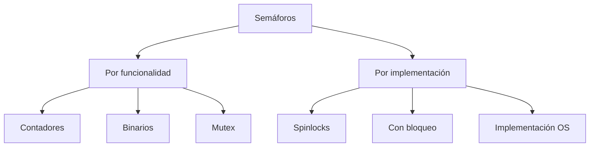
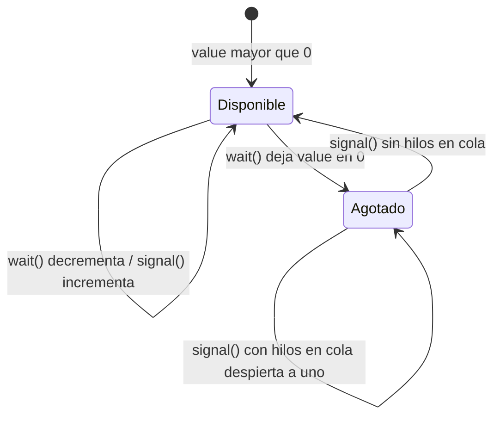

# Modelado y Programación - Programación concurrente

## 5.5 Semáforos.

---

### 1. Introducción a los Semáforos

#### 1.1 Definición y Concepto Fundamental

Un **semáforo** es una variable especial o tipo abstracto de datos utilizado para controlar el acceso a recursos compartidos en un entorno de programación concurrente. Fue propuesto por Edsger Dijkstra en 1965.

**Definición formal:**
Un semáforo $S$ es una tupla $(v, q)$ donde:

- $v$ es un valor entero no negativo que representa el número de recursos disponibles
- $q$ es una cola de procesos bloqueados esperando el recurso

**Operaciones fundamentales:**

- `wait(S)` o `P(S)`: si $v > 0,$ lo decrementa y continúa; si $v = 0,$ el proceso se bloquea en la cola $q.$ Dijkstra usó la letra P de *proberen*, "intentar" en holandés.
- `signal(S)` o `V(S)`: si hay procesos en $q,$ despierta a uno; si no, incrementa $v.$ La V viene de *verhogen*, "incrementar".

Ambas operaciones son **atómicas**: dos procesos nunca ejecutan `wait` o `signal` sobre el mismo semáforo a la vez.

A diferencia de un candado, un semáforo **no tiene dueño**: cualquier hilo puede hacer `signal`, no solo el que hizo `wait`. Eso permite usarlo para **señalizar** entre hilos (un hilo avisa a otro que algo ocurrió), además de para la exclusión mutua.

```text
Semáforo inicializado en 2, tres hilos piden el recurso:

  A: wait  -> v = 1, entra
  B: wait  -> v = 0, entra
  C: wait  -> v = 0, se bloquea en q
  A: signal -> despierta a C, que entra (v sigue en 0)
```

#### 1.2 Tipos de Semáforos



### 2. Implementación de Semáforos

#### 2.1 Semáforo con Espera Activa (Busy Waiting)

La comprobación `value > 0` y el decremento deben ser **un solo paso atómico**: si no, dos hilos pueden ver `value == 1` y ambos entrar. Aquí la atomicidad se obtiene con un candado interno que se toma solo durante la comprobación, y el hilo gira mientras el valor sea 0:

```python
import threading
import time

class SemaphoreBusyWait:
    def __init__(self, initial=1):
        self.value = initial
        self._guard = threading.Lock()   # hace atómico "comprobar y decrementar"

    def wait(self):
        while True:
            with self._guard:
                if self.value > 0:
                    self.value -= 1
                    return
            time.sleep(0.001)  # espera activa, con una pausa para no saturar la CPU

    def signal(self):
        with self._guard:
            self.value += 1

# Ejemplo de uso - Control de acceso a recurso
recurso_compartido = []
semaphore = SemaphoreBusyWait(3)  # Permite 3 accesos simultáneos

def worker(worker_id):
    semaphore.wait()
    try:
        recurso_compartido.append(f"Worker {worker_id} accedió")
        time.sleep(0.1)  # Simular trabajo
        print(f"Worker {worker_id} completó")
    finally:
        semaphore.signal()

hs = [threading.Thread(target=worker, args=(i,)) for i in range(6)]
for h in hs: h.start()
for h in hs: h.join()
print(len(recurso_compartido))   # 6: como máximo 3 trabajan al mismo tiempo
```

#### 2.2 Semáforo con Bloqueo (Sleep/Wakeup)

```python
import threading

class Semaphore:
    def __init__(self, initial=1):
        self.value = initial
        self.lock = threading.Lock()
        self.condition = threading.Condition(self.lock)
        self.waiting_count = 0

    def wait(self, timeout=None):
        with self.lock:
            self.waiting_count += 1
            while self.value <= 0:
                if timeout is not None:
                    result = self.condition.wait(timeout)
                    if not result:  # Timeout expired
                        self.waiting_count -= 1
                        return False
                else:
                    self.condition.wait()
            self.value -= 1
            self.waiting_count -= 1
            return True

    def signal(self):
        with self.lock:
            self.value += 1
            if self.waiting_count > 0:
                self.condition.notify()

    def get_waiting_count(self):
        with self.lock:
            return self.waiting_count

# Ejemplo de uso con timeout
def worker_with_timeout(worker_id, semaphore):
    if semaphore.wait(timeout=2.0):  # Espera máximo 2 segundos
        try:
            print(f"Worker {worker_id} obtuvo el semáforo")
            time.sleep(1)
        finally:
            semaphore.signal()
    else:
        print(f"Worker {worker_id} timeout esperando semáforo")
```

`threading.Condition.wait()` libera el candado mientras el hilo duerme y lo vuelve a tomar al despertar; por eso la condición `self.value <= 0` se vuelve a comprobar en un `while` y no en un `if`: otro hilo pudo tomar la unidad liberada antes. En la práctica se usa directamente `threading.Semaphore` o `threading.BoundedSemaphore`, que lanza un error si se hace `signal` de más.

### 3. Semáforos Binarios y de Conteo

#### 3.1 Semáforo Binario (Mutex)

```python
class BinarySemaphore:
    def __init__(self, initial=1):
        if initial not in (0, 1):
            raise ValueError("Binary semaphore must be initialized with 0 or 1")
        self.semaphore = Semaphore(initial)

    def wait(self):
        self.semaphore.wait()

    def signal(self):
        self.semaphore.signal()

    def try_wait(self):
        """Intenta adquirir sin bloquear"""
        return self.semaphore.wait(timeout=0)

# Uso como mutex
mutex = BinarySemaphore(1)  # Inicialmente disponible

def seccion_critica():
    mutex.wait()
    try:
        # Operaciones críticas
        pass
    finally:
        mutex.signal()
```

#### 3.2 Semáforo de Conteo

```python
class CountingSemaphore:
    def __init__(self, initial=1, max_value=None):
        self.initial = initial
        self.max_value = max_value
        self.value = initial
        self.lock = threading.Lock()
        self.condition = threading.Condition(self.lock)

    def wait(self):
        with self.lock:
            while self.value <= 0:
                self.condition.wait()
            self.value -= 1

    def signal(self):
        with self.lock:
            if self.max_value is not None and self.value >= self.max_value:
                raise ValueError("Maximum semaphore value exceeded")
            self.value += 1
            self.condition.notify()

    def reset(self):
        """Restablece el semáforo a su valor inicial"""
        with self.lock:
            self.value = self.initial
            self.condition.notify_all()
```

### 4. Patrones de Uso de Semáforos

#### 4.1 Productor-Consumidor

```python
import collections

class BoundedBuffer:
    def __init__(self, capacity):
        self.buffer = collections.deque(maxlen=capacity)
        self.mutex = Semaphore(1)  # Para exclusión mutua
        self.empty = Semaphore(capacity)  # Espacios vacíos
        self.full = Semaphore(0)  # Espacios llenos

    def put(self, item):
        self.empty.wait()  # Esperar espacio disponible
        self.mutex.wait()
        try:
            self.buffer.append(item)
        finally:
            self.mutex.signal()
        self.full.signal()  # Anunciar nuevo item disponible

    def get(self):
        self.full.wait()  # Esperar item disponible
        self.mutex.wait()
        try:
            item = self.buffer.popleft()
        finally:
            self.mutex.signal()
        self.empty.signal()  # Anunciar espacio disponible
        return item

# Ejemplo de uso
buffer = BoundedBuffer(5)

def producer():
    for i in range(10):
        buffer.put(i)
        print(f"Producido: {i}")

def consumer():
    for i in range(10):
        item = buffer.get()
        print(f"Consumido: {item}")

p = threading.Thread(target=producer)
c = threading.Thread(target=consumer)
p.start(); c.start(); p.join(); c.join()
```

Cada semáforo tiene un papel distinto: `empty` cuenta los espacios libres y detiene al productor cuando el buffer está lleno; `full` cuenta los elementos y detiene al consumidor cuando está vacío; `mutex` protege la estructura del buffer. En todo momento se cumple $\text{empty} + \text{full} \leq \text{capacidad}.$

**El orden de los `wait` importa.** Si el productor hiciera `mutex.wait()` antes de `empty.wait()` con el buffer lleno, se dormiría **con el mutex tomado**; el consumidor no podría entrar a sacar elementos y ambos quedarían en interbloqueo. Regla: primero se espera la condición (el semáforo contador) y luego se toma el mutex.

Un error sutil de la versión original de este ejemplo era hacer `return` dentro del `try` y poner `empty.signal()` después: esa línea nunca se ejecutaba, el productor perdía un espacio libre en cada `get` y terminaba bloqueado para siempre.

#### 4.2 Barrera de Sincronización

```python
class Barrier:
    def __init__(self, n):
        self.n = n  # Número de hilos requeridos
        self.count = 0  # Contador de hilos que han llegado
        self.mutex = Semaphore(1)  # Protege count
        self.turnstile = Semaphore(0)  # Para bloquear/habilitar hilos

    def wait(self):
        self.mutex.wait()
        self.count += 1
        if self.count == self.n:
            # Último hilo en llegar - libera a todos
            for _ in range(self.n):
                self.turnstile.signal()
        self.mutex.signal()

        self.turnstile.wait()  # Esperar a que todos lleguen

barrera = Barrier(3)
llegadas = []

def fase(i):
    llegadas.append(i)
    barrera.wait()
    assert len(llegadas) == 3      # nadie pasa antes de que lleguen los tres

hs = [threading.Thread(target=fase, args=(i,)) for i in range(3)]
for h in hs: h.start()
for h in hs: h.join()
print("barrera ok")
```

Esta barrera solo sirve **una vez**: para reutilizarla en un ciclo hace falta un segundo torniquete que impida que un hilo rápido entre a la siguiente fase antes de que los demás salgan de la actual (véase *The Little Book of Semaphores*, sección 3.6).

### 5. Propiedades Matemáticas de los Semáforos

#### 5.1 Invariantes de Semáforos

Para un semáforo $S$ con valor inicial $v_0:$

**Invariante fundamental.** Si $\#\text{wait}(S)$ cuenta los `wait` **completados** (los que ya pasaron) y $\#\text{signal}(S)$ los `signal` ejecutados, entonces en todo momento

$$ S.\text{value} = v_0 + \#\text{signal}(S) - \#\text{wait}(S) \geq 0 $$

Es un invariante porque cada `wait` completado resta uno, cada `signal` suma uno (o despierta a un proceso que completa su `wait`, con el mismo efecto neto) y `wait` nunca deja el valor negativo.

**Teorema (exclusión mutua).** Si un semáforo con $v_0 = 1$ protege una sección crítica con el protocolo `wait`, sección crítica, `signal`, entonces a lo más un proceso está en la sección crítica.

*Demostración.* El número de procesos dentro es $\#\text{wait}(S) - \#\text{signal}(S),$ porque cada uno entró con un `wait` completado y aún no hace su `signal`. Por el invariante,

$$ \#\text{wait}(S) - \#\text{signal}(S) = v_0 - S.\text{value} \leq v_0 = 1. \qquad \blacksquare $$

**Generalización.** Con $v_0 = C,$ el mismo argumento muestra que a lo más $C$ procesos usan el recurso a la vez; con $N$ procesos, el uso concurrente máximo es $\min(C, N).$

**Vivacidad.** El invariante no garantiza que nadie espere para siempre. Eso depende de la política de la cola $q:$ con una cola FIFO (semáforo **fuerte**), un proceso que espera será despertado después de un número finito de `signal`; con un semáforo **débil**, que despierta a cualquiera, puede haber inanición. Tampoco evita interbloqueos cuando hay varios semáforos, como muestra el problema de los filósofos (ejercicio 3).

### 6. Implementación a Nivel de Sistema Operativo

#### 6.1 Semáforos POSIX

```c
#include <pthread.h>
#include <semaphore.h>
#include <stdio.h>
#include <unistd.h>   // sleep

sem_t semaphore;

void* worker(void* arg) {
    int id = *(int*)arg;

    // Esperar semáforo
    sem_wait(&semaphore);
    printf("Worker %d en sección crítica\n", id);

    // Trabajar...
    sleep(1);

    // Liberar semáforo
    sem_post(&semaphore);
    printf("Worker %d liberó semáforo\n", id);

    return NULL;
}

int main() {
    // Inicializar semáforo con valor 2
    sem_init(&semaphore, 0, 2);

    pthread_t threads[5];
    int ids[5];

    for (int i = 0; i < 5; i++) {
        ids[i] = i;
        pthread_create(&threads[i], NULL, worker, &ids[i]);
    }

    for (int i = 0; i < 5; i++) {
        pthread_join(threads[i], NULL);
    }

    sem_destroy(&semaphore);
    return 0;
}
```

Se compila con `gcc archivo.c -pthread`. El segundo argumento de `sem_init` en 0 indica que el semáforo se comparte entre hilos del mismo proceso; con un valor distinto de 0, y colocado en memoria compartida, se comparte entre procesos. En la salida nunca hay más de dos trabajadores en la sección crítica al mismo tiempo. macOS no implementa `sem_init` (solo semáforos con nombre, `sem_open`).

En Java la clase equivalente es `java.util.concurrent.Semaphore`, con `acquire()` y `release()`; su constructor `Semaphore(permisos, true)` crea un semáforo justo, con cola FIFO.

### 7. Ejercicios Propuestos

#### Ejercicio 1: Implementación de Read-Write Lock

Implementa un read-write lock usando semáforos que permita:

- Múltiples lectores simultáneos
- Un único escritor con exclusión mutua

#### Ejercicio 2: Semáforo con Prioridad

Implementa un read-write lock con semáforos que dé prioridad a los escritores sobre los lectores: cuando un escritor está esperando, no deben entrar lectores nuevos.

#### Ejercicio 3: Dining Philosophers

Resuelve el problema de los filósofos comensales usando semáforos.

#### Ejercicio 4: Análisis de Rendimiento

Para un sistema con:

- 100 procesos
- Semáforo con valor inicial 10
- Tiempo de wait: 50ns
- Tiempo de signal: 30ns

Calcula el tiempo total de operaciones de semáforo si cada proceso ejecuta 5 waits y 5 signals.

### 8. Soluciones a Ejercicios

#### Solución Ejercicio 1: Read-Write Lock

```python
class ReadWriteLock:
    def __init__(self):
        self.read_count = 0
        self.mutex = Semaphore(1)  # Protege read_count
        self.write_lock = Semaphore(1)  # Exclusión para escritores
        self.read_lock = Semaphore(1)  # Control acceso readers

    def read_acquire(self):
        self.read_lock.wait()
        self.mutex.wait()
        self.read_count += 1
        if self.read_count == 1:
            self.write_lock.wait()  # Primer reader bloquea writers
        self.mutex.signal()
        self.read_lock.signal()

    def read_release(self):
        self.mutex.wait()
        self.read_count -= 1
        if self.read_count == 0:
            self.write_lock.signal()  # Último reader libera writers
        self.mutex.signal()

    def write_acquire(self):
        self.write_lock.wait()

    def write_release(self):
        self.write_lock.signal()

# Prueba
rwl = ReadWriteLock()
dato = [0]

def lector_rw():
    for _ in range(200):
        rwl.read_acquire(); _ = dato[0]; rwl.read_release()

def escritor_rw():
    for _ in range(200):
        rwl.write_acquire(); dato[0] += 1; rwl.write_release()

hs = [threading.Thread(target=lector_rw) for _ in range(4)] + [threading.Thread(target=escritor_rw) for _ in range(2)]
for h in hs: h.start()
for h in hs: h.join()
print(dato[0])   # 400
```

El primer lector que entra toma `write_lock` en nombre de todo el grupo de lectores y el último que sale lo devuelve; los lectores intermedios no lo tocan. Es una solución con **prioridad a los lectores**: mientras siga llegando algún lector, `read_count` nunca baja a 0 y un escritor puede esperar para siempre.

#### Solución Ejercicio 2: Prioridad a escritores

Se agrega un contador de escritores y un semáforo `no_lectores`, que el **primer escritor** en llegar toma para cerrar la puerta a lectores nuevos y el último escritor devuelve:

```python
class WriterPriorityRWLock:
    def __init__(self):
        self.readers = 0
        self.writers = 0                  # escritores esperando o escribiendo
        self.mutex_r = Semaphore(1)       # protege readers
        self.mutex_w = Semaphore(1)       # protege writers
        self.no_lectores = Semaphore(1)   # cerrado mientras haya escritores
        self.recurso = Semaphore(1)       # exclusión del recurso

    def read_acquire(self):
        self.no_lectores.wait()           # si hay escritores, el lector espera aquí
        self.mutex_r.wait()
        self.readers += 1
        if self.readers == 1:
            self.recurso.wait()           # el primer lector bloquea a escritores
        self.mutex_r.signal()
        self.no_lectores.signal()

    def read_release(self):
        self.mutex_r.wait()
        self.readers -= 1
        if self.readers == 0:
            self.recurso.signal()
        self.mutex_r.signal()

    def write_acquire(self):
        self.mutex_w.wait()
        self.writers += 1
        if self.writers == 1:
            self.no_lectores.wait()       # el primer escritor cierra la puerta a lectores
        self.mutex_w.signal()
        self.recurso.wait()

    def write_release(self):
        self.recurso.signal()
        self.mutex_w.wait()
        self.writers -= 1
        if self.writers == 0:
            self.no_lectores.signal()     # el último escritor reabre la puerta
        self.mutex_w.signal()

wp = WriterPriorityRWLock()
valor = [0]

def lector_wp():
    for _ in range(200):
        wp.read_acquire(); _ = valor[0]; wp.read_release()

def escritor_wp():
    for _ in range(200):
        wp.write_acquire(); valor[0] += 1; wp.write_release()

hs = [threading.Thread(target=lector_wp) for _ in range(4)] + [threading.Thread(target=escritor_wp) for _ in range(2)]
for h in hs: h.start()
for h in hs: h.join()
print(valor[0])   # 400
```

Ahora el problema es el simétrico: un flujo constante de escritores puede dejar sin turno a los lectores. Una solución **justa** usa un solo torniquete que todos, lectores y escritores, atraviesan en orden de llegada.

#### Solución Ejercicio 3: Filósofos comensales

Cinco filósofos se sientan en una mesa redonda con un tenedor entre cada par; para comer, cada uno necesita los dos tenedores que tiene a los lados. Si todos toman primero el tenedor izquierdo, todos esperan el derecho para siempre: **interbloqueo** por espera circular.

Una solución es romper la simetría: los filósofos toman primero el tenedor de **menor número**. Así el filósofo 4, cuyos tenedores son el 4 y el 0, toma primero el 0, y no puede formarse un ciclo de espera. Es la técnica de orden global de recursos del tema 5.1.

```python
import threading
import time

N = 5
tenedores = [Semaphore(1) for _ in range(N)]
comidas = [0] * N

def filosofo(i, rondas=20):
    izq, der = i, (i + 1) % N
    primero, segundo = min(izq, der), max(izq, der)   # orden global
    for _ in range(rondas):
        time.sleep(0.001)          # pensar
        tenedores[primero].wait()
        tenedores[segundo].wait()
        comidas[i] += 1            # comer
        tenedores[segundo].signal()
        tenedores[primero].signal()

hs = [threading.Thread(target=filosofo, args=(i,)) for i in range(N)]
for h in hs: h.start()
for h in hs: h.join()
print(comidas)   # [20, 20, 20, 20, 20]
```

Otra solución clásica es un semáforo `mesero` inicializado en $N - 1 = 4:$ como mucho cuatro filósofos intentan tomar tenedores a la vez, y entonces al menos uno consigue ambos. Las dos soluciones evitan el interbloqueo; ninguna garantiza por sí sola que todos coman lo mismo si los semáforos no son justos.

#### Solución Ejercicio 4:

$$ T_{\text{total}} = N \times (\#\text{wait} \times T_{\text{wait}} + \#\text{signal} \times T_{\text{signal}}) $$

$$ T_{\text{total}} = 100 \times (5 \times 50 + 5 \times 30) $$

$$ T_{\text{total}} = 100 \times (250 + 150) = 100 \times 400 = 40\,000 \text{ ns} = 40\,\mu\text{s} $$

Este es el tiempo **acumulado** de las operaciones. Si los procesos corren en paralelo, el tiempo de reloj puede ser menor; pero con un semáforo inicializado en 10 y 100 procesos, 90 tendrán que esperar en cada ronda, y ese tiempo de espera, que depende de cuánto dure la sección crítica, suele ser mucho mayor que los 80 ns de cada par `wait`/`signal`.

### 9. Referencias y Bibliografía

#### Libros Recomendados:

1. "Operating System Concepts" - Abraham Silberschatz, Peter Galvin, Greg Gagne
2. "The Little Book of Semaphores" - Allen B. Downey
3. "Modern Operating Systems" - Andrew S. Tanenbaum

#### Artículos Fundamentales:

- Dijkstra, E. W. (1965). "Solution of a problem in concurrent programming control"
- Dijkstra, E. W. (1968). "Cooperating sequential processes"
- Hoare, C. A. R. (1974). "Monitors: An operating system structuring concept"

#### Recursos Online:

- [POSIX Semaphores](https://pubs.opengroup.org/onlinepubs/007904975/basedefs/semaphore.h.html)
- [Python threading semaphores](https://docs.python.org/3/library/threading.html#semaphore-objects)
- [Java Semaphore class](https://docs.oracle.com/javase/8/docs/api/java/util/concurrent/Semaphore.html)

### 10. Diagrama de Estados de un Semáforo



Esta guía proporciona una comprensión completa de los semáforos, desde sus fundamentos teóricos hasta implementaciones prácticas y aplicaciones en problemas clásicos de concurrencia.
