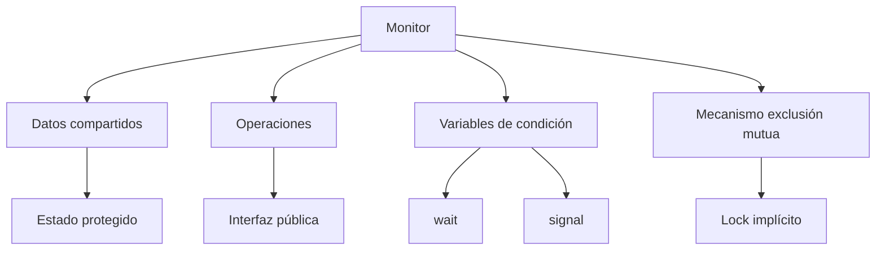
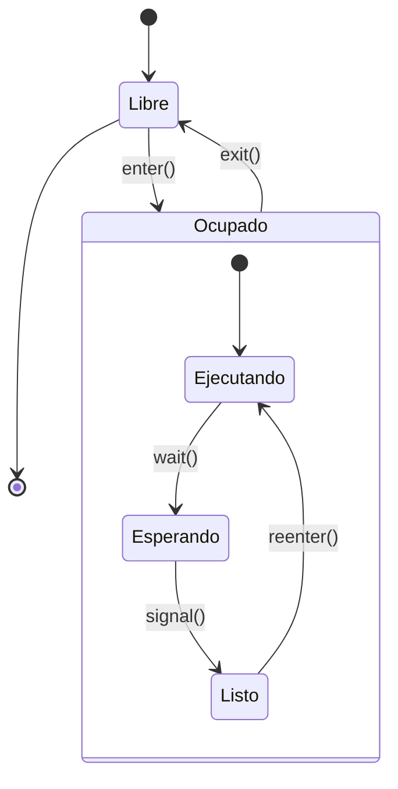

# Modelado y Programación - Programación concurrente

## 5.6 Monitores.

---

### 1. Introducción a los Monitores

#### 1.1 Concepto Fundamental

Un **monitor** es una construcción de programación concurrente que encapsula datos compartidos y los procedimientos que operan sobre ellos, garantizando la exclusión mutua. Fue propuesto por C. A. R. Hoare y Per Brinch Hansen en la década de 1970.

**Definición formal:**
Un monitor es una estructura que consiste en:

- Variables de datos compartidas
- Procedimientos que operan sobre los datos
- Variables de condición para sincronización
- Un mecanismo de exclusión mutua implícito

**Estructura básica:**

$$ \text{Monitor} = (\text{datos}, \text{procedimientos}, \text{condiciones}, \text{lock}) $$

La idea es que el programador ya no tenga que recordar adquirir y liberar candados ni hacer `wait`/`signal` de semáforos en el orden correcto: los datos compartidos **solo** son accesibles a través de los procedimientos del monitor, y el lenguaje garantiza que a lo más un hilo ejecuta dentro del monitor en cada momento. Con semáforos, olvidar un `signal` en un camino del código bloquea todo el programa; con un monitor, la exclusión mutua es automática.

#### 1.2 Principios de Diseño



### 2. Implementación de Monitores

#### 2.1 Monitor Básico en Java

Java proporciona soporte nativo para monitores mediante la palabra clave `synchronized`:

```java
public class ContadorMonitor {
    private int contador = 0;

    // Los métodos synchronized forman el monitor
    public synchronized void incrementar() {
        contador++;
        System.out.println("Incrementado: " + contador);
    }

    public synchronized void decrementar() {
        contador--;
        System.out.println("Decrementado: " + contador);
    }

    public synchronized int obtenerValor() {
        return contador;
    }
}

// Uso del monitor
public class EjemploMonitor {
    public static void main(String[] args) {
        ContadorMonitor monitor = new ContadorMonitor();

        // Múltiples hilos acceden al monitor
        Thread hilo1 = new Thread(() -> {
            for (int i = 0; i < 1000; i++) {
                monitor.incrementar();
            }
        });

        Thread hilo2 = new Thread(() -> {
            for (int i = 0; i < 1000; i++) {
                monitor.decrementar();
            }
        });

        hilo1.start();
        hilo2.start();
        try {
            hilo1.join();
            hilo2.join();
        } catch (InterruptedException e) {
            Thread.currentThread().interrupt();
        }
        System.out.println("Valor final: " + monitor.obtenerValor()); // siempre 0
    }
}
```

Cada objeto de Java tiene un candado intrínseco; un método `synchronized` lo adquiere al entrar y lo libera al salir, incluso si se lanza una excepción. El método `obtenerValor` también es `synchronized`: aunque solo lee, sin sincronización no hay garantía de que vea el último valor escrito por otro hilo.

#### 2.2 Variables de Condición

Las variables de condición permiten a los hilos esperar por condiciones específicas:

```java
import java.util.LinkedList;
import java.util.Queue;
import java.util.concurrent.locks.Condition;
import java.util.concurrent.locks.Lock;
import java.util.concurrent.locks.ReentrantLock;

public class BufferMonitor {
    private final Queue<Integer> buffer = new LinkedList<>();
    private final int capacidad;
    private final Lock lock = new ReentrantLock();
    private final Condition noLleno = lock.newCondition();
    private final Condition noVacio = lock.newCondition();

    public BufferMonitor(int capacidad) {
        this.capacidad = capacidad;
    }

    public void producir(int item) throws InterruptedException {
        lock.lock();
        try {
            while (buffer.size() == capacidad) {
                noLleno.await(); // Esperar hasta que no esté lleno
            }
            buffer.add(item);
            noVacio.signal(); // Señalar que ya no está vacío
        } finally {
            lock.unlock();
        }
    }

    public int consumir() throws InterruptedException {
        lock.lock();
        try {
            while (buffer.isEmpty()) {
                noVacio.await(); // Esperar hasta que no esté vacío
            }
            int item = buffer.remove();
            noLleno.signal(); // Señalar que ya no está lleno
            return item;
        } finally {
            lock.unlock();
        }
    }

    public static void main(String[] args) throws InterruptedException {
        BufferMonitor b = new BufferMonitor(3);
        Thread productor = new Thread(() -> {
            try {
                for (int i = 1; i <= 10; i++) b.producir(i);
            } catch (InterruptedException e) {
                Thread.currentThread().interrupt();
            }
        });
        productor.start();
        int suma = 0;
        for (int i = 0; i < 10; i++) suma += b.consumir();
        productor.join();
        System.out.println("Suma consumida: " + suma); // 55
    }
}
```

Una **variable de condición** no guarda ningún valor: es una cola de hilos que esperan a que cierta condición sobre el estado del monitor se vuelva verdadera. `await()` hace tres cosas de forma atómica: libera el candado, duerme al hilo y, al despertar, vuelve a adquirir el candado antes de regresar. Tener dos condiciones, `noLleno` y `noVacio`, permite despertar solo al tipo de hilo que puede avanzar.

### 3. Semántica de Señalización

#### 3.1 Signal and Continue vs Signal and Wait

**Signal and Continue (semántica Mesa; Java, Python, C++, POSIX):**

- El hilo que señala continúa ejecutándose y conserva el monitor.
- El hilo señalado pasa a competir por el candado; cuando lo obtenga, otro hilo puede haber cambiado el estado.
- Por eso la condición debe volver a comprobarse en un **`while`**, nunca en un `if`. Además, Java y POSIX permiten **despertares espurios**: un hilo puede salir de `wait` sin que nadie lo haya señalado.

**Signal and Wait (semántica Hoare):**

- El hilo que señala cede el monitor **inmediatamente** al señalado y espera.
- El señalado ejecuta sabiendo que la condición sigue siendo verdadera, así que bastaría un `if`.
- Facilita las demostraciones, pero cuesta dos cambios de contexto por señal; casi ningún lenguaje actual la implementa.

**La señal perdida.** Una variable de condición no recuerda señales: si se hace `signal` cuando nadie espera, la señal se pierde. Por eso el hilo que espera nunca debe dormir sin antes comprobar el **estado** (como `buffer.isEmpty()`), y ese estado debe modificarse dentro del monitor antes de señalar.

#### 3.2 Implementación de Diferentes Semánticas

```java
import java.util.concurrent.locks.Condition;
import java.util.concurrent.locks.Lock;
import java.util.concurrent.locks.ReentrantLock;

// Monitor con semántica Signal and Continue (Java estándar)
public class MonitorSC {
    private final Lock lock = new ReentrantLock();
    private final Condition cond = lock.newCondition();
    private boolean condicion = false;

    public void metodoWait() throws InterruptedException {
        lock.lock();
        try {
            while (!condicion) {
                cond.await(); // Signal and Continue
            }
            // Realizar trabajo
        } finally {
            lock.unlock();
        }
    }

    public void metodoSignal() {
        lock.lock();
        try {
            condicion = true;
            cond.signal(); // Señalar y continuar
        } finally {
            lock.unlock();
        }
    }
}

```

Con semántica de Hoare, el mismo monitor podría escribirse con `if (!condicion) cond.wait();`, porque el señalado recibe el monitor justo en el estado en que el señalador lo dejó. Java no ofrece esa semántica; imitarla requiere colas y candados adicionales, y no vale la pena: el ciclo `while` es correcto con ambas semánticas.

### 4. Patrones de Diseño con Monitores

#### 4.1 Patrón Productor-Consumidor

```java
public class BufferCircularMonitor {
    private final int[] buffer;
    private int count = 0;
    private int front = 0;
    private int rear = 0;
    private final Object lock = new Object();

    public BufferCircularMonitor(int tamaño) {
        buffer = new int[tamaño];
    }

    public void producir(int item) throws InterruptedException {
        synchronized (lock) {
            while (count == buffer.length) {
                lock.wait(); // Esperar hasta que haya espacio
            }

            buffer[rear] = item;
            rear = (rear + 1) % buffer.length;
            count++;

            lock.notifyAll(); // Notificar a consumidores
        }
    }

    public int consumir() throws InterruptedException {
        synchronized (lock) {
            while (count == 0) {
                lock.wait(); // Esperar hasta que haya items
            }

            int item = buffer[front];
            front = (front + 1) % buffer.length;
            count--;

            lock.notifyAll(); // Notificar a productores
            return item;
        }
    }
}
```

Con `synchronized`, cada objeto tiene **una sola** cola de espera, compartida por productores y consumidores. Por eso se usa `notifyAll()`: con `notify()` un consumidor podría despertar a otro consumidor en vez de a un productor, y si ese consumidor vuelve a dormir, la señal se habría desperdiciado y el programa podría quedar bloqueado. Las dos `Condition` de la sección 2.2 evitan ese problema y permiten usar `signal()`.

#### 4.2 Patrón Lectores-Escritores

```java
public class RecursoCompartidoMonitor {
    private int lectores = 0;
    private boolean escribiendo = false;
    private final Object lock = new Object();

    public void iniciarLectura() throws InterruptedException {
        synchronized (lock) {
            while (escribiendo) {
                lock.wait(); // Esperar si alguien está escribiendo
            }
            lectores++;
        }
    }

    public void terminarLectura() {
        synchronized (lock) {
            lectores--;
            if (lectores == 0) {
                lock.notifyAll(); // Notificar a escritores
            }
        }
    }

    public void iniciarEscritura() throws InterruptedException {
        synchronized (lock) {
            while (lectores > 0 || escribiendo) {
                lock.wait(); // Esperar hasta que no haya lectores ni escritores
            }
            escribiendo = true;
        }
    }

    public void terminarEscritura() {
        synchronized (lock) {
            escribiendo = false;
            lock.notifyAll(); // Notificar a todos
        }
    }
}
```

Esta versión da prioridad a los lectores: mientras haya lectores entrando y saliendo, `lectores` puede no llegar nunca a 0 y un escritor esperaría indefinidamente. Para dar prioridad a los escritores basta agregar un contador `escritoresEsperando` y hacer que los lectores esperen también mientras sea mayor que 0, como en el tema 5.3.

### 5. Modelo Matemático de Monitores

#### 5.1 Formalización de Monitores

Un monitor puede ser formalizado como una tupla:

$$ M = (V, P, C, Q) $$

Donde:

- $V:$ Conjunto de variables de datos
- $P:$ Conjunto de procedimientos
- $C:$ Conjunto de variables de condición
- $Q:$ Cola de hilos esperando entrar al monitor

#### 5.2 Operaciones sobre Variables de Condición

Para cada variable de condición $c \in C:$

- $\text{wait}(c):$ Libera el monitor y se bloquea en $c$
- $\text{signal}(c):$ Despierta un hilo esperando en $c$
- $\text{signalAll}(c):$ Despierta todos los hilos en $c$

**Invariante del monitor.** Es una propiedad $I_M$ de los datos que debe cumplirse siempre que **ningún** hilo esté ejecutando dentro del monitor. Para el buffer circular de la sección 4.1:

$$ I_M: \quad 0 \leq \text{count} \leq n \quad \text{y} \quad \text{rear} \equiv \text{front} + \text{count} \pmod{n} $$

Para razonar sobre un monitor basta comprobar que:

1. La inicialización establece $I_M.$
2. Cada procedimiento, suponiendo $I_M$ al entrar, lo restablece antes de salir **y antes de cada `wait`**, porque `wait` libera el monitor y otro hilo entrará suponiendo $I_M.$
3. Después de un `wait` solo se puede suponer $I_M$ más la condición que se vuelve a comprobar en el `while`.

Por ejemplo, `producir` entra con $I_M,$ sale del `while` con $\text{count} < n,$ escribe en `rear`, avanza `rear` e incrementa `count`; ambas partes del invariante se conservan.

#### 5.3 Análisis de Correctitud

**Exclusión mutua.** Para cualesquiera dos hilos $t_1 \neq t_2,$ nunca ocurre que ambos estén ejecutando dentro del monitor al mismo tiempo:

$$ \forall t_1 \neq t_2: \quad \neg\big(\text{enMonitor}(t_1) \land \text{enMonitor}(t_2)\big) $$

Se cumple porque estar "en el monitor" significa poseer su candado, y un hilo en `wait` no cuenta como dentro: lo soltó y debe readquirirlo antes de continuar.

**Ausencia de interbloqueo.** Un monitor por sí solo no la garantiza. Hay que verificar que todo hilo bloqueado en una condición $c$ será señalado: cada vez que un procedimiento puede volver verdadera la condición asociada a $c,$ debe hacer `signal` o `signalAll` sobre $c.$ Además, si un procedimiento de un monitor llama a otro monitor, se pueden formar ciclos de espera igual que con candados (el problema de las **llamadas anidadas a monitores**).

### 6. Monitores en Diferentes Lenguajes

#### 6.1 Monitores en Python

Python no tiene monitores nativos pero se pueden implementar:

```python
import threading

class Monitor:
    def __init__(self):
        self.lock = threading.RLock()
        self.conditions = {}

    def __enter__(self):
        self.lock.acquire()
        return self

    def __exit__(self, exc_type, exc_val, exc_tb):
        self.lock.release()

    def get_condition(self, name):
        if name not in self.conditions:
            self.conditions[name] = threading.Condition(self.lock)
        return self.conditions[name]

# Ejemplo de uso
class BufferMonitor:
    def __init__(self, capacity):
        self.monitor = Monitor()
        self.buffer = []
        self.capacity = capacity

    def producir(self, item):
        with self.monitor:
            cond = self.monitor.get_condition('buffer')
            while len(self.buffer) >= self.capacity:
                cond.wait()
            self.buffer.append(item)
            cond.notify_all()

    def consumir(self):
        with self.monitor:
            cond = self.monitor.get_condition('buffer')
            while len(self.buffer) == 0:
                cond.wait()
            item = self.buffer.pop(0)
            cond.notify_all()
            return item

buf = BufferMonitor(2)
t = threading.Thread(target=lambda: [buf.producir(i) for i in range(10)])
t.start()
print([buf.consumir() for _ in range(10)])   # [0, 1, ..., 9]
t.join()
```

`threading.Condition` es exactamente una variable de condición de semántica Mesa, ligada a un candado. Python ofrece además `Condition.wait_for(predicado)`, que ya incluye el ciclo `while`. Para un buffer de producción y consumo, en la práctica se usa `queue.Queue`, que es un monitor ya hecho.

#### 6.2 Monitores en C++

C++11 introdujo `std::mutex` y `std::condition_variable`, con los que se construye un monitor. La versión de `wait` que recibe un predicado ejecuta internamente el ciclo `while (!pred()) wait(lock);`:

```cpp
#include <iostream>
#include <thread>
#include <mutex>
#include <condition_variable>
#include <queue>

template<typename T>
class Monitor {
private:
    std::mutex mutex;
    std::condition_variable cond;
    std::queue<T> queue;
    const size_t capacity;

public:
    Monitor(size_t cap) : capacity(cap) {}

    void produce(T item) {
        std::unique_lock<std::mutex> lock(mutex);
        cond.wait(lock, [this] { return queue.size() < capacity; });
        queue.push(item);
        cond.notify_all();
    }

    T consume() {
        std::unique_lock<std::mutex> lock(mutex);
        cond.wait(lock, [this] { return !queue.empty(); });
        T item = queue.front();
        queue.pop();
        cond.notify_all();
        return item;
    }
};

// Uso
Monitor<int> buffer(10);

void producer() {
    for (int i = 0; i < 100; ++i) {
        buffer.produce(i);
    }
}

long suma = 0;

void consumer() {
    for (int i = 0; i < 100; ++i) {
        suma += buffer.consume();
    }
}

int main() {
    std::thread p(producer), c(consumer);
    p.join();
    c.join();
    std::cout << "Suma consumida: " << suma << std::endl;   // 4950
}
```

`std::unique_lock` libera el `mutex` en su destructor, así que no hay que acordarse de hacerlo en cada salida del método.

### 7. Ejercicios Propuestos

#### Ejercicio 1: Implementación de Monitor

Implementa un monitor para el problema de los filósofos comensales.

#### Ejercicio 2: Semáforo usando Monitor

Implementa un semáforo de conteo usando un monitor.

#### Ejercicio 3: Análisis de Correctitud

Para el `BufferMonitor` de la sección 2.2, que tiene 2 variables de condición, demuestra que garantiza exclusión mutua y que el buffer nunca tiene más de `capacidad` elementos ni se intenta sacar un elemento de un buffer vacío.

#### Ejercicio 4: Monitor con Timeout

Extiende la implementación de monitor para soportar operaciones con timeout.

### 8. Soluciones a Ejercicios

#### Solución Ejercicio 1: Filósofos Comensales

```java
public class CenaFilosofos {
    private enum Estado { PENSANDO, HAMBRIENTO, COMIENDO }
    private final Estado[] estados;
    private final Object lock = new Object();

    public CenaFilosofos(int numFilosofos) {
        estados = new Estado[numFilosofos];
        for (int i = 0; i < numFilosofos; i++) {
            estados[i] = Estado.PENSANDO;
        }
    }

    public void tomarCubiertos(int id) throws InterruptedException {
        synchronized (lock) {
            estados[id] = Estado.HAMBRIENTO;
            while (estados[(id + 1) % estados.length] == Estado.COMIENDO ||
                   estados[(id + estados.length - 1) % estados.length] == Estado.COMIENDO) {
                lock.wait();
            }
            estados[id] = Estado.COMIENDO;
        }
    }

    public void soltarCubiertos(int id) {
        synchronized (lock) {
            estados[id] = Estado.PENSANDO;
            lock.notifyAll();
        }
    }

    public static void main(String[] args) throws InterruptedException {
        CenaFilosofos mesa = new CenaFilosofos(5);
        int[] comidas = new int[5];
        Thread[] hilos = new Thread[5];
        for (int i = 0; i < 5; i++) {
            final int id = i;
            hilos[i] = new Thread(() -> {
                try {
                    for (int r = 0; r < 100; r++) {
                        mesa.tomarCubiertos(id);
                        comidas[id]++;           // comer
                        mesa.soltarCubiertos(id);
                    }
                } catch (InterruptedException e) {
                    Thread.currentThread().interrupt();
                }
            });
            hilos[i].start();
        }
        for (Thread h : hilos) h.join();
        System.out.println(java.util.Arrays.toString(comidas)); // [100, 100, 100, 100, 100]
    }
}
```

Un filósofo solo pasa a `COMIENDO` si ninguno de sus vecinos está comiendo, y esa comprobación y el cambio de estado ocurren dentro del monitor, así que dos vecinos nunca comen a la vez. No hay interbloqueo porque un filósofo toma **ambos** cubiertos en un solo paso atómico o ninguno: no existe el estado "tengo uno y espero el otro". Sí puede haber inanición: dos vecinos que se turnan pueden impedir comer indefinidamente al filósofo de en medio.

#### Solución Ejercicio 2: Semáforo con Monitor

```java
public class SemaphoreMonitor {
    private int permits;
    private final Object monitor = new Object();

    public SemaphoreMonitor(int initialPermits) {
        permits = initialPermits;
    }

    public void acquire() throws InterruptedException {
        synchronized (monitor) {
            while (permits <= 0) {
                monitor.wait();
            }
            permits--;
        }
    }

    public void release() {
        synchronized (monitor) {
            permits++;
            monitor.notify();
        }
    }

    public boolean tryAcquire() {
        synchronized (monitor) {
            if (permits > 0) {
                permits--;
                return true;
            }
            return false;
        }
    }
}
```

Aquí `notify()` es suficiente, a diferencia del buffer: todos los hilos que esperan en este monitor esperan lo mismo (un permiso), así que cualquiera que despierte puede avanzar. Esta equivalencia, monitores implementados con semáforos y semáforos con monitores, muestra que ambos mecanismos tienen el mismo poder expresivo.

#### Solución Ejercicio 3: Análisis de Correctitud

*Exclusión mutua.* Los métodos `producir` y `consumir` ejecutan todo su cuerpo entre `lock.lock()` y `lock.unlock()`, sobre el mismo `ReentrantLock`, y `buffer` es privado. La única operación que suelta el candado a mitad del método es `await()`, y antes de continuar lo vuelve a adquirir. Por lo tanto, en cualquier instante a lo más un hilo ejecuta código que toca `buffer`. El número de variables de condición no cambia el argumento: todas están asociadas al **mismo** candado (`lock.newCondition()`).

*Invariante.* Sea $I: 0 \leq |\text{buffer}| \leq \text{capacidad}.$ Se cumple al inicio. En `producir`, al salir del `while` el hilo tiene el candado y sabe que $|\text{buffer}| < \text{capacidad},$ porque acaba de comprobarlo y nadie más pudo modificarlo; después de `add` se cumple $|\text{buffer}| \leq \text{capacidad}.$ Simétricamente, `consumir` solo llama a `remove()` tras comprobar $|\text{buffer}| > 0.$ Como $I$ se cumple cada vez que se suelta el candado, en `unlock` y en `await`, se cumple siempre.

*Progreso.* Cada `producir` que agrega un elemento hace `noVacio.signal()`, y cada `consumir` que libera espacio hace `noLleno.signal()`, así que un hilo que espera en una condición es señalado cada vez que esa condición puede haberse vuelto verdadera.

#### Solución Ejercicio 4: Monitor con Timeout

Se extiende el monitor de Python con un `wait` que recibe un tiempo máximo. Como puede haber despertares sin que la condición se cumpla, se descuenta el tiempo ya esperado en cada vuelta del ciclo:

```python
import threading
import time

class MonitorConTimeout(Monitor):
    def esperar(self, nombre, predicado, timeout):
        """Espera hasta que predicado() sea verdadero o pase el tiempo.
        Debe llamarse dentro de 'with monitor'. Devuelve si se cumplió."""
        cond = self.get_condition(nombre)
        limite = time.monotonic() + timeout
        while not predicado():
            restante = limite - time.monotonic()
            if restante <= 0:
                return False
            cond.wait(restante)
        return True

class BufferConTimeout:
    def __init__(self, capacidad):
        self.m = MonitorConTimeout()
        self.items = []
        self.capacidad = capacidad

    def consumir(self, timeout):
        with self.m:
            if not self.m.esperar('datos', lambda: self.items, timeout):
                return None                      # se agotó el tiempo
            return self.items.pop(0)

    def producir(self, x):
        with self.m:
            self.items.append(x)
            self.m.get_condition('datos').notify()

bt = BufferConTimeout(5)
print(bt.consumir(0.1))                          # None: nadie produjo
threading.Timer(0.05, bt.producir, args=(7,)).start()
print(bt.consumir(1.0))                          # 7
```

Se usa `time.monotonic()` y no `time.time()`, porque el reloj de pared puede cambiar (por ejemplo al sincronizar la hora) y alargar o acortar la espera. Python ya ofrece esto como `Condition.wait_for(predicado, timeout)`; en Java es `Condition.await(tiempo, unidad)`, que devuelve `false` si se agotó el tiempo.

### 9. Referencias y Bibliografía

#### Libros Recomendados:

1. "Concurrent Programming in Java" - Doug Lea
2. "Java Concurrency in Practice" - Brian Goetz
3. "Principles of Concurrent and Distributed Programming" - M. Ben-Ari

#### Artículos Fundamentales:

- Hoare, C. A. R. (1974). "Monitors: An operating system structuring concept"
- Brinch Hansen, P. (1975). "The programming language Concurrent Pascal"
- Lampson, B. W., & Redell, D. D. (1980). "Experience with processes and monitors in Mesa"

#### Recursos Online:

- [Java Monitor Mechanism](https://docs.oracle.com/javase/tutorial/essential/concurrency/sync.html)
- [Python threading](https://docs.python.org/3/library/threading.html)
- [C++ Concurrency](https://en.cppreference.com/w/cpp/thread)

### 10. Diagrama de Estados de un Monitor



Esta guía proporciona una comprensión completa de los monitores, desde sus fundamentos teóricos hasta implementaciones prácticas en diferentes lenguajes de programación.
