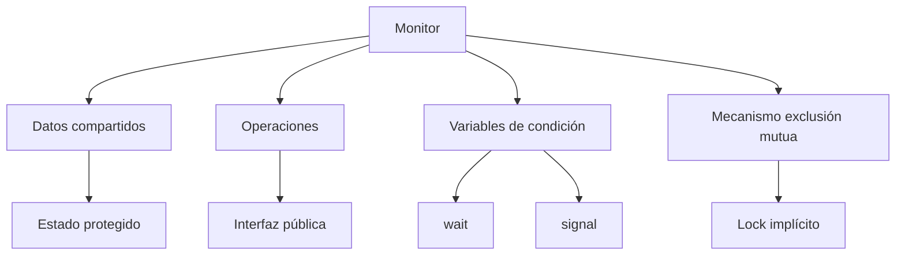
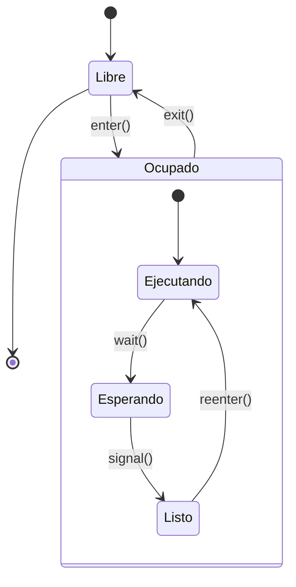

# Modelado y Programación - Programación concurrente

## 5.6 Monitores.

---

### 1. Introducción a los Monitores

#### 1.1 Concepto Fundamental

Un **monitor** es una construcción de programación concurrente que encapsula datos compartidos y los procedimientos que operan sobre ellos, garantizando la exclusión mutua. Fue propuesto por C. A. R. Hoare y Per Brinch Hansen en la década de 1970.

**Definición formal:**
Un monitor es una estructura que consiste en:

- Variables de datos compartidas
- Procedimientos que operan sobre los datos
- Variables de condición para sincronización
- Un mecanismo de exclusión mutua implícito

**Estructura básica:**
$$ \text{Monitor} = (\text{datos}, \text{procedimientos}, \text{condiciones}, \text{lock}) $$

#### 1.2 Principios de Diseño



### 2. Implementación de Monitores

#### 2.1 Monitor Básico en Java

Java proporciona soporte nativo para monitores mediante la palabra clave `synchronized`:

```java
public class ContadorMonitor {
    private int contador = 0;

    // Los métodos synchronized forman el monitor
    public synchronized void incrementar() {
        contador++;
        System.out.println("Incrementado: " + contador);
    }

    public synchronized void decrementar() {
        contador--;
        System.out.println("Decrementado: " + contador);
    }

    public synchronized int obtenerValor() {
        return contador;
    }
}

// Uso del monitor
public class EjemploMonitor {
    public static void main(String[] args) {
        ContadorMonitor monitor = new ContadorMonitor();

        // Múltiples hilos acceden al monitor
        Thread hilo1 = new Thread(() -> {
            for (int i = 0; i < 1000; i++) {
                monitor.incrementar();
            }
        });

        Thread hilo2 = new Thread(() -> {
            for (int i = 0; i < 1000; i++) {
                monitor.decrementar();
            }
        });

        hilo1.start();
        hilo2.start();
    }
}
```

#### 2.2 Variables de Condición

Las variables de condición permiten a los hilos esperar por condiciones específicas:

```java
import java.util.LinkedList;
import java.util.Queue;
import java.util.concurrent.locks.Condition;
import java.util.concurrent.locks.Lock;
import java.util.concurrent.locks.ReentrantLock;

public class BufferMonitor {
    private final Queue<Integer> buffer = new LinkedList<>();
    private final int capacidad;
    private final Lock lock = new ReentrantLock();
    private final Condition noLleno = lock.newCondition();
    private final Condition noVacio = lock.newCondition();

    public BufferMonitor(int capacidad) {
        this.capacidad = capacidad;
    }

    public void producir(int item) throws InterruptedException {
        lock.lock();
        try {
            while (buffer.size() == capacidad) {
                noLleno.await(); // Esperar hasta que no esté lleno
            }
            buffer.add(item);
            noVacio.signal(); // Señalar que ya no está vacío
        } finally {
            lock.unlock();
        }
    }

    public int consumir() throws InterruptedException {
        lock.lock();
        try {
            while (buffer.isEmpty()) {
                noVacio.await(); // Esperar hasta que no esté vacío
            }
            int item = buffer.remove();
            noLleno.signal(); // Señalar que ya no está lleno
            return item;
        } finally {
            lock.unlock();
        }
    }
}
```

### 3. Semántica de Señalización

#### 3.1 Signal and Continue vs Signal and Wait

**Signal and Continue (Java):**

- El hilo que señala continúa ejecutándose
- El hilo señalado se mueve a la cola de ready
- Más eficiente pero puede causar "señalización perdida"

**Signal and Wait (Hoare):**

- El hilo que señala cede el monitor al señalado
- El señalado ejecuta inmediatamente
- Más predecible pero menos eficiente

#### 3.2 Implementación de Diferentes Semánticas

```java
// Monitor con semántica Signal and Continue (Java estándar)
public class MonitorSC {
    private final Lock lock = new ReentrantLock();
    private final Condition cond = lock.newCondition();
    private boolean condicion = false;

    public void metodoWait() throws InterruptedException {
        lock.lock();
        try {
            while (!condicion) {
                cond.await(); // Signal and Continue
            }
            // Realizar trabajo
        } finally {
            lock.unlock();
        }
    }

    public void metodoSignal() {
        lock.lock();
        try {
            condicion = true;
            cond.signal(); // Señalar y continuar
        } finally {
            lock.unlock();
        }
    }
}

// Monitor con semántica Signal and Wait (aproximación)
public class MonitorSW {
    private final Object monitor = new Object();
    private boolean condicion = false;
    private boolean señalando = false;

    public void metodoWait() throws InterruptedException {
        synchronized (monitor) {
            while (!condicion || !señalando) {
                monitor.wait();
            }
            señalando = false;
            // Realizar trabajo
        }
    }

    public void metodoSignal() {
        synchronized (monitor) {
            condicion = true;
            señalando = true;
            monitor.notify();
            // En Signal and Wait, aquí esperaríamos
        }
    }
}
```

### 4. Patrones de Diseño con Monitores

#### 4.1 Patrón Productor-Consumidor

```java
public class BufferCircularMonitor {
    private final int[] buffer;
    private int count = 0;
    private int front = 0;
    private int rear = 0;
    private final Object lock = new Object();

    public BufferCircularMonitor(int tamaño) {
        buffer = new int[tamaño];
    }

    public void producir(int item) throws InterruptedException {
        synchronized (lock) {
            while (count == buffer.length) {
                lock.wait(); // Esperar hasta que haya espacio
            }

            buffer[rear] = item;
            rear = (rear + 1) % buffer.length;
            count++;

            lock.notifyAll(); // Notificar a consumidores
        }
    }

    public int consumir() throws InterruptedException {
        synchronized (lock) {
            while (count == 0) {
                lock.wait(); // Esperar hasta que haya items
            }

            int item = buffer[front];
            front = (front + 1) % buffer.length;
            count--;

            lock.notifyAll(); // Notificar a productores
            return item;
        }
    }
}
```

#### 4.2 Patrón Lectores-Escritores

```java
public class RecursoCompartidoMonitor {
    private int lectores = 0;
    private boolean escribiendo = false;
    private final Object lock = new Object();

    public void iniciarLectura() throws InterruptedException {
        synchronized (lock) {
            while (escribiendo) {
                lock.wait(); // Esperar si alguien está escribiendo
            }
            lectores++;
        }
    }

    public void terminarLectura() {
        synchronized (lock) {
            lectores--;
            if (lectores == 0) {
                lock.notifyAll(); // Notificar a escritores
            }
        }
    }

    public void iniciarEscritura() throws InterruptedException {
        synchronized (lock) {
            while (lectores > 0 || escribiendo) {
                lock.wait(); // Esperar hasta que no haya lectores ni escritores
            }
            escribiendo = true;
        }
    }

    public void terminarEscritura() {
        synchronized (lock) {
            escribiendo = false;
            lock.notifyAll(); // Notificar a todos
        }
    }
}
```

### 5. Modelo Matemático de Monitores

#### 5.1 Formalización de Monitores

Un monitor puede ser formalizado como una tupla:

$$ M = (V, P, C, Q) $$

Donde:

- $V$: Conjunto de variables de datos
- $P$: Conjunto de procedimientos
- $C$: Conjunto de variables de condición
- $Q$: Cola de hilos esperando entrar al monitor

#### 5.2 Operaciones sobre Variables de Condición

Para cada variable de condición $c \in C$:

- $\text{wait}(c)$: Libera el monitor y se bloquea en $c$
- $\text{signal}(c)$: Despierta un hilo esperando en $c$
- $\text{signalAll}(c)$: Despierta todos los hilos en $c$

**Invariante del monitor:**
$$ I_M \text{ se mantiene antes y después de cada operación} $$

#### 5.3 Análisis de Correctitud

**Exclusión mutua:**
$$ \forall t_1, t_2 \in \text{hilos}, \neg(\text{enMonitor}(t_1) \land \text{enMonitor}(t_2)) $$

**Ausencia de deadlock:**
$$ \forall t \in \text{hilos}, \text{si } t \text{ está bloqueado} \Rightarrow \exists \text{ operación que lo desbloquee} $$

### 6. Monitores en Diferentes Lenguajes

#### 6.1 Monitores en Python

Python no tiene monitores nativos pero se pueden implementar:

```python
import threading

class Monitor:
    def __init__(self):
        self.lock = threading.RLock()
        self.conditions = {}

    def __enter__(self):
        self.lock.acquire()
        return self

    def __exit__(self, exc_type, exc_val, exc_tb):
        self.lock.release()

    def get_condition(self, name):
        if name not in self.conditions:
            self.conditions[name] = threading.Condition(self.lock)
        return self.conditions[name]

# Ejemplo de uso
class BufferMonitor:
    def __init__(self, capacity):
        self.monitor = Monitor()
        self.buffer = []
        self.capacity = capacity

    def producir(self, item):
        with self.monitor:
            cond = self.monitor.get_condition('buffer')
            while len(self.buffer) >= self.capacity:
                cond.wait()
            self.buffer.append(item)
            cond.notify_all()

    def consumir(self):
        with self.monitor:
            cond = self.monitor.get_condition('buffer')
            while len(self.buffer) == 0:
                cond.wait()
            item = self.buffer.pop(0)
            cond.notify_all()
            return item
```

#### 6.2 Monitores en C++

C++11 introdució soporte para monitores:

```cpp
#include <iostream>
#include <thread>
#include <mutex>
#include <condition_variable>
#include <queue>

template<typename T>
class Monitor {
private:
    std::mutex mutex;
    std::condition_variable cond;
    std::queue<T> queue;
    const size_t capacity;

public:
    Monitor(size_t cap) : capacity(cap) {}

    void produce(T item) {
        std::unique_lock<std::mutex> lock(mutex);
        cond.wait(lock, [this] { return queue.size() < capacity; });
        queue.push(item);
        cond.notify_all();
    }

    T consume() {
        std::unique_lock<std::mutex> lock(mutex);
        cond.wait(lock, [this] { return !queue.empty(); });
        T item = queue.front();
        queue.pop();
        cond.notify_all();
        return item;
    }
};

// Uso
Monitor<int> buffer(10);

void producer() {
    for (int i = 0; i < 100; ++i) {
        buffer.produce(i);
    }
}

void consumer() {
    for (int i = 0; i < 100; ++i) {
        int item = buffer.consume();
        std::cout << "Consumed: " << item << std::endl;
    }
}
```

### 7. Ejercicios Propuestos

#### Ejercicio 1: Implementación de Monitor

Implementa un monitor para el problema de los filósofos comensales.

#### Ejercicio 2: Semáforo usando Monitor

Implementa un semáfo de conteo usando un monitor.

#### Ejercicio 3: Análisis de Correctitud

Para un monitor con 2 variables de condición, demuestra que garantiza exclusión mutua.

#### Ejercicio 4: Monitor con Timeout

Extiende la implementación de monitor para soportar operaciones con timeout.

### 8. Soluciones a Ejercicios

#### Solución Ejercicio 1: Filósofos Comensales

```java
public class CenaFilosofos {
    private enum Estado { PENSANDO, HAMBRIENTO, COMIENDO }
    private final Estado[] estados;
    private final Object lock = new Object();

    public CenaFilosofos(int numFilosofos) {
        estados = new Estado[numFilosofos];
        for (int i = 0; i < numFilosofos; i++) {
            estados[i] = Estado.PENSANDO;
        }
    }

    public void tomarCubiertos(int id) throws InterruptedException {
        synchronized (lock) {
            estados[id] = Estado.HAMBRIENTO;
            while (estados[(id + 1) % estados.length] == Estado.COMIENDO ||
                   estados[(id + estados.length - 1) % estados.length] == Estado.COMIENDO) {
                lock.wait();
            }
            estados[id] = Estado.COMIENDO;
        }
    }

    public void soltarCubiertos(int id) {
        synchronized (lock) {
            estados[id] = Estado.PENSANDO;
            lock.notifyAll();
        }
    }
}
```

#### Solución Ejercicio 2: Semáforo con Monitor

```java
public class SemaphoreMonitor {
    private int permits;
    private final Object monitor = new Object();

    public SemaphoreMonitor(int initialPermits) {
        permits = initialPermits;
    }

    public void acquire() throws InterruptedException {
        synchronized (monitor) {
            while (permits <= 0) {
                monitor.wait();
            }
            permits--;
        }
    }

    public void release() {
        synchronized (monitor) {
            permits++;
            monitor.notify();
        }
    }

    public boolean tryAcquire() {
        synchronized (monitor) {
            if (permits > 0) {
                permits--;
                return true;
            }
            return false;
        }
    }
}
```

### 9. Referencias y Bibliografía

#### Libros Recomendados:

1. "Concurrent Programming in Java" - Doug Lea
2. "Java Concurrency in Practice" - Brian Goetz
3. "Principles of Concurrent and Distributed Programming" - M. Ben-Ari

#### Artículos Fundamentales:

- Hoare, C. A. R. (1974). "Monitors: An operating system structuring concept"
- Brinch Hansen, P. (1975). "The programming language Concurrent Pascal"
- Lampson, B. W., & Redell, D. D. (1980). "Experience with processes and monitors in Mesa"

#### Recursos Online:

- [Java Monitor Mechanism](https://docs.oracle.com/javase/tutorial/essential/concurrency/sync.html)
- [Python threading](https://docs.python.org/3/library/threading.html)
- [C++ Concurrency](https://en.cppreference.com/w/cpp/thread)

### 10. Diagrama de Estados de un Monitor



Esta guía proporciona una comprensión completa de los monitores, desde sus fundamentos teóricos hasta implementaciones prácticas en diferentes lenguajes de programación.
