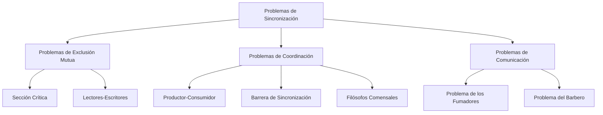
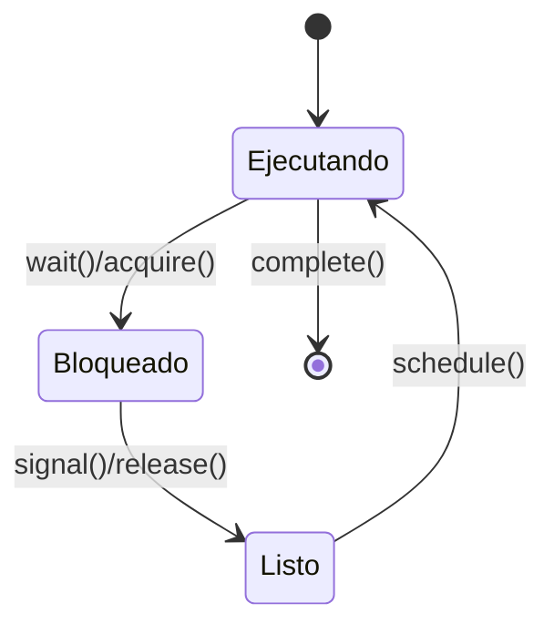

# Modelado y Programación - Programación concurrente

## 5.7 Problemas de sincronización

---

### 1. Introducción a los Problemas de Sincronización

#### 1.1 Concepto Fundamental

Los **problemas de sincronización** son escenarios clásicos en programación concurrente que ilustran los desafíos de coordinar múltiples procesos o hilos que acceden a recursos compartidos. Estos problemas sirven como benchmarks para evaluar mecanismos de sincronización y entender patrones comunes de concurrencia.

**Definición formal:**
Un problema de sincronización puede representarse como una tupla:

$$ P = (T, R, C, O) $$

Donde:

- $T:$ Conjunto de tareas o procesos
- $R:$ Recursos compartidos
- $C:$ Condiciones de sincronización
- $O:$ Objetivos a alcanzar

#### 1.2 Clasificación de Problemas



### 2. Problema de la Sección Crítica

#### 2.1 Definición y Soluciones

El **problema de la sección crítica** implica garantizar que solo un proceso ejecute su sección crítica a la vez.

**Condiciones requeridas:**

1. **Exclusión mutua**: Solo un proceso en la sección crítica
2. **Progreso**: si ningún proceso está en la sección crítica, solo los procesos que quieren entrar participan en decidir quién entra, y esa decisión no puede posponerse indefinidamente
3. **Espera limitada**: después de que un proceso pide entrar, hay un límite en el número de veces que otros entran antes que él

**Solución con semáforos:**

```python
import threading

class SeccionCritica:
    def __init__(self):
        self.semaphore = threading.Semaphore(1)
        self.contador = 0

    def entrar_seccion_critica(self, proceso_id):
        self.semaphore.acquire()
        try:
            # Sección crítica
            self.contador += 1
            print(f"Proceso {proceso_id} en SC, contador: {self.contador}")
        finally:
            self.semaphore.release()

# Uso
def proceso(proceso_id, sc):
    for _ in range(5):
        sc.entrar_seccion_critica(proceso_id)

sc = SeccionCritica()
hilos = [threading.Thread(target=proceso, args=(i, sc)) for i in range(3)]
for hilo in hilos:
    hilo.start()
for hilo in hilos:
    hilo.join()
```

### 3. Problema Productor-Consumidor

#### 3.1 Definición y Solución

El **problema productor-consumidor** involucra dos tipos de procesos que comparten un buffer de tamaño limitado.

**Condiciones:**

- Productores: Insertan datos en el buffer
- Consumidores: Extraen datos del buffer
- Buffer: Tiene capacidad limitada

**Solución con monitores:**

```python
import threading
import time
import collections

class BufferMonitor:
    def __init__(self, capacidad):
        self.buffer = collections.deque(maxlen=capacidad)
        self.lock = threading.Lock()
        self.no_lleno = threading.Condition(self.lock)
        self.no_vacio = threading.Condition(self.lock)

    def producir(self, item):
        with self.lock:
            while len(self.buffer) == self.buffer.maxlen:
                self.no_lleno.wait()
            self.buffer.append(item)
            self.no_vacio.notify()

    def consumir(self):
        with self.lock:
            while len(self.buffer) == 0:
                self.no_vacio.wait()
            item = self.buffer.popleft()
            self.no_lleno.notify()
            return item

# Simulación
def productor(monitor, id_productor):
    for i in range(10):
        item = f"Item_{id_productor}_{i}"
        monitor.producir(item)
        print(f"Productor {id_productor} produjo: {item}")
        time.sleep(0.1)

def consumidor(monitor, id_consumidor):
    for i in range(10):
        item = monitor.consumir()
        print(f"Consumidor {id_consumidor} consumió: {item}")
        time.sleep(0.15)

monitor = BufferMonitor(5)
productores = [threading.Thread(target=productor, args=(monitor, i)) for i in range(2)]
consumidores = [threading.Thread(target=consumidor, args=(monitor, i)) for i in range(2)]

for p in productores: p.start()
for c in consumidores: c.start()
for p in productores: p.join()
for c in consumidores: c.join()
```

Las dos condiciones comparten el mismo candado. Como los productores solo esperan en `no_lleno` y los consumidores solo en `no_vacio`, basta `notify()`: cada señal despierta a un hilo que puede aprovecharla. El `while` protege de que otro hilo se adelante entre la señal y el despertar.

### 4. Problema de los Lectores-Escritores

#### 4.1 Definición y Variantes

El **problema de lectores-escritores** maneja el acceso a un recurso compartido donde:

- Múltiples lectores pueden leer simultáneamente
- Solo un escritor puede escribir a la vez
- Lectores y escritores son excluyentes

**Variantes:**

- **Primer lector**: Prioridad a lectores
- **Primer escritor**: Prioridad a escritores
- **Justo**: Evita inanición

**Solución con prioridad a lectores:**

```python
import threading

class RecursoLectoresEscritores:
    def __init__(self):
        self.lectores = 0
        self.escritor_activo = False
        self.mutex = threading.Lock()
        self.lectura_ok = threading.Condition(self.mutex)
        self.escritura_ok = threading.Condition(self.mutex)

    def iniciar_lectura(self):
        with self.mutex:
            while self.escritor_activo:
                self.lectura_ok.wait()
            self.lectores += 1
            self.lectura_ok.notify_all()

    def terminar_lectura(self):
        with self.mutex:
            self.lectores -= 1
            if self.lectores == 0:
                self.escritura_ok.notify()

    def iniciar_escritura(self):
        with self.mutex:
            while self.lectores > 0 or self.escritor_activo:
                self.escritura_ok.wait()
            self.escritor_activo = True

    def terminar_escritura(self):
        with self.mutex:
            self.escritor_activo = False
            self.lectura_ok.notify_all()
            self.escritura_ok.notify()

# Ejemplo de uso
recurso = RecursoLectoresEscritores()

def lector(id_lector):
    for i in range(3):
        recurso.iniciar_lectura()
        print(f"Lector {id_lector} leyendo...")
        recurso.terminar_lectura()

def escritor(id_escritor):
    for i in range(2):
        recurso.iniciar_escritura()
        print(f"Escritor {id_escritor} escribiendo...")
        recurso.terminar_escritura()

hilos = [threading.Thread(target=lector, args=(i,)) for i in range(3)]
hilos += [threading.Thread(target=escritor, args=(i,)) for i in range(2)]
for h in hilos: h.start()
for h in hilos: h.join()
```

Los lectores solo esperan si hay un escritor **activo**, no si hay escritores esperando; por eso es la variante con prioridad a lectores y los escritores pueden sufrir inanición. El ejercicio 2 pide la variante contraria.

### 5. Problema de los Filósofos Comensales

#### 5.1 Definición y Soluciones

El **problema de los filósofos comensales** ilustra problemas de deadlock e inanición.

**Escenario:**

- 5 filósofos alrededor de una mesa
- 5 tenedores (1 entre cada dos filósofos)
- Necesitan 2 tenedores para comer

**Solución evitando deadlock.** Esta solución, de Dijkstra, lleva el **estado** de cada filósofo en lugar de modelar tenedores. Un filósofo hambriento solo pasa a comer si ninguno de sus vecinos come, y esa comprobación (`_verificar`) es atómica porque ocurre con el `mutex` tomado. Al terminar, el filósofo verifica a sus dos vecinos, que quizá estaban esperando sus tenedores. Como un filósofo nunca toma un tenedor y espera el otro, no hay espera circular:

```python
import threading
import time
import random

class CenaFilosofos:
    def __init__(self, num_filosofos=5):
        self.tenedores = [threading.Lock() for _ in range(num_filosofos)]
        self.estados = ['pensando'] * num_filosofos
        self.mutex = threading.Lock()
        self.condiciones = [threading.Condition(self.mutex) for _ in range(num_filosofos)]

    def tomar_tenedores(self, filosofo_id):
        with self.mutex:
            self.estados[filosofo_id] = 'hambriento'
            self._verificar(filosofo_id)
            while self.estados[filosofo_id] == 'hambriento':
                self.condiciones[filosofo_id].wait()

    def liberar_tenedores(self, filosofo_id):
        with self.mutex:
            self.estados[filosofo_id] = 'pensando'
            self._verificar((filosofo_id + 1) % len(self.estados))
            self._verificar((filosofo_id - 1) % len(self.estados))

    def _verificar(self, filosofo_id):
        izquierda = (filosofo_id - 1) % len(self.estados)
        derecha = (filosofo_id + 1) % len(self.estados)

        if (self.estados[filosofo_id] == 'hambriento' and
            self.estados[izquierda] != 'comiendo' and
            self.estados[derecha] != 'comiendo'):
            self.estados[filosofo_id] = 'comiendo'
            self.condiciones[filosofo_id].notify()

def filosofo(filosofo_id, cena):
    for i in range(3):  # Comer 3 veces
        # Pensar
        print(f"Filósofo {filosofo_id} pensando")
        time.sleep(random.uniform(0.1, 0.5))

        # Tomar tenedores y comer
        cena.tomar_tenedores(filosofo_id)
        print(f"Filósofo {filosofo_id} comiendo")
        time.sleep(random.uniform(0.1, 0.3))
        cena.liberar_tenedores(filosofo_id)

# Ejecución
cena = CenaFilosofos()
filosofos = [threading.Thread(target=filosofo, args=(i, cena)) for i in range(5)]
for f in filosofos:
    f.start()
for f in filosofos:
    f.join()
```

Esta solución evita el interbloqueo pero no la inanición: si los filósofos 0 y 2 se turnan para comer de forma que siempre uno de ellos esté comiendo, el filósofo 1 nunca come.

### 6. Problema del Barbero Dormilón

#### 6.1 Definición y Solución

El **problema del barbero dormilón**, propuesto por Dijkstra, modela un barbero que atiende clientes en una barbería con sillas limitadas.

**Elementos:**

- Barbero: duerme si no hay clientes; un cliente que llega lo despierta.
- Clientes: si hay una silla libre se sientan a esperar; si no, se van.
- Sillas de espera: número limitado $n.$

La dificultad es evitar dos errores: que el barbero se duerma justo cuando un cliente acaba de sentarse (y ambos esperen para siempre), y que dos clientes ocupen la misma silla. Se usan un contador protegido por `mutex` y semáforos para **señalizar** en cada dirección:

- `cliente`: cuenta los clientes que esperan; el barbero duerme en él.
- `barbero`: el barbero lo libera para llamar al siguiente cliente.
- `corte_hecho`: el barbero avisa que terminó, para que el cliente se vaya.

**Solución con semáforos:**

```python
import threading
import time
import random

class Barberia:
    def __init__(self, sillas_espera):
        self.sillas_espera = sillas_espera
        self.clientes_esperando = 0
        self.mutex = threading.Semaphore(1)        # protege clientes_esperando
        self.cliente = threading.Semaphore(0)      # clientes listos para ser atendidos
        self.barbero = threading.Semaphore(0)      # el barbero llama al siguiente
        self.corte_hecho = threading.Semaphore(0)  # el barbero terminó un corte
        self.atendidos = 0
        self.rechazados = 0
        self.cerrado = False

    def llegar_cliente(self, cliente_id):
        self.mutex.acquire()
        if self.clientes_esperando == self.sillas_espera:
            self.rechazados += 1
            self.mutex.release()
            return False                 # no hay sillas: se va
        self.clientes_esperando += 1
        self.mutex.release()

        self.cliente.release()           # despierta al barbero si dormía
        self.barbero.acquire()           # espera a que lo llamen
        self.corte_hecho.acquire()       # espera a que termine su corte
        return True

    def barbero_trabajar(self):
        while True:
            self.cliente.acquire()       # duerme mientras no haya clientes
            if self.cerrado:
                return
            self.mutex.acquire()
            self.clientes_esperando -= 1 # el cliente deja su silla de espera
            self.mutex.release()
            self.barbero.release()       # pasa a la silla del barbero
            time.sleep(0.005)            # cortar el pelo
            self.atendidos += 1
            self.corte_hecho.release()

barberia = Barberia(sillas_espera=3)
barbero = threading.Thread(target=barberia.barbero_trabajar)
barbero.start()

clientes = []
for i in range(20):
    t = threading.Thread(target=barberia.llegar_cliente, args=(i,))
    clientes.append(t)
    t.start()
    time.sleep(random.uniform(0, 0.006))  # llegan a intervalos aleatorios
for t in clientes:
    t.join()

barberia.cerrado = True
barberia.cliente.release()               # despierta al barbero para que cierre
barbero.join()
print(barberia.atendidos + barberia.rechazados)   # 20: cada cliente fue atendido o se fue
```

¿Por qué el barbero no puede dormirse mientras un cliente espera? El cliente incrementa el **semáforo** `cliente` y no una simple bandera: si el barbero todavía no llega a su `acquire`, la señal no se pierde, queda contada en el semáforo. En cada momento, el valor de `cliente` más el número de clientes que el barbero ya tomó es igual al número de clientes que se sentaron.

### 7. Problema de los Fumadores

#### 7.1 Definición y Solución

El **problema de los fumadores** (Patil, 1971) tiene un agente y tres fumadores. Para fumar se necesitan tres ingredientes: papel, tabaco y fósforos. Cada fumador tiene una cantidad ilimitada de **uno** de ellos. El agente pone en la mesa, al azar, dos ingredientes distintos; el fumador que tiene el tercero debe tomarlos, fumar y avisar al agente para que ponga los siguientes.

En la versión original el agente no se puede modificar y solo usa semáforos, lo que obliga a usar hilos intermediarios; con un monitor la solución es directa: cada fumador espera hasta que en la mesa estén exactamente los dos ingredientes que le faltan.

**Solución con monitor:**

```python
import threading
import random
import time

INGREDIENTES = ['papel', 'tabaco', 'fósforos']

class MesaFumadores:
    def __init__(self):
        self.cond = threading.Condition()
        self.mesa = None              # conjunto con los dos ingredientes, o None
        self.fin = False
        self.fumadas = {ing: 0 for ing in INGREDIENTES}

    def agente(self, rondas):
        for _ in range(rondas):
            with self.cond:
                while self.mesa is not None:        # esperar a que retiren lo anterior
                    self.cond.wait()
                self.mesa = set(random.sample(INGREDIENTES, 2))
                self.cond.notify_all()
        with self.cond:
            while self.mesa is not None:
                self.cond.wait()
            self.fin = True
            self.cond.notify_all()

    def fumador(self, propio):
        while True:
            with self.cond:
                # Puede fumar si en la mesa están los dos ingredientes que NO tiene
                while not (self.mesa is not None and propio not in self.mesa):
                    if self.fin:
                        return
                    self.cond.wait()
                self.mesa = None                    # toma los ingredientes
                self.fumadas[propio] += 1
                self.cond.notify_all()              # avisa al agente
            time.sleep(0.001)                       # fumar, fuera del monitor

mesa = MesaFumadores()
hilos = [threading.Thread(target=mesa.fumador, args=(ing,)) for ing in INGREDIENTES]
hilos.append(threading.Thread(target=mesa.agente, args=(30,)))
for h in hilos: h.start()
for h in hilos: h.join()
print(sum(mesa.fumadas.values()))   # 30
```

Fumar ocurre **fuera** del monitor: mantener el candado durante una actividad larga impediría que el agente y los demás fumadores avanzaran. Como el agente espera a que la mesa quede vacía, nunca hay dos fumadores tomando ingredientes de la misma ronda.

### 8. Ejercicios Propuestos

#### Ejercicio 1: Implementación de Barrera

Implementa una barrera de sincronización que espere a N hilos.

#### Ejercicio 2: Semáforos con Prioridad

Extiende el problema lectores-escritores para dar prioridad a escritores.

#### Ejercicio 3: Cena de Filósofos sin Deadlock

Implementa una solución donde los filósofos toman tenedores en orden diferente.

#### Ejercicio 4: Análisis de Rendimiento

Un productor genera un elemento cada 20 ms y un consumidor procesa un elemento cada 25 ms, con un buffer de tamaño 10. Calcula el throughput máximo del sistema. ¿Cambia si el buffer es de tamaño 100? ¿Para qué sirve entonces el buffer?

### 9. Soluciones a Ejercicios

#### Solución Ejercicio 1: Barrera de Sincronización

```python
class Barrera:
    def __init__(self, n):
        self.n = n
        self.count = 0
        self.mutex = threading.Semaphore(1)
        self.barrera = threading.Semaphore(0)

    def esperar(self):
        self.mutex.acquire()
        self.count += 1
        if self.count == self.n:
            for _ in range(self.n):
                self.barrera.release()
        self.mutex.release()

        self.barrera.acquire()
```

Esta barrera funciona **una vez**. Si se usa en un ciclo, un hilo rápido puede salir, volver a llamar a `esperar` y consumir uno de los permisos destinados a la fase anterior. La versión reutilizable usa **dos torniquetes**: todos esperan en el primero hasta que llega el último, y luego en el segundo hasta que salió el último:

```python
class BarreraReutilizable:
    def __init__(self, n):
        self.n = n
        self.count = 0
        self.mutex = threading.Semaphore(1)
        self.torniquete1 = threading.Semaphore(0)
        self.torniquete2 = threading.Semaphore(0)

    def esperar(self):
        with self.mutex:
            self.count += 1
            if self.count == self.n:          # llegó el último: abrir el primero
                for _ in range(self.n):
                    self.torniquete1.release()
        self.torniquete1.acquire()

        with self.mutex:
            self.count -= 1
            if self.count == 0:               # salió el último: abrir el segundo
                for _ in range(self.n):
                    self.torniquete2.release()
        self.torniquete2.acquire()

N, FASES = 4, 5
barrera = BarreraReutilizable(N)
fase_actual = [0] * N
errores = []

def trabajador(i):
    for f in range(FASES):
        fase_actual[i] = f
        barrera.esperar()
        if any(x != f for x in fase_actual):   # todos deben estar en la fase f
            errores.append((i, f))
        barrera.esperar()                       # segunda barrera antes de avanzar

hs = [threading.Thread(target=trabajador, args=(i,)) for i in range(N)]
for h in hs: h.start()
for h in hs: h.join()
print("errores:", errores)   # errores: []
```

#### Solución Ejercicio 2: Prioridad a escritores

Se cuenta a los escritores que esperan; un lector nuevo no entra mientras haya alguno, aunque no haya un escritor activo:

```python
class LectoresEscritoresPrioridadEscritores:
    def __init__(self):
        self.lectores = 0
        self.escritor_activo = False
        self.escritores_esperando = 0
        self.cond = threading.Condition()

    def iniciar_lectura(self):
        with self.cond:
            while self.escritor_activo or self.escritores_esperando > 0:
                self.cond.wait()
            self.lectores += 1

    def terminar_lectura(self):
        with self.cond:
            self.lectores -= 1
            if self.lectores == 0:
                self.cond.notify_all()

    def iniciar_escritura(self):
        with self.cond:
            self.escritores_esperando += 1
            while self.lectores > 0 or self.escritor_activo:
                self.cond.wait()
            self.escritores_esperando -= 1
            self.escritor_activo = True

    def terminar_escritura(self):
        with self.cond:
            self.escritor_activo = False
            self.cond.notify_all()

rec = LectoresEscritoresPrioridadEscritores()
valor = [0]

def lee():
    for _ in range(100):
        rec.iniciar_lectura(); _ = valor[0]; rec.terminar_lectura()

def escribe():
    for _ in range(100):
        rec.iniciar_escritura(); valor[0] += 1; rec.terminar_escritura()

hs = [threading.Thread(target=lee) for _ in range(4)] + [threading.Thread(target=escribe) for _ in range(2)]
for h in hs: h.start()
for h in hs: h.join()
print(valor[0])   # 200
```

Ahora los que pueden sufrir inanición son los lectores, si los escritores llegan continuamente. Una política justa alterna: al terminar un escritor se deja pasar a todos los lectores que esperaban en ese momento, y al terminar ese grupo, al siguiente escritor.

#### Solución Ejercicio 3: Filósofos sin Deadlock

```python
def filosofo_sin_deadlock(filosofo_id, tenedores):
    if filosofo_id % 2 == 0:
        # Filósofos pares: tomar izquierdo luego derecho
        primero = filosofo_id
        segundo = (filosofo_id + 1) % len(tenedores)
    else:
        # Filósofos impares: tomar derecho luego izquierdo
        primero = (filosofo_id + 1) % len(tenedores)
        segundo = filosofo_id

    tenedores[primero].acquire()
    tenedores[segundo].acquire()
    # Comer
    tenedores[segundo].release()
    tenedores[primero].release()

tenedores = [threading.Lock() for _ in range(5)]

def comer_varias_veces(i):
    for _ in range(200):
        filosofo_sin_deadlock(i, tenedores)

hs = [threading.Thread(target=comer_varias_veces, args=(i,)) for i in range(5)]
for h in hs: h.start()
for h in hs: h.join()
print("sin interbloqueo")
```

*Por qué no hay interbloqueo.* Un interbloqueo requeriría que los cinco filósofos tuvieran un tenedor cada uno y esperaran el siguiente en el círculo, es decir, que todos tomaran primero el tenedor del mismo lado. Pero los pares toman primero el izquierdo y los impares el derecho, así que dos filósofos vecinos de distinta paridad compiten primero por el **mismo** tenedor: el que lo pierde no toma ninguno, y el ciclo de espera no puede cerrarse. Con 5 filósofos, el 4 y el 0 son ambos pares y compiten por tenedores distintos, pero el resto de la cadena basta para romper el ciclo.

#### Solución Ejercicio 4: Análisis de Rendimiento

El productor puede generar $\frac{1}{20 \text{ ms}} = 50$ elementos por segundo y el consumidor procesar $\frac{1}{25 \text{ ms}} = 40$ por segundo. En régimen estable, nada sale del sistema más rápido de lo que el consumidor procesa, así que el throughput máximo es

$$ X = \min(\lambda_{\text{prod}}, \mu_{\text{cons}}) = \min(50, 40) = 40 \text{ elementos/s} $$

y **no depende del tamaño del buffer**. Como el productor es más rápido, el buffer se llena a razón de $50 - 40 = 10$ elementos por segundo: con capacidad 10 se llena en 1 segundo y, a partir de ahí, el productor queda bloqueado parte del tiempo y opera al ritmo del consumidor. Con capacidad 100 tardaría 10 segundos en llenarse, pero el throughput a largo plazo sigue siendo 40.

El buffer sirve para **absorber variaciones**: si los tiempos de producción y consumo fluctúan, por ejemplo el consumidor a veces tarda 5 ms y a veces 45 ms, un buffer más grande evita que uno se detenga esperando al otro durante las rachas. Si se quiere más throughput, hay que agregar consumidores: con dos consumidores la capacidad de consumo es 80 por segundo y el cuello de botella pasa a ser el productor, con 50 elementos por segundo.

### 10. Referencias y Bibliografía

#### Libros Recomendados:

1. "The Little Book of Semaphores" - Allen B. Downey
2. "Java Concurrency in Practice" - Brian Goetz
3. "Operating System Concepts" - Silberschatz, Galvin, Gagne

#### Artículos Fundamentales:

- Dijkstra, E. W. (1965). "Solution of a problem in concurrent programming control"
- Hoare, C. A. R. (1974). "Monitors: An operating system structuring concept"
- Lamport, L. (1974). "A new solution of Dijkstra's concurrent programming problem"

#### Recursos Online:

- [Python threading documentation](https://docs.python.org/3/library/threading.html)
- [Java Concurrency Tutorial](https://docs.oracle.com/javase/tutorial/essential/concurrency/)
- [POSIX Threads Programming](https://computing.llnl.gov/tutorials/pthreads/)

### 11. Diagrama de Estados de Sincronización



Esta guía proporciona una comprensión completa de los problemas clásicos de sincronización en programación concurrente, con implementaciones prácticas y soluciones a desafíos comunes.
