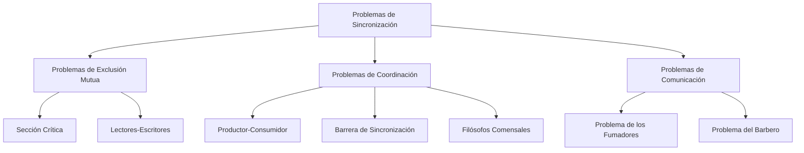
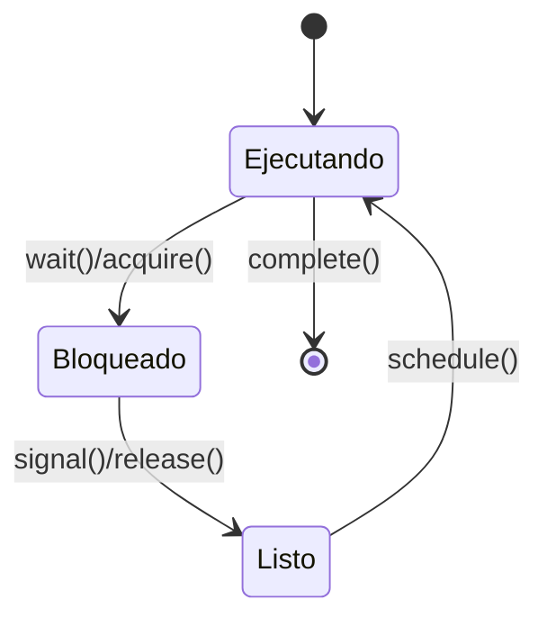

# Modelado y Programación - Programación concurrente

## 5.7 Problemas de sincronización

---

### 1. Introducción a los Problemas de Sincronización

#### 1.1 Concepto Fundamental

Los **problemas de sincronización** son escenarios clásicos en programación concurrente que ilustran los desafíos de coordinar múltiples procesos o hilos que acceden a recursos compartidos. Estos problemas sirven como benchmarks para evaluar mecanismos de sincronización y entender patrones comunes de concurrencia.

**Definición formal:**
Un problema de sincronización puede representarse como una tupla:

$$ P = (T, R, C, O) $$

Donde:

- $T$: Conjunto de tareas o procesos
- $R$: Recursos compartidos
- $C$: Condiciones de sincronización
- $O$: Objetivos a alcanzar

#### 1.2 Clasificación de Problemas



### 2. Problema de la Sección Crítica

#### 2.1 Definición y Soluciones

El **problema de la sección crítica** implica garantizar que solo un proceso ejecute su sección crítica a la vez.

**Condiciones requeridas:**

1. **Exclusión mutua**: Solo un proceso en la sección crítica
2. **Progreso**: Si ningún proceso está en SC, solo procesos que solicitan entrar deciden
3. **Espera limitada**: Tiempo de espera para entrar debe ser finito

**Solución con semáforos:**

```python
import threading

class SeccionCritica:
    def __init__(self):
        self.semaphore = threading.Semaphore(1)
        self.contador = 0

    def entrar_seccion_critica(self, proceso_id):
        self.semaphore.acquire()
        try:
            # Sección crítica
            self.contador += 1
            print(f"Proceso {proceso_id} en SC, contador: {self.contador}")
        finally:
            self.semaphore.release()

# Uso
def proceso(proceso_id, sc):
    for _ in range(5):
        sc.entrar_seccion_critica(proceso_id)

sc = SeccionCritica()
hilos = [threading.Thread(target=proceso, args=(i, sc)) for i in range(3)]
for hilo in hilos:
    hilo.start()
for hilo in hilos:
    hilo.join()
```

### 3. Problema Productor-Consumidor

#### 3.1 Definición y Solución

El **problema productor-consumidor** involucra dos tipos de procesos que comparten un buffer de tamaño limitado.

**Condiciones:**

- Productores: Insertan datos en el buffer
- Consumidores: Extraen datos del buffer
- Buffer: Tiene capacidad limitada

**Solución con monitores:**

```python
import threading
import time
import collections

class BufferMonitor:
    def __init__(self, capacidad):
        self.buffer = collections.deque(maxlen=capacidad)
        self.lock = threading.Lock()
        self.no_lleno = threading.Condition(self.lock)
        self.no_vacio = threading.Condition(self.lock)

    def producir(self, item):
        with self.lock:
            while len(self.buffer) == self.buffer.maxlen:
                self.no_lleno.wait()
            self.buffer.append(item)
            self.no_vacio.notify()

    def consumir(self):
        with self.lock:
            while len(self.buffer) == 0:
                self.no_vacio.wait()
            item = self.buffer.popleft()
            self.no_lleno.notify()
            return item

# Simulación
def productor(monitor, id_productor):
    for i in range(10):
        item = f"Item_{id_productor}_{i}"
        monitor.producir(item)
        print(f"Productor {id_productor} produjo: {item}")
        time.sleep(0.1)

def consumidor(monitor, id_consumidor):
    for i in range(10):
        item = monitor.consumir()
        print(f"Consumidor {id_consumidor} consumió: {item}")
        time.sleep(0.15)

monitor = BufferMonitor(5)
productores = [threading.Thread(target=productor, args=(monitor, i)) for i in range(2)]
consumidores = [threading.Thread(target=consumidor, args=(monitor, i)) for i in range(2)]

for p in productores: p.start()
for c in consumidores: c.start()
for p in productores: p.join()
for c in consumidores: c.join()
```

### 4. Problema de los Lectores-Escritores

#### 4.1 Definición y Variantes

El **problema de lectores-escritores** maneja el acceso a un recurso compartido donde:

- Múltiples lectores pueden leer simultáneamente
- Solo un escritor puede escribir a la vez
- Lectores y escritores son excluyentes

**Variantes:**

- **Primer lector**: Prioridad a lectores
- **Primer escritor**: Prioridad a escritores
- **Justo**: Evita inanición

**Solución con prioridad a lectores:**

```python
import threading

class RecursoLectoresEscritores:
    def __init__(self):
        self.lectores = 0
        self.escritor_activo = False
        self.mutex = threading.Lock()
        self.lectura_ok = threading.Condition(self.mutex)
        self.escritura_ok = threading.Condition(self.mutex)

    def iniciar_lectura(self):
        with self.mutex:
            while self.escritor_activo:
                self.lectura_ok.wait()
            self.lectores += 1
            self.lectura_ok.notify_all()

    def terminar_lectura(self):
        with self.mutex:
            self.lectores -= 1
            if self.lectores == 0:
                self.escritura_ok.notify()

    def iniciar_escritura(self):
        with self.mutex:
            while self.lectores > 0 or self.escritor_activo:
                self.escritura_ok.wait()
            self.escritor_activo = True

    def terminar_escritura(self):
        with self.mutex:
            self.escritor_activo = False
            self.lectura_ok.notify_all()
            self.escritura_ok.notify()

# Ejemplo de uso
recurso = RecursoLectoresEscritores()

def lector(id_lector):
    for i in range(3):
        recurso.iniciar_lectura()
        print(f"Lector {id_lector} leyendo...")
        recurso.terminar_lectura()

def escritor(id_escritor):
    for i in range(2):
        recurso.iniciar_escritura()
        print(f"Escritor {id_escritor} escribiendo...")
        recurso.terminar_escritura()
```

### 5. Problema de los Filósofos Comensales

#### 5.1 Definición y Soluciones

El **problema de los filósofos comensales** ilustra problemas de deadlock e inanición.

**Escenario:**

- 5 filósofos alrededor de una mesa
- 5 tenedores (1 entre cada dos filósofos)
- Necesitan 2 tenedores para comer

**Solución evitando deadlock:**

```python
import threading
import time
import random

class CenaFilosofos:
    def __init__(self, num_filosofos=5):
        self.tenedores = [threading.Lock() for _ in range(num_filosofos)]
        self.estados = ['pensando'] * num_filosofos
        self.mutex = threading.Lock()
        self.condiciones = [threading.Condition(self.mutex) for _ in range(num_filosofos)]

    def tomar_tenedores(self, filosofo_id):
        with self.mutex:
            self.estados[filosofo_id] = 'hambriento'
            self._verificar(filosofo_id)
            while self.estados[filosofo_id] == 'hambriento':
                self.condiciones[filosofo_id].wait()

    def liberar_tenedores(self, filosofo_id):
        with self.mutex:
            self.estados[filosofo_id] = 'pensando'
            self._verificar((filosofo_id + 1) % len(self.estados))
            self._verificar((filosofo_id - 1) % len(self.estados))

    def _verificar(self, filosofo_id):
        izquierda = (filosofo_id - 1) % len(self.estados)
        derecha = (filosofo_id + 1) % len(self.estados)

        if (self.estados[filosofo_id] == 'hambriento' and
            self.estados[izquierda] != 'comiendo' and
            self.estados[derecha] != 'comiendo'):
            self.estados[filosofo_id] = 'comiendo'
            self.condiciones[filosofo_id].notify()

def filosofo(filosofo_id, cena):
    for i in range(3):  # Comer 3 veces
        # Pensar
        print(f"Filósofo {filosofo_id} pensando")
        time.sleep(random.uniform(0.1, 0.5))

        # Tomar tenedores y comer
        cena.tomar_tenedores(filosofo_id)
        print(f"Filósofo {filosofo_id} comiendo")
        time.sleep(random.uniform(0.1, 0.3))
        cena.liberar_tenedores(filosofo_id)

# Ejecución
cena = CenaFilosofos()
filosofos = [threading.Thread(target=filosofo, args=(i, cena)) for i in range(5)]
for f in filosofos:
    f.start()
for f in filosofos:
    f.join()
```

### 6. Problema del Barbero Dormilón

#### 6.1 Definición y Solución

El **problema del barbero dormilón** modela un barbero que atiende clientes en una barbería con sillas limitadas.

**Elementos:**

- Barbero: Duerme si no hay clientes
- Clientes: Llegan y se sientan o se van si no hay sillas
- Sillas de espera: Número limitado

**Solución con semáforos:**

```python
import threading
import time
import random

class Barberia:
    def __init__(self, sillas_espera):
        self.sillas_espera = sillas_espera
        self.clientes_esperando = 0
        self.mutex = threading.Semaphore(1)
        self.cliente_esperando = threading.Semaphore(0)
        self.barbero_listo = threading.Semaphore(0)
        self.silla_barbero = threading.Semaphore(1)
        self.barbero_durmiendo = True

    def llegar_cliente(self, cliente_id):
        with self.mutex:
            if self.clientes_esperando < self.sillas_espera:
                self.clientes_esperando += 1
                print(f"Cliente {cliente_id} esperando ({self.clientes_esperando}/{self.sillas_espera})")
                self.cliente_esperando.release()
                self.mutex.release()

                self.barbero_listo.acquire()
                # Ser atendido por el barbero
                print(f"Cliente {cliente_id} siendo atendido")
                time.sleep(random.uniform(0.2, 0.4))
                self.silla_barbero.release()
                return True
            else:
                print(f"Cliente {cliente_id} se fue (sin sillas)")
                self.mutex.release()
                return False

    def barbero_trabajar(self):
        while True:
            print("Barbero durmiendo..." if self.barbero_durmiendo else "Barbero esperando...")
            self.cliente_esperando.acquire()

            with self.mutex:
                self.clientes_esperando -= 1
                self.barbero_durmiendo = False

            self.barbero_listo.release()
            self.silla_barbero.acquire()
            print("Barbero terminó corte")
```

### 7. Problema de los Fumadores

#### 7.1 Definición y Solución

El **problema de los fumadores** involucra un agente que provee ingredientes y fumadores que necesitan ingredientes específicos.

**Solución:**

```python
import threading
import random

class MesaFumadores:
    def __init__(self):
        self.ingredientes = None
        self.mutex = threading.Lock()
        self.agente_listo = threading.Condition(self.mutex)
        self.fumadores_listos = [threading.Condition(self.mutex) for _ in range(3)]
        self.fumador_activo = None

    def agente(self):
        with self.mutex:
            while True:
                # Esperar a que ningún fumador esté activo
                while self.fumador_activo is not None:
                    self.agente_listo.wait()

                # Elegir dos ingredientes al azar (falta uno)
                self.ingredientes = random.sample(['papel', 'tabaco', 'fósforos'], 2)
                print(f"Agente pone: {self.ingredientes}")

                # Notificar al fumador que puede fumar
                fumador_id = 3 - sum(
                    2**i for i, ing in enumerate(['papel', 'tabaco', 'fósforos'])
                    if ing not in self.ingredientes
                )
                self.fumador_activo = fumador_id
                self.fumadores_listos[fumador_id].notify()

    def fumador(self, id_fumador, ingrediente_necesario):
        with self.mutex:
            while True:
                while self.fumador_activo != id_fumador:
                    self.fumadores_listos[id_fumador].wait()

                if ingrediente_necesario not in self.ingredientes:
                    print(f"Fumador {id_fumador} fumando con {ingrediente_necesario}")
                    time.sleep(0.3)
                    self.fumador_activo = None
                    self.agente_listo.notify()
```

### 8. Ejercicios Propuestos

#### Ejercicio 1: Implementación de Barrera

Implementa una barrera de sincronización que espere a N hilos.

#### Ejercicio 2: Semáforos con Prioridad

Extiende el problema lectores-escritores para dar prioridad a escritores.

#### Ejercicio 3: Cena de Filósofos sin Deadlock

Implementa una solución donde los filósofos toman tenedores en orden diferente.

#### Ejercicio 4: Análisis de Rendimiento

Para un buffer productor-consumidor de tamaño 10, calcula el throughput máximo.

### 9. Soluciones a Ejercicios

#### Solución Ejercicio 1: Barrera de Sincronización

```python
class Barrera:
    def __init__(self, n):
        self.n = n
        self.count = 0
        self.mutex = threading.Semaphore(1)
        self.barrera = threading.Semaphore(0)

    def esperar(self):
        self.mutex.acquire()
        self.count += 1
        if self.count == self.n:
            for _ in range(self.n):
                self.barrera.release()
        self.mutex.release()

        self.barrera.acquire()
```

#### Solución Ejercicio 3: Filósofos sin Deadlock

```python
def filosofo_sin_deadlock(filosofo_id, tenedores):
    if filosofo_id % 2 == 0:
        # Filósofos pares: tomar izquierdo luego derecho
        primero = filosofo_id
        segundo = (filosofo_id + 1) % len(tenedores)
    else:
        # Filósofos impares: tomar derecho luego izquierdo
        primero = (filosofo_id + 1) % len(tenedores)
        segundo = filosofo_id

    tenedores[primero].acquire()
    tenedores[segundo].acquire()
    # Comer
    tenedores[segundo].release()
    tenedores[primero].release()
```

### 10. Referencias y Bibliografía

#### Libros Recomendados:

1. "The Little Book of Semaphores" - Allen B. Downey
2. "Java Concurrency in Practice" - Brian Goetz
3. "Operating System Concepts" - Silberschatz, Galvin, Gagne

#### Artículos Fundamentales:

- Dijkstra, E. W. (1965). "Solution of a problem in concurrent programming control"
- Hoare, C. A. R. (1974). "Monitors: An operating system structuring concept"
- Lamport, L. (1974). "A new solution of Dijkstra's concurrent programming problem"

#### Recursos Online:

- [Python threading documentation](https://docs.python.org/3/library/threading.html)
- [Java Concurrency Tutorial](https://docs.oracle.com/javase/tutorial/essential/concurrency/)
- [POSIX Threads Programming](https://computing.llnl.gov/tutorials/pthreads/)

### 11. Diagrama de Estados de Sincronización



Esta guía proporciona una comprensión completa de los problemas clásicos de sincronización en programación concurrente, con implementaciones prácticas y soluciones a desafíos comunes.
