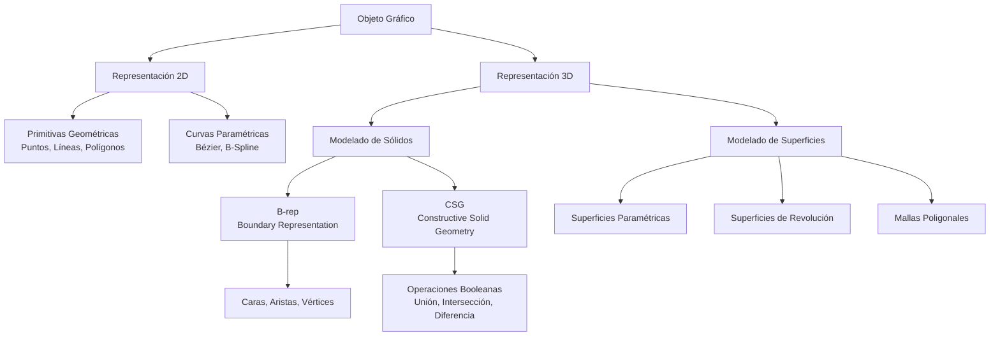

# Modelado y Programación - Graficación por computadora

## 6.1 Descripción.

---

La **graficación por computadora** es el área de la informática que se encarga de la creación, manipulación y representación de imágenes y modelos visuales mediante el uso de computadoras. La **descripción** se refiere a cómo representamos matemáticamente los objetos gráficos para su procesamiento.

### Sistemas de Coordenadas

#### Coordenadas Cartesianas

Sistema bidimensional donde cada punto se define por:

$$ P = (x, y) $$

#### Coordenadas Homogéneas

Permiten representar transformaciones como traslaciones mediante multiplicación de matrices:

$$ P = \begin{bmatrix} x \\ y \\ w \end{bmatrix} $$

donde las coordenadas cartesianas son $(x/w, y/w)$.

### Representación de Objetos Geométricos

#### Puntos

Un punto en 2D se representa como:

$$ P = (x, y) $$

#### Líneas

Ecuación paramétrica de una línea:

$$ L(t) = P_0 + t(P_1 - P_0), \quad 0 \leq t \leq 1 $$

donde $P_0$ y $P_1$ son puntos extremos.

#### Circunferencias

Ecuación estándar:

$$ (x - h)^2 + (y - k)^2 = r^2 $$

donde $(h, k)$ es el centro y $r$ el radio.

#### Elipses

Ecuación estándar:

$$ \frac{(x - h)^2}{a^2} + \frac{(y - k)^2}{b^2} = 1 $$

donde $(h, k)$ es el centro, $a$ es el semieje mayor y $b$ el semieje menor.

### Representación de Curvas

#### Curvas de Bézier

Definidas por puntos de control:

$$ B(t) = \sum_{i=0}^{n} \binom{n}{i} (1-t)^{n-i} t^i P_i, \quad 0 \leq t \leq 1 $$

#### Curvas B-Spline

Proporcionan mayor control local:

$$ S(t) = \sum_{i=0}^{n} N_{i,k}(t) P_i $$

donde $N_{i,k}$ son funciones base B-spline de grado $k$.

### Representación de Superficies

#### Superficies Paramétricas

Una superficie se define como:

$$ S(u,v) = [x(u,v), y(u,v), z(u,v)], \quad 0 \leq u,v \leq 1 $$

#### Superficies de Revolución

Generadas al rotar una curva alrededor de un eje:

$$ S(\theta, t) = [r(t)\cos\theta, r(t)\sin\theta, z(t)] $$

### Modelado de Sólidos

#### Representación por Boundary Representation (B-rep)

Describe objetos mediante sus caras, aristas y vértices.

#### Constructive Solid Geometry (CSG)

Construye objetos complejos mediante operaciones booleanas sobre primitivas simples.

### Diagrama de Representación de Objetos Gráficos



### Algoritmos de Representación

#### Algoritmo del Punto Medio para Círculos

```python
def draw_circle_midpoint(center, radius):
    x, y = 0, radius
    p = 1 - radius  # Parámetro de decisión inicial

    points = set()

    def plot_circle_points(cx, cy, x, y):
        points.add((cx + x, cy + y))
        points.add((cx - x, cy + y))
        points.add((cx + x, cy - y))
        points.add((cx - x, cy - y))
        points.add((cx + y, cy + x))
        points.add((cx - y, cy + x))
        points.add((cx + y, cy - x))
        points.add((cx - y, cy - x))

    plot_circle_points(center[0], center[1], x, y)

    while x < y:
        x += 1
        if p < 0:
            p += 2 * x + 1
        else:
            y -= 1
            p += 2 * (x - y) + 1

        plot_circle_points(center[0], center[1], x, y)

    return points
```

#### Representación de una Curva de Bézier Cúbica

```python
import numpy as np

def cubic_bezier(P0, P1, P2, P3, num_points=100):
    """
    Calcula puntos en una curva de Bézier cúbica
    P0, P1, P2, P3: puntos de control
    """
    t = np.linspace(0, 1, num_points)
    points = []

    for i in t:
        # Fórmula de Bézier cúbica
        point = (1-i)**3 * P0 + 3*(1-i)**2*i * P1 + 3*(1-i)*i**2 * P2 + i**3 * P3
        points.append(point)

    return points
```

### Ejemplos Prácticos

#### Ejemplo 1: Representación de una Línea

Dados los puntos $P_0 = (2, 3)$ y $P_1 = (8, 6)$, la ecuación paramétrica es:

$$ L(t) = (2, 3) + t((8, 6) - (2, 3)) = (2 + 6t, 3 + 3t) $$

#### Ejemplo 2: Circunferencia con Radio 5

Ecuación: $x^2 + y^2 = 25$

Puntos significativos: $(0, 5)$, $(5, 0)$, $(0, -5)$, $(-5, 0)$

#### Ejemplo 3: Curva de Bézier Cuadrática

Puntos de control: $P_0 = (0, 0)$, $P_1 = (2, 4)$, $P_2 = (4, 0)$

$$ B(t) = (1-t)^2(0, 0) + 2(1-t)t(2, 4) + t^2(4, 0) = (4t(1-t) + 4t^2, 8t(1-t)) $$

### Ejercicios Propuestos

1. **Ejercicio 1**: Dados los puntos $A(1, 2)$ y $B(7, 5)$, calcula 5 puntos equidistantes en la línea usando la ecuación paramétrica.

2. **Ejercicio 2**: Implementa una función que genere puntos en una elipse con centro en $(h, k)$, semieje mayor $a$ y semieje menor $b$.

3. **Ejercicio 3**: Dados los puntos de control $P_0(0, 0)$, $P_1(3, 6)$, $P_2(6, 3)$, $P_3(9, 0)$, calcula la curva de Bézier cúbica para $t = 0, 0.25, 0.5, 0.75, 1$.

4. **Ejercicio 4**: Describe matemáticamente una superficie cilíndrica de radio 2 y altura 5, alineada con el eje Z.

5. **Ejercicio 5**: Diseña un algoritmo para detectar si un punto dado está dentro de un polígono convexo.

### Aplicaciones de la Descripción en Graficación

- **CAD/CAM**: Diseño asistido por computadora
- **Animación**: Modelado de personajes y escenas
- **Realidad Virtual**: Creación de entornos inmersivos
- **Visualización Científica**: Representación de datos complejos
- **Juegos**: Modelado de objetos y entornos virtuales

### Referencias Bibliográficas

1. Foley, J. D., van Dam, A., Feiner, S. K., & Hughes, J. F. (1996). _Computer Graphics: Principles and Practice_.
2. Hearn, D., & Baker, M. P. (2004). _Computer Graphics with OpenGL_.
3. Rogers, D. F. (2001). _An Introduction to NURBS: With Historical Perspective_.
4. Shirley, P., & Marschner, S. (2009). _Fundamentals of Computer Graphics_.

### Recursos Adicionales

- [OpenGL Programming Guide](https://www.opengl.org/documentation/)
- [Computer Graphics Stack Exchange](https://computergraphics.stackexchange.com/)
- [GPU Gems Series](https://developer.nvidia.com/gpugems/gpugems/contributors)

Esta guía proporciona las bases matemáticas y algorítmicas para la descripción de objetos en graficación por computadora, sentando las bases para temas más avanzados como transformaciones, rasterización y renderizado.
