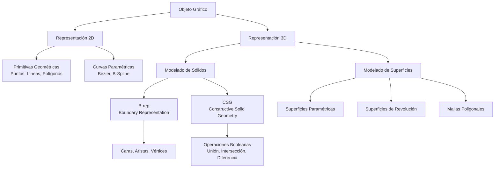

# Modelado y Programación - Graficación por computadora

## 6.1 Descripción.

---

La **graficación por computadora** es el área de la informática que se encarga de la creación, manipulación y representación de imágenes y modelos visuales mediante el uso de computadoras. La **descripción** se refiere a cómo representamos matemáticamente los objetos gráficos para su procesamiento.

### Sistemas de Coordenadas

#### Coordenadas Cartesianas

Sistema bidimensional donde cada punto se define por:

$$ P = (x, y) $$

#### Coordenadas Homogéneas

Permiten representar transformaciones como traslaciones mediante multiplicación de matrices:

$$ P = \begin{bmatrix} x \\ y \\ w \end{bmatrix} $$

donde las coordenadas cartesianas son $(x/w, y/w).$ Todos los múltiplos $(\lambda x, \lambda y, \lambda w)$ con $\lambda \neq 0$ representan el mismo punto, y lo usual es tomar $w = 1.$ Los vectores de $w = 0$ representan **direcciones** o puntos al infinito: no se ven afectados por las traslaciones, lo cual es justo lo que se espera de una dirección.

La ventaja es que una traslación, que en coordenadas cartesianas es una suma y no una multiplicación por matriz, se vuelve lineal:

$$ \begin{bmatrix} 1 & 0 & t_x \\ 0 & 1 & t_y \\ 0 & 0 & 1 \end{bmatrix} \begin{bmatrix} x \\ y \\ 1 \end{bmatrix} = \begin{bmatrix} x + t_x \\ y + t_y \\ 1 \end{bmatrix} $$

así que traslaciones, rotaciones y escalamientos se componen multiplicando matrices (tema 6.4).

### Representación de Objetos Geométricos

#### Puntos

Un punto en 2D se representa como:

$$ P = (x, y) $$

#### Líneas

Ecuación paramétrica de una línea:

$$ L(t) = P_0 + t(P_1 - P_0), \quad 0 \leq t \leq 1 $$

donde $P_0$ y $P_1$ son puntos extremos. Con $t \in \mathbb{R}$ se obtiene la recta completa y con $t \geq 0$ un rayo, que es la forma que usa el trazado de rayos (tema 6.6). La forma paramétrica es preferible a $y = mx + b$ en graficación porque también representa líneas verticales y porque recorrer $t$ de 0 a 1 genera los puntos en orden.

La forma **implícita** $f(x, y) = ax + by + c = 0$ con $a = y_0 - y_1,$ $b = x_1 - x_0$ y $c = x_0 y_1 - x_1 y_0$ es útil para clasificar puntos: el signo de $f(x, y)$ indica de qué lado de la línea está el punto. Es la base de la rasterización de triángulos y de la prueba del ejercicio 5.

#### Circunferencias

Ecuación estándar:

$$ (x - h)^2 + (y - k)^2 = r^2 $$

donde $(h, k)$ es el centro y $r$ el radio.

#### Elipses

Ecuación estándar:

$$ \frac{(x - h)^2}{a^2} + \frac{(y - k)^2}{b^2} = 1 $$

donde $(h, k)$ es el centro, $a$ es el semieje horizontal y $b$ el vertical; si $a > b,$ $a$ es el semieje mayor.

Para generar puntos es más cómoda la forma **paramétrica**, con $\theta \in [0, 2\pi):$

$$ x = h + a\cos\theta, \qquad y = k + b\sin\theta $$

y con $a = b = r$ se obtiene la circunferencia.

### Representación de Curvas

#### Curvas de Bézier

Definidas por $n + 1$ puntos de control $P_0, \ldots, P_n:$

$$ B(t) = \sum_{i=0}^{n} \binom{n}{i} (1-t)^{n-i} t^i P_i, \quad 0 \leq t \leq 1 $$

Los coeficientes $b_{i,n}(t) = \binom{n}{i}(1-t)^{n-i}t^i$ son los **polinomios de Bernstein**. De ellos se siguen las propiedades que hacen útiles a estas curvas:

- **Interpolan los extremos**: $B(0) = P_0$ y $B(1) = P_n;$ los puntos intermedios solo atraen a la curva.
- **Tangentes en los extremos**: $B'(0) = n(P_1 - P_0)$ y $B'(1) = n(P_n - P_{n-1}).$ Para unir dos curvas sin esquina basta alinear esos segmentos.
- **Envolvente convexa**: como $b_{i,n}(t) \geq 0$ y $\sum_i b_{i,n}(t) = (t + (1 - t))^n = 1,$ cada $B(t)$ es un promedio ponderado de los $P_i,$ así que la curva queda dentro de la envolvente convexa de los puntos de control.
- **Invariancia afín**: transformar los puntos de control y luego evaluar da lo mismo que evaluar y luego transformar.

Su desventaja es el **control global**: mover un punto de control cambia toda la curva, y con muchos puntos el grado crece.

#### Curvas B-Spline

Proporcionan **control local**: cada punto de control solo afecta un tramo de la curva.

$$ S(t) = \sum_{i=0}^{n} N_{i,p}(t) P_i $$

donde $N_{i,p}$ son funciones base B-spline de grado $p,$ definidas sobre un vector de **nudos** $t_0 \leq t_1 \leq \cdots \leq t_{n+p+1}$ por la recurrencia de Cox-de Boor:

$$ N_{i,0}(t) = \begin{cases} 1, & t_i \leq t < t_{i+1} \\ 0, & \text{en otro caso} \end{cases} $$

$$ N_{i,p}(t) = \frac{t - t_i}{t_{i+p} - t_i} N_{i,p-1}(t) + \frac{t_{i+p+1} - t}{t_{i+p+1} - t_{i+1}} N_{i+1,p-1}(t) $$

con la convención de que un cociente con denominador 0 vale 0. Cada $N_{i,p}$ es distinta de cero solo en $[t_i, t_{i+p+1}),$ por eso mover $P_i$ modifica solo $p + 1$ tramos. Una curva B-spline de grado 3 es dos veces continuamente derivable en las uniones entre tramos, sin importar cuántos puntos de control tenga. Las **NURBS** agregan un peso a cada punto de control y permiten representar exactamente circunferencias y otras cónicas.

### Representación de Superficies

#### Superficies Paramétricas

Una superficie se define como:

$$ S(u,v) = [x(u,v), y(u,v), z(u,v)], \quad 0 \leq u,v \leq 1 $$

#### Superficies de Revolución

Generadas al rotar una curva alrededor de un eje:

$$ S(\theta, t) = [r(t)\cos\theta, r(t)\sin\theta, z(t)], \quad 0 \leq \theta < 2\pi $$

donde $(r(t), z(t))$ es la curva perfil, en el plano que contiene al eje $z.$ Por ejemplo, con $r(t) = R\sin t$ y $z(t) = R\cos t,$ $0 \leq t \leq \pi,$ se obtiene una esfera de radio $R.$

### Modelado de Sólidos

#### Representación por Boundary Representation (B-rep)

Describe objetos mediante sus caras, aristas y vértices, junto con la información de cómo se conectan. La forma más común es la **malla de triángulos**: una lista de vértices y una lista de triángulos que indican tres índices de vértices. Para un poliedro cerrado sin agujeros se cumple la fórmula de Euler $V - A + C = 2;$ un cubo tiene $8 - 12 + 6 = 2.$

#### Constructive Solid Geometry (CSG)

Construye objetos complejos mediante operaciones booleanas (unión, intersección y diferencia) sobre primitivas simples como cubos, esferas y cilindros. El objeto se guarda como un **árbol**: las hojas son primitivas y los nodos internos son operaciones. Por ejemplo, una tuerca es un prisma hexagonal menos un cilindro.

Si cada primitiva se describe como un conjunto $\{p : f(p) \leq 0\},$ las operaciones se traducen a funciones: la unión es $\min(f_A, f_B),$ la intersección $\max(f_A, f_B)$ y la diferencia $A \setminus B$ es $\max(f_A, -f_B).$

### Diagrama de Representación de Objetos Gráficos



### Algoritmos de Representación

#### Algoritmo del Punto Medio para Círculos

```python
def draw_circle_midpoint(center, radius):
    x, y = 0, radius
    p = 1 - radius  # Parámetro de decisión inicial

    points = set()

    def plot_circle_points(cx, cy, x, y):
        points.add((cx + x, cy + y))
        points.add((cx - x, cy + y))
        points.add((cx + x, cy - y))
        points.add((cx - x, cy - y))
        points.add((cx + y, cy + x))
        points.add((cx - y, cy + x))
        points.add((cx + y, cy - x))
        points.add((cx - y, cy - x))

    plot_circle_points(center[0], center[1], x, y)

    while x < y:
        x += 1
        if p < 0:
            p += 2 * x + 1
        else:
            y -= 1
            p += 2 * (x - y) + 1

        plot_circle_points(center[0], center[1], x, y)

    return points

pts = draw_circle_midpoint((0, 0), 5)
print(sorted(p for p in pts if p[0] >= 0 and p[1] >= p[0]))
# [(0, 5), (1, 5), (2, 5), (3, 4)]
```

El algoritmo solo calcula el octante de $x = 0$ a $x = y$ y obtiene los otros siete por **simetría**. En cada paso $x$ aumenta en 1 y hay que decidir si $y$ se queda o baja; para ello se evalúa la función $f(x, y) = x^2 + y^2 - r^2$ en el punto medio entre los dos candidatos, $(x + 1, y - \tfrac{1}{2}).$ Si $f < 0$ el punto medio está dentro del círculo y se conserva $y;$ si no, se baja. El parámetro $p$ guarda ese valor y se actualiza con sumas enteras, sin multiplicaciones ni raíces. El valor inicial es $f(1, r - \tfrac{1}{2}) = \tfrac{5}{4} - r,$ que se redondea a $1 - r.$

#### Representación de una Curva de Bézier Cúbica

```python
import numpy as np

def cubic_bezier(P0, P1, P2, P3, num_points=100):
    """
    Calcula puntos en una curva de Bézier cúbica
    P0, P1, P2, P3: puntos de control
    """
    t = np.linspace(0, 1, num_points)
    points = []

    for i in t:
        # Fórmula de Bézier cúbica
        point = (1-i)**3 * P0 + 3*(1-i)**2*i * P1 + 3*(1-i)*i**2 * P2 + i**3 * P3
        points.append(point)

    return points

def de_casteljau(control, t):
    """Evalúa una curva de Bézier de cualquier grado interpolando repetidamente."""
    pts = [np.asarray(p, dtype=float) for p in control]
    while len(pts) > 1:
        pts = [(1 - t) * a + t * b for a, b in zip(pts, pts[1:])]
    return pts[0]

P = [np.array(p, dtype=float) for p in [(0, 0), (1, 2), (3, 2), (4, 0)]]
print(cubic_bezier(*P, num_points=3)[1])   # [2.  1.5]
print(de_casteljau(P, 0.5))                # [2.  1.5]
```

El **algoritmo de De Casteljau** calcula lo mismo sin usar los polinomios de Bernstein: interpola linealmente cada par de puntos consecutivos con el parámetro $t$ y repite con los puntos obtenidos hasta que queda uno solo. Es numéricamente más estable y además divide la curva en dos curvas de Bézier en el punto $t,$ lo que se usa para dibujarla por subdivisión.

### Ejemplos Prácticos

#### Ejemplo 1: Representación de una Línea

Dados los puntos $P_0 = (2, 3)$ y $P_1 = (8, 6),$ la ecuación paramétrica es:

$$ L(t) = (2, 3) + t((8, 6) - (2, 3)) = (2 + 6t, 3 + 3t) $$

#### Ejemplo 2: Circunferencia con Radio 5

Ecuación: $x^2 + y^2 = 25$

Puntos significativos: $(0, 5),$ $(5, 0),$ $(0, -5),$ $(-5, 0)$

#### Ejemplo 3: Curva de Bézier Cuadrática

Puntos de control: $P_0 = (0, 0),$ $P_1 = (2, 4),$ $P_2 = (4, 0)$

$$ B(t) = (1-t)^2(0, 0) + 2(1-t)t(2, 4) + t^2(4, 0) = (4t(1-t) + 4t^2, 8t(1-t)) = (4t, 8t - 8t^2) $$

Es una parábola: con $x = 4t$ queda $y = 2x - \frac{x^2}{2}.$ Su punto más alto es $B(\tfrac{1}{2}) = (2, 2),$ a la mitad de la altura del punto de control $P_1,$ como corresponde a una curva que solo es atraída por él.

### Ejercicios Propuestos

1. **Ejercicio 1**: Dados los puntos $A(1, 2)$ y $B(7, 5),$ calcula 5 puntos equidistantes en la línea usando la ecuación paramétrica.

2. **Ejercicio 2**: Implementa una función que genere puntos en una elipse con centro en $(h, k),$ semieje mayor $a$ y semieje menor $b.$

3. **Ejercicio 3**: Dados los puntos de control $P_0(0, 0),$ $P_1(3, 6),$ $P_2(6, 3),$ $P_3(9, 0),$ calcula la curva de Bézier cúbica para $t = 0, 0.25, 0.5, 0.75, 1.$

4. **Ejercicio 4**: Describe matemáticamente una superficie cilíndrica de radio 2 y altura 5, alineada con el eje Z.

5. **Ejercicio 5**: Diseña un algoritmo para detectar si un punto dado está dentro de un polígono convexo.

### Soluciones a los Ejercicios

**Ejercicio 1.** $L(t) = (1, 2) + t(6, 3) = (1 + 6t, 2 + 3t).$ Con $t = 0, \tfrac{1}{4}, \tfrac{1}{2}, \tfrac{3}{4}, 1$ se obtienen los puntos $(1, 2),$ $(2.5, 2.75),$ $(4, 3.5),$ $(5.5, 4.25)$ y $(7, 5).$ Son equidistantes porque la parametrización tiene velocidad constante: la distancia entre puntos consecutivos es $\frac{1}{4}\|(6, 3)\| = \frac{3\sqrt{5}}{4}.$

**Ejercicio 2.**

```python
import math

def puntos_elipse(h, k, a, b, n=8):
    return [(h + a * math.cos(2 * math.pi * i / n),
             k + b * math.sin(2 * math.pi * i / n)) for i in range(n)]

for x, y in puntos_elipse(1, 2, 4, 2, n=4):
    print(round(x, 6), round(y, 6))   # (5,2), (1,4), (-3,2), (1,0)
```

Los puntos quedan equiespaciados en $\theta$ pero **no** en longitud de arco: se juntan cerca de los extremos del eje mayor. Para dibujar, esto se compensa usando suficientes puntos.

**Ejercicio 3.** Con $B(t) = (1-t)^3 P_0 + 3(1-t)^2 t P_1 + 3(1-t)t^2 P_2 + t^3 P_3:$

| $t$ | $B(t)$ |
| --- | --- |
| 0 | $(0, 0)$ |
| 0.25 | $(2.25, 2.953125)$ |
| 0.5 | $(4.5, 3.375)$ |
| 0.75 | $(6.75, 2.109375)$ |
| 1 | $(9, 0)$ |

Por ejemplo, en $t = 0.5$ los pesos son $\tfrac{1}{8}, \tfrac{3}{8}, \tfrac{3}{8}, \tfrac{1}{8},$ así que $B(0.5) = \tfrac{3}{8}(3, 6) + \tfrac{3}{8}(6, 3) + \tfrac{1}{8}(9, 0) = (4.5, 3.375).$ La coordenada $x$ es exactamente $9t$ porque las coordenadas $x$ de los puntos de control están igualmente espaciadas.

```python
P3 = [np.array(p, dtype=float) for p in [(0, 0), (3, 6), (6, 3), (9, 0)]]
for t in [0, 0.25, 0.5, 0.75, 1]:
    print(t, de_casteljau(P3, t))
```

**Ejercicio 4.** Con parámetros $\theta$ y $z:$

$$ S(\theta, z) = (2\cos\theta, 2\sin\theta, z), \qquad 0 \leq \theta < 2\pi, \quad 0 \leq z \leq 5 $$

En forma implícita, la superficie lateral es $x^2 + y^2 = 4$ con $0 \leq z \leq 5;$ las tapas son los discos $x^2 + y^2 \leq 4$ en $z = 0$ y $z = 5.$ Es la superficie de revolución con perfil $r(t) = 2,$ $z(t) = t.$

**Ejercicio 5.** Si los vértices $V_0, \ldots, V_{n-1}$ del polígono convexo están en orden antihorario, un punto $P$ está dentro si y solo si queda a la **izquierda** de cada arista $V_i V_{i+1}.$ El lado se obtiene con el producto cruz en 2D:

$$ c_i = (V_{i+1} - V_i) \times (P - V_i) = (x_{i+1} - x_i)(y - y_i) - (y_{i+1} - y_i)(x - x_i) $$

$P$ está dentro si $c_i \geq 0$ para todo $i$ (la igualdad corresponde a estar sobre el borde). Para no depender de la orientación, basta pedir que todos los $c_i$ tengan el mismo signo. El costo es $O(n);$ con búsqueda binaria sobre los ángulos se puede hacer en $O(\log n).$

```python
def dentro_convexo(poligono, p):
    signos = set()
    n = len(poligono)
    for i in range(n):
        (x1, y1), (x2, y2) = poligono[i], poligono[(i + 1) % n]
        c = (x2 - x1) * (p[1] - y1) - (y2 - y1) * (p[0] - x1)
        if c != 0:
            signos.add(c > 0)
    return len(signos) <= 1

cuadrado = [(0, 0), (4, 0), (4, 4), (0, 4)]
print(dentro_convexo(cuadrado, (2, 2)), dentro_convexo(cuadrado, (5, 1)))   # True False
```

Para polígonos **no** convexos esta prueba falla; se usa el algoritmo de cruce de rayos: se lanza un rayo horizontal desde $P$ y se cuentan las aristas que cruza; el punto está dentro si el número es impar.

### Aplicaciones de la Descripción en Graficación

- **CAD/CAM**: Diseño asistido por computadora
- **Animación**: Modelado de personajes y escenas
- **Realidad Virtual**: Creación de entornos inmersivos
- **Visualización Científica**: Representación de datos complejos
- **Juegos**: Modelado de objetos y entornos virtuales

### Referencias Bibliográficas

1. Foley, J. D., van Dam, A., Feiner, S. K., & Hughes, J. F. (1996). _Computer Graphics: Principles and Practice_.
2. Hearn, D., & Baker, M. P. (2004). _Computer Graphics with OpenGL_.
3. Rogers, D. F. (2001). _An Introduction to NURBS: With Historical Perspective_.
4. Shirley, P., & Marschner, S. (2009). _Fundamentals of Computer Graphics_.

### Recursos Adicionales

- [OpenGL Programming Guide](https://www.opengl.org/documentation/)
- [Computer Graphics Stack Exchange](https://computergraphics.stackexchange.com/)
- [GPU Gems Series](https://developer.nvidia.com/gpugems/gpugems/contributors)

Esta guía proporciona las bases matemáticas y algorítmicas para la descripción de objetos en graficación por computadora, sentando las bases para temas más avanzados como transformaciones, rasterización y renderizado.
