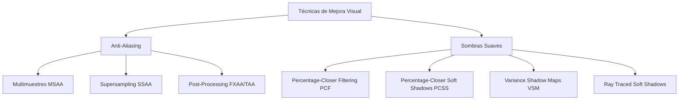

# Modelado y Programación - Graficación por computadora

## 6.10 Multimuestreo y sombras suaves.

---

El **multimuestreo** (multisampling) y las **sombras suaves** (soft shadows) son técnicas avanzadas en graficación por computadora que mejoran significativamente la calidad visual eliminando artefactos de aliasing y creando sombras más realistas.

### Sistema de Técnicas de Mejora Visual



### Fundamentos del Aliasing y Anti-Aliasing

#### Teorema de Nyquist-Shannon

Para muestrear correctamente una señal, la frecuencia de muestreo debe ser al menos el doble de la frecuencia más alta presente:

$$ f_s \geq 2f_{max} $$

#### Aliasing en Gráficos por Computadora

El aliasing ocurre cuando la frecuencia de muestreo es insuficiente, causando:

- Escalones en bordes (jaggies)
- Artefactos de moiré
- Parpadeo (flickering) en animaciones

### Multimuestreo (Multisampling Anti-Aliasing - MSAA)

#### Concepto de MSAA

El multimuestreo toma múltiples muestras por píxel pero comparte el cálculo de profundidad y color entre muestras, reduciendo el costo computacional comparado con supersampling.

#### Implementación de MSAA

```python
class MultisampleBuffer:
    def __init__(self, width, height, samples=4):
        self.width = width
        self.height = height
        self.samples = samples

        # Buffer de muestras (color, profundidad, cobertura)
        self.color_buffer = np.zeros((height, width, samples, 4), dtype=np.float32)
        self.depth_buffer = np.full((height, width, samples), float('inf'))
        self.coverage_buffer = np.zeros((height, width, samples), dtype=bool)

        # Patrón de muestreo (posiciones dentro del píxel)
        self.sample_pattern = self._generate_sample_pattern(samples)

    def _generate_sample_pattern(self, samples):
        """Genera patrón de muestreo dentro del píxel"""
        if samples == 1:
            return [(0.5, 0.5)]  # Centro del píxel

        patterns = {
            2: [(0.25, 0.25), (0.75, 0.75)],
            4: [(0.375, 0.125), (0.875, 0.375),
                (0.125, 0.625), (0.625, 0.875)],
            8: [(0.0625, 0.0625), (0.5625, 0.1875),
                (0.1875, 0.5625), (0.6875, 0.6875),
                (0.8125, 0.3125), (0.3125, 0.8125),
                (0.4375, 0.4375), (0.9375, 0.9375)]
        }
        return patterns.get(samples, patterns[4])

    def resolve_to_framebuffer(self, framebuffer):
        """Resuelve el buffer multisample al framebuffer final"""
        for y in range(self.height):
            for x in range(self.width):
                # Promediar muestras para obtener color final
                color_sum = np.zeros(4)
                sample_count = 0

                for s in range(self.samples):
                    if self.coverage_buffer[y, x, s]:
                        color_sum += self.color_buffer[y, x, s]
                        sample_count += 1

                if sample_count > 0:
                    framebuffer[y, x] = color_sum / sample_count
                else:
                    framebuffer[y, x] = np.zeros(4)
```

#### Rasterización con Multimuestreo

```python
def rasterize_triangle_msaa(triangle, multisample_buffer):
    """Rasteriza un triángulo con multisampling"""
    v0, v1, v2 = triangle.vertices
    bbox = calculate_bounding_box(v0, v1, v2)

    for y in range(bbox.min_y, bbox.max_y + 1):
        for x in range(bbox.min_x, bbox.max_x + 1):
            for sample_idx in range(multisample_buffer.samples):
                # Obtener posición de muestra dentro del píxel
                sample_x = x + multisample_buffer.sample_pattern[sample_idx][0]
                sample_y = y + multisample_buffer.sample_pattern[sample_idx][1]

                # Calcular coordenadas baricéntricas
                barycentric = calculate_barycentric_coords(
                    v0, v1, v2, sample_x, sample_y
                )

                if is_inside_triangle(barycentric):
                    # Calcular profundidad interpolada
                    z = interpolate_depth(v0, v1, v2, barycentric)

                    # Test de profundidad
                    if z < multisample_buffer.depth_buffer[y, x, sample_idx]:
                        # Actualizar buffers
                        multisample_buffer.depth_buffer[y, x, sample_idx] = z
                        multisample_buffer.color_buffer[y, x, sample_idx] = triangle.color
                        multisample_buffer.coverage_buffer[y, x, sample_idx] = True
```

### Sombras Suaves (Soft Shadows)

#### Fundamentos de Sombras Suaves

Las sombras suaves se producen con fuentes de luz de área, creando:

- Umbra: región completamente en sombra
- Penumbra: región parcialmente en sombra
- Antumbra: región donde la fuente de luz es completamente visible

#### Percentage-Closer Filtering (PCF)

```python
def pcf_shadow(shadow_map, light_pos, world_pos, filter_size=3):
    """
    Percentage-Closer Filtering para suavizar bordes de sombras
    """
    shadow_map_coord = world_to_shadow_map(light_pos, world_pos)
    shadow = 0.0
    samples = 0

    # Kernel de filtrado
    for i in range(-filter_size, filter_size + 1):
        for j in range(-filter_size, filter_size + 1):
            sample_coord = shadow_map_coord + np.array([i, j]) / shadow_map.size
            sample_depth = sample_shadow_map(shadow_map, sample_coord)

            if sample_depth + 0.001 < shadow_map_coord.z:
                shadow += 1.0
            samples += 1

    return 1.0 - (shadow / samples)

def sample_shadow_map(shadow_map, coord):
    """Muestrea el shadow map con coordenadas normalizadas"""
    x = int(coord.x * shadow_map.width)
    y = int(coord.y * shadow_map.height)

    if 0 <= x < shadow_map.width and 0 <= y < shadow_map.height:
        return shadow_map.data[y, x]
    return 1.0
```

#### Percentage-Closer Soft Shadows (PCSS)

```python
def pcss_shadow(shadow_map, light_pos, world_pos, light_size):
    """
    Algoritmo PCSS para sombras suaves con fuentes de luz de área
    """
    # Paso 1: Blocker search
    blocker_depth = find_blocker_depth(shadow_map, light_pos, world_pos, light_size)

    if blocker_depth == -1:
        return 1.0  # No hay blockers, completamente iluminado

    # Paso 2: Estimación del tamaño de penumbra
    penumbra_size = calculate_penumbra_size(
        light_pos, world_pos, light_size, blocker_depth
    )

    # Paso 3: Filtrado PCF con kernel adaptativo
    return pcf_shadow(shadow_map, light_pos, world_pos, penumbra_size)

def find_blocker_depth(shadow_map, light_pos, world_pos, search_size):
    """Encuentra la profundidad promedio de los blockers"""
    shadow_coord = world_to_shadow_map(light_pos, world_pos)
    blocker_sum = 0.0
    blocker_count = 0

    for i in range(-search_size, search_size + 1):
        for j in range(-search_size, search_size + 1):
            sample_coord = shadow_coord + np.array([i, j]) / shadow_map.size
            sample_depth = sample_shadow_map(shadow_map, sample_coord)

            if sample_depth + 0.001 < shadow_coord.z:
                blocker_sum += sample_depth
                blocker_count += 1

    if blocker_count > 0:
        return blocker_sum / blocker_count
    return -1

def calculate_penumbra_size(light_pos, world_pos, light_size, blocker_depth):
    """Calcula el tamaño de penumbra basado en geometría similar a triángulos"""
    light_distance = np.linalg.norm(light_pos - world_pos)
    blocker_distance = blocker_depth * light_distance

    # Triángulos similares: (light_size / light_distance) = (penumbra_size / blocker_distance)
    penumbra_size = (light_size * blocker_distance) / light_distance
    return max(1, int(penumbra_size))
```

### Variance Shadow Maps (VSM)

#### Fundamentos de VSM

Los Variance Shadow Maps almacenan momentos en lugar de profundidades, permitiendo filtrado lineal y suavizado de sombras.

$$ \text{Momento 1: } M_1 = depth $$

$$ \text{Momento 2: } M_2 = depth^2 $$

```python
class VarianceShadowMap:
    def __init__(self, width, height):
        self.width = width
        self.height = height
        self.moment1 = np.zeros((height, width), dtype=np.float32)
        self.moment2 = np.zeros((height, width), dtype=np.float32)

    def update(self, depth_buffer):
        """Actualiza los momentos con el buffer de profundidad"""
        self.moment1 = depth_buffer
        self.moment2 = depth_buffer ** 2

    def calculate_shadow(self, light_pos, world_pos, filter_size=3):
        """Calcula sombra usando Chebyshev's inequality"""
        shadow_coord = world_to_shadow_map(light_pos, world_pos)
        current_depth = shadow_coord.z

        # Obtener momentos filtrados
        mean1, mean2 = self.filter_moments(shadow_coord.xy, filter_size)

        # Calcular varianza
        variance = max(0.0, mean2 - mean1 * mean1)

        # Chebyshev's inequality
        delta = current_depth - mean1
        p_max = variance / (variance + delta * delta)

        return min(1.0, p_max)

    def filter_moments(self, coord, filter_size):
        """Filtra los momentos usando un kernel gaussiano"""
        mean1 = 0.0
        mean2 = 0.0
        weight_sum = 0.0

        for i in range(-filter_size, filter_size + 1):
            for j in range(-filter_size, filter_size + 1):
                sample_coord = coord + np.array([i, j]) / self.size
                weight = gaussian_weight(i, j, filter_size)

                m1 = sample_moment_map(self.moment1, sample_coord)
                m2 = sample_moment_map(self.moment2, sample_coord)

                mean1 += m1 * weight
                mean2 += m2 * weight
                weight_sum += weight

        return mean1 / weight_sum, mean2 / weight_sum
```

### Implementación Integrada

#### Sistema de Renderizado con MSAA y Sombras Suaves

```python
class AdvancedRenderer:
    def __init__(self, width, height, msaa_samples=4, shadow_quality='high'):
        self.width = width
        self.height = height
        self.msaa_samples = msaa_samples

        # Buffers
        self.multisample_buffer = MultisampleBuffer(width, height, msaa_samples)
        self.shadow_maps = {}
        self.framebuffer = np.zeros((height, width, 4), dtype=np.float32)

        # Configuración de sombras
        self.shadow_technique = {
            'low': self._pcf_shadow,
            'medium': self._pcss_shadow,
            'high': self._vsm_shadow
        }[shadow_quality]

    def render_scene(self, scene, camera):
        """Renderiza la escena completa con MSAA y sombras suaves"""
        # Clear buffers
        self.multisample_buffer.clear()

        # Renderizar sombras
        self._render_shadow_maps(scene)

        # Renderizar escena principal con MSAA
        for obj in scene.objects:
            self._render_object_msaa(obj, camera, scene.lights)

        # Resolver MSAA
        self.multisample_buffer.resolve_to_framebuffer(self.framebuffer)

        # Aplicar post-processing
        self._apply_post_processing()

        return self.framebuffer

    def _render_object_msaa(self, obj, camera, lights):
        """Renderiza un objeto con MSAA y sombras suaves"""
        # Transformar vértices a espacio de pantalla
        screen_vertices = []
        for vertex in obj.mesh.vertices:
            screen_pos = camera.project(vertex.position)
            screen_vertices.append(screen_pos)

        # Rasterizar cada triángulo
        for i in range(0, len(screen_vertices), 3):
            triangle = screen_vertices[i:i+3]
            self._rasterize_triangle_msaa(triangle, obj.material, lights)

    def _rasterize_triangle_msaa(self, triangle, material, lights):
        """Rasteriza un triángulo con MSAA"""
        for y in range(self.height):
            for x in range(self.width):
                for s in range(self.msaa_samples):
                    sample_pos = self._get_sample_position(x, y, s)

                    if self._is_sample_inside(triangle, sample_pos):
                        # Calcular atributos interpolados
                        barycentric = calculate_barycentric(triangle, sample_pos)
                        depth = interpolate_depth(triangle, barycentric)
                        normal = interpolate_normal(triangle, barycentric)
                        world_pos = interpolate_position(triangle, barycentric)

                        # Test de profundidad
                        if depth < self.multisample_buffer.depth_buffer[y, x, s]:
                            # Calcular iluminación con sombras suaves
                            color = self._calculate_lighting(
                                world_pos, normal, material, lights
                            )

                            # Actualizar buffers
                            self.multisample_buffer.color_buffer[y, x, s] = color
                            self.multisample_buffer.depth_buffer[y, x, s] = depth
                            self.multisample_buffer.coverage_buffer[y, x, s] = True

    def _calculate_lighting(self, position, normal, material, lights):
        """Calcula iluminación con sombras suaves"""
        color = material.ambient

        for light in lights:
            # Calcular componentes de iluminación
            diffuse = self._calculate_diffuse(light, position, normal, material)
            specular = self._calculate_specular(light, position, normal, material)

            # Calcular sombra suave
            shadow_factor = self.shadow_technique(light, position)

            # Combinar componentes
            light_color = (diffuse + specular) * shadow_factor
            color += light_color * light.color * light.intensity

        return np.clip(color, 0, 1)
```

### Ejercicios Propuestos

1. **Ejercicio 1**: Implementa un comparador de técnicas de anti-aliasing (MSAA vs SSAA vs FXAA) visualizando el rendimiento y calidad.

2. **Ejercicio 2**: Desarrolla un sistema de sombras suaves que adapte dinámicamente el tamaño de filtro basado en la distancia a la cámara.

3. **Ejercicio 3**: Crea una visualización interactiva que muestre la diferencia entre umbra, penumbra y antumbra.

4. **Ejercicio 4**: Implementa Contact Hardening Shadows (CHS) que varíen la suavidad basado en la proximidad al objeto bloqueador.

5. **Ejercicio 5**: Desarrolla un sistema de medición de calidad que cuantifique el improvement visual de estas técnicas.

### Referencias Bibliográficas

1. Akenine-Möller, T., Haines, E., & Hoffman, N. (2018). _Real-Time Rendering_ (4th ed.).
2. Fernando, R. (2005). _Percentage-Closer Soft Shadows_. NVIDIA Corporation.
3. Donnelly, W., & Lauritzen, A. (2006). _Variance Shadow Maps_. NVIDIA Corporation.
4. Reshetov, A. (2007). _Morphological Antialiasing_. Intel Corporation.

### Recursos Adicionales

- [NVIDIA GPU Gems: Shadow Techniques](https://developer.nvidia.com/gpugems/gpugems3/part-ii-light-and-shadows)
- [AMD GPUOpen: Anti-Aliasing Methods](https://gpuopen.com/learn/anti-aliasing-methods/)
- [SIGGRAPH Courses: Advanced Shadow Techniques](https://www.siggraph.org/education/materials/)
- [Real-Time Rendering Resources](https://www.realtimerendering.com/)
