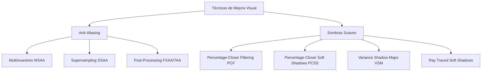

# Modelado y Programación - Graficación por computadora

## 6.10 Multimuestreo y sombras suaves.

---

El **multimuestreo** (multisampling) y las **sombras suaves** (soft shadows) son técnicas avanzadas en graficación por computadora que mejoran significativamente la calidad visual eliminando artefactos de aliasing y creando sombras más realistas.

### Sistema de Técnicas de Mejora Visual



### Fundamentos del Aliasing y Anti-Aliasing

#### Teorema de Nyquist-Shannon

Para muestrear correctamente una señal, la frecuencia de muestreo debe ser al menos el doble de la frecuencia más alta presente:

$$ f_s \geq 2f_{max} $$

#### Aliasing en Gráficos por Computadora

Una imagen digital **muestrea** la escena en una cuadrícula de puntos, uno por píxel. Pero un borde nítido entre dos objetos tiene frecuencias arbitrariamente altas, así que ninguna resolución cumple el criterio de Nyquist: las frecuencias que no caben se "disfrazan" (*alias*) de frecuencias bajas. Como no se puede eliminar, se combate de dos formas: tomar **más muestras** por píxel y promediarlas, que equivale a filtrar la señal antes de reducirla a un valor por píxel, o filtrar la imagen ya calculada.

El aliasing ocurre cuando la frecuencia de muestreo es insuficiente, causando:

- Escalones en bordes (jaggies)
- Artefactos de moiré
- Parpadeo (flickering) en animaciones

### Multimuestreo (Multisampling Anti-Aliasing - MSAA)

#### Concepto de MSAA

El **supersampling** (SSAA) es la solución directa: dibujar la imagen con $n$ muestras por píxel, calculando el color de cada una, y promediar. Es el de mejor calidad, pero cuesta $n$ veces más.

El **multimuestreo** (MSAA) observa que el aliasing se nota sobre todo en los **bordes** de los triángulos. Por eso guarda la **cobertura** y la **profundidad** de cada muestra por separado, pero ejecuta el cálculo de color (el *fragment shader*) **una sola vez por píxel y por triángulo**, normalmente en el centro del píxel, y copia ese color a las muestras que el triángulo cubre. En el interior de un triángulo todas las muestras reciben el mismo color y el costo es casi el de una sola muestra; en un borde, las muestras se reparten entre los triángulos y el promedio suaviza el escalón. Su limitación es que no suaviza el aliasing **dentro** de los triángulos, como el de texturas o reflejos especulares muy finos.

Al final, un paso de **resolución** promedia **todas** las muestras de cada píxel, incluidas las que conservan el color de fondo: en un píxel donde un triángulo blanco cubre 2 de 4 muestras sobre fondo negro, el resultado es gris al 50%.

#### Implementación de MSAA

```python
class MultisampleBuffer:
    def __init__(self, width, height, samples=4):
        self.width = width
        self.height = height
        self.samples = samples

        # Buffer de muestras (color, profundidad, cobertura); el color inicial es el de fondo
        self.color_buffer = np.zeros((height, width, samples, 4), dtype=np.float32)
        self.depth_buffer = np.full((height, width, samples), float('inf'))
        self.coverage_buffer = np.zeros((height, width, samples), dtype=bool)

        # Patrón de muestreo (posiciones dentro del píxel)
        self.sample_pattern = self._generate_sample_pattern(samples)

    def _generate_sample_pattern(self, samples):
        """Genera patrón de muestreo dentro del píxel"""
        if samples == 1:
            return [(0.5, 0.5)]  # Centro del píxel

        patterns = {
            2: [(0.25, 0.25), (0.75, 0.75)],
            4: [(0.375, 0.125), (0.875, 0.375),
                (0.125, 0.625), (0.625, 0.875)],
            8: [(0.0625, 0.0625), (0.5625, 0.1875),
                (0.1875, 0.5625), (0.6875, 0.6875),
                (0.8125, 0.3125), (0.3125, 0.8125),
                (0.4375, 0.4375), (0.9375, 0.9375)]
        }
        return patterns.get(samples, patterns[4])

    def clear(self, color=(0, 0, 0, 1)):
        self.color_buffer[:] = color
        self.depth_buffer[:] = np.inf
        self.coverage_buffer[:] = False

    def resolve_to_framebuffer(self, framebuffer):
        """Resuelve el buffer multisample al framebuffer final.
        Se promedian TODAS las muestras: las no cubiertas conservan el color
        de fondo, y así los bordes se mezclan con lo que hay detrás."""
        framebuffer[:] = self.color_buffer.mean(axis=2)
```

Promediar solo las muestras cubiertas sería un error: un píxel de borde cubierto en una de cuatro muestras tomaría el color completo del triángulo y el borde seguiría escalonado.

#### Rasterización con Multimuestreo

```python
def rasterize_triangle_msaa(triangle, multisample_buffer):
    """Rasteriza un triángulo con multisampling"""
    v0, v1, v2 = triangle.vertices
    bbox = calculate_bounding_box(v0, v1, v2)

    for y in range(bbox.min_y, bbox.max_y + 1):
        for x in range(bbox.min_x, bbox.max_x + 1):
            for sample_idx in range(multisample_buffer.samples):
                # Obtener posición de muestra dentro del píxel
                sample_x = x + multisample_buffer.sample_pattern[sample_idx][0]
                sample_y = y + multisample_buffer.sample_pattern[sample_idx][1]

                # Calcular coordenadas baricéntricas
                barycentric = calculate_barycentric_coords(
                    v0, v1, v2, sample_x, sample_y
                )

                if is_inside_triangle(barycentric):
                    # Calcular profundidad interpolada
                    z = interpolate_depth(v0, v1, v2, barycentric)

                    # Test de profundidad
                    if z < multisample_buffer.depth_buffer[y, x, sample_idx]:
                        # Actualizar buffers
                        multisample_buffer.depth_buffer[y, x, sample_idx] = z
                        multisample_buffer.color_buffer[y, x, sample_idx] = triangle.color
                        multisample_buffer.coverage_buffer[y, x, sample_idx] = True
```

El esqueleto anterior usa un color plano por triángulo, así que el sombreado ya es "uno por píxel". El siguiente programa completo dibuja un triángulo blanco sobre fondo negro con 1 y con 4 muestras por píxel, usando el patrón de 4 muestras de la clase anterior, y muestra los niveles de gris resultantes en el borde:

```python
import numpy as np

def dentro(px, py, tri):
    (ax, ay), (bx, by), (cx, cy) = tri
    e = lambda x0, y0, x1, y1: (x1 - x0) * (py - y0) - (y1 - y0) * (px - x0)
    d1, d2, d3 = e(ax, ay, bx, by), e(bx, by, cx, cy), e(cx, cy, ax, ay)
    return (d1 >= 0 and d2 >= 0 and d3 >= 0) or (d1 <= 0 and d2 <= 0 and d3 <= 0)

def dibujar(tri, ancho, alto, patron):
    img = np.zeros((alto, ancho))
    for y in range(alto):
        for x in range(ancho):
            cubiertas = sum(dentro(x + sx, y + sy, tri) for sx, sy in patron)
            img[y, x] = cubiertas / len(patron)       # resolución: promedio de todas
    return img

tri = [(0.5, 0.5), (11.5, 3.0), (2.0, 7.5)]
patron4 = [(0.375, 0.125), (0.875, 0.375), (0.125, 0.625), (0.625, 0.875)]
for nombre, patron in (("1 muestra", [(0.5, 0.5)]), ("4 muestras", patron4)):
    img = dibujar(tri, 12, 8, patron)
    print(nombre, sorted(set(img.ravel().tolist())))
    print("\n".join("".join(" .:#"[min(int(v * 3.99), 3)] for v in fila) for fila in img))
```

Con una muestra cada píxel es 0 o 1 y el borde es una escalera; con cuatro aparecen los niveles intermedios 0.25, 0.5 y 0.75 a lo largo del borde, que el ojo percibe como un borde suave.

### Sombras Suaves (Soft Shadows)

#### Fundamentos de Sombras Suaves

Las sombras suaves se producen con fuentes de luz de área, creando:

- **Umbra**: región desde donde la fuente de luz está **completamente** tapada.
- **Penumbra**: región desde donde la fuente está **parcialmente** tapada; la iluminación pasa gradualmente de 0 a 1.
- **Antumbra**: región, más allá del final de la umbra, desde donde el objeto que tapa se ve **completamente dentro** del disco de la luz, como en un eclipse anular: se ve un anillo de luz alrededor del objeto. Solo existe si el objeto que tapa es más pequeño que la fuente.

Una luz puntual solo produce umbra y sombras de borde nítido. Con una luz de área de tamaño $w_L,$ un objeto que tapa a distancia $d_B$ de la luz y una superficie que recibe la sombra a distancia $d_R,$ por triángulos semejantes el ancho de la penumbra es

$$ w_P = w_L \, \frac{d_R - d_B}{d_B} $$

Por eso la sombra de un objeto apoyado en el suelo es nítida junto al punto de contacto $(d_R ≈ d_B)$ y se difumina al alejarse: es el efecto que reproducen PCSS y las *contact hardening shadows*.

En ray tracing, la sombra suave se calcula directamente: se lanzan varios rayos de sombra hacia puntos aleatorios de la luz de área y la fracción que llega sin obstáculos es la visibilidad:

```python
import math, random

def visibilidad(punto_x, luz_y=10.0, ancho_luz=2.0, bloqueador=(0.0, 5.0, 1.0), n=400):
    """Escena 2D: luz horizontal a altura luz_y, bloqueador = segmento centrado en
    (cx, cy) de medio ancho r, receptor en el suelo (y = 0)."""
    cx, cy, r = bloqueador
    libres = 0
    for k in range(n):
        lx = -ancho_luz / 2 + ancho_luz * (k + random.random()) / n   # muestreo estratificado
        t = cy / luz_y                                    # dónde cruza el rayo la altura del bloqueador
        x_cruce = punto_x + (lx - punto_x) * t
        libres += not (cx - r <= x_cruce <= cx + r)
    return libres / n

random.seed(1)
for x in (0.0, 1.0, 1.5, 2.0, 2.5, 3.5):
    print(x, round(visibilidad(x), 2))
```

Bajo el centro del bloqueador la visibilidad es 0 (umbra); al alejarse sube gradualmente hasta 1. Con $w_L = 2,$ $d_B = 5$ y $d_R = 10,$ la fórmula da una penumbra de ancho $2 \cdot \frac{10 - 5}{5} = 2,$ que coincide con el intervalo de $x = 1$ a $x = 3$ donde la visibilidad pasa de 0 a 1.

#### Percentage-Closer Filtering (PCF)

```python
def pcf_shadow(shadow_map, light_pos, world_pos, filter_size=3):
    """
    Percentage-Closer Filtering para suavizar bordes de sombras
    """
    shadow_map_coord = world_to_shadow_map(light_pos, world_pos)
    shadow = 0.0
    samples = 0

    # Kernel de filtrado
    for i in range(-filter_size, filter_size + 1):
        for j in range(-filter_size, filter_size + 1):
            sample_coord = shadow_map_coord + np.array([i, j]) / shadow_map.size
            sample_depth = sample_shadow_map(shadow_map, sample_coord)

            if sample_depth + 0.001 < shadow_map_coord.z:
                shadow += 1.0
            samples += 1

    return 1.0 - (shadow / samples)

def sample_shadow_map(shadow_map, coord):
    """Muestrea el shadow map con coordenadas normalizadas"""
    x = int(coord.x * shadow_map.width)
    y = int(coord.y * shadow_map.height)

    if 0 <= x < shadow_map.width and 0 <= y < shadow_map.height:
        return shadow_map.data[y, x]
    return 1.0
```

#### Percentage-Closer Soft Shadows (PCSS)

```python
def pcss_shadow(shadow_map, light_pos, world_pos, light_size):
    """
    Algoritmo PCSS para sombras suaves con fuentes de luz de área
    """
    # Paso 1: Blocker search
    blocker_depth = find_blocker_depth(shadow_map, light_pos, world_pos, light_size)

    if blocker_depth == -1:
        return 1.0  # No hay blockers, completamente iluminado

    # Paso 2: Estimación del tamaño de penumbra
    penumbra_size = calculate_penumbra_size(
        light_pos, world_pos, light_size, blocker_depth
    )

    # Paso 3: Filtrado PCF con kernel adaptativo
    return pcf_shadow(shadow_map, light_pos, world_pos, penumbra_size)

def find_blocker_depth(shadow_map, light_pos, world_pos, search_size):
    """Encuentra la profundidad promedio de los blockers"""
    shadow_coord = world_to_shadow_map(light_pos, world_pos)
    blocker_sum = 0.0
    blocker_count = 0

    for i in range(-search_size, search_size + 1):
        for j in range(-search_size, search_size + 1):
            sample_coord = shadow_coord + np.array([i, j]) / shadow_map.size
            sample_depth = sample_shadow_map(shadow_map, sample_coord)

            if sample_depth + 0.001 < shadow_coord.z:
                blocker_sum += sample_depth
                blocker_count += 1

    if blocker_count > 0:
        return blocker_sum / blocker_count
    return -1

def calculate_penumbra_size(receiver_depth, blocker_depth, light_size):
    """Ancho de penumbra por triángulos semejantes: w_L (d_R - d_B) / d_B.
    Las profundidades se miden desde la luz."""
    penumbra_size = light_size * (receiver_depth - blocker_depth) / blocker_depth
    return max(1, int(round(penumbra_size)))

print(calculate_penumbra_size(10.0, 9.5, 8), calculate_penumbra_size(10.0, 5.0, 8))   # 1 8
```

PCSS (Fernando, 2005) hace tres pasos: (1) busca en el mapa de sombras, alrededor del punto, los texels más cercanos a la luz que el punto (**bloqueadores**) y promedia su profundidad; (2) con esa profundidad estima el ancho de la penumbra; y (3) aplica PCF con un núcleo de ese tamaño. Un objeto pegado al receptor $(d_B ≈ d_R)$ produce un núcleo pequeño y una sombra nítida; uno lejano, un núcleo grande y una sombra difusa. En `pcss_shadow`, la llamada debe pasar la profundidad del receptor en el espacio de la luz: `calculate_penumbra_size(shadow_coord.z, blocker_depth, light_size)`.

### Variance Shadow Maps (VSM)

#### Fundamentos de VSM

Los Variance Shadow Maps almacenan momentos en lugar de profundidades, permitiendo filtrado lineal y suavizado de sombras.

$$ \text{Momento 1: } M_1 = depth $$

$$ \text{Momento 2: } M_2 = depth^2 $$

Después de filtrar los momentos en una región, se tienen la media $\mu = E[d]$ y la varianza $\sigma^2 = E[d^2] - E[d]^2$ de las profundidades de los posibles bloqueadores. Para un punto a profundidad $t > \mu,$ la desigualdad de Chebyshev (en su versión unilateral, de Cantelli) acota la fracción de bloqueadores que **no** están delante del punto:

$$ P(d \geq t) \leq p_{max}(t) = \frac{\sigma^2}{\sigma^2 + (t - \mu)^2} $$

y $p_{max}$ se usa como fracción iluminada. Si $t \leq \mu,$ el punto está delante de los bloqueadores promedio y se considera iluminado. La gran ventaja es que los momentos, a diferencia de las comparaciones del PCF, **sí** se pueden filtrar con desenfoque, *mipmaps* y filtrado de hardware; la desventaja es el **light bleeding**: luz que se filtra en zonas de sombra cuando hay varios bloqueadores a profundidades muy distintas.

```python
class VarianceShadowMap:
    def __init__(self, width, height):
        self.width = width
        self.height = height
        self.moment1 = np.zeros((height, width), dtype=np.float32)
        self.moment2 = np.zeros((height, width), dtype=np.float32)

    def update(self, depth_buffer):
        """Actualiza los momentos con el buffer de profundidad"""
        self.moment1 = depth_buffer
        self.moment2 = depth_buffer ** 2

    def calculate_shadow(self, light_pos, world_pos, filter_size=3):
        """Calcula sombra usando Chebyshev's inequality"""
        shadow_coord = world_to_shadow_map(light_pos, world_pos)
        current_depth = shadow_coord.z

        # Obtener momentos filtrados
        mean1, mean2 = self.filter_moments(shadow_coord.xy, filter_size)

        # Calcular varianza
        variance = max(0.0, mean2 - mean1 * mean1)

        # Desigualdad de Chebyshev (unilateral)
        delta = current_depth - mean1
        if delta <= 0:
            return 1.0                       # delante de los bloqueadores: iluminado
        variance = max(variance, 1e-5)       # varianza mínima para evitar divisiones entre 0
        p_max = variance / (variance + delta * delta)

        return min(1.0, p_max)

    def filter_moments(self, coord, filter_size):
        """Filtra los momentos usando un kernel gaussiano"""
        mean1 = 0.0
        mean2 = 0.0
        weight_sum = 0.0

        for i in range(-filter_size, filter_size + 1):
            for j in range(-filter_size, filter_size + 1):
                sample_coord = coord + np.array([i, j]) / self.size
                weight = gaussian_weight(i, j, filter_size)

                m1 = sample_moment_map(self.moment1, sample_coord)
                m2 = sample_moment_map(self.moment2, sample_coord)

                mean1 += m1 * weight
                mean2 += m2 * weight
                weight_sum += weight

        return mean1 / weight_sum, mean2 / weight_sum
```

### Implementación Integrada

#### Sistema de Renderizado con MSAA y Sombras Suaves

```python
class AdvancedRenderer:
    def __init__(self, width, height, msaa_samples=4, shadow_quality='high'):
        self.width = width
        self.height = height
        self.msaa_samples = msaa_samples

        # Buffers
        self.multisample_buffer = MultisampleBuffer(width, height, msaa_samples)
        self.shadow_maps = {}
        self.framebuffer = np.zeros((height, width, 4), dtype=np.float32)

        # Configuración de sombras
        self.shadow_technique = {
            'low': self._pcf_shadow,
            'medium': self._pcss_shadow,
            'high': self._vsm_shadow
        }[shadow_quality]

    def render_scene(self, scene, camera):
        """Renderiza la escena completa con MSAA y sombras suaves"""
        # Clear buffers
        self.multisample_buffer.clear()

        # Renderizar sombras
        self._render_shadow_maps(scene)

        # Renderizar escena principal con MSAA
        for obj in scene.objects:
            self._render_object_msaa(obj, camera, scene.lights)

        # Resolver MSAA
        self.multisample_buffer.resolve_to_framebuffer(self.framebuffer)

        # Aplicar post-processing
        self._apply_post_processing()

        return self.framebuffer

    def _render_object_msaa(self, obj, camera, lights):
        """Renderiza un objeto con MSAA y sombras suaves"""
        # Transformar vértices a espacio de pantalla
        screen_vertices = []
        for vertex in obj.mesh.vertices:
            screen_pos = camera.project(vertex.position)
            screen_vertices.append(screen_pos)

        # Rasterizar cada triángulo
        for i in range(0, len(screen_vertices), 3):
            triangle = screen_vertices[i:i+3]
            self._rasterize_triangle_msaa(triangle, obj.material, lights)

    def _rasterize_triangle_msaa(self, triangle, material, lights):
        """Rasteriza un triángulo con MSAA"""
        for y in range(self.height):
            for x in range(self.width):
                for s in range(self.msaa_samples):
                    sample_pos = self._get_sample_position(x, y, s)

                    if self._is_sample_inside(triangle, sample_pos):
                        # Calcular atributos interpolados
                        barycentric = calculate_barycentric(triangle, sample_pos)
                        depth = interpolate_depth(triangle, barycentric)
                        normal = interpolate_normal(triangle, barycentric)
                        world_pos = interpolate_position(triangle, barycentric)

                        # Test de profundidad
                        if depth < self.multisample_buffer.depth_buffer[y, x, s]:
                            # Calcular iluminación con sombras suaves
                            color = self._calculate_lighting(
                                world_pos, normal, material, lights
                            )

                            # Actualizar buffers
                            self.multisample_buffer.color_buffer[y, x, s] = color
                            self.multisample_buffer.depth_buffer[y, x, s] = depth
                            self.multisample_buffer.coverage_buffer[y, x, s] = True

    def _calculate_lighting(self, position, normal, material, lights):
        """Calcula iluminación con sombras suaves"""
        color = material.ambient

        for light in lights:
            # Calcular componentes de iluminación
            diffuse = self._calculate_diffuse(light, position, normal, material)
            specular = self._calculate_specular(light, position, normal, material)

            # Calcular sombra suave
            shadow_factor = self.shadow_technique(light, position)

            # Combinar componentes
            light_color = (diffuse + specular) * shadow_factor
            color += light_color * light.color * light.intensity

        return np.clip(color, 0, 1)
```

Este esqueleto calcula la iluminación **por muestra**, lo que en realidad es supersampling; para que sea MSAA, `_calculate_lighting` se llamaría una sola vez por píxel y por triángulo, con los atributos interpolados en el centro del píxel, y el color se copiaría a las muestras cubiertas. Además, recorrer todos los píxeles de la imagen por cada triángulo es muy lento: debe limitarse a la caja envolvente del triángulo (tema 6.7).

### Ejercicios Propuestos

1. **Ejercicio 1**: Implementa un comparador de técnicas de anti-aliasing (MSAA vs SSAA vs FXAA) visualizando el rendimiento y calidad.

2. **Ejercicio 2**: Desarrolla un sistema de sombras suaves que adapte dinámicamente el tamaño de filtro basado en la distancia a la cámara.

3. **Ejercicio 3**: Crea una visualización interactiva que muestre la diferencia entre umbra, penumbra y antumbra.

4. **Ejercicio 4**: Implementa Contact Hardening Shadows (CHS) que varíen la suavidad basado en la proximidad al objeto bloqueador.

5. **Ejercicio 5**: Desarrolla un sistema de medición de calidad que cuantifique el improvement visual de estas técnicas.

### Soluciones a los Ejercicios

**Ejercicio 1: comparación de técnicas.** Para comparar se dibuja la misma escena con cada técnica y se mide el tiempo por cuadro y la calidad respecto a una **imagen de referencia** calculada con muchas muestras, por ejemplo SSAA de 16x. Resultados típicos:

| Técnica | Muestras de cobertura | Cálculos de color por píxel | Suaviza | Costo |
| --- | --- | --- | --- | --- |
| Sin AA | 1 | 1 | nada | 1x |
| SSAA 4x | 4 | 4 | todo | ~4x |
| MSAA 4x | 4 | 1 (2 a 4 en los bordes) | bordes de geometría | ~1.2 a 1.5x |
| FXAA | 1 | 1 + filtro | bordes detectados en la imagen | ~1.05x, puede desenfocar texto |
| TAA | 1 por cuadro, acumulada | 1 + reproyección | todo, acumulando cuadros | ~1.1x, estelas con movimiento |

FXAA y MLAA (Reshetov, 2007) son filtros de **posprocesamiento**: buscan bordes por contraste de luminancia en la imagen final y los difuminan en la dirección del borde. TAA desplaza ligeramente la posición de muestreo cada cuadro y mezcla con los cuadros anteriores, obteniendo muchas muestras a lo largo del tiempo.

**Ejercicio 2: filtro según la distancia.** Un núcleo PCF de tamaño fijo en texels del mapa de sombras corresponde, en pantalla, a un tamaño que depende de la distancia: lejos, un texel cubre menos de un píxel y basta un núcleo pequeño; cerca, un texel cubre muchos píxeles y conviene ampliar el núcleo para ocultar los escalones. Una regla simple es escalar el radio de forma inversa a la distancia y limitarlo:

```python
def radio_pcf(distancia, radio_base=3.0, distancia_ref=5.0, minimo=1, maximo=6):
    return int(min(maximo, max(minimo, round(radio_base * distancia_ref / distancia))))

print([radio_pcf(d) for d in (1, 5, 15, 50)])   # [6, 3, 1, 1]
```

Una alternativa más común es usar varios mapas de sombras para distintos rangos de distancia (*cascaded shadow maps*), con más resolución cerca de la cámara.

**Ejercicio 3: umbra, penumbra y antumbra.** En 2D, con una luz circular de radio $R_L$ y un disco bloqueador de radio $R_B < R_L,$ se trazan las cuatro **tangentes comunes** a los dos círculos. Las dos tangentes externas encierran la umbra (que se cierra en un vértice, más allá del cual empieza la antumbra) y las dos internas limitan la penumbra. La visualización puede pintar cada punto según su visibilidad calculada con la función `visibilidad` (0: umbra, entre 0 y 1: penumbra) y marcar la antumbra como la región detrás del vértice de la umbra donde la visibilidad es menor que 1 en todas las direcciones alrededor del bloqueador. Al mover el bloqueador hacia la luz, la umbra se acorta y aparece la antumbra.

**Ejercicio 4: *contact hardening shadows*.** Es exactamente lo que logra PCSS: el radio del PCF crece con $\frac{d_R - d_B}{d_B}.$ Con el mapa de sombras del tema 6.8 y la función `pcf` de su ejercicio 1:

```python
def sombra_chs(mapa, x, y, profundidad, tam_luz=4.0, busqueda=8):
    h, w = mapa.shape
    region = mapa[max(0, y - busqueda):y + busqueda + 1, max(0, x - busqueda):x + busqueda + 1]
    bloqueadores = region[region < profundidad - 0.005]
    if bloqueadores.size == 0:
        return 1.0                                   # nada tapa: iluminado
    d_b = bloqueadores.mean()
    radio = max(1, int(round(tam_luz * (profundidad - d_b) / d_b)))
    iluminados = total = 0
    for dy in range(-radio, radio + 1):
        for dx in range(-radio, radio + 1):
            sx, sy = min(max(x + dx, 0), w - 1), min(max(y + dy, 0), h - 1)
            iluminados += profundidad - 0.005 <= mapa[sy, sx]
            total += 1
    return iluminados / total

mapa = np.ones((32, 32))
mapa[:, :16] = 0.95                                  # bloqueador casi pegado al receptor
print(round(float(sombra_chs(mapa, 19, 16, 1.0)), 2))   # 1.0
mapa[:, :16] = 0.4                                   # bloqueador lejos del receptor
print(round(float(sombra_chs(mapa, 19, 16, 1.0)), 2))   # 0.77
```

En ambos casos el punto está tres texels fuera del borde de la sombra. Con el bloqueador cerca, el radio es 1 y el punto está completamente iluminado: el borde es nítido. Con el bloqueador lejos, el radio es 6 y el mismo punto queda dentro de una penumbra amplia.

**Ejercicio 5: medición de calidad.** Se compara cada imagen $I$ con la de referencia $I_{ref}$ mediante métricas objetivas:

- **Error cuadrático medio** $\text{MSE} = \frac{1}{N}\sum (I - I_{ref})^2$ y su versión logarítmica, la relación señal a ruido de pico $\text{PSNR} = 10\log_{10}\frac{1}{\text{MSE}}$ para valores en el intervalo $[0, 1];$ más dB es mejor.
- **SSIM**, que compara estructura local (medias, varianzas y covarianza en ventanas) y se parece más a la percepción humana.
- Para animaciones, medir también el **parpadeo** como la diferencia entre cuadros consecutivos en una escena estática.

```python
def psnr(img, ref):
    mse = np.mean((np.asarray(img, float) - np.asarray(ref, float)) ** 2)
    return float("inf") if mse == 0 else 10 * np.log10(1.0 / mse)

patron16 = [((i + 0.5) / 4, (j + 0.5) / 4) for i in range(4) for j in range(4)]
ref = dibujar(tri, 12, 8, patron16)
print(round(psnr(dibujar(tri, 12, 8, [(0.5, 0.5)]), ref), 1),
      round(psnr(dibujar(tri, 12, 8, patron4), ref), 1))     # 4 muestras: más dB
```

Las métricas se presentan junto con el costo (milisegundos por cuadro) en una gráfica de calidad contra costo, para elegir la técnica con mejor relación según la plataforma.

### Referencias Bibliográficas

1. Akenine-Möller, T., Haines, E., & Hoffman, N. (2018). _Real-Time Rendering_ (4th ed.).
2. Fernando, R. (2005). _Percentage-Closer Soft Shadows_. NVIDIA Corporation.
3. Donnelly, W., & Lauritzen, A. (2006). _Variance Shadow Maps_. NVIDIA Corporation.
4. Reshetov, A. (2007). _Morphological Antialiasing_. Intel Corporation.

### Recursos Adicionales

- [NVIDIA GPU Gems: Shadow Techniques](https://developer.nvidia.com/gpugems/gpugems3/part-ii-light-and-shadows)
- [AMD GPUOpen: Anti-Aliasing Methods](https://gpuopen.com/learn/anti-aliasing-methods/)
- [SIGGRAPH Courses: Advanced Shadow Techniques](https://www.siggraph.org/education/materials/)
- [Real-Time Rendering Resources](https://www.realtimerendering.com/)
