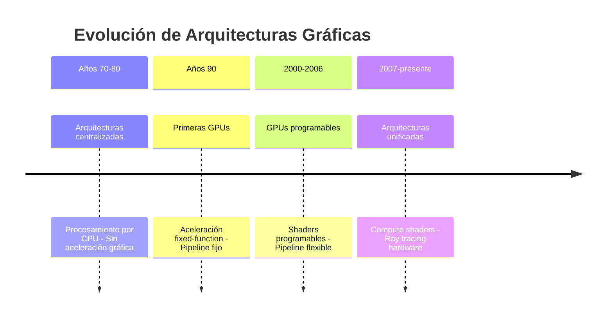
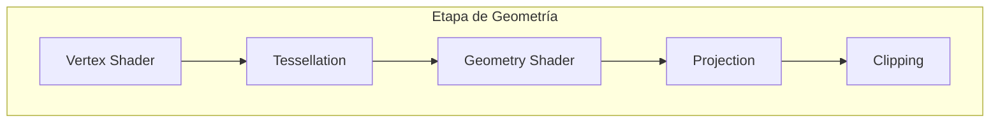
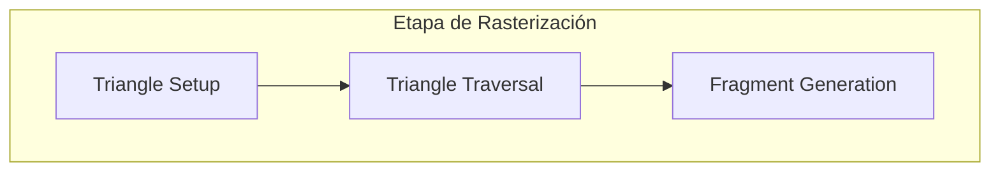
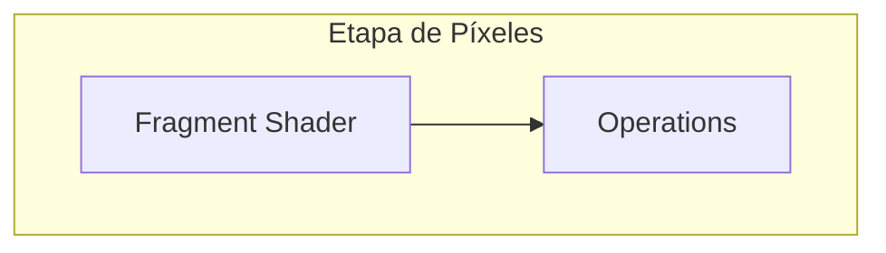
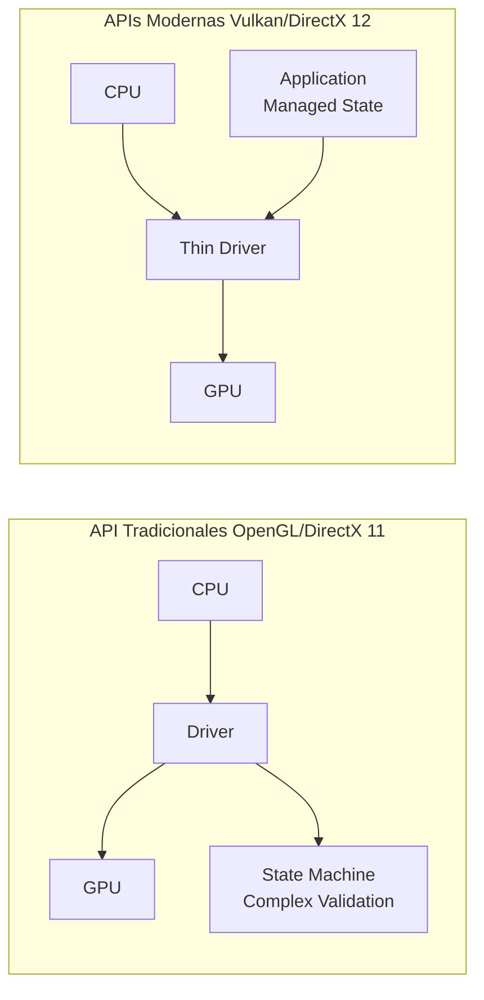

# Modelado y Programación - Graficación por computadora

## 6.2 Arquitectura.

---

La **arquitectura de sistemas de graficación** se refiere al diseño y organización de los componentes hardware y software que trabajan conjuntamente para generar imágenes digitales. Comprender esta arquitectura es fundamental para optimizar el rendimiento y la eficiencia en aplicaciones gráficas.

### Evolución Histórica de la Arquitectura Gráfica



### Componentes Principales de un Sistema de Graficación

#### 1. Unidad Central de Procesamiento (CPU)

- Coordina todas las operaciones del sistema
- Prepara datos para la GPU
- Ejecuta la lógica de aplicación

#### 2. Unidad de Procesamiento Gráfico (GPU)

- Procesador especializado para operaciones gráficas
- Arquitectura altamente paralela
- Optimizada para operaciones matriciales y vectoriales

#### 3. Memoria Gráfica (VRAM)

- Almacena texturas, buffers y datos gráficos
- Mayor ancho de banda que la memoria principal
- Tipos: GDDR5, GDDR6, HBM

#### 4. Pipeline Gráfico (Render Pipeline)

### Pipeline Gráfico Moderno








### Arquitectura de una GPU Moderna

#### Organización Interna de una GPU

- **Streaming Multiprocessors (SMs)**: Unidades de procesamiento principales
- **CUDA Cores**: Unidades de procesamiento individuales dentro de los SMs
- **Memory Hierarchy**:
  - Registros por thread
  - Memoria compartida por SM
  - Memoria global (VRAM)
  - Memoria constante y texturas

#### Fórmula de Rendimiento Teórico

El rendimiento teórico de una GPU se calcula como:

$$ \text{Rendimiento} = \text{Núcleos} \times \text{Frecuencia} \times \text{IPC} $$

donde IPC (Instructions Per Cycle) depende de la arquitectura.

### Etapas Detalladas del Pipeline Gráfico

#### 1. Application Stage (CPU)

Preparación de datos y gestión de la escena:

```cpp
// Ejemplo de preparación de datos en CPU
struct Vertex {
    float position[3];
    float normal[3];
    float texcoord[2];
};

std::vector<Vertex> vertices = loadModel("model.obj");
setupCamera(cameraPosition, target, upVector);
setupLighting(lightPosition, lightColor);
```

#### 2. Geometry Stage (GPU)

##### Vertex Shader

Transforma vértices del espacio objeto al espacio de pantalla:

$$ V_{clip} = M_{projection} \times M_{view} \times M_{model} \times V_{local} $$

```glsl
// Ejemplo de vertex shader en GLSL
#version 450 core
layout(location = 0) in vec3 aPos;
layout(location = 1) in vec3 aNormal;
layout(location = 2) in vec2 aTexCoord;

uniform mat4 model;
uniform mat4 view;
uniform mat4 projection;

out vec3 FragPos;
out vec3 Normal;
out vec2 TexCoord;

void main() {
    gl_Position = projection * view * model * vec4(aPos, 1.0);
    FragPos = vec3(model * vec4(aPos, 1.0));
    Normal = mat3(transpose(inverse(model))) * aNormal;
    TexCoord = aTexCoord;
}
```

##### Tessellation Shader

Subdivide superficies para mayor detalle:

$$ P(u,v) = \sum_{i=0}^{n} \sum_{j=0}^{m} B_i^n(u) B_j^m(v) P_{ij} $$

##### Geometry Shader

Procesa primitivas completas (puede crear o eliminar geometría)

#### 3. Rasterization Stage

Convierte primitivas geométricas en fragmentos (píxeles potenciales):

##### Algoritmo de Rasterización de Triángulos

```python
def rasterize_triangle(v0, v1, v2):
    # Calcular bounding box
    min_x = min(v0.x, v1.x, v2.x)
    max_x = max(v0.x, v1.x, v2.x)
    min_y = min(v0.y, v1.y, v2.y)
    max_y = max(v0.y, v1.y, v2.y)

    fragments = []
    for y in range(min_y, max_y + 1):
        for x in range(min_x, max_x + 1):
            # Calcular coordenadas baricéntricas
            alpha, beta, gamma = calculate_barycentric(v0, v1, v2, x, y)

            # Verificar si el punto está dentro del triángulo
            if alpha >= 0 and beta >= 0 and gamma >= 0:
                # Interpolar atributos
                z = alpha * v0.z + beta * v1.z + gamma * v2.z
                fragments.append(Fragment(x, y, z, alpha, beta, gamma))

    return fragments
```

#### 4. Pixel Processing Stage

##### Fragment Shader

Calcula el color final de cada fragmento:

```glsl
// Ejemplo de fragment shader en GLSL
#version 450 core
in vec3 FragPos;
in vec3 Normal;
in vec2 TexCoord;

out vec4 FragColor;

uniform vec3 lightPos;
uniform vec3 lightColor;
uniform vec3 objectColor;
uniform sampler2D diffuseTexture;

void main() {
    // Ambient
    float ambientStrength = 0.1;
    vec3 ambient = ambientStrength * lightColor;

    // Diffuse
    vec3 norm = normalize(Normal);
    vec3 lightDir = normalize(lightPos - FragPos);
    float diff = max(dot(norm, lightDir), 0.0);
    vec3 diffuse = diff * lightColor;

    // Specular
    float specularStrength = 0.5;
    vec3 viewDir = normalize(-FragPos);
    vec3 reflectDir = reflect(-lightDir, norm);
    float spec = pow(max(dot(viewDir, reflectDir), 0.0), 32);
    vec3 specular = specularStrength * spec * lightColor;

    // Combinar resultados
    vec3 result = (ambient + diffuse + specular) * objectColor;
    FragColor = vec4(result, 1.0);
}
```

#### 5. Output Merging Stage

Combina fragmentos considerando profundidad y transparencia:

##### Depth Testing (Z-buffer)

Algoritmo para determinar visibilidad:

$$ \text{if } fragment_{depth} < depthBuffer[x][y] \text{ then} $$

$$ \quad colorBuffer[x][y] = fragment_{color} $$

$$ \quad depthBuffer[x][y] = fragment_{depth} $$

##### Blending

Para objetos transparentes:

$$ C_{final} = C_{source} \times \alpha + C_{destination} \times (1 - \alpha) $$

### Arquitecturas de Memoria Gráfica

#### Jerarquía de Memoria en GPU

```
Registros → Memoria Shared → Memoria L1/L2 → VRAM → System RAM
```

#### Ancho de Banda de Memoria

$$ \text{Bandwidth} = \text{Bus Width} \times \text{Memory Clock} \times 2 \div 8 $$

(El factor 2 es debido a la tecnología DDR - Double Data Rate)

### API Gráficas y Su Arquitectura

#### Comparación de Arquitecturas de APIs



#### Vulkan: Arquitectura Moderna

```cpp
// Estructura básica de una aplicación Vulkan
void createVulkanApplication() {
    // 1. Crear instancia
    VkInstance instance = createInstance();

    // 2. Seleccionar dispositivo físico
    VkPhysicalDevice physicalDevice = selectPhysicalDevice(instance);

    // 3. Crear dispositivo lógico
    VkDevice device = createLogicalDevice(physicalDevice);

    // 4. Crear command pools y buffers
    VkCommandPool commandPool = createCommandPool(device);
    VkCommandBuffer commandBuffer = createCommandBuffer(device, commandPool);

    // 5. Crear pipeline gráfico
    VkPipeline pipeline = createGraphicsPipeline(device);

    // 6. Bucle de renderizado
    while (running) {
        VkCommandBufferBeginInfo beginInfo{};
        vkBeginCommandBuffer(commandBuffer, &beginInfo);

        // Comandos de renderizado...
        vkCmdBeginRenderPass(commandBuffer, ...);
        vkCmdBindPipeline(commandBuffer, VK_PIPELINE_BIND_POINT_GRAPHICS, pipeline);
        vkCmdDraw(commandBuffer, ...);
        vkCmdEndRenderPass(commandBuffer);

        vkEndCommandBuffer(commandBuffer);

        // Submit y presentación
        submitCommandBuffer(commandBuffer);
        presentImage();
    }
}
```

### Ejercicios Propuestos

1. **Ejercicio 1**: Calcula el ancho de banda teórico de una GPU con bus de 256 bits y memoria GDDR6 a 14 Gbps.

2. **Ejercicio 2**: Implementa un algoritmo de rasterización de triángulos que utilice coordenadas baricéntricas.

3. **Ejercicio 3**: Diseña el diagrama de una arquitectura gráfica simplificada para un sistema embebido con recursos limitados.

4. **Ejercicio 4**: Analiza las diferencias de rendimiento entre el renderizado inmediato y el renderizado por lotes.

5. **Ejercicio 5**: Propone una optimización para el pipeline gráfico cuando se renderizan escenas con múltiples luces.

### Tendencias en Arquitecturas Gráficas

#### Ray Tracing Hardware

Aceleración hardware para intersección rayo-geometría:

$$ t = \frac{(O - P) \cdot N}{D \cdot N} $$

#### Machine Learning en GPU

Tensor Cores para aceleración de operaciones de IA:

$$ C = A \times B + C $$

#### Computación Heterogénea

Integración CPU-GPU para diferentes cargas de trabajo.

### Referencias Bibliográficas

1. Akenine-Möller, T., Haines, E., & Hoffman, N. (2018). _Real-Time Rendering_ (4th ed.).
2. Luebke, D. (2018). _GPU Computing_.
3. NVIDIA (2021). _NVIDIA Turing Architecture Whitepaper_.
4. Khronos Group (2020). _Vulkan Programming Guide_.
5. AMD (2021). _RDNA 2 Architecture Whitepaper_.

### Recursos Adicionales

- [NVIDIA Developer](https://developer.nvidia.com/)
- [AMD GPUOpen](https://gpuopen.com/)
- [Khronos Group](https://www.khronos.org/)
- [GPU Architecture Conference Papers](https://www.computer.org/csdl/proceedings/micro)
