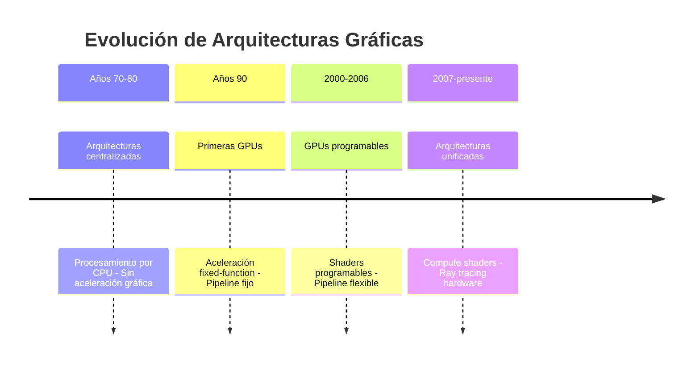
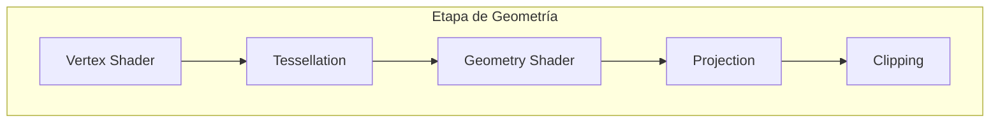
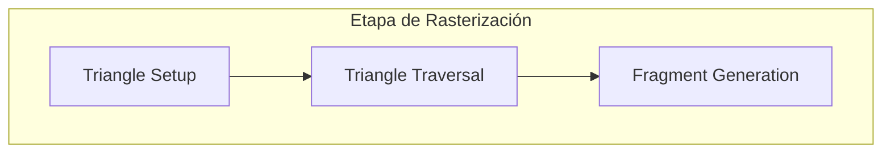
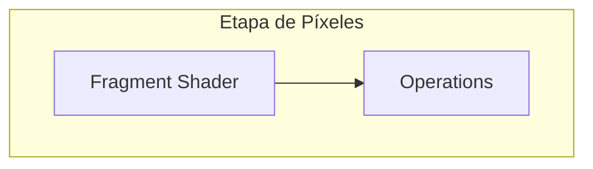
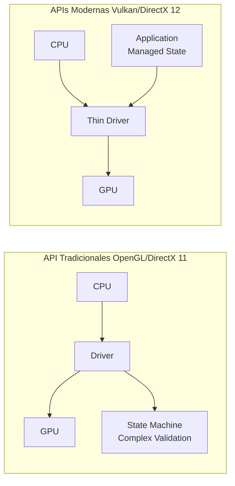
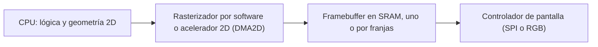

# Modelado y Programación - Graficación por computadora

## 6.2 Arquitectura.

---

La **arquitectura de sistemas de graficación** se refiere al diseño y organización de los componentes hardware y software que trabajan conjuntamente para generar imágenes digitales. Comprender esta arquitectura es fundamental para optimizar el rendimiento y la eficiencia en aplicaciones gráficas.

### Evolución Histórica de la Arquitectura Gráfica



### Componentes Principales de un Sistema de Graficación

#### 1. Unidad Central de Procesamiento (CPU)

- Coordina todas las operaciones del sistema
- Prepara datos para la GPU
- Ejecuta la lógica de aplicación

#### 2. Unidad de Procesamiento Gráfico (GPU)

- Procesador especializado para operaciones gráficas
- Arquitectura altamente paralela
- Optimizada para operaciones matriciales y vectoriales

#### 3. Memoria Gráfica (VRAM)

- Almacena texturas, buffers y datos gráficos
- Mayor ancho de banda que la memoria principal
- Tipos: GDDR5, GDDR6, HBM

#### 4. Pipeline Gráfico (Render Pipeline)

### Pipeline Gráfico Moderno








### Arquitectura de una GPU Moderna

#### Organización Interna de una GPU

- **Streaming Multiprocessors (SMs)**: Unidades de procesamiento principales
- **CUDA Cores**: Unidades de procesamiento individuales dentro de los SMs
- **Memory Hierarchy**:
  - Registros por thread
  - Memoria compartida por SM
  - Memoria global (VRAM)
  - Memoria constante y texturas

#### Fórmula de Rendimiento Teórico

El rendimiento teórico de una GPU se calcula como:

$$ \text{Rendimiento} = \text{Núcleos} \times \text{Frecuencia} \times \text{IPC} $$

donde IPC (Instructions Per Cycle) depende de la arquitectura. Para operaciones de punto flotante, cada núcleo suele ejecutar una instrucción *fused multiply-add* (FMA), $a \cdot b + c,$ por ciclo, que cuenta como 2 operaciones. Por ejemplo, una GPU con 10 240 núcleos a 1.7 GHz alcanza

$$ 10\,240 \times 1.7 \times 10^9 \times 2 ≈ 34.8 \times 10^{12} \text{ FLOPS} = 34.8 \text{ TFLOPS} $$

Es un **máximo teórico**: en la práctica, el rendimiento suele estar limitado por el ancho de banda de memoria y no por la capacidad de cálculo.

La GPU logra este paralelismo con un modelo **SIMT** (*single instruction, multiple threads*): los hilos se agrupan de 32 en 32 (*warps* en NVIDIA) o de 32 o 64 (*wavefronts* en AMD) y cada grupo ejecuta la misma instrucción sobre datos distintos. Si los hilos de un grupo toman ramas distintas de un `if`, ambas ramas se ejecutan una tras otra con parte de los hilos desactivados (**divergencia**), lo que reduce el rendimiento. Mientras un grupo espera datos de memoria, el SM cambia a otro grupo sin costo; así la GPU oculta la latencia de la memoria con paralelismo en lugar de con cachés grandes, como hace la CPU.

### Etapas Detalladas del Pipeline Gráfico

#### 1. Application Stage (CPU)

Preparación de datos y gestión de la escena:

```cpp
// Ejemplo de preparación de datos en CPU
struct Vertex {
    float position[3];
    float normal[3];
    float texcoord[2];
};

std::vector<Vertex> vertices = loadModel("model.obj");
setupCamera(cameraPosition, target, upVector);
setupLighting(lightPosition, lightColor);
```

#### 2. Geometry Stage (GPU)

##### Vertex Shader

Transforma cada vértice del espacio del objeto al **espacio de recorte** (*clip space*):

$$ V_{clip} = M_{projection} \times M_{view} \times M_{model} \times V_{local} $$

- $M_{model}$ lleva el objeto de sus coordenadas locales al mundo.
- $M_{view}$ lleva el mundo al sistema de la cámara.
- $M_{projection}$ aplica la proyección, en perspectiva u ortográfica (tema 6.5).

Las matrices se aplican de derecha a izquierda. Después del recorte, la GPU hace la **división de perspectiva**, $(x, y, z) / w,$ que da las coordenadas normalizadas del dispositivo en $[-1, 1]^3,$ y la **transformación de *viewport***, que las convierte en coordenadas de píxel. Es en la división entre $w$ donde los objetos lejanos se ven más pequeños.

```glsl
// Ejemplo de vertex shader en GLSL
#version 450 core
layout(location = 0) in vec3 aPos;
layout(location = 1) in vec3 aNormal;
layout(location = 2) in vec2 aTexCoord;

uniform mat4 model;
uniform mat4 view;
uniform mat4 projection;

out vec3 FragPos;
out vec3 Normal;
out vec2 TexCoord;

void main() {
    gl_Position = projection * view * model * vec4(aPos, 1.0);
    FragPos = vec3(model * vec4(aPos, 1.0));
    Normal = mat3(transpose(inverse(model))) * aNormal;
    TexCoord = aTexCoord;
}
```

##### Tessellation Shader

Subdivide superficies para mayor detalle. Por ejemplo, un parche de Bézier rectangular, con polinomios de Bernstein $B_i^n$ (tema 6.1) y una red de $(n + 1)(m + 1)$ puntos de control $P_{ij},$ se evalúa en tantos puntos $(u, v)$ como se necesiten:

$$ P(u,v) = \sum_{i=0}^{n} \sum_{j=0}^{m} B_i^n(u) B_j^m(v) P_{ij} $$

La ventaja es que la CPU solo envía los puntos de control y la GPU genera los triángulos; el nivel de subdivisión puede depender de la distancia a la cámara.

##### Geometry Shader

Procesa primitivas completas, como triángulos o líneas, y puede crear o eliminar geometría; por ejemplo, convertir cada punto en un cuadrado para dibujar partículas. Es una etapa opcional y en las GPU modernas suele sustituirse por *mesh shaders* o *compute shaders*.

#### 3. Rasterization Stage

Convierte primitivas geométricas en fragmentos (píxeles potenciales):

##### Algoritmo de Rasterización de Triángulos

Las GPU rasterizan con **funciones de arista**. Para la arista de $A$ a $B$ y un punto $P:$

$$ E_{AB}(P) = (B_x - A_x)(P_y - A_y) - (B_y - A_y)(P_x - A_x) $$

que es el doble del área con signo del triángulo $ABP.$ Un punto está dentro del triángulo $V_0V_1V_2$ si las tres funciones de arista tienen el mismo signo, y dividiéndolas entre el área total se obtienen las **coordenadas baricéntricas**:

$$ \alpha = \frac{E_{12}(P)}{E_{12}(V_0)}, \qquad \beta = \frac{E_{20}(P)}{E_{20}(V_1)}, \qquad \gamma = 1 - \alpha - \beta $$

Con ellas se interpola cualquier atributo de los vértices: profundidad, color, coordenadas de textura o normales. Se evalúa en el **centro** de cada píxel, $(x + 0.5, y + 0.5).$

```python
from dataclasses import dataclass

@dataclass
class Vertice:
    x: float
    y: float
    z: float

def arista(ax, ay, bx, by, px, py):
    return (bx - ax) * (py - ay) - (by - ay) * (px - ax)

def rasterize_triangle(v0, v1, v2):
    area = arista(v0.x, v0.y, v1.x, v1.y, v2.x, v2.y)
    if area == 0:
        return []                      # triángulo degenerado
    # Caja envolvente en píxeles
    min_x = int(min(v0.x, v1.x, v2.x)); max_x = int(max(v0.x, v1.x, v2.x))
    min_y = int(min(v0.y, v1.y, v2.y)); max_y = int(max(v0.y, v1.y, v2.y))

    fragments = []
    for y in range(min_y, max_y + 1):
        for x in range(min_x, max_x + 1):
            px, py = x + 0.5, y + 0.5   # centro del píxel
            alpha = arista(v1.x, v1.y, v2.x, v2.y, px, py) / area
            beta = arista(v2.x, v2.y, v0.x, v0.y, px, py) / area
            gamma = 1 - alpha - beta
            if alpha >= 0 and beta >= 0 and gamma >= 0:
                z = alpha * v0.z + beta * v1.z + gamma * v2.z   # interpolar profundidad
                fragments.append((x, y, round(z, 3)))
    return fragments

frags = rasterize_triangle(Vertice(0, 0, 0.0), Vertice(8, 0, 0.5), Vertice(0, 8, 1.0))
print(len(frags), frags[:3])   # 36 [(0, 0, 0.094), (1, 0, 0.156), (2, 0, 0.219)]
```

Dividir entre `area` en lugar de exigir signos positivos hace que el algoritmo funcione con los vértices en cualquier orientación. Las GPU además siguen una **regla de arista superior-izquierda** para decidir a qué triángulo pertenece un píxel que cae exactamente sobre una arista compartida, de modo que no se dibuje dos veces. En perspectiva, los atributos deben interpolarse dividiendo entre $w$ (interpolación con corrección de perspectiva); la interpolación lineal en pantalla solo es correcta para la profundidad.

#### 4. Pixel Processing Stage

##### Fragment Shader

Calcula el color final de cada fragmento:

```glsl
// Ejemplo de fragment shader en GLSL
#version 450 core
in vec3 FragPos;
in vec3 Normal;
in vec2 TexCoord;

out vec4 FragColor;

uniform vec3 lightPos;
uniform vec3 viewPos;      // posición de la cámara en el mundo
uniform vec3 lightColor;
uniform vec3 objectColor;
uniform sampler2D diffuseTexture;

void main() {
    // Ambient
    float ambientStrength = 0.1;
    vec3 ambient = ambientStrength * lightColor;

    // Diffuse
    vec3 norm = normalize(Normal);
    vec3 lightDir = normalize(lightPos - FragPos);
    float diff = max(dot(norm, lightDir), 0.0);
    vec3 diffuse = diff * lightColor;

    // Specular
    float specularStrength = 0.5;
    vec3 viewDir = normalize(viewPos - FragPos);
    vec3 reflectDir = reflect(-lightDir, norm);
    float spec = pow(max(dot(viewDir, reflectDir), 0.0), 32);
    vec3 specular = specularStrength * spec * lightColor;

    // Combinar resultados
    vec3 result = (ambient + diffuse + specular) * objectColor;
    FragColor = vec4(result, 1.0);
}
```

Es el modelo de iluminación de Phong (tema 6.7) evaluado por fragmento. Todas las posiciones deben estar en el **mismo** espacio: `FragPos` está en coordenadas del mundo, así que la dirección hacia el observador se calcula con la posición de la cámara en el mundo y no con $-\text{FragPos},$ que solo es correcto si se trabaja en el espacio de la cámara.

#### 5. Output Merging Stage

Combina fragmentos considerando profundidad y transparencia:

##### Depth Testing (Z-buffer)

Algoritmo para determinar visibilidad. El *depth buffer* guarda, para cada píxel, la profundidad del fragmento más cercano dibujado hasta el momento, y se inicializa con el valor máximo:

```text
para cada fragmento (x, y, z, color):
    si z < depthBuffer[x][y]:
        colorBuffer[x][y] = color
        depthBuffer[x][y] = z
```

Su gran ventaja es que los triángulos pueden dibujarse en **cualquier orden**, con memoria $O(\text{píxeles})$ y tiempo proporcional al número de fragmentos. Su limitación es la precisión: con proyección en perspectiva la profundidad almacenada es proporcional a $1/z,$ así que casi toda la precisión se concentra cerca del plano cercano y superficies lejanas muy próximas pueden parpadear (*z-fighting*). Por eso conviene no poner el plano cercano demasiado cerca de la cámara.

##### Blending

Para objetos transparentes:

$$ C_{final} = C_{source} \times \alpha + C_{destination} \times (1 - \alpha) $$

donde $\alpha$ es la opacidad del fragmento nuevo. Esta operación **no es conmutativa**: el resultado depende del orden en que se dibujen las capas, así que los objetos transparentes se ordenan de atrás hacia adelante y se dibujan después de los opacos. Con $\alpha = 0.5,$ un fragmento rojo $(1, 0, 0)$ sobre un fondo azul $(0, 0, 1)$ da $(0.5, 0, 0.5).$

### Arquitecturas de Memoria Gráfica

#### Jerarquía de Memoria en GPU

```text
Registros → Memoria compartida → Caché L1/L2 → VRAM → RAM del sistema (vía PCIe)
  más rápida y más pequeña                         más lenta y más grande
```

Los registros y la memoria compartida responden en pocos ciclos; la VRAM tarda cientos de ciclos; y copiar datos desde la RAM del sistema a través del bus PCIe es todavía más lento, por eso las texturas y mallas se suben a la GPU una vez y se reutilizan.

#### Ancho de Banda de Memoria

$$ \text{Bandwidth} = \frac{\text{Bus Width} \times \text{Memory Clock} \times 2}{8} $$

El factor 2 se debe a la tecnología DDR (*Double Data Rate*), que transfiere datos en los dos flancos del reloj, y la división entre 8 convierte bits en bytes. Los fabricantes de GDDR6 suelen dar directamente la **tasa efectiva por pin**, en Gbps, que ya incluye todos los factores; en ese caso

$$ \text{Bandwidth} = \frac{\text{Bus Width} \times \text{tasa por pin}}{8} $$

### API Gráficas y Su Arquitectura

#### Comparación de Arquitecturas de APIs



#### Vulkan: Arquitectura Moderna

```cpp
// Estructura básica de una aplicación Vulkan
void createVulkanApplication() {
    // 1. Crear instancia
    VkInstance instance = createInstance();

    // 2. Seleccionar dispositivo físico
    VkPhysicalDevice physicalDevice = selectPhysicalDevice(instance);

    // 3. Crear dispositivo lógico
    VkDevice device = createLogicalDevice(physicalDevice);

    // 4. Crear command pools y buffers
    VkCommandPool commandPool = createCommandPool(device);
    VkCommandBuffer commandBuffer = createCommandBuffer(device, commandPool);

    // 5. Crear pipeline gráfico
    VkPipeline pipeline = createGraphicsPipeline(device);

    // 6. Bucle de renderizado
    while (running) {
        VkCommandBufferBeginInfo beginInfo{};
        vkBeginCommandBuffer(commandBuffer, &beginInfo);

        // Comandos de renderizado...
        vkCmdBeginRenderPass(commandBuffer, ...);
        vkCmdBindPipeline(commandBuffer, VK_PIPELINE_BIND_POINT_GRAPHICS, pipeline);
        vkCmdDraw(commandBuffer, ...);
        vkCmdEndRenderPass(commandBuffer);

        vkEndCommandBuffer(commandBuffer);

        // Submit y presentación
        submitCommandBuffer(commandBuffer);
        presentImage();
    }
}
```

### Ejercicios Propuestos

1. **Ejercicio 1**: Calcula el ancho de banda teórico de una GPU con bus de 256 bits y memoria GDDR6 a 14 Gbps.

2. **Ejercicio 2**: Implementa un algoritmo de rasterización de triángulos que utilice coordenadas baricéntricas.

3. **Ejercicio 3**: Diseña el diagrama de una arquitectura gráfica simplificada para un sistema embebido con recursos limitados.

4. **Ejercicio 4**: Analiza las diferencias de rendimiento entre el renderizado inmediato y el renderizado por lotes.

5. **Ejercicio 5**: Propón una optimización para el pipeline gráfico cuando se renderizan escenas con múltiples luces.

### Soluciones a los Ejercicios

**Ejercicio 1.** La tasa de 14 Gbps de GDDR6 es la tasa efectiva por pin, así que

$$ \text{Bandwidth} = \frac{256 \text{ bits} \times 14 \text{ Gbps}}{8} = 448 \text{ GB/s} $$

Es el ancho de banda de tarjetas como la RTX 2080. Para dibujar una imagen de $1920 \times 1080$ a 60 cuadros por segundo, escribir solo el color (4 bytes) y la profundidad (4 bytes) de cada píxel una vez requiere $1920 \cdot 1080 \cdot 8 \cdot 60 ≈ 1$ GB/s; el resto del ancho de banda se usa en leer texturas, en dibujar cada píxel varias veces (*overdraw*) y en los búferes intermedios.

**Ejercicio 2.** La función `rasterize_triangle` de la sección 3 es una solución completa: calcula la caja envolvente, evalúa las funciones de arista en el centro de cada píxel, obtiene $(\alpha, \beta, \gamma)$ dividiendo entre el área y descarta los píxeles con alguna coordenada negativa. Una mejora importante es actualizar las funciones de arista **incrementalmente**: al avanzar un píxel en $x,$ $E$ cambia en una constante, así que basta una suma por arista en lugar de recalcular productos.

**Ejercicio 3.** En un sistema embebido, como un microcontrolador con pantalla pequeña, una arquitectura razonable es:



Las decisiones clave son: geometría mayoritariamente 2D, aritmética de **punto fijo** si no hay unidad de punto flotante, *framebuffer* por franjas cuando la memoria no alcanza para la imagen completa, y redibujar solo las regiones que cambian (*dirty rectangles*). Si hay una GPU móvil, suele ser de arquitectura **por mosaicos** (*tile-based*): la pantalla se divide en bloques pequeños que caben en memoria interna del chip y cada bloque se termina antes de escribirlo a memoria externa, lo que ahorra ancho de banda y energía.

**Ejercicio 4.** En el **modo inmediato** (por ejemplo `glBegin`/`glEnd` del OpenGL antiguo) la CPU envía cada vértice en una llamada, lo que genera miles de llamadas al controlador por cuadro y deja a la GPU esperando. En el **renderizado por lotes** los vértices se guardan una sola vez en búferes de la GPU y se dibujan grupos enteros con una llamada (`glDrawElements`); se agrupan además los objetos que comparten material para cambiar de estado lo menos posible, y con *instancing* se dibujan miles de copias de una malla con una sola llamada. Como cada llamada de dibujo cuesta del orden de microsegundos de CPU, pasar de 10 000 llamadas a 100 por cuadro libera decenas de milisegundos, más que todo el presupuesto de un cuadro a 60 FPS (16.7 ms).

**Ejercicio 5.** Con *forward rendering*, cada fragmento evalúa todas las luces, con costo proporcional a $\text{fragmentos} \times \text{luces},$ aunque la mayoría de las luces no lo afecten. Dos optimizaciones comunes:

- **Deferred shading**: una primera pasada escribe en un *G-buffer* la posición, normal y material de la superficie visible en cada píxel; una segunda pasada calcula la iluminación solo para esos píxeles, y cada luz se aplica únicamente a la región de pantalla que cubre su volumen de influencia. El costo pasa a ser proporcional a $\text{píxeles} \times \text{luces cercanas}.$
- **Forward+ o clustered shading**: se divide la pantalla, o el volumen de visión, en celdas; un *compute shader* calcula qué luces afectan cada celda y cada fragmento solo evalúa la lista de su celda. Funciona bien con transparencias y con antialiasing por hardware, que son difíciles con *deferred*.

### Tendencias en Arquitecturas Gráficas

#### Ray Tracing Hardware

Aceleración hardware para intersección rayo-geometría:

Para un rayo $R(t) = O + tD$ y un plano que pasa por $P$ con normal $N,$ la intersección ocurre cuando $(R(t) - P) \cdot N = 0,$ es decir

$$ t = \frac{(P - O) \cdot N}{D \cdot N} $$

siempre que $D \cdot N \neq 0;$ si es 0, el rayo es paralelo al plano. Las unidades de *ray tracing* de las GPU modernas aceleran las pruebas de intersección rayo-triángulo y el recorrido de la jerarquía de volúmenes envolventes (BVH) que evita probar cada rayo contra todos los triángulos.

#### Machine Learning en GPU

Tensor Cores para aceleración de operaciones de IA:

$$ C = A \times B + C $$

Cada Tensor Core realiza esta operación sobre bloques pequeños de matrices, por ejemplo de $4 \times 4,$ en un solo paso y con precisión reducida (FP16, BF16 u 8 bits). Se usa en redes neuronales y en gráficos para técnicas como el reescalado por aprendizaje profundo (DLSS) y la eliminación de ruido en ray tracing.

#### Computación Heterogénea

Integración CPU-GPU para diferentes cargas de trabajo.

### Referencias Bibliográficas

1. Akenine-Möller, T., Haines, E., & Hoffman, N. (2018). _Real-Time Rendering_ (4th ed.).
2. Luebke, D. (2018). _GPU Computing_.
3. NVIDIA (2021). _NVIDIA Turing Architecture Whitepaper_.
4. Khronos Group (2020). _Vulkan Programming Guide_.
5. AMD (2021). _RDNA 2 Architecture Whitepaper_.

### Recursos Adicionales

- [NVIDIA Developer](https://developer.nvidia.com/)
- [AMD GPUOpen](https://gpuopen.com/)
- [Khronos Group](https://www.khronos.org/)
- [GPU Architecture Conference Papers](https://www.computer.org/csdl/proceedings/micro)
