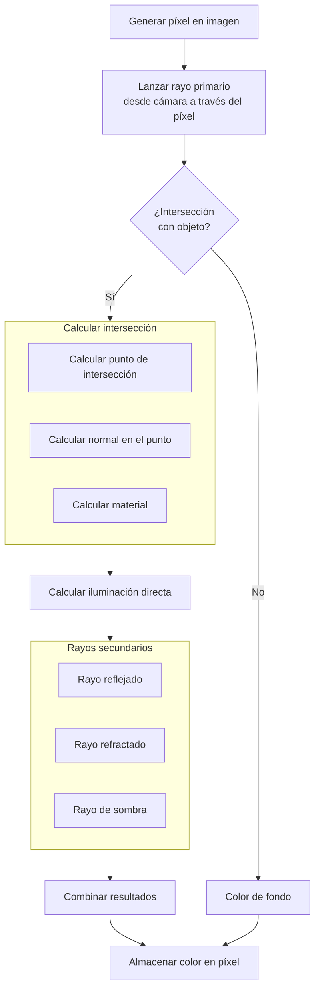
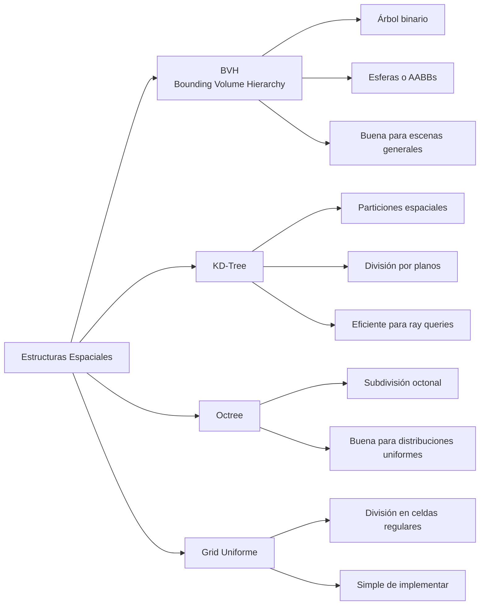

# Modelado y Programación - Graficación por computadora

## 6.3 El algoritmo de ray-tracing.

---

El **ray tracing** (trazado de rayos) es una técnica de renderizado que simula el comportamiento físico de la luz para generar imágenes digitales de alta calidad y realismo. A diferencia de la rasterización tradicional, el ray tracing modela cómo la luz interactúa con las superficies, produciendo efectos como reflejos, refracciones y sombras con un alto grado de precisión.

### Fundamentos Físicos del Ray Tracing

#### Leyes de la Óptica Aplicadas

1. **Reflexión**: El ángulo de incidencia es igual al ángulo de reflexión:

   $$ \theta_i = \theta_r $$

2. **Refracción**: Descrita por la Ley de Snell:

   $$ n_1 \sin(\theta_1) = n_2 \sin(\theta_2) $$

   donde $n_1$ y $n_2$ son los índices de refracción de los medios.

### El Algoritmo Básico de Ray Tracing



### Componentes del Algoritmo de Ray Tracing

#### 1. Generación de Rayos Primarios

Para cada píxel de la imagen, generamos un rayo desde el ojo (cámara) a través del píxel:

```python
def generate_primary_ray(camera, x, y, image_width, image_height):
    # Convertir coordenadas de píxel a coordenadas NDC (-1 a 1)
    ndc_x = (2.0 * x) / image_width - 1.0
    ndc_y = 1.0 - (2.0 * y) / image_height  # Invertir Y

    # Convertir NDC a coordenadas de pantalla
    aspect_ratio = image_width / image_height
    screen_x = ndc_x * aspect_ratio * camera.tan_fovx
    screen_y = ndc_y * camera.tan_fovy

    # Crear dirección del rayo en espacio de mundo
    direction = camera.right * screen_x + camera.up * screen_y + camera.forward
    direction = normalize(direction)

    return Ray(camera.position, direction)
```

#### 2. Intersección Rayo-Objeto

##### Intersección con Esfera

Para una esfera con centro $C$ y radio $r$, la ecuación es:

$$ \|O + tD - C\|^2 = r^2 $$

Resolvemos la ecuación cuadrática:

$$ t^2(D \cdot D) + 2t(D \cdot (O - C)) + ((O - C) \cdot (O - C)) - r^2 = 0 $$

```python
def ray_sphere_intersection(ray, sphere):
    oc = ray.origin - sphere.center
    a = dot(ray.direction, ray.direction)
    b = 2.0 * dot(oc, ray.direction)
    c = dot(oc, oc) - sphere.radius * sphere.radius

    discriminant = b * b - 4 * a * c

    if discriminant < 0:
        return None  # No hay intersección

    t = (-b - math.sqrt(discriminant)) / (2.0 * a)
    if t < 0:
        t = (-b + math.sqrt(discriminant)) / (2.0 * a)
        if t < 0:
            return None  # Intersección detrás del rayo

    point = ray.origin + t * ray.direction
    normal = normalize(point - sphere.center)

    return Intersection(t, point, normal, sphere)
```

##### Intersección con Triángulo

Usando el algoritmo de Moller-Trumbore:

```python
def ray_triangle_intersection(ray, triangle):
    edge1 = triangle.v1 - triangle.v0
    edge2 = triangle.v2 - triangle.v0

    h = cross(ray.direction, edge2)
    a = dot(edge1, h)

    if abs(a) < 1e-8:
        return None  # Rayo paralelo al triángulo

    f = 1.0 / a
    s = ray.origin - triangle.v0
    u = f * dot(s, h)

    if u < 0.0 or u > 1.0:
        return None

    q = cross(s, edge1)
    v = f * dot(ray.direction, q)

    if v < 0.0 or u + v > 1.0:
        return None

    t = f * dot(edge2, q)
    if t > 1e-8:  # Intersección válida
        point = ray.origin + t * ray.direction
        normal = normalize(cross(edge1, edge2))
        return Intersection(t, point, normal, triangle)

    return None
```

#### 3. Modelado de Materiales

##### Modelo de Iluminación de Phong

$$ I = I_a + I_d + I_s $$

donde:

- $I_a = k_a \cdot L_a$ (componente ambiental)
- $I_d = k_d \cdot (L \cdot N) \cdot L_d$ (componente difusa)
- $I_s = k_s \cdot (R \cdot V)^\alpha \cdot L_s$ (componente especular)

```glsl
vec3 phong_illumination(vec3 position, vec3 normal, vec3 view_dir, Material material) {
    vec3 ambient = material.ambient * light.ambient;

    vec3 light_dir = normalize(light.position - position);
    float diff = max(dot(normal, light_dir), 0.0);
    vec3 diffuse = material.diffuse * diff * light.diffuse;

    vec3 reflect_dir = reflect(-light_dir, normal);
    float spec = pow(max(dot(view_dir, reflect_dir), 0.0), material.shininess);
    vec3 specular = material.specular * spec * light.specular;

    return ambient + diffuse + specular;
}
```

#### 4. Rayos Secundarios

##### Rayos Reflejados

$$ R = I - 2(N \cdot I)N $$

donde $I$ es el vector incidente y $N$ la normal.

```python
def calculate_reflection(incident, normal):
    return incident - 2 * dot(incident, normal) * normal
```

##### Rayos Refractados

Usando la Ley de Snell:

$$ \eta_1 \sin(\theta_1) = \eta_2 \sin(\theta_2) $$

$$ T = \left( \frac{\eta_1}{\eta_2} \right) I - \left( \frac{\eta_1}{\eta_2} (N \cdot I) + \sqrt{1 - \left( \frac{\eta_1}{\eta_2} \right)^2 (1 - (N \cdot I)^2)} \right) N $$

```python
def calculate_refraction(incident, normal, eta_i, eta_t):
    cos_i = -dot(normal, incident)
    if cos_i < 0:
        # El rayo está saliendo del medio
        return calculate_refraction(incident, -normal, eta_t, eta_i)

    eta = eta_i / eta_t
    k = 1.0 - eta * eta * (1.0 - cos_i * cos_i)

    if k < 0:
        return None  # Reflexión interna total

    return eta * incident + (eta * cos_i - math.sqrt(k)) * normal
```

### Implementación del Algoritmo de Ray Tracing

```python
class RayTracer:
    def __init__(self, width, height, max_depth=5):
        self.width = width
        self.height = height
        self.max_depth = max_depth
        self.scene = Scene()
        self.camera = Camera()

    def trace_ray(self, ray, depth=0):
        if depth >= self.max_depth:
            return Color(0, 0, 0)  # Negro (sin contribución)

        # Encontrar la intersección más cercana
        closest_intersection = None
        for obj in self.scene.objects:
            intersection = obj.intersect(ray)
            if intersection and (not closest_intersection or
                               intersection.t < closest_intersection.t):
                closest_intersection = intersection

        if not closest_intersection:
            return self.scene.background_color

        # Calcular iluminación directa
        material = closest_intersection.object.material
        color = self.calculate_direct_illumination(closest_intersection)

        # Calcular reflexión
        if material.reflectivity > 0:
            reflection_dir = calculate_reflection(ray.direction,
                                                closest_intersection.normal)
            reflection_ray = Ray(closest_intersection.point +
                               reflection_dir * 1e-4, reflection_dir)
            reflection_color = self.trace_ray(reflection_ray, depth + 1)
            color = color * (1 - material.reflectivity) + \
                   reflection_color * material.reflectivity

        # Calcular refracción
        if material.transparency > 0:
            refraction_dir = calculate_refraction(ray.direction,
                                                closest_intersection.normal,
                                                1.0, material.ior)
            if refraction_dir:
                refraction_ray = Ray(closest_intersection.point +
                                   refraction_dir * 1e-4, refraction_dir)
                refraction_color = self.trace_ray(refraction_ray, depth + 1)
                color = color * (1 - material.transparency) + \
                       refraction_color * material.transparency

        return color

    def render(self):
        image = Image.new("RGB", (self.width, self.height))
        pixels = image.load()

        for y in range(self.height):
            for x in range(self.width):
                ray = self.camera.generate_ray(x, y, self.width, self.height)
                color = self.trace_ray(ray)
                pixels[x, y] = (int(color.r * 255),
                               int(color.g * 255),
                               int(color.b * 255))

        return image
```

### Optimizaciones del Ray Tracing

#### 1. Estructuras de Aceleración

##### Bounding Volume Hierarchy (BVH)

```python
class BVHNode:
    def __init__(self, objects):
        if len(objects) <= 2:
            self.left = None
            self.right = None
            self.objects = objects
            self.bounding_box = self.calculate_bounding_box(objects)
        else:
            # Dividir objetos según el eje más largo
            axis = self.find_longest_axis(objects)
            sorted_objects = sorted(objects, key=lambda obj: obj.get_center()[axis])

            mid = len(sorted_objects) // 2
            self.left = BVHNode(sorted_objects[:mid])
            self.right = BVHNode(sorted_objects[mid:])
            self.objects = None
            self.bounding_box = self.merge_boxes(self.left.bounding_box,
                                               self.right.bounding_box)

    def intersect(self, ray):
        if not self.bounding_box.intersect(ray):
            return None

        if self.objects:  # Nodo hoja
            closest = None
            for obj in self.objects:
                intersection = obj.intersect(ray)
                if intersection and (not closest or intersection.t < closest.t):
                    closest = intersection
            return closest
        else:
            left_intersection = self.left.intersect(ray)
            right_intersection = self.right.intersect(ray)

            if not left_intersection:
                return right_intersection
            if not right_intersection:
                return left_intersection

            return left_intersection if left_intersection.t < right_intersection.t else right_intersection
```

#### 2. Spatial Data Structures



### Ejercicios Propuestos

1. **Ejercicio 1**: Implementa la intersección rayo-esfera con optimización para evitar cálculos redundantes.

2. **Ejercicio 2**: Desarrolla un algoritmo de suavizado de bordes (anti-aliasing) para el ray tracer usando múltiples rayos por píxel.

3. **Ejercicio 3**: Implementa sombras suaves (soft shadows) utilizando muestreo de área de luz.

4. **Ejercicio 4**: Crea una escena con materiales metálicos (alta reflectividad) y dieléctricos (transparentes) y compara los resultados.

5. **Ejercicio 5**: Optimiza el ray tracer usando una estructura de aceleración (BVH o KD-Tree) y mide la mejora de rendimiento.

### Ejemplo de Escena Compleja

```python
# Creación de una escena con múltiples objetos y materiales
def create_complex_scene():
    scene = Scene()

    # Materiales
    red_diffuse = Material(diffuse=Color(0.8, 0.2, 0.2))
    blue_metal = Material(diffuse=Color(0.2, 0.2, 0.8),
                         specular=Color(0.8, 0.8, 0.8),
                         reflectivity=0.8, shininess=50)
    glass = Material(diffuse=Color(0.9, 0.9, 0.9),
                    transparency=0.9, ior=1.5)

    # Objetos
    scene.add(Sphere(Point(0, 0, -5), 1, red_diffuse))
    scene.add(Sphere(Point(2, 0, -7), 1.5, blue_metal))
    scene.add(Sphere(Point(-2, 0, -6), 1, glass))

    # Plano base
    floor_material = Material(diffuse=Color(0.8, 0.8, 0.8))
    scene.add(Plane(Point(0, -2, 0), Vector(0, 1, 0), floor_material))

    # Luces
    scene.add(PointLight(Point(5, 5, 3), Color(1, 1, 1), 1.0))
    scene.add(DirectionalLight(Vector(-1, -1, -1), Color(0.5, 0.5, 0.5)))

    return scene
```

### Referencias Bibliográficas

1. Shirley, P., & Marschner, S. (2009). _Fundamentals of Computer Graphics_.
2. Pharr, M., Jakob, W., & Humphreys, G. (2016). _Physically Based Rendering: From Theory to Implementation_.
3. Glassner, A. S. (1989). _An Introduction to Ray Tracing_.
4. Kajiya, J. T. (1986). _The Rendering Equation_. SIGGRAPH.
5. Whitted, T. (1980). _An Improved Illumination Model for Shaded Display_. Communications of the ACM.

### Recursos Adicionales

- [Ray Tracing in One Weekend Series](https://raytracing.github.io/)
- [NVIDIA OptiX Ray Tracing Engine](https://developer.nvidia.com/optix)
- [Intel Embree Ray Tracing Kernels](https://www.embree.org/)
- [PBRT Book Source Code](https://github.com/mmp/pbrt-v4)
