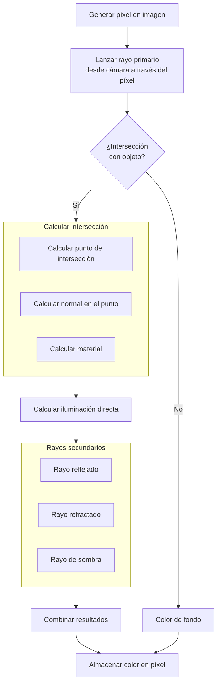
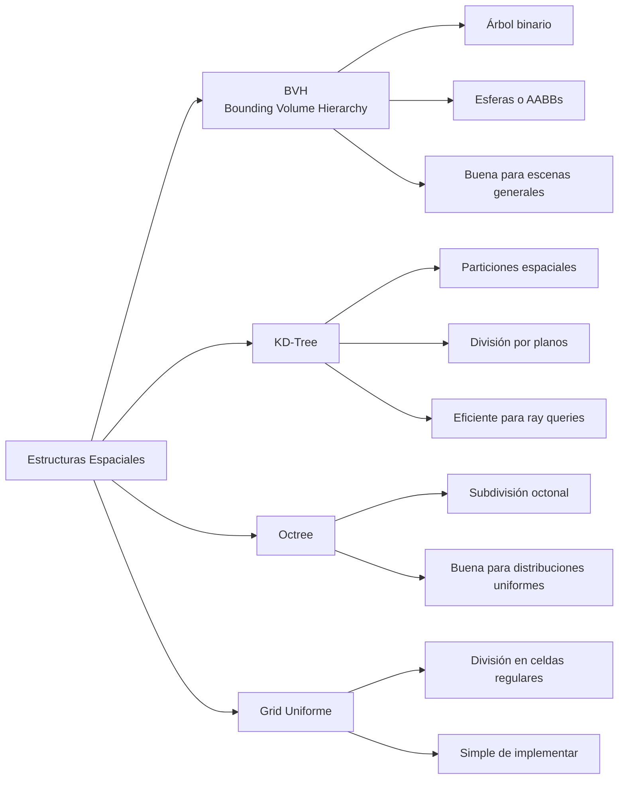

# Modelado y Programación - Graficación por computadora

## 6.3 El algoritmo de ray-tracing.

---

El **ray tracing** (trazado de rayos) es una técnica de renderizado que simula el comportamiento físico de la luz para generar imágenes digitales de alta calidad y realismo. A diferencia de la rasterización tradicional, el ray tracing modela cómo la luz interactúa con las superficies, produciendo efectos como reflejos, refracciones y sombras con un alto grado de precisión.

En la naturaleza, la luz sale de las fuentes, rebota en los objetos y una fracción minúscula llega al ojo. Simular eso directamente sería muy costoso, así que el ray tracing recorre el camino **al revés**: lanza rayos desde la cámara, uno o más por píxel, y sigue cada uno hacia la escena. Esto es válido porque los caminos de la luz son reversibles. El algoritmo recursivo que se describe aquí es el de Whitted (1980).

**Rasterización contra ray tracing.** La rasterización recorre los **objetos** y, para cada triángulo, determina qué píxeles cubre; el ray tracing recorre los **píxeles** y, para cada rayo, determina qué objeto encuentra primero. La rasterización es más rápida para la visibilidad desde la cámara, pero no sabe nada de los demás objetos al sombrear un píxel; el ray tracing puede preguntar en cualquier punto "¿qué hay en esta dirección?", y eso es lo que hace naturales las sombras, los reflejos y las refracciones.

### Fundamentos Físicos del Ray Tracing

#### Leyes de la Óptica Aplicadas

1. **Reflexión**: El ángulo de incidencia es igual al ángulo de reflexión, medidos respecto a la normal, y el rayo reflejado está en el mismo plano que el incidente y la normal:

   $$ \theta_i = \theta_r $$

2. **Refracción**: Descrita por la Ley de Snell:

   $$ n_1 \sin(\theta_1) = n_2 \sin(\theta_2) $$

   donde $n_1$ y $n_2$ son los índices de refracción de los medios: 1.0 para el vacío (y aproximadamente para el aire), 1.33 para el agua y alrededor de 1.5 para el vidrio. Si la luz pasa de un medio más denso a uno menos denso $(n_1 > n_2)$ y $\sin\theta_1 > \frac{n_2}{n_1},$ no hay solución para $\theta_2:$ ocurre la **reflexión interna total**.

### El Algoritmo Básico de Ray Tracing



### Componentes del Algoritmo de Ray Tracing

#### 1. Generación de Rayos Primarios

Para cada píxel de la imagen, generamos un rayo desde el ojo (cámara) a través del píxel. Si la cámara tiene un campo de visión vertical $\text{fov},$ el plano de imagen colocado a distancia 1 mide $2\tan(\text{fov}/2)$ de alto y, para no deformar la imagen, $\text{aspecto} \cdot 2\tan(\text{fov}/2)$ de ancho (tema 6.9):

```python
def generate_primary_ray(camera, x, y, image_width, image_height):
    # Centro del píxel (x + 0.5, y + 0.5) en coordenadas normalizadas de -1 a 1
    ndc_x = (2.0 * (x + 0.5)) / image_width - 1.0
    ndc_y = 1.0 - (2.0 * (y + 0.5)) / image_height  # Invertir Y: la fila 0 está arriba

    # Escalar por el tamaño del plano de imagen
    aspect_ratio = image_width / image_height
    screen_x = ndc_x * aspect_ratio * camera.tan_half_fov
    screen_y = ndc_y * camera.tan_half_fov

    # Crear dirección del rayo en espacio de mundo
    direction = camera.right * screen_x + camera.up * screen_y + camera.forward
    direction = normalize(direction)

    return Ray(camera.position, direction)
```

#### 2. Intersección Rayo-Objeto

##### Intersección con Esfera

Para una esfera con centro $C$ y radio $r,$ la ecuación es:

$$ \|O + tD - C\|^2 = r^2 $$

Desarrollando el producto punto se obtiene una ecuación cuadrática en $t:$

$$ t^2(D \cdot D) + 2t(D \cdot (O - C)) + ((O - C) \cdot (O - C)) - r^2 = 0 $$

con $a = D \cdot D,$ $b = 2D \cdot (O - C)$ y $c = \|O - C\|^2 - r^2.$ El discriminante $b^2 - 4ac$ indica si el rayo no toca la esfera (negativo), es tangente (cero) o la atraviesa (positivo). Interesa la **menor** raíz positiva: la raíz menor es la entrada a la esfera y la mayor la salida; si la menor es negativa, el origen del rayo está dentro de la esfera.

```python
def ray_sphere_intersection(ray, sphere):
    oc = ray.origin - sphere.center
    a = dot(ray.direction, ray.direction)
    b = 2.0 * dot(oc, ray.direction)
    c = dot(oc, oc) - sphere.radius * sphere.radius

    discriminant = b * b - 4 * a * c

    if discriminant < 0:
        return None  # No hay intersección

    t = (-b - math.sqrt(discriminant)) / (2.0 * a)
    if t < 0:
        t = (-b + math.sqrt(discriminant)) / (2.0 * a)
        if t < 0:
            return None  # Intersección detrás del rayo

    point = ray.origin + t * ray.direction
    normal = normalize(point - sphere.center)

    return Intersection(t, point, normal, sphere)
```

##### Intersección con Triángulo

Usando el algoritmo de Möller-Trumbore (1997). Un punto del triángulo se escribe con coordenadas baricéntricas como $V_0 + u(V_1 - V_0) + v(V_2 - V_0)$ con $u, v \geq 0$ y $u + v \leq 1.$ Igualándolo con el rayo $O + tD$ queda un sistema lineal de $3 \times 3$ en las incógnitas $(t, u, v),$ que se resuelve con la regla de Cramer usando productos cruz; si $u$ o $v$ quedan fuera de rango, se descarta en cuanto se detecta:

```python
def ray_triangle_intersection(ray, triangle):
    edge1 = triangle.v1 - triangle.v0
    edge2 = triangle.v2 - triangle.v0

    h = cross(ray.direction, edge2)
    a = dot(edge1, h)

    if abs(a) < 1e-8:
        return None  # Rayo paralelo al triángulo

    f = 1.0 / a
    s = ray.origin - triangle.v0
    u = f * dot(s, h)

    if u < 0.0 or u > 1.0:
        return None

    q = cross(s, edge1)
    v = f * dot(ray.direction, q)

    if v < 0.0 or u + v > 1.0:
        return None

    t = f * dot(edge2, q)
    if t > 1e-8:  # Intersección válida
        point = ray.origin + t * ray.direction
        normal = normalize(cross(edge1, edge2))
        return Intersection(t, point, normal, triangle)

    return None
```

#### 3. Modelado de Materiales

##### Modelo de Iluminación de Phong

$$ I = I_a + I_d + I_s $$

donde, con todos los vectores unitarios, $L$ hacia la luz, $V$ hacia el observador y $R$ la reflexión de $-L$ respecto a $N:$

- $I_a = k_a \cdot L_a$ (componente ambiental)
- $I_d = k_d \cdot \max(L \cdot N, 0) \cdot L_d$ (componente difusa, ley de Lambert)
- $I_s = k_s \cdot \max(R \cdot V, 0)^\alpha \cdot L_s$ (componente especular)

El exponente $\alpha$ controla el brillo: valores grandes dan reflejos pequeños e intensos. En ray tracing, $I_d$ e $I_s$ solo se suman si el **rayo de sombra** desde el punto hacia la luz no encuentra ningún objeto antes de llegar a ella.

```glsl
vec3 phong_illumination(vec3 position, vec3 normal, vec3 view_dir, Material material) {
    vec3 ambient = material.ambient * light.ambient;

    vec3 light_dir = normalize(light.position - position);
    float diff = max(dot(normal, light_dir), 0.0);
    vec3 diffuse = material.diffuse * diff * light.diffuse;

    vec3 reflect_dir = reflect(-light_dir, normal);
    float spec = pow(max(dot(view_dir, reflect_dir), 0.0), material.shininess);
    vec3 specular = material.specular * spec * light.specular;

    return ambient + diffuse + specular;
}
```

#### 4. Rayos Secundarios

##### Rayos Reflejados

$$ R = I - 2(N \cdot I)N $$

donde $I$ es el vector incidente y $N$ la normal unitaria. La componente de $I$ paralela a la normal es $(N \cdot I)N;$ reflejar consiste en invertir esa componente y conservar la tangencial, de ahí el factor 2.

```python
def calculate_reflection(incident, normal):
    return incident - 2 * dot(incident, normal) * normal
```

##### Rayos Refractados

Usando la Ley de Snell:

$$ \eta_1 \sin(\theta_1) = \eta_2 \sin(\theta_2) $$

$$ T = \left( \frac{\eta_1}{\eta_2} \right) I - \left( \frac{\eta_1}{\eta_2} (N \cdot I) + \sqrt{1 - \left( \frac{\eta_1}{\eta_2} \right)^2 (1 - (N \cdot I)^2)} \right) N $$

con $I$ y $N$ unitarios y $N$ apuntando hacia el lado de donde viene el rayo, de modo que $N \cdot I = -\cos\theta_1 < 0.$ El radicando es $1 - \sin^2\theta_2 = \cos^2\theta_2;$ si es negativo, hay reflexión interna total. En el código, `cos_i` es $-N \cdot I$ y, si es negativo, el rayo sale del objeto y se invierten la normal y los índices.

```python
def calculate_refraction(incident, normal, eta_i, eta_t):
    cos_i = -dot(normal, incident)
    if cos_i < 0:
        # El rayo está saliendo del medio
        return calculate_refraction(incident, -normal, eta_t, eta_i)

    eta = eta_i / eta_t
    k = 1.0 - eta * eta * (1.0 - cos_i * cos_i)

    if k < 0:
        return None  # Reflexión interna total

    return eta * incident + (eta * cos_i - math.sqrt(k)) * normal
```

### Implementación del Algoritmo de Ray Tracing

```python
class RayTracer:
    def __init__(self, width, height, max_depth=5):
        self.width = width
        self.height = height
        self.max_depth = max_depth
        self.scene = Scene()
        self.camera = Camera()

    def trace_ray(self, ray, depth=0):
        if depth >= self.max_depth:
            return Color(0, 0, 0)  # Negro (sin contribución)

        # Encontrar la intersección más cercana
        closest_intersection = None
        for obj in self.scene.objects:
            intersection = obj.intersect(ray)
            if intersection and (not closest_intersection or
                               intersection.t < closest_intersection.t):
                closest_intersection = intersection

        if not closest_intersection:
            return self.scene.background_color

        # Calcular iluminación directa
        material = closest_intersection.object.material
        color = self.calculate_direct_illumination(closest_intersection)

        # Calcular reflexión
        if material.reflectivity > 0:
            reflection_dir = calculate_reflection(ray.direction,
                                                closest_intersection.normal)
            reflection_ray = Ray(closest_intersection.point +
                               reflection_dir * 1e-4, reflection_dir)
            reflection_color = self.trace_ray(reflection_ray, depth + 1)
            color = color * (1 - material.reflectivity) + \
                   reflection_color * material.reflectivity

        # Calcular refracción
        if material.transparency > 0:
            refraction_dir = calculate_refraction(ray.direction,
                                                closest_intersection.normal,
                                                1.0, material.ior)
            if refraction_dir:
                refraction_ray = Ray(closest_intersection.point +
                                   refraction_dir * 1e-4, refraction_dir)
                refraction_color = self.trace_ray(refraction_ray, depth + 1)
                color = color * (1 - material.transparency) + \
                       refraction_color * material.transparency

        return color

    def render(self):
        image = Image.new("RGB", (self.width, self.height))
        pixels = image.load()

        for y in range(self.height):
            for x in range(self.width):
                ray = self.camera.generate_ray(x, y, self.width, self.height)
                color = self.trace_ray(ray)
                pixels[x, y] = (int(color.r * 255),
                               int(color.g * 255),
                               int(color.b * 255))

        return image
```

La recursión se corta con `max_depth`: entre dos espejos paralelos un rayo rebotaría indefinidamente. Los nuevos rayos parten de `point + dir * 1e-4` y no exactamente del punto de intersección; si no, por errores de redondeo, el rayo podría intersectar la misma superficie en $t ≈ 0$ y producir manchas oscuras (*shadow acne*).

### Un Ray Tracer Completo y Mínimo

El código anterior supone clases `Scene`, `Camera`, `Color` y funciones como `dot` y `normalize`. El siguiente programa es autocontenido: define vectores, esferas, un plano, una luz puntual con sombras, reflexión y refracción, y dibuja la imagen como caracteres para poder verla en la terminal. Cambiando la última parte se puede escribir un archivo PPM.

```python
import math

class V:
    def __init__(self, x, y, z): self.x, self.y, self.z = x, y, z
    def __add__(s, o): return V(s.x + o.x, s.y + o.y, s.z + o.z)
    def __sub__(s, o): return V(s.x - o.x, s.y - o.y, s.z - o.z)
    def __mul__(s, k): return V(s.x * k, s.y * k, s.z * k)
    __rmul__ = __mul__
    def __neg__(s): return V(-s.x, -s.y, -s.z)
    def dot(s, o): return s.x * o.x + s.y * o.y + s.z * o.z
    def norm(s):
        l = math.sqrt(s.dot(s)); return V(s.x / l, s.y / l, s.z / l)

class Material:
    def __init__(self, color, kd=0.8, ks=0.3, shininess=30, reflect=0.0, transp=0.0, ior=1.5):
        self.color, self.kd, self.ks, self.shininess = color, kd, ks, shininess
        self.reflect, self.transp, self.ior = reflect, transp, ior

class Esfera:
    def __init__(self, c, r, m): self.c, self.r, self.m = c, r, m
    def intersect(self, o, d):              # d unitario: a = 1
        oc = o - self.c
        h = oc.dot(d)                       # b/2
        disc = h * h - (oc.dot(oc) - self.r * self.r)
        if disc < 0: return None
        s = math.sqrt(disc)
        for t in (-h - s, -h + s):
            if t > 1e-4: return t
        return None
    def normal(self, p): return (p - self.c).norm()

class Plano:
    def __init__(self, p, n, m): self.p, self.n, self.m = p, n.norm(), m
    def intersect(self, o, d):
        den = d.dot(self.n)
        if abs(den) < 1e-9: return None
        t = (self.p - o).dot(self.n) / den
        return t if t > 1e-4 else None
    def normal(self, p): return self.n

escena = [
    Esfera(V(0, 0, -5), 1, Material(1.0)),
    Esfera(V(2.2, 0.3, -6), 1.3, Material(0.9, reflect=0.7)),
    Esfera(V(-2, -0.2, -4.5), 0.8, Material(0.9, transp=0.8, ior=1.5)),
    Plano(V(0, -1, 0), V(0, 1, 0), Material(0.6)),
]
luz = V(5, 5, 0)
FONDO, AMBIENTE = 0.05, 0.1

def mas_cercano(o, d):
    mejor, obj = math.inf, None
    for s in escena:
        t = s.intersect(o, d)
        if t is not None and t < mejor: mejor, obj = t, s
    return mejor, obj

def reflejar(i, n): return i - 2 * n.dot(i) * n

def refractar(i, n, eta_i, eta_t):
    cos_i = -n.dot(i)
    if cos_i < 0:                                  # sale del objeto
        return refractar(i, -n, eta_t, eta_i)
    eta = eta_i / eta_t
    k = 1 - eta * eta * (1 - cos_i * cos_i)
    return None if k < 0 else eta * i + (eta * cos_i - math.sqrt(k)) * n

def trazar(o, d, prof=0):
    if prof > 4: return 0.0
    t, obj = mas_cercano(o, d)
    if obj is None: return FONDO
    p = o + t * d
    n = obj.normal(p)
    if n.dot(d) > 0 and isinstance(obj, Plano): n = -n
    m = obj.m
    # Iluminación directa de Phong con rayo de sombra
    l = (luz - p).norm()
    dist_luz = math.sqrt((luz - p).dot(luz - p))
    t_sombra, _ = mas_cercano(p + n * 1e-4, l)
    color = AMBIENTE * m.color
    if t_sombra > dist_luz:                         # nada tapa a la luz
        difusa = max(n.dot(l), 0)
        r = reflejar(-l, n)
        especular = max(r.dot(-d), 0) ** m.shininess
        color += m.kd * difusa * m.color + m.ks * especular
    # Rayos secundarios
    if m.reflect > 0:
        rd = reflejar(d, n).norm()
        color = (1 - m.reflect) * color + m.reflect * trazar(p + rd * 1e-4, rd, prof + 1)
    if m.transp > 0:
        td = refractar(d, n, 1.0, m.ior)
        if td is not None:
            td = td.norm()
            color = (1 - m.transp) * color + m.transp * trazar(p + td * 1e-4, td, prof + 1)
    return color

def render(ancho=64, alto=24, fov=60):
    tan_half = math.tan(math.radians(fov) / 2)
    aspecto = ancho / alto / 2          # los caracteres miden el doble de alto que de ancho
    rampa = " .:-=+*#%@"
    filas = []
    for y in range(alto):
        fila = ""
        for x in range(ancho):
            px = (2 * (x + 0.5) / ancho - 1) * aspecto * tan_half
            py = (1 - 2 * (y + 0.5) / alto) * tan_half
            d = V(px, py, -1).norm()
            c = min(max(trazar(V(0, 0, 0), d), 0), 1)
            fila += rampa[int(c * (len(rampa) - 1))]
        filas.append(fila)
    return "\n".join(filas)

print(render())
```

En la salida se ven las tres esferas sobre el piso, la sombra de la esfera central en el plano, el reflejo de la escena en la esfera de la derecha y la esfera de vidrio de la izquierda, que deja ver el fondo invertido. Para obtener una imagen a color basta que `trazar` devuelva tres componentes y escribir un archivo PPM: la cabecera `P3`, el ancho, el alto y 255, seguida de los valores RGB de cada píxel.

### Optimizaciones del Ray Tracing

#### 1. Estructuras de Aceleración

##### Bounding Volume Hierarchy (BVH)

```python
class BVHNode:
    def __init__(self, objects):
        if len(objects) <= 2:
            self.left = None
            self.right = None
            self.objects = objects
            self.bounding_box = self.calculate_bounding_box(objects)
        else:
            # Dividir objetos según el eje más largo
            axis = self.find_longest_axis(objects)
            sorted_objects = sorted(objects, key=lambda obj: obj.get_center()[axis])

            mid = len(sorted_objects) // 2
            self.left = BVHNode(sorted_objects[:mid])
            self.right = BVHNode(sorted_objects[mid:])
            self.objects = None
            self.bounding_box = self.merge_boxes(self.left.bounding_box,
                                               self.right.bounding_box)

    def intersect(self, ray):
        if not self.bounding_box.intersect(ray):
            return None

        if self.objects:  # Nodo hoja
            closest = None
            for obj in self.objects:
                intersection = obj.intersect(ray)
                if intersection and (not closest or intersection.t < closest.t):
                    closest = intersection
            return closest
        else:
            left_intersection = self.left.intersect(ray)
            right_intersection = self.right.intersect(ray)

            if not left_intersection:
                return right_intersection
            if not right_intersection:
                return left_intersection

            return left_intersection if left_intersection.t < right_intersection.t else right_intersection
```

#### 2. Spatial Data Structures



### Ejercicios Propuestos

1. **Ejercicio 1**: Implementa la intersección rayo-esfera con optimización para evitar cálculos redundantes.

2. **Ejercicio 2**: Desarrolla un algoritmo de suavizado de bordes (anti-aliasing) para el ray tracer usando múltiples rayos por píxel.

3. **Ejercicio 3**: Implementa sombras suaves (soft shadows) utilizando muestreo de área de luz.

4. **Ejercicio 4**: Crea una escena con materiales metálicos (alta reflectividad) y dieléctricos (transparentes) y compara los resultados.

5. **Ejercicio 5**: Optimiza el ray tracer usando una estructura de aceleración (BVH o KD-Tree) y mide la mejora de rendimiento.

### Soluciones a los Ejercicios

**Ejercicio 1.** Si $D$ es unitario, $a = 1,$ y si se usa $h = \frac{b}{2} = D \cdot (O - C),$ las raíces quedan

$$ t = -h \pm \sqrt{h^2 - c} $$

lo que ahorra varias multiplicaciones y la división entre $2a.$ Otras optimizaciones: guardar $r^2$ en la esfera; descartar pronto si $c > 0$ (origen fuera de la esfera) y $h > 0$ (la esfera queda detrás del rayo); y, al buscar el objeto más cercano, descartar la esfera si su $t$ es mayor que el mejor encontrado hasta ahora. El método `Esfera.intersect` del ray tracer mínimo usa esta forma.

**Ejercicio 2.** Se lanzan $n \times n$ rayos por píxel, en posiciones aleatorias dentro de cada una de las $n^2$ subceldas del píxel (**muestreo estratificado** o *jittering*), y se promedia:

```python
import random

def color_pixel_aa(x, y, ancho, alto, tan_half, aspecto, n=3):
    total = 0.0
    for i in range(n):
        for j in range(n):
            sx = x + (i + random.random()) / n      # posición dentro del píxel
            sy = y + (j + random.random()) / n
            px = (2 * sx / ancho - 1) * aspecto * tan_half
            py = (1 - 2 * sy / alto) * tan_half
            total += trazar(V(0, 0, 0), V(px, py, -1).norm())
    return total / (n * n)

print(round(color_pixel_aa(32, 12, 64, 24, math.tan(math.radians(30)), 64 / 24 / 2), 3))
```

El costo se multiplica por $n^2,$ y el error del promedio disminuye como $\frac{1}{n}$ con el número de muestras por lado. El tema 6.10 compara este método con el multimuestreo de las GPU.

**Ejercicio 3.** En lugar de una luz puntual, se modela una luz de **área**, por ejemplo un cuadrado de lado $s.$ Para cada punto se lanzan $k$ rayos de sombra hacia puntos aleatorios de la luz y la iluminación directa se multiplica por la fracción de rayos que no encontraron obstáculo. En la zona de **penumbra** solo parte de la luz es visible y la sombra se difumina. Con pocas muestras aparece ruido; con muestreo estratificado sobre la superficie de la luz se reduce. El tema 6.10 desarrolla el método.

**Ejercicio 4.** En la escena del ray tracer mínimo, la esfera con `reflect=0.7` se comporta como metal: refleja la escena con el color del objeto. La esfera de vidrio refracta: invierte y desplaza lo que está detrás. Para hacerla más realista, la proporción entre luz reflejada y refractada en un dieléctrico no es constante, sino que depende del ángulo según las **ecuaciones de Fresnel**; la aproximación de Schlick es

$$ F(\theta) = F_0 + (1 - F_0)(1 - \cos\theta)^5, \qquad F_0 = \left(\frac{n_1 - n_2}{n_1 + n_2}\right)^2 $$

Para vidrio $F_0 = 0.04:$ de frente refleja el 4% de la luz, pero vista en ángulo rasante refleja casi toda. Se usa $F$ en lugar de `reflect` y $1 - F$ en lugar de `transp`.

**Ejercicio 5.** Sin estructura de aceleración, cada rayo se prueba contra los $N$ objetos, con costo $O(N)$ por rayo. Con una BVH balanceada, el recorrido visita del orden de $O(\log N)$ nodos en escenas típicas, porque se descartan ramas completas cuando el rayo no toca la caja de un nodo. Con $N = 10^5$ triángulos la diferencia es de unas $10^5$ pruebas contra unas decenas. Para medirlo, se cuenta el número de pruebas rayo-objeto por rayo y el tiempo total de render con y sin BVH, para escenas de tamaño creciente; la mejora debe crecer con $N.$ La prueba rayo-caja usa el método de los *slabs*: para cada eje se calcula el intervalo de $t$ en que el rayo está entre los dos planos de la caja, y hay intersección si la intersección de los tres intervalos no es vacía.

### Ejemplo de Escena Compleja

```python
# Creación de una escena con múltiples objetos y materiales
def create_complex_scene():
    scene = Scene()

    # Materiales
    red_diffuse = Material(diffuse=Color(0.8, 0.2, 0.2))
    blue_metal = Material(diffuse=Color(0.2, 0.2, 0.8),
                         specular=Color(0.8, 0.8, 0.8),
                         reflectivity=0.8, shininess=50)
    glass = Material(diffuse=Color(0.9, 0.9, 0.9),
                    transparency=0.9, ior=1.5)

    # Objetos
    scene.add(Sphere(Point(0, 0, -5), 1, red_diffuse))
    scene.add(Sphere(Point(2, 0, -7), 1.5, blue_metal))
    scene.add(Sphere(Point(-2, 0, -6), 1, glass))

    # Plano base
    floor_material = Material(diffuse=Color(0.8, 0.8, 0.8))
    scene.add(Plane(Point(0, -2, 0), Vector(0, 1, 0), floor_material))

    # Luces
    scene.add(PointLight(Point(5, 5, 3), Color(1, 1, 1), 1.0))
    scene.add(DirectionalLight(Vector(-1, -1, -1), Color(0.5, 0.5, 0.5)))

    return scene
```

### Referencias Bibliográficas

1. Shirley, P., & Marschner, S. (2009). _Fundamentals of Computer Graphics_.
2. Pharr, M., Jakob, W., & Humphreys, G. (2016). _Physically Based Rendering: From Theory to Implementation_.
3. Glassner, A. S. (1989). _An Introduction to Ray Tracing_.
4. Kajiya, J. T. (1986). _The Rendering Equation_. SIGGRAPH.
5. Whitted, T. (1980). _An Improved Illumination Model for Shaded Display_. Communications of the ACM.

### Recursos Adicionales

- [Ray Tracing in One Weekend Series](https://raytracing.github.io/)
- [NVIDIA OptiX Ray Tracing Engine](https://developer.nvidia.com/optix)
- [Intel Embree Ray Tracing Kernels](https://www.embree.org/)
- [PBRT Book Source Code](https://github.com/mmp/pbrt-v4)
