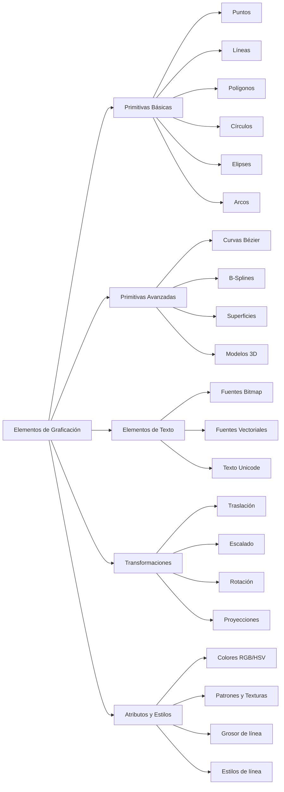
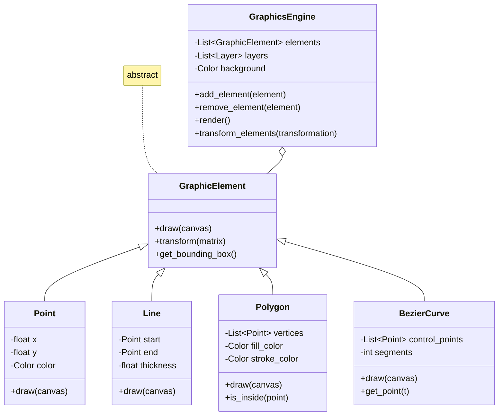

# Modelado y Programación - Graficación por computadora

## 6.4 Elementos soportados en el proyecto.

---

Los **elementos de graficación** son las primitivas básicas que pueden ser representadas y manipuladas en un sistema de gráficos por computadora. En un proyecto de graficación, es fundamental determinar qué elementos serán soportados y cómo se implementarán.

### Clasificación de Elementos de Graficación



### Primitivas Básicas Soportadas

#### 1. Puntos

Representación matemática:

$$ P = (x, y) \quad \text{o} \quad P = (x, y, z) $$

Implementación:

```python
class Point:
    def __init__(self, x, y, z=0):
        self.x = x
        self.y = y
        self.z = z

    def draw(self, canvas, color):
        # Dibujar punto en el canvas
        canvas.set_pixel(int(self.x), int(self.y), color)

    def transform(self, matrix):
        # Aplicar transformación matricial
        transformed = matrix @ np.array([self.x, self.y, self.z, 1])
        return Point(transformed[0], transformed[1], transformed[2])
```

#### 2. Líneas

Ecuación paramétrica:

$$ L(t) = P_0 + t(P_1 - P_0), \quad 0 \leq t \leq 1 $$

Algoritmo de Bresenham para líneas:

```python
def draw_line_bresenham(x0, y0, x1, y1, color):
    dx = abs(x1 - x0)
    dy = abs(y1 - y0)
    steep = dy > dx

    if steep:
        x0, y0 = y0, x0
        x1, y1 = y1, x1

    if x0 > x1:
        x0, x1 = x1, x0
        y0, y1 = y1, y0

    dx = x1 - x0
    dy = abs(y1 - y0)
    error = dx / 2
    y = y0
    y_step = 1 if y0 < y1 else -1

    points = []
    for x in range(x0, x1 + 1):
        coord = (y, x) if steep else (x, y)
        points.append(coord)
        error -= dy
        if error < 0:
            y += y_step
            error += dx

    return points
```

#### 3. Polígonos

Ecuación de un polígono regular de n lados:

$$ x_i = x_c + r \cdot \cos\left(\frac{2\pi i}{n}\right) $$

$$ y_i = y_c + r \cdot \sin\left(\frac{2\pi i}{n}\right) $$

Algoritmo de relleno (flood fill):

```python
def flood_fill(canvas, x, y, target_color, replacement_color):
    if target_color == replacement_color:
        return

    stack = [(x, y)]
    while stack:
        x, y = stack.pop()
        if not (0 <= x < canvas.width and 0 <= y < canvas.height):
            continue
        if canvas.get_pixel(x, y) != target_color:
            continue

        canvas.set_pixel(x, y, replacement_color)
        stack.append((x + 1, y))
        stack.append((x - 1, y))
        stack.append((x, y + 1))
        stack.append((x, y - 1))
```

#### 4. Círculos y Elipses

Ecuación del círculo:

$$ (x - h)^2 + (y - k)^2 = r^2 $$

Algoritmo del punto medio para círculos:

```python
def draw_circle_midpoint(center, radius, color):
    x = 0
    y = radius
    p = 1 - radius  # Parámetro de decisión inicial

    points = []

    def plot_circle_points(cx, cy, x, y):
        points.extend([
            (cx + x, cy + y), (cx - x, cy + y),
            (cx + x, cy - y), (cx - x, cy - y),
            (cx + y, cy + x), (cx - y, cy + x),
            (cx + y, cy - x), (cx - y, cy - x)
        ])

    plot_circle_points(center.x, center.y, x, y)

    while x < y:
        x += 1
        if p < 0:
            p += 2 * x + 1
        else:
            y -= 1
            p += 2 * (x - y) + 1
        plot_circle_points(center.x, center.y, x, y)

    return points
```

### Primitivas Avanzadas

#### 1. Curvas de Bézier

Ecuación general:

$$ B(t) = \sum_{i=0}^{n} \binom{n}{i} (1-t)^{n-i} t^i P_i, \quad 0 \leq t \leq 1 $$

Implementación de Bézier cúbica:

```python
def cubic_bezier(P0, P1, P2, P3, num_points=100):
    curve_points = []
    for i in range(num_points + 1):
        t = i / num_points
        # Fórmula de Bézier cúbica
        point = (1-t)**3 * P0 + 3*(1-t)**2*t * P1 + 3*(1-t)*t**2 * P2 + t**3 * P3
        curve_points.append(point)
    return curve_points
```

#### 2. B-Splines

Base recursiva de B-Splines:

$$ N_{i,0}(t) = \begin{cases} 1 & \text{si } t_i \leq t < t_{i+1} \\\ 0 & \text{en otro caso} \end{cases} $$

$$ N_{i,k}(t) = \frac{t - t_i}{t_{i+k} - t_i} N_{i,k-1}(t) + \frac{t_{i+k+1} - t}{t_{i+k+1} - t_{i+1}} N_{i+1,k-1}(t) $$

### Transformaciones Geométricas

#### Matrices de Transformación 2D

##### Traslación

$$ T(t_x, t_y) = \begin{bmatrix} 1 & 0 & t_x \\\ 0 & 1 & t_y \\\ 0 & 0 & 1 \end{bmatrix} $$

##### Escalado

$$ S(s_x, s_y) = \begin{bmatrix} s_x & 0 & 0 \\\ 0 & s_y & 0 \\\ 0 & 0 & 1 \end{bmatrix} $$

##### Rotación

$$ R(\theta) = \begin{bmatrix} \cos\theta & -\sin\theta & 0 \\\ \sin\theta & \cos\theta & 0 \\\ 0 & 0 & 1 \end{bmatrix} $$

#### Composición de Transformaciones
```python
class Transformation:
    def __init__(self):
        self.matrix = np.identity(3)

    def translate(self, tx, ty):
        translation = np.array([
            [1, 0, tx],
            [0, 1, ty],
            [0, 0, 1]
        ])
        self.matrix = translation @ self.matrix
        return self

    def scale(self, sx, sy):
        scaling = np.array([
            [sx, 0, 0],
            [0, sy, 0],
            [0, 0, 1]
        ])
        self.matrix = scaling @ self.matrix
        return self

    def rotate(self, angle):
        rad = math.radians(angle)
        cos_a = math.cos(rad)
        sin_a = math.sin(rad)
        rotation = np.array([
            [cos_a, -sin_a, 0],
            [sin_a, cos_a, 0],
            [0, 0, 1]
        ])
        self.matrix = rotation @ self.matrix
        return self

    def apply(self, point):
        homogeneous = np.array([point.x, point.y, 1])
        transformed = self.matrix @ homogeneous
        return Point(transformed[0], transformed[1])
```

### Sistema de Coordenadas y Proyecciones

#### Transformación de Ventana a Viewport

$$ x_{viewport} = \left( \frac{x - x_{min}}{x_{max} - x_{min}} \right) \cdot width_{viewport} + x_{viewportMin} $$

$$ y_{viewport} = \left(1 - \frac{y - y_{min}}{y_{max} - y_{min}} \right) \cdot height_{viewport} + y_{viewportMin} $$

Implementación:
```python
def window_to_viewport(x_w, y_w, window, viewport):
    # Normalizar coordenadas de ventana
    x_norm = (x_w - window.x_min) / (window.x_max - window.x_min)
    y_norm = (y_w - window.y_min) / (window.y_max - window.y_min)

    # Escalar a viewport
    x_v = viewport.x_min + x_norm * (viewport.x_max - viewport.x_min)
    y_v = viewport.y_min + (1 - y_norm) * (viewport.y_max - viewport.y_min)

    return x_v, y_v
```

### Atributos y Estilos

#### Sistema de Colores
```python
class Color:
    def __init__(self, r=0, g=0, b=0, a=1):
        self.r = max(0, min(1, r))
        self.g = max(0, min(1, g))
        self.b = max(0, min(1, b))
        self.a = max(0, min(1, a))

    @staticmethod
    def from_hex(hex_code):
        hex_code = hex_code.lstrip('#')
        r = int(hex_code[0:2], 16) / 255
        g = int(hex_code[2:4], 16) / 255
        b = int(hex_code[4:6], 16) / 255
        return Color(r, g, b)

    def to_rgb255(self):
        return (int(self.r * 255), int(self.g * 255), int(self.b * 255))

    def interpolate(self, other, t):
        return Color(
            self.r + (other.r - self.r) * t,
            self.g + (other.g - self.g) * t,
            self.b + (other.b - self.b) * t,
            self.a + (other.a - self.a) * t
        )
```

#### Patrones y Texturas
```python
class Pattern:
    def __init__(self, width, height):
        self.width = width
        self.height = height
        self.pixels = [[Color() for _ in range(width)] for _ in range(height)]

    def checkerboard(self, color1, color2, size=10):
        for y in range(self.height):
            for x in range(self.width):
                if (x // size + y // size) % 2 == 0:
                    self.pixels[y][x] = color1
                else:
                    self.pixels[y][x] = color2

    def get_color(self, u, v):
        x = int(u * self.width) % self.width
        y = int(v * self.height) % self.height
        return self.pixels[y][x]
```

### Ejercicios Propuestos

1. **Ejercicio 1**: Implementa el algoritmo de Cohen-Sutherland para recorte de líneas.

2. **Ejercicio 2**: Desarrolla una función que convieta coordenadas polares a cartesianas para dibujar estrellas y polígonos regulares.

3. **Ejercicio 3**: Crea un sistema de capas (layers) que permita agrupar elementos gráficos y aplicar transformaciones a grupos completos.

4. **Ejercicio 4**: Implementa un algoritmo para dibujar elipses rotadas utilizando transformaciones afines.

5. **Ejercicio 5**: Desarrolla un sistema de gradientes lineales y radiales para relleno de formas.

### Estructura del Proyecto de Graficación



### Referencias Bibliográficas

1. Foley, J. D., van Dam, A., Feiner, S. K., & Hughes, J. F. (1996). *Computer Graphics: Principles and Practice*.
2. Hearn, D., & Baker, M. P. (2004). *Computer Graphics with OpenGL*.
3. Rogers, D. F. (2001). *An Introduction to NURBS: With Historical Perspective*.
4. Bresenham, J. E. (1965). *Algorithm for computer control of a digital plotter*. IBM Systems Journal.

### Recursos Adicionales

- [OpenGL Programming Guide](https://www.opengl.org/documentation/)
- [Computer Graphics Algorithms](https://www.tutorialspoint.com/computer_graphics/)
- [Geometric Transformations](https://www.geogebra.org/materials)
- [2D Graphics Programming](https://www.learncpp.com/)
