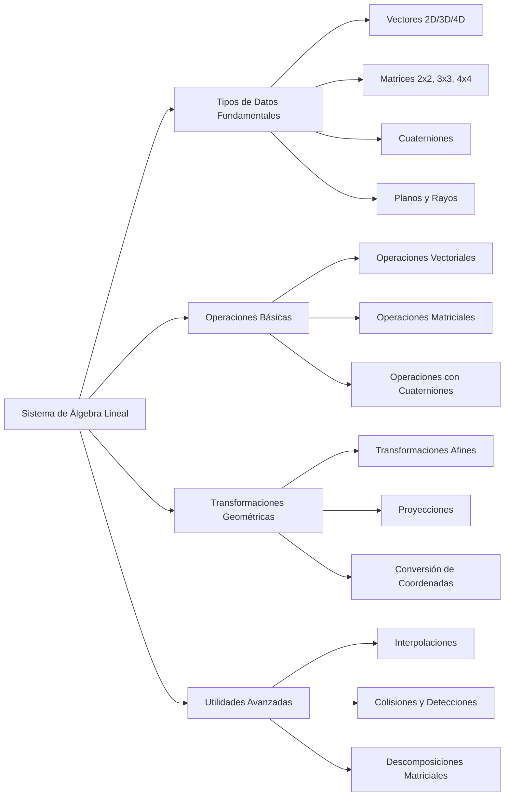
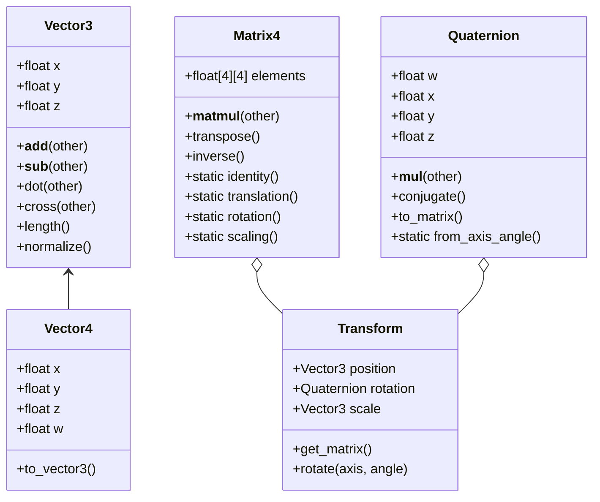

# Modelado y Programación - Graficación por computadora

## 6.5 Construcción del sistema de álgebra lineal.

---

El **álgebra lineal** es fundamental en graficación por computadora, proporcionando las herramientas matemáticas para representar y manipular objetos geométricos, transformaciones y proyecciones. Un sistema robusto de álgebra lineal es la columna vertebral de cualquier motor gráfico.

### Estructura del Sistema de Álgebra Lineal



### Vectores: Definición y Operaciones

#### Vectores en 2D, 3D y 4D

Un vector en 3D se define como:

$$ \vec{v} = \begin{bmatrix} x \\ y \\ z \end{bmatrix} $$

#### Operaciones Vectoriales Básicas

##### Producto Punto (Dot Product)

$$ \vec{a} \cdot \vec{b} = a_x b_x + a_y b_y + a_z b_z = \|\vec{a}\| \|\vec{b}\| \cos\theta $$

##### Producto Cruz (Cross Product)

$$ \vec{a} \times \vec{b} = \begin{bmatrix} a_y b_z - a_z b_y \\ a_z b_x - a_x b_z \\ a_x b_y - a_y b_x \end{bmatrix} $$

##### Normalización

$$ \hat{v} = \frac{\vec{v}}{\|\vec{v}\|} = \frac{1}{\sqrt{x^2 + y^2 + z^2}} \begin{bmatrix} x \\ y \\ z \end{bmatrix} $$

#### Implementación de Clase Vector

```python
import math
import numpy as np

class Vector3:
    def __init__(self, x=0.0, y=0.0, z=0.0):
        self.x = x
        self.y = y
        self.z = z

    def __add__(self, other):
        return Vector3(self.x + other.x, self.y + other.y, self.z + other.z)

    def __sub__(self, other):
        return Vector3(self.x - other.x, self.y - other.y, self.z - other.z)

    def __mul__(self, scalar):
        return Vector3(self.x * scalar, self.y * scalar, self.z * scalar)

    def dot(self, other):
        return self.x * other.x + self.y * other.y + self.z * other.z

    def cross(self, other):
        return Vector3(
            self.y * other.z - self.z * other.y,
            self.z * other.x - self.x * other.z,
            self.x * other.y - self.y * other.x
        )

    def length(self):
        return math.sqrt(self.dot(self))

    def normalize(self):
        length = self.length()
        if length > 0:
            return Vector3(self.x / length, self.y / length, self.z / length)
        return Vector3()

    def to_array(self):
        return np.array([self.x, self.y, self.z])

    def to_homogeneous(self):
        return Vector4(self.x, self.y, self.z, 1.0)

    @staticmethod
    def from_array(arr):
        return Vector3(arr[0], arr[1], arr[2])
```

### Matrices: Definición y Operaciones

#### Matrices 4x4 para Transformaciones

Una matriz de transformación 4x4 tiene la forma:

$$ M = \begin{bmatrix} m_{00} & m_{01} & m_{02} & m_{03} \\ m_{10} & m_{11} & m_{12} & m_{13} \\ m_{20} & m_{21} & m_{22} & m_{23} \\ m_{30} & m_{31} & m_{32} & m_{33} \end{bmatrix} $$

#### Operaciones Matriciales Clave

##### Multiplicación de Matrices

$$ C = AB \quad \text{donde} \quad c_{ij} = \sum_{k=0}^{3} a_{ik} b_{kj} $$

##### Transposición

$$ M^T = \begin{bmatrix} m_{00} & m_{10} & m_{20} & m_{30} \\ m_{01} & m_{11} & m_{21} & m_{31} \\ m_{02} & m_{12} & m_{22} & m_{32} \\ m_{03} & m_{13} & m_{23} & m_{33} \end{bmatrix} $$

##### Inversa (para matrices ortogonales)

$$ M^{-1} = M^T $$

#### Implementación de Clase Matrix

```python
class Matrix4:
    def __init__(self, elements=None):
        if elements is None:
            self.elements = np.identity(4, dtype=np.float32)
        else:
            self.elements = np.array(elements, dtype=np.float32).reshape(4, 4)

    def __matmul__(self, other):
        if isinstance(other, Matrix4):
            return Matrix4(np.matmul(self.elements, other.elements))
        elif isinstance(other, Vector4):
            result = np.matmul(self.elements, other.to_array())
            return Vector4.from_array(result)
        elif isinstance(other, Vector3):
            # Convert Vector3 to homogeneous coordinates
            vec4 = Vector4(other.x, other.y, other.z, 1.0)
            result = np.matmul(self.elements, vec4.to_array())
            return Vector3.from_array(result[:3] / result[3])

    def transpose(self):
        return Matrix4(np.transpose(self.elements))

    def inverse(self):
        try:
            return Matrix4(np.linalg.inv(self.elements))
        except np.linalg.LinAlgError:
            raise ValueError("Matrix is not invertible")

    @staticmethod
    def identity():
        return Matrix4()

    @staticmethod
    def translation(tx, ty, tz):
        return Matrix4([
            [1, 0, 0, tx],
            [0, 1, 0, ty],
            [0, 0, 1, tz],
            [0, 0, 0, 1]
        ])

    @staticmethod
    def scaling(sx, sy, sz):
        return Matrix4([
            [sx, 0, 0, 0],
            [0, sy, 0, 0],
            [0, 0, sz, 0],
            [0, 0, 0, 1]
        ])

    @staticmethod
    def rotation_x(angle):
        c = math.cos(angle)
        s = math.sin(angle)
        return Matrix4([
            [1, 0, 0, 0],
            [0, c, -s, 0],
            [0, s, c, 0],
            [0, 0, 0, 1]
        ])

    @staticmethod
    def rotation_y(angle):
        c = math.cos(angle)
        s = math.sin(angle)
        return Matrix4([
            [c, 0, s, 0],
            [0, 1, 0, 0],
            [-s, 0, c, 0],
            [0, 0, 0, 1]
        ])

    @staticmethod
    def rotation_z(angle):
        c = math.cos(angle)
        s = math.sin(angle)
        return Matrix4([
            [c, -s, 0, 0],
            [s, c, 0, 0],
            [0, 0, 1, 0],
            [0, 0, 0, 1]
        ])
```

### Transformaciones Geométricas

#### Composición de Transformaciones

$$ M = T \cdot R \cdot S $$

```python
class Transform:
    def __init__(self):
        self.position = Vector3(0, 0, 0)
        self.rotation = Quaternion.identity()
        self.scale = Vector3(1, 1, 1)
        self.matrix = Matrix4.identity()
        self.dirty = True

    def get_matrix(self):
        if self.dirty:
            # Calcular matriz de transformación
            translation_mat = Matrix4.translation(
                self.position.x, self.position.y, self.position.z
            )
            rotation_mat = self.rotation.to_matrix()
            scale_mat = Matrix4.scaling(
                self.scale.x, self.scale.y, self.scale.z
            )

            self.matrix = translation_mat @ rotation_mat @ scale_mat
            self.dirty = False

        return self.matrix

    def set_position(self, x, y, z):
        self.position = Vector3(x, y, z)
        self.dirty = True

    def rotate(self, axis, angle):
        rotation = Quaternion.from_axis_angle(axis, angle)
        self.rotation = rotation @ self.rotation
        self.dirty = True
```

### Sistema de Coordenadas y Proyecciones

#### Transformación de Modelo-Vista-Proyección (MVP)

$$ P_{clip} = M_{projection} \cdot M_{view} \cdot M_{model} \cdot P_{local} $$

#### Proyección Perspectiva

$$ M_{perspective} = \begin{bmatrix} \frac{2n}{r-l} & 0 & \frac{r+l}{r-l} & 0 \\ 0 & \frac{2n}{t-b} & \frac{t+b}{t-b} & 0 \\ 0 & 0 & -\frac{f+n}{f-n} & -\frac{2fn}{f-n} \\ 0 & 0 & -1 & 0 \end{bmatrix} $$

#### Proyección Ortográfica

$$ M_{orthographic} = \begin{bmatrix} \frac{2}{r-l} & 0 & 0 & -\frac{r+l}{r-l} \\ 0 & \frac{2}{t-b} & 0 & -\frac{t+b}{t-b} \\ 0 & 0 & -\frac{2}{f-n} & -\frac{f+n}{f-n} \\ 0 & 0 & 0 & 1 \end{bmatrix} $$

### Cuaterniones para Rotaciones

#### Definición de Cuaternión

$$ q = w + xi + yj + zk = \begin{bmatrix} w \\ \vec{v} \end{bmatrix} $$

#### Rotación con Cuaterniones

$$ p' = qpq^{-1} $$

```python
class Quaternion:
    def __init__(self, w=1.0, x=0.0, y=0.0, z=0.0):
        self.w = w
        self.x = x
        self.y = y
        self.z = z

    def __mul__(self, other):
        w = self.w * other.w - self.x * other.x - self.y * other.y - self.z * other.z
        x = self.w * other.x + self.x * other.w + self.y * other.z - self.z * other.y
        y = self.w * other.y - self.x * other.z + self.y * other.w + self.z * other.x
        z = self.w * other.z + self.x * other.y - self.y * other.x + self.z * other.w
        return Quaternion(w, x, y, z)

    def conjugate(self):
        return Quaternion(self.w, -self.x, -self.y, -self.z)

    def norm(self):
        return math.sqrt(self.w**2 + self.x**2 + self.y**2 + self.z**2)

    def normalize(self):
        norm = self.norm()
        if norm > 0:
            return Quaternion(
                self.w / norm,
                self.x / norm,
                self.y / norm,
                self.z / norm
            )
        return Quaternion()

    def to_matrix(self):
        # Convert quaternion to rotation matrix
        x2 = self.x + self.x
        y2 = self.y + self.y
        z2 = self.z + self.z

        xx = self.x * x2
        xy = self.x * y2
        xz = self.x * z2

        yy = self.y * y2
        yz = self.y * z2
        zz = self.z * z2

        wx = self.w * x2
        wy = self.w * y2
        wz = self.w * z2

        return Matrix4([
            [1.0 - (yy + zz), xy - wz, xz + wy, 0.0],
            [xy + wz, 1.0 - (xx + zz), yz - wx, 0.0],
            [xz - wy, yz + wx, 1.0 - (xx + yy), 0.0],
            [0.0, 0.0, 0.0, 1.0]
        ])

    @staticmethod
    def from_axis_angle(axis, angle):
        axis = axis.normalize()
        half_angle = angle / 2
        s = math.sin(half_angle)
        return Quaternion(
            math.cos(half_angle),
            axis.x * s,
            axis.y * s,
            axis.z * s
        )

    @staticmethod
    def identity():
        return Quaternion(1.0, 0.0, 0.0, 0.0)
```

### Utilidades Avanzadas

#### Interpolación Lineal (Lerp) y Esférica (Slerp)

```python
def lerp(v0, v1, t):
    return v0 + (v1 - v0) * t

def slerp(q0, q1, t):
    # Spherical linear interpolation for quaternions
    dot = q0.w * q1.w + q0.x * q1.x + q0.y * q1.y + q0.z * q1.z

    if dot < 0:
        q1 = Quaternion(-q1.w, -q1.x, -q1.y, -q1.z)
        dot = -dot

    if dot > 0.9995:
        result = Quaternion(
            lerp(q0.w, q1.w, t),
            lerp(q0.x, q1.x, t),
            lerp(q0.y, q1.y, t),
            lerp(q0.z, q1.z, t)
        )
        return result.normalize()

    theta_0 = math.acos(dot)
    theta = theta_0 * t
    sin_theta = math.sin(theta)
    sin_theta_0 = math.sin(theta_0)

    s0 = math.cos(theta) - dot * sin_theta / sin_theta_0
    s1 = sin_theta / sin_theta_0

    return Quaternion(
        s0 * q0.w + s1 * q1.w,
        s0 * q0.x + s1 * q1.x,
        s0 * q0.y + s1 * q1.y,
        s0 * q0.z + s1 * q1.z
    ).normalize()
```

#### Sistema de Planos y Rayos

```python
class Plane:
    def __init__(self, normal, point):
        self.normal = normal.normalize()
        self.distance = -self.normal.dot(point)

    def distance_to_point(self, point):
        return self.normal.dot(point) + self.distance

    @staticmethod
    def from_points(a, b, c):
        normal = (b - a).cross(c - a).normalize()
        return Plane(normal, a)

class Ray:
    def __init__(self, origin, direction):
        self.origin = origin
        self.direction = direction.normalize()

    def point_at_parameter(self, t):
        return self.origin + self.direction * t

    def intersect_plane(self, plane):
        denom = plane.normal.dot(self.direction)
        if abs(denom) > 1e-6:
            t = (-plane.distance - plane.normal.dot(self.origin)) / denom
            if t >= 0:
                return t
        return None
```

### Ejercicios Propuestos

1. **Ejercicio 1**: Implementa una función que calcule la matriz de look-at para una cámara dada su posición, objetivo y vector up.

2. **Ejercicio 2**: Desarrolla un sistema de jerarquía de transformaciones que permita anidar transformaciones.

3. **Ejercicio 3**: Implementa la descomposición de una matriz de transformación en sus componentes de traslación, rotación y escalado.

4. **Ejercicio 4**: Crea funciones para convertir entre diferentes representaciones de rotación (matrices, cuaterniones, ángulos de Euler).

5. **Ejercicio 5**: Implementa un sistema de frustum culling usando planos para determinar qué objetos son visibles.

### Diagrama de Clases del Sistema de Álgebra Lineal



### Referencias Bibliográficas

1. Dunn, F. & Parberry, I. (2011). _3D Math Primer for Graphics and Game Development_.
2. Van Verth, J. M. & Bishop, L. M. (2015). _Essential Mathematics for Games and Interactive Applications_.
3. Schneider, P. J. & Eberly, D. H. (2002). _Geometric Tools for Computer Graphics_.
4. Hughes, J. F., van Dam, A., McGuire, M., et al. (2013). _Computer Graphics: Principles and Practice_.

### Recursos Adicionales

- [3Blue1Brown: Essence of Linear Algebra](https://www.3blue1brown.com/topics/linear-algebra)
- [Khan Academy: Linear Algebra](https://www.khanacademy.org/math/linear-algebra)
- [GPU Gems: Mathematics for 3D Graphics](https://developer.nvidia.com/gpugems/gpugems/contributors)
- [Geometric Tools Engine](https://www.geometrictools.com/)
