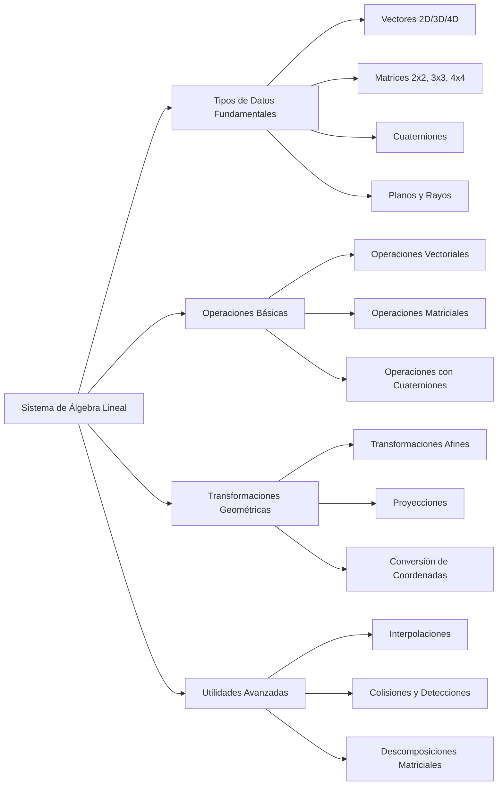
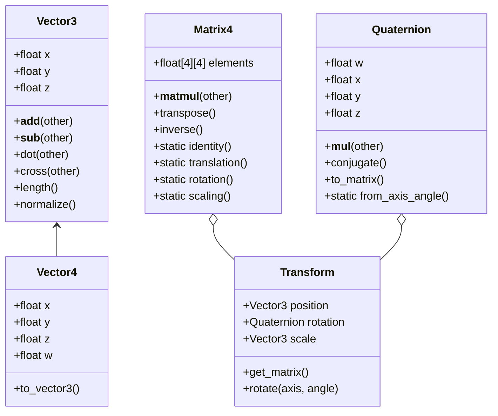

# Modelado y Programación - Graficación por computadora

## 6.5 Construcción del sistema de álgebra lineal.

---

El **álgebra lineal** es fundamental en graficación por computadora, proporcionando las herramientas matemáticas para representar y manipular objetos geométricos, transformaciones y proyecciones. Un sistema robusto de álgebra lineal es la columna vertebral de cualquier motor gráfico.

### Estructura del Sistema de Álgebra Lineal



### Vectores: Definición y Operaciones

#### Vectores en 2D, 3D y 4D

Un vector en 3D se define como:

$$ \vec{v} = \begin{bmatrix} x \\ y \\ z \end{bmatrix} $$

#### Operaciones Vectoriales Básicas

##### Producto Punto (Dot Product)

$$ \vec{a} \cdot \vec{b} = a_x b_x + a_y b_y + a_z b_z = \|\vec{a}\| \|\vec{b}\| \cos\theta $$

En graficación se usa para medir ángulos (la iluminación difusa es proporcional al producto $N \cdot L$ de la normal y la dirección de la luz), para saber si dos vectores apuntan hacia el mismo lado (signo positivo) y para proyectar: la componente de $\vec{a}$ en la dirección unitaria $\hat{u}$ es $(\vec{a} \cdot \hat{u})\hat{u}.$

##### Producto Cruz (Cross Product)

$$ \vec{a} \times \vec{b} = \begin{bmatrix} a_y b_z - a_z b_y \\ a_z b_x - a_x b_z \\ a_x b_y - a_y b_x \end{bmatrix} $$

El resultado es perpendicular a $\vec{a}$ y a $\vec{b},$ con longitud $\|\vec{a}\|\|\vec{b}\|\sin\theta,$ el área del paralelogramo que forman. Se usa para calcular la normal de un triángulo, $(V_1 - V_0) \times (V_2 - V_0),$ y para construir bases ortonormales como la de la cámara. No es conmutativo: $\vec{a} \times \vec{b} = -\vec{b} \times \vec{a},$ y por eso el orden de los vértices determina hacia qué lado apunta la normal.

##### Normalización

$$ \hat{v} = \frac{\vec{v}}{\|\vec{v}\|} = \frac{1}{\sqrt{x^2 + y^2 + z^2}} \begin{bmatrix} x \\ y \\ z \end{bmatrix} $$

#### Implementación de Clase Vector

```python
import math
import numpy as np

class Vector3:
    def __init__(self, x=0.0, y=0.0, z=0.0):
        self.x = x
        self.y = y
        self.z = z

    def __add__(self, other):
        return Vector3(self.x + other.x, self.y + other.y, self.z + other.z)

    def __sub__(self, other):
        return Vector3(self.x - other.x, self.y - other.y, self.z - other.z)

    def __mul__(self, scalar):
        return Vector3(self.x * scalar, self.y * scalar, self.z * scalar)

    def dot(self, other):
        return self.x * other.x + self.y * other.y + self.z * other.z

    def cross(self, other):
        return Vector3(
            self.y * other.z - self.z * other.y,
            self.z * other.x - self.x * other.z,
            self.x * other.y - self.y * other.x
        )

    def length(self):
        return math.sqrt(self.dot(self))

    def normalize(self):
        length = self.length()
        if length > 0:
            return Vector3(self.x / length, self.y / length, self.z / length)
        return Vector3()

    def to_array(self):
        return np.array([self.x, self.y, self.z])

    def to_homogeneous(self):
        return Vector4(self.x, self.y, self.z, 1.0)

    @staticmethod
    def from_array(arr):
        return Vector3(float(arr[0]), float(arr[1]), float(arr[2]))

    def __repr__(self):
        r = lambda v: round(v, 10) + 0.0
        return f"Vector3({r(self.x):.4g}, {r(self.y):.4g}, {r(self.z):.4g})"

class Vector4:
    """Vector homogéneo: w = 1 para puntos, w = 0 para direcciones."""
    def __init__(self, x=0.0, y=0.0, z=0.0, w=0.0):
        self.x, self.y, self.z, self.w = x, y, z, w

    def to_array(self):
        return np.array([self.x, self.y, self.z, self.w])

    @staticmethod
    def from_array(arr):
        return Vector4(*(float(a) for a in arr[:4]))

    def to_vector3(self):
        if self.w != 0:
            return Vector3(self.x / self.w, self.y / self.w, self.z / self.w)
        return Vector3(self.x, self.y, self.z)
```

### Matrices: Definición y Operaciones

#### Matrices 4x4 para Transformaciones

Una matriz de transformación 4x4 tiene la forma:

$$ M = \begin{bmatrix} m_{00} & m_{01} & m_{02} & m_{03} \\ m_{10} & m_{11} & m_{12} & m_{13} \\ m_{20} & m_{21} & m_{22} & m_{23} \\ m_{30} & m_{31} & m_{32} & m_{33} \end{bmatrix} $$

#### Operaciones Matriciales Clave

##### Multiplicación de Matrices

$$ C = AB \quad \text{donde} \quad c_{ij} = \sum_{k=0}^{3} a_{ik} b_{kj} $$

##### Transposición

$$ M^T = \begin{bmatrix} m_{00} & m_{10} & m_{20} & m_{30} \\ m_{01} & m_{11} & m_{21} & m_{31} \\ m_{02} & m_{12} & m_{22} & m_{32} \\ m_{03} & m_{13} & m_{23} & m_{33} \end{bmatrix} $$

##### Inversa (para matrices ortogonales)

$$ M^{-1} = M^T $$

Las matrices de rotación son ortogonales, así que invertirlas es tan barato como transponerlas. Para una transformación rígida $M = T(\vec{t}) \cdot R,$ la inversa también se obtiene sin calcular una inversa general:

$$ M^{-1} = R^T \cdot T(-\vec{t}) = \begin{bmatrix} R^T & -R^T\vec{t} \\ 0 & 1 \end{bmatrix} $$

Así se calcula la matriz de vista a partir de la posición y orientación de la cámara.

##### Transformación de normales

Si una superficie se transforma con la parte lineal $A$ de $M,$ es decir, su submatriz de $3 \times 3,$ sus normales **no** se transforman con $A$ sino con $(A^{-1})^T.$ Si $\vec{t}$ es tangente a la superficie, $\vec{n} \cdot \vec{t} = 0,$ y la tangente transformada es $A\vec{t};$ para que la normal transformada siga siendo perpendicular se necesita

$$ \big((A^{-1})^T\vec{n}\big) \cdot (A\vec{t}) = \vec{n}^T A^{-1} A \vec{t} = \vec{n} \cdot \vec{t} = 0 $$

Con rotaciones $(A^{-1})^T = A,$ pero con un escalamiento no uniforme usar $A$ inclinaría las normales. Es la razón del `transpose(inverse(model))` en el *vertex shader* del tema 6.2.

#### Implementación de Clase Matrix

```python
class Matrix4:
    def __init__(self, elements=None):
        if elements is None:
            self.elements = np.identity(4, dtype=np.float32)
        else:
            self.elements = np.array(elements, dtype=np.float32).reshape(4, 4)

    def __matmul__(self, other):
        if isinstance(other, Matrix4):
            return Matrix4(np.matmul(self.elements, other.elements))
        elif isinstance(other, Vector4):
            result = np.matmul(self.elements, other.to_array())
            return Vector4.from_array(result)
        elif isinstance(other, Vector3):
            # Convert Vector3 to homogeneous coordinates
            vec4 = Vector4(other.x, other.y, other.z, 1.0)
            result = np.matmul(self.elements, vec4.to_array())
            return Vector3.from_array(result[:3] / result[3])

    def transpose(self):
        return Matrix4(np.transpose(self.elements))

    def inverse(self):
        try:
            return Matrix4(np.linalg.inv(self.elements))
        except np.linalg.LinAlgError:
            raise ValueError("Matrix is not invertible")

    @staticmethod
    def identity():
        return Matrix4()

    @staticmethod
    def translation(tx, ty, tz):
        return Matrix4([
            [1, 0, 0, tx],
            [0, 1, 0, ty],
            [0, 0, 1, tz],
            [0, 0, 0, 1]
        ])

    @staticmethod
    def scaling(sx, sy, sz):
        return Matrix4([
            [sx, 0, 0, 0],
            [0, sy, 0, 0],
            [0, 0, sz, 0],
            [0, 0, 0, 1]
        ])

    @staticmethod
    def rotation_x(angle):
        c = math.cos(angle)
        s = math.sin(angle)
        return Matrix4([
            [1, 0, 0, 0],
            [0, c, -s, 0],
            [0, s, c, 0],
            [0, 0, 0, 1]
        ])

    @staticmethod
    def rotation_y(angle):
        c = math.cos(angle)
        s = math.sin(angle)
        return Matrix4([
            [c, 0, s, 0],
            [0, 1, 0, 0],
            [-s, 0, c, 0],
            [0, 0, 0, 1]
        ])

    @staticmethod
    def rotation_z(angle):
        c = math.cos(angle)
        s = math.sin(angle)
        return Matrix4([
            [c, -s, 0, 0],
            [s, c, 0, 0],
            [0, 0, 1, 0],
            [0, 0, 0, 1]
        ])
```

### Transformaciones Geométricas

#### Composición de Transformaciones

$$ M = T \cdot R \cdot S $$

Aplicada a un punto, $M\vec{p} = T(R(S\vec{p})):$ primero se escala, luego se rota y al final se traslada. Es el orden natural para colocar un objeto: si se trasladara primero, la rotación y el escalamiento girarían y estirarían el objeto alrededor del origen del mundo y no alrededor de su propio centro.

```python
class Transform:
    def __init__(self):
        self.position = Vector3(0, 0, 0)
        self.rotation = Quaternion.identity()
        self.scale = Vector3(1, 1, 1)
        self.matrix = Matrix4.identity()
        self.dirty = True

    def get_matrix(self):
        if self.dirty:
            # Calcular matriz de transformación
            translation_mat = Matrix4.translation(
                self.position.x, self.position.y, self.position.z
            )
            rotation_mat = self.rotation.to_matrix()
            scale_mat = Matrix4.scaling(
                self.scale.x, self.scale.y, self.scale.z
            )

            self.matrix = translation_mat @ rotation_mat @ scale_mat
            self.dirty = False

        return self.matrix

    def set_position(self, x, y, z):
        self.position = Vector3(x, y, z)
        self.dirty = True

    def rotate(self, axis, angle):
        rotation = Quaternion.from_axis_angle(axis, angle)
        self.rotation = rotation * self.rotation   # producto de cuaterniones
        self.dirty = True
```

La bandera `dirty` evita recalcular la matriz cuando nada cambió: solo se recalcula la primera vez que se pide después de una modificación.

### Sistema de Coordenadas y Proyecciones

#### Transformación de Modelo-Vista-Proyección (MVP)

$$ P_{clip} = M_{projection} \cdot M_{view} \cdot M_{model} \cdot P_{local} $$

#### Proyección Perspectiva

$$ M_{perspective} = \begin{bmatrix} \frac{2n}{r-l} & 0 & \frac{r+l}{r-l} & 0 \\ 0 & \frac{2n}{t-b} & \frac{t+b}{t-b} & 0 \\ 0 & 0 & -\frac{f+n}{f-n} & -\frac{2fn}{f-n} \\ 0 & 0 & -1 & 0 \end{bmatrix} $$

Es la convención de OpenGL: la cámara mira hacia $-z,$ $n$ y $f$ son las distancias a los planos cercano y lejano, y $l, r, b, t$ los bordes del plano cercano. La última fila hace $w_{clip} = -z,$ de modo que la división de perspectiva divide entre la distancia: los objetos al doble de distancia se ven a la mitad de tamaño. La tercera fila está elegida para que $z = -n$ vaya a $-1$ y $z = -f$ vaya a $1.$ Para una cámara simétrica con campo de visión vertical $\text{fov}$ y relación de aspecto $a,$ se toma $t = n\tan\frac{\text{fov}}{2},$ $b = -t,$ $r = a\,t$ y $l = -r.$

#### Proyección Ortográfica

$$ M_{orthographic} = \begin{bmatrix} \frac{2}{r-l} & 0 & 0 & -\frac{r+l}{r-l} \\ 0 & \frac{2}{t-b} & 0 & -\frac{t+b}{t-b} \\ 0 & 0 & -\frac{2}{f-n} & -\frac{f+n}{f-n} \\ 0 & 0 & 0 & 1 \end{bmatrix} $$

Es solo una traslación y un escalamiento que lleva la caja $[l, r] \times [b, t] \times [-f, -n]$ al cubo $[-1, 1]^3;$ como $w$ sigue valiendo 1, el tamaño no depende de la distancia. Se usa en planos técnicos, juegos 2D y mapas de sombras de luces direccionales.

### Cuaterniones para Rotaciones

#### Definición de Cuaternión

$$ q = w + xi + yj + zk = \begin{bmatrix} w \\ \vec{v} \end{bmatrix} $$

con $i^2 = j^2 = k^2 = ijk = -1.$ El producto **no** es conmutativo: $ij = k$ pero $ji = -k.$

#### Rotación con Cuaterniones

Una rotación de ángulo $\theta$ alrededor del eje unitario $\hat{u}$ se representa con el cuaternión unitario

$$ q = \cos\frac{\theta}{2} + \sin\frac{\theta}{2}(u_x i + u_y j + u_z k) $$

y un punto $\vec{p},$ escrito como el cuaternión puro $p = 0 + \vec{p},$ se rota con

$$ p' = qpq^{-1} $$

donde, para $q$ unitario, $q^{-1}$ es el conjugado $\bar{q} = w - xi - yj - zk.$ Aparece el ángulo $\frac{\theta}{2}$ porque $q$ actúa dos veces. Una consecuencia es que $q$ y $-q$ representan la misma rotación.

**Ventajas sobre las matrices y los ángulos de Euler:** un cuaternión ocupa 4 números en lugar de 9; componer rotaciones es un producto de 16 multiplicaciones; renormalizarlo corrige el error numérico acumulado, mientras que una matriz se deja de ser ortogonal poco a poco; se interpolan suavemente con *slerp*; y no sufren **bloqueo de cardán** (*gimbal lock*), la pérdida de un grado de libertad que ocurre con ángulos de Euler cuando el ángulo intermedio es de 90°.

```python
class Quaternion:
    def __init__(self, w=1.0, x=0.0, y=0.0, z=0.0):
        self.w = w
        self.x = x
        self.y = y
        self.z = z

    def __mul__(self, other):
        w = self.w * other.w - self.x * other.x - self.y * other.y - self.z * other.z
        x = self.w * other.x + self.x * other.w + self.y * other.z - self.z * other.y
        y = self.w * other.y - self.x * other.z + self.y * other.w + self.z * other.x
        z = self.w * other.z + self.x * other.y - self.y * other.x + self.z * other.w
        return Quaternion(w, x, y, z)

    def conjugate(self):
        return Quaternion(self.w, -self.x, -self.y, -self.z)

    def norm(self):
        return math.sqrt(self.w**2 + self.x**2 + self.y**2 + self.z**2)

    def normalize(self):
        norm = self.norm()
        if norm > 0:
            return Quaternion(
                self.w / norm,
                self.x / norm,
                self.y / norm,
                self.z / norm
            )
        return Quaternion()

    def to_matrix(self):
        # Convert quaternion to rotation matrix
        x2 = self.x + self.x
        y2 = self.y + self.y
        z2 = self.z + self.z

        xx = self.x * x2
        xy = self.x * y2
        xz = self.x * z2

        yy = self.y * y2
        yz = self.y * z2
        zz = self.z * z2

        wx = self.w * x2
        wy = self.w * y2
        wz = self.w * z2

        return Matrix4([
            [1.0 - (yy + zz), xy - wz, xz + wy, 0.0],
            [xy + wz, 1.0 - (xx + zz), yz - wx, 0.0],
            [xz - wy, yz + wx, 1.0 - (xx + yy), 0.0],
            [0.0, 0.0, 0.0, 1.0]
        ])

    @staticmethod
    def from_axis_angle(axis, angle):
        axis = axis.normalize()
        half_angle = angle / 2
        s = math.sin(half_angle)
        return Quaternion(
            math.cos(half_angle),
            axis.x * s,
            axis.y * s,
            axis.z * s
        )

    @staticmethod
    def identity():
        return Quaternion(1.0, 0.0, 0.0, 0.0)

    def rotate(self, v):
        """Rota el Vector3 v calculando q p q*."""
        p = Quaternion(0.0, v.x, v.y, v.z)
        r = self * p * self.conjugate()
        return Vector3(r.x, r.y, r.z)

# 90° alrededor de z lleva el eje x al eje y
q = Quaternion.from_axis_angle(Vector3(0, 0, 1), math.pi / 2)
print(q.rotate(Vector3(1, 0, 0)))                    # Vector3(0, 1, 0)
print(q.to_matrix() @ Vector3(1, 0, 0))              # Vector3(0, 1, 0)
```

### Utilidades Avanzadas

#### Interpolación Lineal (Lerp) y Esférica (Slerp)

```python
def lerp(v0, v1, t):
    return v0 + (v1 - v0) * t

def slerp(q0, q1, t):
    # Spherical linear interpolation for quaternions
    dot = q0.w * q1.w + q0.x * q1.x + q0.y * q1.y + q0.z * q1.z

    if dot < 0:
        q1 = Quaternion(-q1.w, -q1.x, -q1.y, -q1.z)
        dot = -dot

    if dot > 0.9995:
        result = Quaternion(
            lerp(q0.w, q1.w, t),
            lerp(q0.x, q1.x, t),
            lerp(q0.y, q1.y, t),
            lerp(q0.z, q1.z, t)
        )
        return result.normalize()

    theta_0 = math.acos(dot)
    theta = theta_0 * t
    sin_theta = math.sin(theta)
    sin_theta_0 = math.sin(theta_0)

    s0 = math.cos(theta) - dot * sin_theta / sin_theta_0
    s1 = sin_theta / sin_theta_0

    return Quaternion(
        s0 * q0.w + s1 * q1.w,
        s0 * q0.x + s1 * q1.x,
        s0 * q0.y + s1 * q1.y,
        s0 * q0.z + s1 * q1.z
    ).normalize()

# A la mitad entre 0° y 90° alrededor de z hay una rotación de 45°
q_mitad = slerp(Quaternion.identity(), q, 0.5)
print(q_mitad.rotate(Vector3(1, 0, 0)))              # Vector3(0.7071, 0.7071, 0)
```

*Slerp* recorre el arco de círculo máximo entre $q_0$ y $q_1$ sobre la esfera unitaria de cuaterniones con velocidad angular constante:

$$ \text{slerp}(q_0, q_1, t) = \frac{\sin((1 - t)\theta_0)}{\sin\theta_0} q_0 + \frac{\sin(t\theta_0)}{\sin\theta_0} q_1, \qquad \cos\theta_0 = q_0 \cdot q_1 $$

El código usa la forma equivalente $s_0 = \cos\theta - \cos\theta_0 \frac{\sin\theta}{\sin\theta_0}$ con $\theta = t\theta_0.$ Si el producto punto es negativo se cambia $q_1$ por $-q_1,$ que representa la misma rotación, para tomar el camino **corto**; y si los cuaterniones están casi alineados se usa interpolación lineal normalizada, porque $\sin\theta_0 ≈ 0$ haría inestable la división.

#### Sistema de Planos y Rayos

```python
class Plane:
    def __init__(self, normal, point):
        self.normal = normal.normalize()
        self.distance = -self.normal.dot(point)

    def distance_to_point(self, point):
        return self.normal.dot(point) + self.distance

    @staticmethod
    def from_points(a, b, c):
        normal = (b - a).cross(c - a).normalize()
        return Plane(normal, a)

class Ray:
    def __init__(self, origin, direction):
        self.origin = origin
        self.direction = direction.normalize()

    def point_at_parameter(self, t):
        return self.origin + self.direction * t

    def intersect_plane(self, plane):
        denom = plane.normal.dot(self.direction)
        if abs(denom) > 1e-6:
            t = (-plane.distance - plane.normal.dot(self.origin)) / denom
            if t >= 0:
                return t
        return None
```

### Ejercicios Propuestos

1. **Ejercicio 1**: Implementa una función que calcule la matriz de look-at para una cámara dada su posición, objetivo y vector up.

2. **Ejercicio 2**: Desarrolla un sistema de jerarquía de transformaciones que permita anidar transformaciones.

3. **Ejercicio 3**: Implementa la descomposición de una matriz de transformación en sus componentes de traslación, rotación y escalado.

4. **Ejercicio 4**: Crea funciones para convertir entre diferentes representaciones de rotación (matrices, cuaterniones, ángulos de Euler).

5. **Ejercicio 5**: Implementa un sistema de frustum culling usando planos para determinar qué objetos son visibles.

### Soluciones a los Ejercicios

**Ejercicio 1: matriz *look-at*.** Se construye una base ortonormal de la cámara: $\hat{f}$ hacia el objetivo, $\hat{r} = \hat{f} \times \widehat{up}$ a la derecha y $\hat{u} = \hat{r} \times \hat{f}$ hacia arriba. La matriz de vista es la inversa de la transformación rígida de la cámara; como la cámara mira hacia $-z,$ la tercera fila es $-\hat{f}:$

$$ V = \begin{bmatrix} r_x & r_y & r_z & -\hat{r} \cdot \vec{e} \\ u_x & u_y & u_z & -\hat{u} \cdot \vec{e} \\ -f_x & -f_y & -f_z & \hat{f} \cdot \vec{e} \\ 0 & 0 & 0 & 1 \end{bmatrix} $$

donde $\vec{e}$ es la posición de la cámara.

```python
def look_at(eye, target, up):
    f = (target - eye).normalize()
    r = f.cross(up).normalize()
    u = r.cross(f)
    return Matrix4([
        [r.x, r.y, r.z, -r.dot(eye)],
        [u.x, u.y, u.z, -u.dot(eye)],
        [-f.x, -f.y, -f.z, f.dot(eye)],
        [0, 0, 0, 1],
    ])

V = look_at(Vector3(0, 0, 5), Vector3(0, 0, 0), Vector3(0, 1, 0))
print(V @ Vector3(0, 0, 0))   # Vector3(0, 0, -5): el origen queda 5 unidades frente a la cámara
```

Si `up` es paralelo a la dirección de vista, el producto cruz es cero y la base no está definida; hay que elegir otro vector `up`.

**Ejercicio 2: jerarquía.** Cada nodo guarda su transformación **local** respecto a su padre; la transformación de mundo es el producto de las locales desde la raíz: $M_{mundo}(\text{hijo}) = M_{mundo}(\text{padre}) \cdot M_{local}(\text{hijo}).$ Así, al mover un brazo se mueven la mano y los dedos.

```python
class Nodo:
    def __init__(self, local=None):
        self.local = local or Matrix4.identity()
        self.hijos, self.padre = [], None

    def agregar(self, hijo):
        hijo.padre = self
        self.hijos.append(hijo)
        return hijo

    def mundo(self):
        return self.local if self.padre is None else self.padre.mundo() @ self.local

brazo = Nodo(Matrix4.rotation_z(math.pi / 2))
mano = brazo.agregar(Nodo(Matrix4.translation(2, 0, 0)))   # 2 unidades a lo largo del brazo
print(mano.mundo() @ Vector3(0, 0, 0))                     # Vector3(0, 2, 0)
```

**Ejercicio 3: descomposición.** Si $M = T \cdot R \cdot S$ sin sesgo, la traslación es la última columna; la escala en cada eje es la longitud de cada columna de la submatriz de $3 \times 3;$ y al dividir cada columna entre su escala queda $R.$ Si $\det < 0$ hay una reflexión y se niega una de las escalas.

```python
def descomponer(M):
    m = np.array(M.elements, dtype=float)
    t = m[:3, 3]
    s = np.linalg.norm(m[:3, :3], axis=0)
    if np.linalg.det(m[:3, :3]) < 0:
        s[0] = -s[0]
    r = m[:3, :3] / s
    return t, s, r

M = Matrix4.translation(1, 2, 3) @ Matrix4.rotation_y(0.3) @ Matrix4.scaling(2, 3, 4)
t, s, r = descomponer(M)
print(t.round(4), s.round(4), np.allclose(r, Matrix4.rotation_y(0.3).elements[:3, :3], atol=1e-6))
# [1. 2. 3.] [2. 3. 4.] True
```

**Ejercicio 4: conversiones.** De ángulos de Euler, en el orden $R = R_z(\psi) R_y(\theta) R_x(\varphi),$ a cuaternión se multiplican los cuaterniones de cada eje; de vuelta, se leen los ángulos de la matriz:

$$ \theta = \arcsin(-m_{20}), \qquad \varphi = \operatorname{atan2}(m_{21}, m_{22}), \qquad \psi = \operatorname{atan2}(m_{10}, m_{00}) $$

```python
def euler_a_cuaternion(phi, theta, psi):
    qx = Quaternion.from_axis_angle(Vector3(1, 0, 0), phi)
    qy = Quaternion.from_axis_angle(Vector3(0, 1, 0), theta)
    qz = Quaternion.from_axis_angle(Vector3(0, 0, 1), psi)
    return qz * qy * qx

def matriz_a_euler(m):
    theta = math.asin(-m[2][0])
    phi = math.atan2(m[2][1], m[2][2])
    psi = math.atan2(m[1][0], m[0][0])
    return phi, theta, psi

angulos = (0.1, 0.2, 0.3)
m = euler_a_cuaternion(*angulos).to_matrix().elements
print([round(a, 4) for a in matriz_a_euler(m)])   # [0.1, 0.2, 0.3]
```

Cuando $\theta = \pm 90°,$ $m_{21}$ y $m_{22}$ son ambos cero: es el bloqueo de cardán, y solo la suma o la diferencia de $\varphi$ y $\psi$ queda determinada.

**Ejercicio 5: *frustum culling*.** El volumen visible es la intersección de seis semiespacios. Con la matriz combinada $C = P \cdot V$ y sus filas $c_0, \ldots, c_3,$ los planos son $c_3 \pm c_0,$ $c_3 \pm c_1$ y $c_3 \pm c_2$ (método de Gribb y Hartmann), con normales hacia adentro. Una esfera de centro $\vec{p}$ y radio $r$ es invisible si para algún plano la distancia con signo es menor que $-r.$

```python
def perspectiva(fov, aspecto, n, f):
    t = n * math.tan(fov / 2); r = aspecto * t
    return Matrix4([[n / r, 0, 0, 0], [0, n / t, 0, 0],
                    [0, 0, -(f + n) / (f - n), -2 * f * n / (f - n)], [0, 0, -1, 0]])

def planos_frustum(C):
    c = np.array(C.elements, dtype=float)
    planos = []
    for i in range(3):
        for signo in (1, -1):
            p = c[3] + signo * c[i]
            planos.append(p / np.linalg.norm(p[:3]))
    return planos

def esfera_visible(planos, centro, radio):
    for p in planos:
        if p[:3] @ np.array([centro.x, centro.y, centro.z]) + p[3] < -radio:
            return False
    return True

C = perspectiva(math.radians(60), 16 / 9, 0.1, 100) @ look_at(Vector3(0, 0, 0), Vector3(0, 0, -1), Vector3(0, 1, 0))
planos = planos_frustum(C)
print(esfera_visible(planos, Vector3(0, 0, -10), 1),    # True: enfrente
      esfera_visible(planos, Vector3(0, 0, 10), 1),     # False: detrás
      esfera_visible(planos, Vector3(50, 0, -10), 1))   # False: muy a la derecha
```

La prueba es conservadora: una esfera cerca de una esquina del *frustum* puede pasar los seis planos sin ser visible, lo cual solo cuesta dibujar un objeto de más. Con una jerarquía de volúmenes envolventes, si un nodo queda fuera se descartan todos sus hijos sin probarlos.

### Diagrama de Clases del Sistema de Álgebra Lineal



### Referencias Bibliográficas

1. Dunn, F. & Parberry, I. (2011). _3D Math Primer for Graphics and Game Development_.
2. Van Verth, J. M. & Bishop, L. M. (2015). _Essential Mathematics for Games and Interactive Applications_.
3. Schneider, P. J. & Eberly, D. H. (2002). _Geometric Tools for Computer Graphics_.
4. Hughes, J. F., van Dam, A., McGuire, M., et al. (2013). _Computer Graphics: Principles and Practice_.

### Recursos Adicionales

- [3Blue1Brown: Essence of Linear Algebra](https://www.3blue1brown.com/topics/linear-algebra)
- [Khan Academy: Linear Algebra](https://www.khanacademy.org/math/linear-algebra)
- [GPU Gems: Mathematics for 3D Graphics](https://developer.nvidia.com/gpugems/gpugems/contributors)
- [Geometric Tools Engine](https://www.geometrictools.com/)
