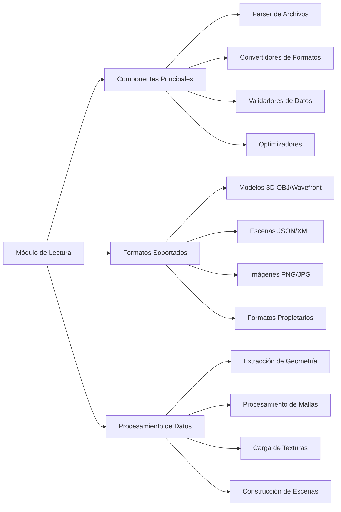
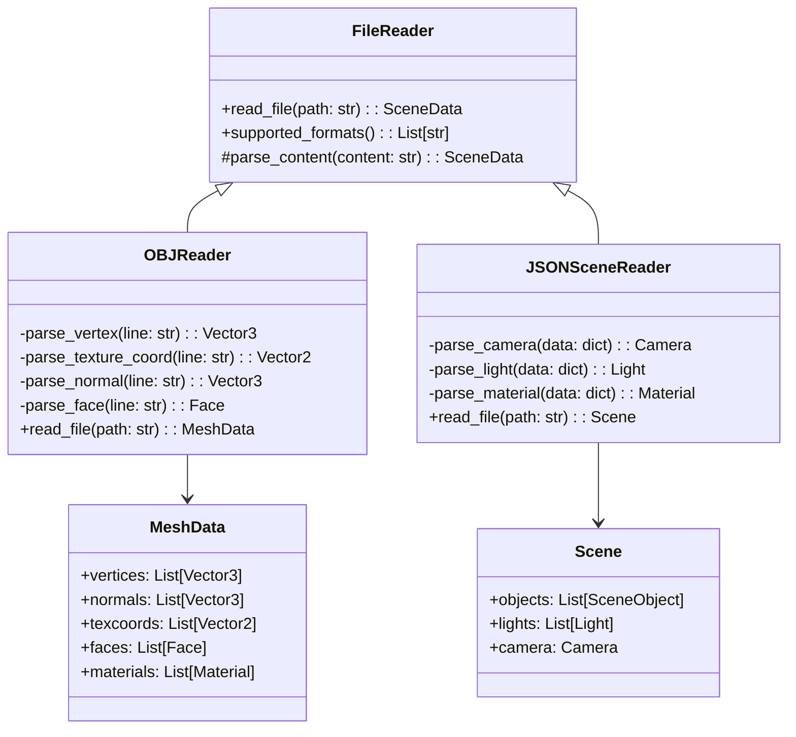

# Modelado y Programación - Graficación por computadora

## 6.6 Construcción del módulo de lectura.

---

El **módulo de lectura** es un componente fundamental en sistemas de graficación que se encarga de importar, procesar y convertir datos externos en estructuras internas manipulables por el motor gráfico. Este módulo permite cargar modelos 3D, escenas, texturas y configuraciones desde diversos formatos de archivo.

### Arquitectura del Módulo de Lectura



### Formatos de Archivo Comunes en Graficación

#### Formato OBJ (Wavefront)

Estructura básica de un archivo OBJ:

```
# Comentario
v x y z           # Vértice
vt u v            # Coordenada de textura
vn i j k          # Normal
f v1/vt1/vn1 ...  # Cara
```

#### Formato JSON para Escenas

```json
{
  "scene": {
    "name": "Escena Ejemplo",
    "objects": [
      {
        "type": "mesh",
        "file": "model.obj",
        "position": [0, 0, 0],
        "material": {
          "diffuse": [1.0, 0.5, 0.2],
          "specular": [0.8, 0.8, 0.8]
        }
      }
    ],
    "lights": [
      {
        "type": "point",
        "position": [5, 5, 5],
        "intensity": 1.0
      }
    ]
  }
}
```

### Estructura del Módulo de Lectura

#### Diagrama de Clases del Módulo de Lectura



### Implementación del Lector OBJ

#### Clase Base para Lectores de Archivos

```python
from abc import ABC, abstractmethod
from typing import List, Dict, Tuple
import numpy as np

class FileReader(ABC):
    def __init__(self):
        self.supported_extensions = []

    @abstractmethod
    def read_file(self, file_path: str):
        pass

    def can_read(self, file_path: str) -> bool:
        return any(file_path.lower().endswith(ext) for ext in self.supported_extensions)

class Vector2:
    def __init__(self, u=0.0, v=0.0):
        self.u = u
        self.v = v

class Vector3:
    def __init__(self, x=0.0, y=0.0, z=0.0):
        self.x = x
        self.y = y
        self.z = z

class Face:
    def __init__(self):
        self.vertex_indices = []
        self.normal_indices = []
        self.texcoord_indices = []

class Material:
    def __init__(self, name="default"):
        self.name = name
        self.diffuse = Vector3(0.8, 0.8, 0.8)
        self.specular = Vector3(0.5, 0.5, 0.5)
        self.shininess = 32.0
        self.texture_path = None

class MeshData:
    def __init__(self):
        self.vertices = []
        self.normals = []
        self.texcoords = []
        self.faces = []
        self.materials = {}
        self.current_material = "default"
```

#### Implementación del Parser OBJ

```python
class OBJReader(FileReader):
    def __init__(self):
        super().__init__()
        self.supported_extensions = ['.obj']

    def read_file(self, file_path: str) -> MeshData:
        mesh_data = MeshData()

        try:
            with open(file_path, 'r', encoding='utf-8') as file:
                lines = file.readlines()

                for line in lines:
                    line = line.strip()
                    if not line or line.startswith('#'):
                        continue

                    parts = line.split()
                    if not parts:
                        continue

                    keyword = parts[0]
                    data = parts[1:]

                    if keyword == 'v':  # Vertex
                        vertex = self._parse_vertex(data)
                        mesh_data.vertices.append(vertex)

                    elif keyword == 'vt':  # Texture coordinate
                        texcoord = self._parse_texture_coord(data)
                        mesh_data.texcoords.append(texcoord)

                    elif keyword == 'vn':  # Normal
                        normal = self._parse_normal(data)
                        mesh_data.normals.append(normal)

                    elif keyword == 'f':  # Face
                        face = self._parse_face(data)
                        mesh_data.faces.append(face)

                    elif keyword == 'usemtl':  # Material
                        if data:
                            mesh_data.current_material = data[0]

                    elif keyword == 'mtllib':  # Material library
                        if data:
                            self._load_material_library(data[0],
                                                       file_path,
                                                       mesh_data)

            self._validate_mesh_data(mesh_data)
            return mesh_data

        except Exception as e:
            raise IOError(f"Error reading OBJ file {file_path}: {str(e)}")

    def _parse_vertex(self, data: List[str]) -> Vector3:
        if len(data) < 3:
            raise ValueError("Vertex requires at least 3 coordinates")
        return Vector3(float(data[0]), float(data[1]), float(data[2]))

    def _parse_texture_coord(self, data: List[str]) -> Vector2:
        if len(data) < 2:
            raise ValueError("Texture coordinate requires at least 2 values")
        return Vector2(float(data[0]), float(data[1]))

    def _parse_normal(self, data: List[str]) -> Vector3:
        if len(data) < 3:
            raise ValueError("Normal requires 3 coordinates")
        return Vector3(float(data[0]), float(data[1]), float(data[2]))

    def _parse_face(self, data: List[str]) -> Face:
        face = Face()

        for vertex_str in data:
            indices = vertex_str.split('/')

            # Parse vertex index (required)
            if indices[0]:
                vertex_idx = int(indices[0]) - 1  # OBJ uses 1-based indexing
                face.vertex_indices.append(vertex_idx)

            # Parse texture coordinate index (optional)
            texcoord_idx = -1
            if len(indices) > 1 and indices[1]:
                texcoord_idx = int(indices[1]) - 1
            face.texcoord_indices.append(texcoord_idx)

            # Parse normal index (optional)
            normal_idx = -1
            if len(indices) > 2 and indices[2]:
                normal_idx = int(indices[2]) - 1
            face.normal_indices.append(normal_idx)

        return face

    def _load_material_library(self, mtl_filename: str,
                             obj_file_path: str,
                             mesh_data: MeshData):
        import os
        mtl_path = os.path.join(os.path.dirname(obj_file_path), mtl_filename)

        try:
            with open(mtl_path, 'r', encoding='utf-8') as mtl_file:
                current_material = None

                for line in mtl_file:
                    line = line.strip()
                    if not line or line.startswith('#'):
                        continue

                    parts = line.split()
                    if not parts:
                        continue

                    keyword = parts[0]
                    data = parts[1:]

                    if keyword == 'newmtl':
                        if data:
                            material_name = data[0]
                            current_material = Material(material_name)
                            mesh_data.materials[material_name] = current_material

                    elif current_material:
                        if keyword == 'Kd':  # Diffuse color
                            if len(data) >= 3:
                                current_material.diffuse = Vector3(
                                    float(data[0]), float(data[1]), float(data[2])
                                )

                        elif keyword == 'Ks':  # Specular color
                            if len(data) >= 3:
                                current_material.specular = Vector3(
                                    float(data[0]), float(data[1]), float(data[2])
                                )

                        elif keyword == 'Ns':  # Shininess
                            if data:
                                current_material.shininess = float(data[0])

                        elif keyword == 'map_Kd':  # Diffuse texture
                            if data:
                                current_material.texture_path = data[0]

        except FileNotFoundError:
            print(f"Warning: Material file {mtl_path} not found")
        except Exception as e:
            print(f"Warning: Error reading material file {mtl_path}: {str(e)}")

    def _validate_mesh_data(self, mesh_data: MeshData):
        # Validar que todas las caras referencien vértices existentes
        max_vertex_idx = len(mesh_data.vertices) - 1
        max_texcoord_idx = len(mesh_data.texcoords) - 1
        max_normal_idx = len(mesh_data.normals) - 1

        for i, face in enumerate(mesh_data.faces):
            for vertex_idx in face.vertex_indices:
                if vertex_idx < 0 or vertex_idx > max_vertex_idx:
                    raise ValueError(f"Face {i} references invalid vertex index {vertex_idx}")

            for texcoord_idx in face.texcoord_indices:
                if texcoord_idx != -1 and (texcoord_idx < 0 or texcoord_idx > max_texcoord_idx):
                    raise ValueError(f"Face {i} references invalid texture coordinate index {texcoord_idx}")

            for normal_idx in face.normal_indices:
                if normal_idx != -1 and (normal_idx < 0 or normal_idx > max_normal_idx):
                    raise ValueError(f"Face {i} references invalid normal index {normal_idx}")
```

### Lector de Escenas JSON

#### Implementación del Parser JSON para Escenas

```python
import json
from enum import Enum

class LightType(Enum):
    POINT = "point"
    DIRECTIONAL = "directional"
    SPOT = "spot"

class Light:
    def __init__(self):
        self.type = LightType.POINT
        self.position = Vector3(0, 0, 0)
        self.direction = Vector3(0, -1, 0)
        self.intensity = 1.0
        self.color = Vector3(1, 1, 1)

class Camera:
    def __init__(self):
        self.position = Vector3(0, 0, 5)
        self.target = Vector3(0, 0, 0)
        self.up = Vector3(0, 1, 0)
        self.fov = 60.0
        self.near_plane = 0.1
        self.far_plane = 100.0

class SceneObject:
    def __init__(self):
        self.name = ""
        self.type = "mesh"
        self.file_path = ""
        self.position = Vector3(0, 0, 0)
        self.rotation = Vector3(0, 0, 0)
        self.scale = Vector3(1, 1, 1)
        self.material = Material()

class Scene:
    def __init__(self):
        self.name = "Untitled Scene"
        self.objects = []
        self.lights = []
        self.camera = Camera()

class JSONSceneReader(FileReader):
    def __init__(self):
        super().__init__()
        self.supported_extensions = ['.json', '.scene']

    def read_file(self, file_path: str) -> Scene:
        scene = Scene()

        try:
            with open(file_path, 'r', encoding='utf-8') as file:
                data = json.load(file)

                # Parse scene metadata
                if 'scene' in data:
                    scene_data = data['scene']
                    scene.name = scene_data.get('name', 'Untitled Scene')

                    # Parse camera
                    if 'camera' in scene_data:
                        scene.camera = self._parse_camera(scene_data['camera'])

                    # Parse objects
                    if 'objects' in scene_data:
                        for obj_data in scene_data['objects']:
                            scene_object = self._parse_object(obj_data)
                            scene.objects.append(scene_object)

                    # Parse lights
                    if 'lights' in scene_data:
                        for light_data in scene_data['lights']:
                            light = self._parse_light(light_data)
                            scene.lights.append(light)

                return scene

        except Exception as e:
            raise IOError(f"Error reading scene file {file_path}: {str(e)}")

    def _parse_camera(self, data: dict) -> Camera:
        camera = Camera()

        if 'position' in data:
            pos = data['position']
            camera.position = Vector3(pos[0], pos[1], pos[2])

        if 'target' in data:
            target = data['target']
            camera.target = Vector3(target[0], target[1], target[2])

        if 'up' in data:
            up = data['up']
            camera.up = Vector3(up[0], up[1], up[2])

        if 'fov' in data:
            camera.fov = float(data['fov'])

        if 'near' in data:
            camera.near_plane = float(data['near'])

        if 'far' in data:
            camera.far_plane = float(data['far'])

        return camera

    def _parse_object(self, data: dict) -> SceneObject:
        obj = SceneObject()

        obj.name = data.get('name', 'unnamed')
        obj.type = data.get('type', 'mesh')
        obj.file_path = data.get('file', '')

        if 'position' in data:
            pos = data['position']
            obj.position = Vector3(pos[0], pos[1], pos[2])

        if 'rotation' in data:
            rot = data['rotation']
            obj.rotation = Vector3(rot[0], rot[1], rot[2])

        if 'scale' in data:
            scale = data['scale']
            obj.scale = Vector3(scale[0], scale[1], scale[2])

        if 'material' in data:
            obj.material = self._parse_material(data['material'])

        return obj

    def _parse_light(self, data: dict) -> Light:
        light = Light()

        light_type = data.get('type', 'point')
        if light_type == 'point':
            light.type = LightType.POINT
        elif light_type == 'directional':
            light.type = LightType.DIRECTIONAL
        elif light_type == 'spot':
            light.type = LightType.SPOT

        if 'position' in data:
            pos = data['position']
            light.position = Vector3(pos[0], pos[1], pos[2])

        if 'direction' in data:
            dir_data = data['direction']
            light.direction = Vector3(dir_data[0], dir_data[1], dir_data[2])

        if 'intensity' in data:
            light.intensity = float(data['intensity'])

        if 'color' in data:
            color = data['color']
            light.color = Vector3(color[0], color[1], color[2])

        return light

    def _parse_material(self, data: dict) -> Material:
        material = Material()

        material.name = data.get('name', 'default')

        if 'diffuse' in data:
            diffuse = data['diffuse']
            material.diffuse = Vector3(diffuse[0], diffuse[1], diffuse[2])

        if 'specular' in data:
            specular = data['specular']
            material.specular = Vector3(specular[0], specular[1], specular[2])

        if 'shininess' in data:
            material.shininess = float(data['shininess'])

        if 'texture' in data:
            material.texture_path = data['texture']

        return material
```

### Gestor de Carga de Recursos

#### Sistema de Gestión de Recursos

```python
class ResourceManager:
    def __init__(self):
        self.readers = []
        self.loaded_meshes = {}
        self.loaded_textures = {}
        self.loaded_scenes = {}

        # Registrar lectores por defecto
        self.register_reader(OBJReader())
        self.register_reader(JSONSceneReader())

    def register_reader(self, reader: FileReader):
        self.readers.append(reader)

    def load_mesh(self, file_path: str) -> MeshData:
        if file_path in self.loaded_meshes:
            return self.loaded_meshes[file_path]

        reader = self._get_reader_for_file(file_path)
        if not reader:
            raise ValueError(f"No reader found for file: {file_path}")

        mesh_data = reader.read_file(file_path)
        self.loaded_meshes[file_path] = mesh_data
        return mesh_data

    def load_scene(self, file_path: str) -> Scene:
        if file_path in self.loaded_scenes:
            return self.loaded_scenes[file_path]

        reader = self._get_reader_for_file(file_path)
        if not reader:
            raise ValueError(f"No reader found for file: {file_path}")

        scene = reader.read_file(file_path)
        self.loaded_scenes[file_path] = scene

        # Cargar mallas referenciadas en la escena
        for obj in scene.objects:
            if obj.file_path and obj.type == 'mesh':
                obj.mesh_data = self.load_mesh(obj.file_path)

        return scene

    def _get_reader_for_file(self, file_path: str):
        for reader in self.readers:
            if reader.can_read(file_path):
                return reader
        return None

    def clear_cache(self):
        self.loaded_meshes.clear()
        self.loaded_textures.clear()
        self.loaded_scenes.clear()
```

### Ejercicios Propuestos

1. **Ejercicio 1**: Extiende el lector OBJ para soportar grupos (g) y objetos (o) y organizar las caras por grupos.

2. **Ejercicio 2**: Implementa un lector para el formato PLY (Polygon File Format) con soporte para propiedades personalizadas.

3. **Ejercicio 3**: Crea un sistema de validación que detecte y repare mallas con problemas (caras degeneradas, normales inconsistentes).

4. **Ejercicio 4**: Implementa un sistema de carga asíncrona que permita cargar recursos en segundo plano mientras se renderiza.

5. **Ejercicio 5**: Desarrolla un conversor que pueda importar desde formatos comunes (OBJ, FBX, glTF) y exportar a un formato interno optimizado.

### Referencias Bibliográficas

1. Marschner, S., & Shirley, P. (2018). _Fundamentals of Computer Graphics_.
2. Bourg, D. M., & Bywalec, B. (2013). _Physics for Game Developers_.
3. Wavefront Technologies (1996). _OBJ File Format Specification_.
4. Khronos Group (2023). _glTF 2.0 Specification_.

### Recursos Adicionales

- [Wavefront OBJ File Format](https://en.wikipedia.org/wiki/Wavefront_.obj_file)
- [glTF File Format Specification](https://www.khronos.org/gltf/)
- [Stanford 3D Scanning Repository](https://graphics.stanford.edu/data/3Dscanrep/)
- [Model-Viewer Loader Architecture](https://modelviewer.dev/)
