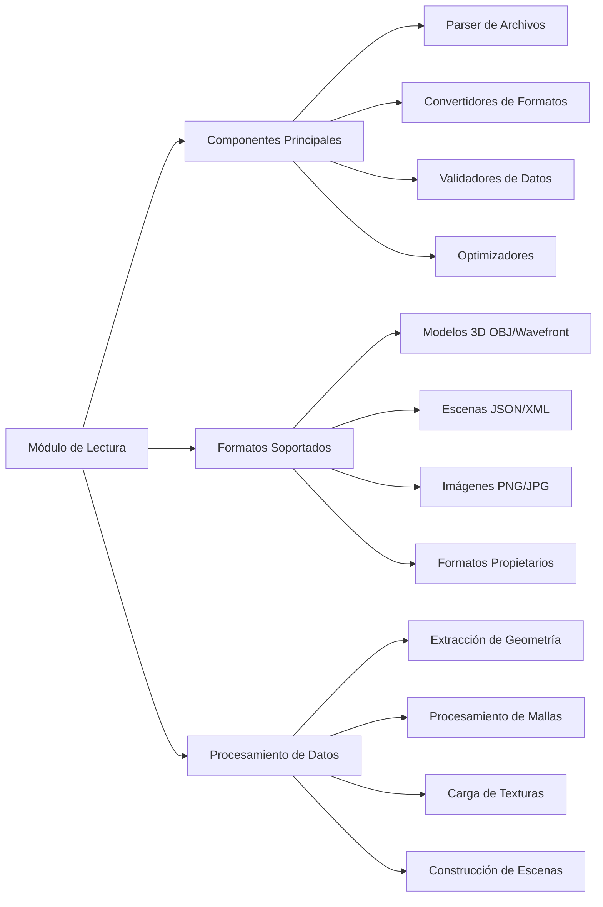
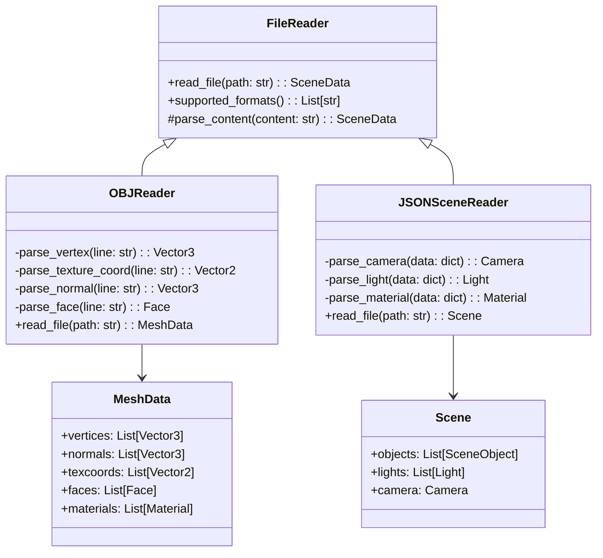

# Modelado y Programación - Graficación por computadora

## 6.6 Construcción del módulo de lectura.

---

El **módulo de lectura** es un componente fundamental en sistemas de graficación que se encarga de importar, procesar y convertir datos externos en estructuras internas manipulables por el motor gráfico. Este módulo permite cargar modelos 3D, escenas, texturas y configuraciones desde diversos formatos de archivo.

### Arquitectura del Módulo de Lectura



### Formatos de Archivo Comunes en Graficación

#### Formato OBJ (Wavefront)

Estructura básica de un archivo OBJ:

```text
# Comentario
mtllib materiales.mtl  # Biblioteca de materiales
v x y z                # Vértice
vt u v                 # Coordenada de textura
vn i j k               # Normal
usemtl rojo            # Material para las caras siguientes
f v1/vt1/vn1 ...       # Cara
```

Es un formato de texto, fácil de leer y escribir, en el que cada línea empieza con una palabra clave. Detalles importantes para un lector correcto:

- Los índices empiezan en **1**, no en 0.
- Un índice **negativo** es relativo: $-1$ es el último vértice definido hasta esa línea.
- Una cara puede escribirse `f 1 2 3` (solo posiciones), `f 1/1 2/2 3/3` (con textura), `f 1//1 2//1 3//1` (con normal, sin textura) o `f 1/1/1 2/2/1 3/3/1`.
- Una cara puede tener más de tres vértices; como las GPU dibujan triángulos, se **triangula**. Para un polígono convexo $v_0 v_1 \ldots v_{k-1}$ basta un abanico: $(v_0, v_i, v_{i+1})$ para $i = 1, \ldots, k - 2.$

Ejemplo, un cuadrado unitario con una sola cara de cuatro vértices:

```text
v 0 0 0
v 1 0 0
v 1 1 0
v 0 1 0
vn 0 0 1
f 1//1 2//1 3//1 4//1
```

#### Formato JSON para Escenas

```json
{
  "scene": {
    "name": "Escena Ejemplo",
    "objects": [
      {
        "type": "mesh",
        "file": "model.obj",
        "position": [0, 0, 0],
        "material": {
          "diffuse": [1.0, 0.5, 0.2],
          "specular": [0.8, 0.8, 0.8]
        }
      }
    ],
    "lights": [
      {
        "type": "point",
        "position": [5, 5, 5],
        "intensity": 1.0
      }
    ]
  }
}
```

### Estructura del Módulo de Lectura

#### Diagrama de Clases del Módulo de Lectura



### Implementación del Lector OBJ

#### Clase Base para Lectores de Archivos

```python
from abc import ABC, abstractmethod
from typing import List, Dict, Tuple
import numpy as np

class FileReader(ABC):
    def __init__(self):
        self.supported_extensions = []

    @abstractmethod
    def read_file(self, file_path: str):
        pass

    def can_read(self, file_path: str) -> bool:
        return any(file_path.lower().endswith(ext) for ext in self.supported_extensions)

class Vector2:
    def __init__(self, u=0.0, v=0.0):
        self.u = u
        self.v = v

class Vector3:
    def __init__(self, x=0.0, y=0.0, z=0.0):
        self.x = x
        self.y = y
        self.z = z

class Face:
    def __init__(self):
        self.vertex_indices = []
        self.normal_indices = []
        self.texcoord_indices = []
        self.material = "default"
        self.group = "default"

class Material:
    def __init__(self, name="default"):
        self.name = name
        self.diffuse = Vector3(0.8, 0.8, 0.8)
        self.specular = Vector3(0.5, 0.5, 0.5)
        self.shininess = 32.0
        self.texture_path = None

class MeshData:
    def __init__(self):
        self.vertices = []
        self.normals = []
        self.texcoords = []
        self.faces = []
        self.materials = {}
        self.current_material = "default"
```

#### Implementación del Parser OBJ

```python
class OBJReader(FileReader):
    def __init__(self):
        super().__init__()
        self.supported_extensions = ['.obj']

    def read_file(self, file_path: str) -> MeshData:
        mesh_data = MeshData()

        try:
            with open(file_path, 'r', encoding='utf-8') as file:
                lines = file.readlines()

                for line in lines:
                    line = line.strip()
                    if not line or line.startswith('#'):
                        continue

                    parts = line.split()
                    if not parts:
                        continue

                    keyword = parts[0]
                    data = parts[1:]

                    if keyword == 'v':  # Vertex
                        vertex = self._parse_vertex(data)
                        mesh_data.vertices.append(vertex)

                    elif keyword == 'vt':  # Texture coordinate
                        texcoord = self._parse_texture_coord(data)
                        mesh_data.texcoords.append(texcoord)

                    elif keyword == 'vn':  # Normal
                        normal = self._parse_normal(data)
                        mesh_data.normals.append(normal)

                    elif keyword == 'f':  # Face
                        face = self._parse_face(data, mesh_data)
                        face.material = mesh_data.current_material
                        mesh_data.faces.extend(self._triangulate(face))

                    elif keyword == 'usemtl':  # Material
                        if data:
                            mesh_data.current_material = data[0]

                    elif keyword == 'mtllib':  # Material library
                        if data:
                            self._load_material_library(data[0],
                                                       file_path,
                                                       mesh_data)

            self._validate_mesh_data(mesh_data)
            return mesh_data

        except Exception as e:
            raise IOError(f"Error reading OBJ file {file_path}: {str(e)}")

    def _parse_vertex(self, data: List[str]) -> Vector3:
        if len(data) < 3:
            raise ValueError("Vertex requires at least 3 coordinates")
        return Vector3(float(data[0]), float(data[1]), float(data[2]))

    def _parse_texture_coord(self, data: List[str]) -> Vector2:
        if len(data) < 2:
            raise ValueError("Texture coordinate requires at least 2 values")
        return Vector2(float(data[0]), float(data[1]))

    def _parse_normal(self, data: List[str]) -> Vector3:
        if len(data) < 3:
            raise ValueError("Normal requires 3 coordinates")
        return Vector3(float(data[0]), float(data[1]), float(data[2]))

    @staticmethod
    def _resolve_index(token: str, count: int) -> int:
        """Convierte un índice OBJ (base 1, o negativo relativo) a base 0."""
        i = int(token)
        return i - 1 if i > 0 else count + i

    def _parse_face(self, data: List[str], mesh_data: MeshData) -> Face:
        if len(data) < 3:
            raise ValueError("Face requires at least 3 vertices")
        face = Face()

        for vertex_str in data:
            indices = vertex_str.split('/')

            # Índice de vértice (obligatorio)
            face.vertex_indices.append(
                self._resolve_index(indices[0], len(mesh_data.vertices)))

            # Índice de coordenada de textura (opcional); -1 indica que no hay
            texcoord_idx = -1
            if len(indices) > 1 and indices[1]:
                texcoord_idx = self._resolve_index(indices[1], len(mesh_data.texcoords))
            face.texcoord_indices.append(texcoord_idx)

            # Índice de normal (opcional)
            normal_idx = -1
            if len(indices) > 2 and indices[2]:
                normal_idx = self._resolve_index(indices[2], len(mesh_data.normals))
            face.normal_indices.append(normal_idx)

        return face

    @staticmethod
    def _triangulate(face: Face) -> List[Face]:
        """Divide una cara convexa de k vértices en k - 2 triángulos (abanico)."""
        triangles = []
        for i in range(1, len(face.vertex_indices) - 1):
            t = Face()
            for j in (0, i, i + 1):
                t.vertex_indices.append(face.vertex_indices[j])
                t.texcoord_indices.append(face.texcoord_indices[j])
                t.normal_indices.append(face.normal_indices[j])
            t.material, t.group = face.material, face.group
            triangles.append(t)
        return triangles

    def _load_material_library(self, mtl_filename: str,
                             obj_file_path: str,
                             mesh_data: MeshData):
        import os
        mtl_path = os.path.join(os.path.dirname(obj_file_path), mtl_filename)

        try:
            with open(mtl_path, 'r', encoding='utf-8') as mtl_file:
                current_material = None

                for line in mtl_file:
                    line = line.strip()
                    if not line or line.startswith('#'):
                        continue

                    parts = line.split()
                    if not parts:
                        continue

                    keyword = parts[0]
                    data = parts[1:]

                    if keyword == 'newmtl':
                        if data:
                            material_name = data[0]
                            current_material = Material(material_name)
                            mesh_data.materials[material_name] = current_material

                    elif current_material:
                        if keyword == 'Kd':  # Diffuse color
                            if len(data) >= 3:
                                current_material.diffuse = Vector3(
                                    float(data[0]), float(data[1]), float(data[2])
                                )

                        elif keyword == 'Ks':  # Specular color
                            if len(data) >= 3:
                                current_material.specular = Vector3(
                                    float(data[0]), float(data[1]), float(data[2])
                                )

                        elif keyword == 'Ns':  # Shininess
                            if data:
                                current_material.shininess = float(data[0])

                        elif keyword == 'map_Kd':  # Diffuse texture
                            if data:
                                current_material.texture_path = data[0]

        except FileNotFoundError:
            print(f"Warning: Material file {mtl_path} not found")
        except Exception as e:
            print(f"Warning: Error reading material file {mtl_path}: {str(e)}")

    def _validate_mesh_data(self, mesh_data: MeshData):
        # Validar que todas las caras referencien vértices existentes
        max_vertex_idx = len(mesh_data.vertices) - 1
        max_texcoord_idx = len(mesh_data.texcoords) - 1
        max_normal_idx = len(mesh_data.normals) - 1

        for i, face in enumerate(mesh_data.faces):
            for vertex_idx in face.vertex_indices:
                if vertex_idx < 0 or vertex_idx > max_vertex_idx:
                    raise ValueError(f"Face {i} references invalid vertex index {vertex_idx}")

            for texcoord_idx in face.texcoord_indices:
                if texcoord_idx != -1 and (texcoord_idx < 0 or texcoord_idx > max_texcoord_idx):
                    raise ValueError(f"Face {i} references invalid texture coordinate index {texcoord_idx}")

            for normal_idx in face.normal_indices:
                if normal_idx != -1 and (normal_idx < 0 or normal_idx > max_normal_idx):
                    raise ValueError(f"Face {i} references invalid normal index {normal_idx}")

# Prueba: se escribe el cuadrado del ejemplo en un archivo temporal y se lee
import os, tempfile

contenido = """v 0 0 0
v 1 0 0
v 1 1 0
v 0 1 0
vn 0 0 1
f 1//1 2//1 3//1 -1//-1
"""
ruta = os.path.join(tempfile.mkdtemp(), "cuadrado.obj")
with open(ruta, "w", encoding="utf-8") as f:
    f.write(contenido)

malla = OBJReader().read_file(ruta)
print(len(malla.vertices), len(malla.faces))                # 4 2
print([t.vertex_indices for t in malla.faces])              # [[0, 1, 2], [0, 2, 3]]
```

La última referencia de la cara, `-1//-1`, es relativa: el último vértice (el 4) y la última normal. La cara de cuatro vértices se convirtió en dos triángulos que comparten la diagonal del vértice 0 al 2.

Al leer un archivo externo hay que **desconfiar** de su contenido: un índice fuera de rango provocaría un error mucho después, al dibujar, o leería memoria ajena en un lenguaje como C. Por eso `_validate_mesh_data` revisa todos los índices al terminar la lectura y el error indica la cara culpable.

### Lector de Escenas JSON

#### Implementación del Parser JSON para Escenas

```python
import json
from enum import Enum

class LightType(Enum):
    POINT = "point"
    DIRECTIONAL = "directional"
    SPOT = "spot"

class Light:
    def __init__(self):
        self.type = LightType.POINT
        self.position = Vector3(0, 0, 0)
        self.direction = Vector3(0, -1, 0)
        self.intensity = 1.0
        self.color = Vector3(1, 1, 1)

class Camera:
    def __init__(self):
        self.position = Vector3(0, 0, 5)
        self.target = Vector3(0, 0, 0)
        self.up = Vector3(0, 1, 0)
        self.fov = 60.0
        self.near_plane = 0.1
        self.far_plane = 100.0

class SceneObject:
    def __init__(self):
        self.name = ""
        self.type = "mesh"
        self.file_path = ""
        self.position = Vector3(0, 0, 0)
        self.rotation = Vector3(0, 0, 0)
        self.scale = Vector3(1, 1, 1)
        self.material = Material()

class Scene:
    def __init__(self):
        self.name = "Untitled Scene"
        self.objects = []
        self.lights = []
        self.camera = Camera()

class JSONSceneReader(FileReader):
    def __init__(self):
        super().__init__()
        self.supported_extensions = ['.json', '.scene']

    def read_file(self, file_path: str) -> Scene:
        scene = Scene()

        try:
            with open(file_path, 'r', encoding='utf-8') as file:
                data = json.load(file)

                # Parse scene metadata
                if 'scene' in data:
                    scene_data = data['scene']
                    scene.name = scene_data.get('name', 'Untitled Scene')

                    # Parse camera
                    if 'camera' in scene_data:
                        scene.camera = self._parse_camera(scene_data['camera'])

                    # Parse objects
                    if 'objects' in scene_data:
                        for obj_data in scene_data['objects']:
                            scene_object = self._parse_object(obj_data)
                            scene.objects.append(scene_object)

                    # Parse lights
                    if 'lights' in scene_data:
                        for light_data in scene_data['lights']:
                            light = self._parse_light(light_data)
                            scene.lights.append(light)

                return scene

        except Exception as e:
            raise IOError(f"Error reading scene file {file_path}: {str(e)}")

    def _parse_camera(self, data: dict) -> Camera:
        camera = Camera()

        if 'position' in data:
            pos = data['position']
            camera.position = Vector3(pos[0], pos[1], pos[2])

        if 'target' in data:
            target = data['target']
            camera.target = Vector3(target[0], target[1], target[2])

        if 'up' in data:
            up = data['up']
            camera.up = Vector3(up[0], up[1], up[2])

        if 'fov' in data:
            camera.fov = float(data['fov'])

        if 'near' in data:
            camera.near_plane = float(data['near'])

        if 'far' in data:
            camera.far_plane = float(data['far'])

        return camera

    def _parse_object(self, data: dict) -> SceneObject:
        obj = SceneObject()

        obj.name = data.get('name', 'unnamed')
        obj.type = data.get('type', 'mesh')
        obj.file_path = data.get('file', '')

        if 'position' in data:
            pos = data['position']
            obj.position = Vector3(pos[0], pos[1], pos[2])

        if 'rotation' in data:
            rot = data['rotation']
            obj.rotation = Vector3(rot[0], rot[1], rot[2])

        if 'scale' in data:
            scale = data['scale']
            obj.scale = Vector3(scale[0], scale[1], scale[2])

        if 'material' in data:
            obj.material = self._parse_material(data['material'])

        return obj

    def _parse_light(self, data: dict) -> Light:
        light = Light()

        light_type = data.get('type', 'point')
        if light_type == 'point':
            light.type = LightType.POINT
        elif light_type == 'directional':
            light.type = LightType.DIRECTIONAL
        elif light_type == 'spot':
            light.type = LightType.SPOT

        if 'position' in data:
            pos = data['position']
            light.position = Vector3(pos[0], pos[1], pos[2])

        if 'direction' in data:
            dir_data = data['direction']
            light.direction = Vector3(dir_data[0], dir_data[1], dir_data[2])

        if 'intensity' in data:
            light.intensity = float(data['intensity'])

        if 'color' in data:
            color = data['color']
            light.color = Vector3(color[0], color[1], color[2])

        return light

    def _parse_material(self, data: dict) -> Material:
        material = Material()

        material.name = data.get('name', 'default')

        if 'diffuse' in data:
            diffuse = data['diffuse']
            material.diffuse = Vector3(diffuse[0], diffuse[1], diffuse[2])

        if 'specular' in data:
            specular = data['specular']
            material.specular = Vector3(specular[0], specular[1], specular[2])

        if 'shininess' in data:
            material.shininess = float(data['shininess'])

        if 'texture' in data:
            material.texture_path = data['texture']

        return material

escena_json = {"scene": {"name": "Demo",
                         "camera": {"position": [0, 2, 8], "fov": 45},
                         "objects": [{"name": "cubo", "file": "cubo.obj", "position": [1, 0, 0],
                                      "material": {"diffuse": [1, 0, 0], "shininess": 64}}],
                         "lights": [{"type": "directional", "direction": [0, -1, -1]}]}}
ruta_json = os.path.join(tempfile.mkdtemp(), "escena.json")
with open(ruta_json, "w", encoding="utf-8") as f:
    json.dump(escena_json, f)

esc = JSONSceneReader().read_file(ruta_json)
print(esc.name, esc.camera.fov, esc.objects[0].material.shininess, esc.lights[0].type)
# Demo 45.0 64.0 LightType.DIRECTIONAL
```

Usar `data.get(clave, valor_por_omisión)` y comprobar cada clave hace que el formato sea **tolerante**: un archivo de escena solo necesita especificar lo que difiere de los valores por omisión.

### Gestor de Carga de Recursos

#### Sistema de Gestión de Recursos

```python
class ResourceManager:
    def __init__(self):
        self.readers = []
        self.loaded_meshes = {}
        self.loaded_textures = {}
        self.loaded_scenes = {}

        # Registrar lectores por defecto
        self.register_reader(OBJReader())
        self.register_reader(JSONSceneReader())

    def register_reader(self, reader: FileReader):
        self.readers.append(reader)

    def load_mesh(self, file_path: str) -> MeshData:
        if file_path in self.loaded_meshes:
            return self.loaded_meshes[file_path]

        reader = self._get_reader_for_file(file_path)
        if not reader:
            raise ValueError(f"No reader found for file: {file_path}")

        mesh_data = reader.read_file(file_path)
        self.loaded_meshes[file_path] = mesh_data
        return mesh_data

    def load_scene(self, file_path: str) -> Scene:
        if file_path in self.loaded_scenes:
            return self.loaded_scenes[file_path]

        reader = self._get_reader_for_file(file_path)
        if not reader:
            raise ValueError(f"No reader found for file: {file_path}")

        scene = reader.read_file(file_path)
        self.loaded_scenes[file_path] = scene

        # Cargar mallas referenciadas en la escena
        for obj in scene.objects:
            if obj.file_path and obj.type == 'mesh':
                obj.mesh_data = self.load_mesh(obj.file_path)

        return scene

    def _get_reader_for_file(self, file_path: str):
        for reader in self.readers:
            if reader.can_read(file_path):
                return reader
        return None

    def clear_cache(self):
        self.loaded_meshes.clear()
        self.loaded_textures.clear()
        self.loaded_scenes.clear()
```

El gestor combina dos patrones: una **caché** (si diez objetos usan el mismo modelo, el archivo se lee una vez y la malla se comparte) y una **cadena de lectores registrados**, que permite agregar un formato nuevo sin modificar el gestor, solo registrando otro `FileReader` (principio abierto/cerrado). Las rutas de las mallas dentro de una escena deberían resolverse relativas a la carpeta del archivo de escena, como se hace con el archivo `.mtl`.

### Ejercicios Propuestos

1. **Ejercicio 1**: Extiende el lector OBJ para soportar grupos (g) y objetos (o) y organizar las caras por grupos.

2. **Ejercicio 2**: Implementa un lector para el formato PLY (Polygon File Format) con soporte para propiedades personalizadas.

3. **Ejercicio 3**: Crea un sistema de validación que detecte y repare mallas con problemas (caras degeneradas, normales inconsistentes).

4. **Ejercicio 4**: Implementa un sistema de carga asíncrona que permita cargar recursos en segundo plano mientras se renderiza.

5. **Ejercicio 5**: Desarrolla un conversor que pueda importar desde formatos comunes (OBJ, FBX, glTF) y exportar a un formato interno optimizado.

### Soluciones a los Ejercicios

**Ejercicio 1: grupos y objetos.** Basta llevar el grupo actual como se lleva el material, asignarlo a cada cara y agrupar al final:

```python
from collections import defaultdict

class OBJReaderConGrupos(OBJReader):
    def read_file(self, file_path: str) -> MeshData:
        # Se preprocesa el archivo: las líneas 'g' y 'o' fijan el grupo actual
        grupo_por_cara, grupo, n_caras = [], "default", 0
        with open(file_path, encoding="utf-8") as f:
            for linea in f:
                partes = linea.split()
                if not partes:
                    continue
                if partes[0] in ("g", "o"):
                    grupo = partes[1] if len(partes) > 1 else "default"
                elif partes[0] == "f":
                    grupo_por_cara += [grupo] * (len(partes) - 3)   # triángulos generados
        malla = super().read_file(file_path)
        for cara, g in zip(malla.faces, grupo_por_cara):
            cara.group = g
        malla.groups = defaultdict(list)
        for i, cara in enumerate(malla.faces):
            malla.groups[cara.group].append(i)
        return malla

ruta_g = os.path.join(tempfile.mkdtemp(), "grupos.obj")
with open(ruta_g, "w", encoding="utf-8") as f:
    f.write("v 0 0 0\nv 1 0 0\nv 0 1 0\nv 1 1 0\ng base\nf 1 2 3\ng tapa\nf 2 4 3\n")
print(dict(OBJReaderConGrupos().read_file(ruta_g).groups))   # {'base': [0], 'tapa': [1]}
```

Una versión más limpia modificaría directamente el ciclo de `OBJReader.read_file`; aquí se extiende la clase sin tocarla para mostrar que el diseño lo permite.

**Ejercicio 2: PLY.** Un archivo PLY tiene una cabecera que **describe** sus datos: cada `element` dice cuántos registros hay y cada `property` qué columnas tiene cada uno. Leer la cabecera primero permite aceptar propiedades personalizadas, como color o confianza por vértice, sin conocerlas de antemano.

```python
def leer_ply_ascii(texto):
    lineas = iter(texto.splitlines())
    assert next(lineas).strip() == "ply"
    elementos = []                                   # [(nombre, cantidad, [propiedades])]
    for linea in lineas:
        p = linea.split()
        if p[0] == "element":
            elementos.append((p[1], int(p[2]), []))
        elif p[0] == "property":
            elementos[-1][2].append(p[-1])           # el nombre es la última palabra
        elif p[0] == "end_header":
            break
    datos = {}
    for nombre, n, props in elementos:
        registros = []
        for _ in range(n):
            valores = next(lineas).split()
            if props == ["vertex_indices"]:          # property list uchar int vertex_indices
                registros.append([int(v) for v in valores[1:]])
            else:
                registros.append(dict(zip(props, map(float, valores))))
        datos[nombre] = registros
    return datos

ply = """ply
format ascii 1.0
element vertex 3
property float x
property float y
property float z
property float confianza
element face 1
property list uchar int vertex_indices
end_header
0 0 0 0.9
1 0 0 0.8
0 1 0 0.5
3 0 1 2"""
d = leer_ply_ascii(ply)
print(d["vertex"][2], d["face"])   # {'x': 0.0, 'y': 1.0, 'z': 0.0, 'confianza': 0.5} [[0, 1, 2]]
```

Los PLY también pueden ser binarios (`format binary_little_endian 1.0`); en ese caso los tipos de las propiedades (`float`, `uchar`, `int`) indican cuántos bytes leer con `struct.unpack`.

**Ejercicio 3: validación y reparación.** Problemas comunes y cómo detectarlos:

- **Caras degeneradas**: dos índices iguales o área casi cero, $\|(v_1 - v_0) \times (v_2 - v_0)\| < \varepsilon.$ Se eliminan.
- **Vértices duplicados**: posiciones iguales con índices distintos. Se fusionan redondeando las coordenadas y usando un diccionario.
- **Orientación inconsistente**: en una malla bien orientada, cada arista compartida por dos caras se recorre en **sentidos opuestos**. Si dos caras vecinas recorren la arista en el mismo sentido, una tiene la normal invertida; se corrige con un recorrido BFS por vecindad que invierte las caras incompatibles.

```python
def validar(vertices, caras, eps=1e-12):
    def area2(c):
        a, b, d = (np.array(vertices[i], dtype=float) for i in c)
        return np.linalg.norm(np.cross(b - a, d - a))
    buenas = [c for c in caras if len(set(c)) == 3 and area2(c) > eps]
    aristas = defaultdict(list)
    for k, c in enumerate(buenas):
        for i in range(3):
            aristas[(c[i], c[(i + 1) % 3])].append(k)
    inconsistentes = [a for a, ks in aristas.items() if len(ks) > 1]
    return buenas, inconsistentes

verts = [(0, 0, 0), (1, 0, 0), (0, 1, 0), (1, 1, 0), (2, 0, 0)]
caras = [(0, 1, 2), (1, 2, 3), (0, 1, 4)]   # la segunda está invertida; la tercera es degenerada
print(validar(verts, caras))   # ([(0, 1, 2), (1, 2, 3)], [(1, 2)])
```

La arista $(1, 2)$ aparece dos veces en el mismo sentido, así que una de las dos caras debe invertirse, por ejemplo cambiando $(1, 2, 3)$ por $(2, 1, 3).$

**Ejercicio 4: carga asíncrona.** El hilo de render no debe bloquearse leyendo archivos. Se lanza la lectura en un grupo de hilos y se obtiene un *future*; mientras no esté listo, se dibuja un objeto sustituto. Subir la malla a la GPU debe hacerse en el hilo que tiene el contexto gráfico, así que el hilo de render revisa en cada cuadro qué cargas terminaron.

```python
from concurrent.futures import ThreadPoolExecutor

class CargadorAsincrono:
    def __init__(self, gestor):
        self.gestor = gestor
        self.pool = ThreadPoolExecutor(max_workers=2)
        self.pendientes = {}

    def solicitar(self, ruta):
        if ruta not in self.pendientes:
            self.pendientes[ruta] = self.pool.submit(self.gestor.load_mesh, ruta)

    def malla_o_sustituto(self, ruta, sustituto=None):
        fut = self.pendientes.get(ruta)
        if fut is not None and fut.done():
            return fut.result()        # vuelve a lanzar la excepción si la lectura falló
        return sustituto

cargador = CargadorAsincrono(ResourceManager())
cargador.solicitar(ruta)
cargador.pendientes[ruta].result()     # en un juego no se espera; aquí, para la prueba
print(len(cargador.malla_o_sustituto(ruta).faces))   # 2
```

La caché de `ResourceManager` no está protegida por un candado; si dos hilos piden el mismo archivo a la vez, podría leerse dos veces. Registrar el *future* en `pendientes` desde un solo hilo evita ese caso.

**Ejercicio 5: formato interno.** Los formatos de intercambio (OBJ, FBX, glTF) se leen una vez con el lector adecuado y se convierten a una representación **lista para la GPU**: un arreglo de vértices entrelazados (posición, normal, UV) sin duplicados y un arreglo de índices, guardados en binario. Cargar ese formato es casi copiar bytes, sin interpretar texto.

```python
def a_formato_interno(malla):
    unicos, indices = {}, []
    for cara in malla.faces:
        for vi, ti, ni in zip(cara.vertex_indices, cara.texcoord_indices, cara.normal_indices):
            clave = (vi, ti, ni)
            if clave not in unicos:
                unicos[clave] = len(unicos)
            indices.append(unicos[clave])
    datos = np.zeros((len(unicos), 8), dtype=np.float32)   # x y z nx ny nz u v
    for (vi, ti, ni), k in unicos.items():
        v = malla.vertices[vi]; datos[k, 0:3] = (v.x, v.y, v.z)
        if ni >= 0: n = malla.normals[ni]; datos[k, 3:6] = (n.x, n.y, n.z)
        if ti >= 0: t = malla.texcoords[ti]; datos[k, 6:8] = (t.u, t.v)
    return datos, np.array(indices, dtype=np.uint32)

datos, idx = a_formato_interno(malla)
destino = os.path.join(tempfile.mkdtemp(), "cuadrado.npz")
np.savez(destino, vertices=datos, indices=idx)
cargado = np.load(destino)
print(cargado["vertices"].shape, cargado["indices"].tolist())   # (4, 8) [0, 1, 2, 0, 2, 3]
```

glTF ya está diseñado con esta idea: un JSON describe la escena y los vértices e índices van en búferes binarios listos para copiarse a la GPU. FBX es un formato propietario y en la práctica se lee con el SDK del fabricante o con bibliotecas como Assimp.

### Referencias Bibliográficas

1. Marschner, S., & Shirley, P. (2018). _Fundamentals of Computer Graphics_.
2. Bourg, D. M., & Bywalec, B. (2013). _Physics for Game Developers_.
3. Wavefront Technologies (1996). _OBJ File Format Specification_.
4. Khronos Group (2023). _glTF 2.0 Specification_.

### Recursos Adicionales

- [Wavefront OBJ File Format](https://en.wikipedia.org/wiki/Wavefront_.obj_file)
- [glTF File Format Specification](https://www.khronos.org/gltf/)
- [Stanford 3D Scanning Repository](https://graphics.stanford.edu/data/3Dscanrep/)
- [Model-Viewer Loader Architecture](https://modelviewer.dev/)
