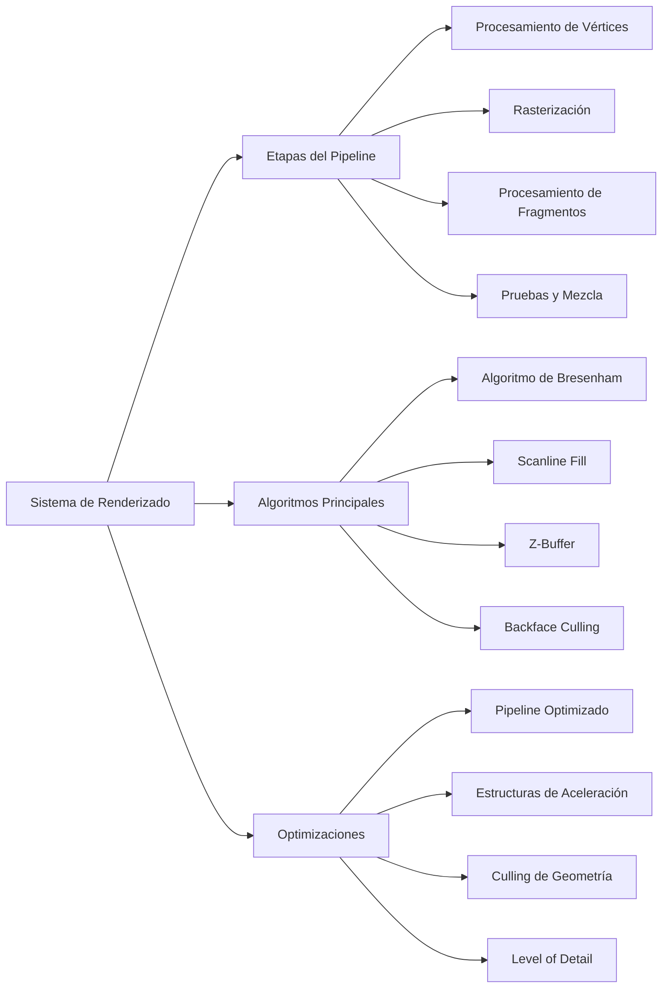

# Modelado y Programación - Graficación por computadora

## 6.7 Implementación del algoritmo.

---

La **implementación de algoritmos** en graficación por computadora se refiere a la codificación eficiente y optimizada de los métodos matemáticos que permiten generar imágenes digitales. Esta implementación debe balancear precisión matemática, rendimiento computacional y calidad visual.

### Arquitectura de un Sistema de Renderizado



### Algoritmos Fundamentales de Rasterización

#### Algoritmo de Bresenham para Líneas

El algoritmo de Bresenham calcula eficientemente los puntos de una línea recta entre dos puntos $(x_0, y_0)$ y $(x_1, y_1)$ usando solo operaciones enteras.

**Ecuación de la línea**: $y = mx + b$ donde $m = \frac{dy}{dx}$

```python
def bresenham_line(x0, y0, x1, y1):
    """
    Implementación del algoritmo de Bresenham para líneas
    """
    points = []
    dx = abs(x1 - x0)
    dy = abs(y1 - y0)
    steep = dy > dx

    # Si la línea es steep, intercambiamos coordenadas
    if steep:
        x0, y0 = y0, x0
        x1, y1 = y1, x1
        dx, dy = dy, dx

    # Aseguramos dibujo de izquierda a derecha
    if x0 > x1:
        x0, x1 = x1, x0
        y0, y1 = y1, y0

    # Inicializamos parámetros
    dx = x1 - x0
    dy = abs(y1 - y0)
    error = dx / 2
    y = y0
    y_step = 1 if y0 < y1 else -1

    # Calculamos puntos
    for x in range(x0, x1 + 1):
        coord = (y, x) if steep else (x, y)
        points.append(coord)
        error -= dy
        if error < 0:
            y += y_step
            error += dx

    return points
```

#### Algoritmo del Punto Medio para Círculos

Basado en la ecuación del círculo: $x^2 + y^2 = r^2$

```python
def midpoint_circle(center_x, center_y, radius):
    """
    Algoritmo del punto medio para círculos
    """
    points = []
    x = radius
    y = 0
    p = 1 - radius  # Parámetro de decisión inicial

    # Puntos iniciales
    points.extend(get_circle_points(center_x, center_y, x, y))

    while x > y:
        y += 1

        # Actualizar parámetro de decisión
        if p <= 0:
            p = p + 2*y + 1
        else:
            x -= 1
            p = p + 2*y - 2*x + 1

        # Asegurar que no salimos del círculo
        if x < y:
            break

        points.extend(get_circle_points(center_x, center_y, x, y))

        # Si estamos en diferente octante, añadir puntos adicionales
        if x != y:
            points.extend(get_circle_points(center_x, center_y, y, x))

    return points

def get_circle_points(cx, cy, x, y):
    """
    Obtiene los 8 puntos simétricos del círculo
    """
    return [
        (cx + x, cy + y), (cx - x, cy + y),
        (cx + x, cy - y), (cx - x, cy - y),
        (cx + y, cy + x), (cx - y, cy + x),
        (cx + y, cy - x), (cx - y, cy - x)
    ]
```

### Algoritmos de Relleno (Fill Algorithms)

#### Algoritmo Scanline para Polígonos

```python
class Edge:
    def __init__(self, y_min, y_max, x_at_y_min, inverse_slope):
        self.y_min = y_min
        self.y_max = y_max
        self.x = x_at_y_min
        self.inverse_slope = inverse_slope

def scanline_fill(vertices):
    """
    Algoritmo scanline para rellenar polígonos
    """
    if len(vertices) < 3:
        return []

    # Encontrar y mínimo y máximo
    y_min = min(v[1] for v in vertices)
    y_max = max(v[1] for v in vertices)

    # Crear tabla de aristas
    edges = []
    for i in range(len(vertices)):
        v1 = vertices[i]
        v2 = vertices[(i + 1) % len(vertices)]

        # Ignorar aristas horizontales
        if v1[1] == v2[1]:
            continue

        # Ordenar por y
        if v1[1] > v2[1]:
            v1, v2 = v2, v1

        y_min_edge = v1[1]
        y_max_edge = v2[1]
        x_at_y_min = v1[0]
        inverse_slope = (v2[0] - v1[0]) / (v2[1] - v1[1])

        edges.append(Edge(y_min_edge, y_max_edge, x_at_y_min, inverse_slope))

    # Ordenar aristas por y_min
    edges.sort(key=lambda e: e.y_min)

    # Algoritmo scanline
    active_edges = []
    fill_points = []

    for y in range(int(y_min), int(y_max) + 1):
        # Añadir aristas que empiezan en esta y
        for edge in edges:
            if edge.y_min == y:
                active_edges.append(edge)

        # Remover aristas que terminan antes de esta y
        active_edges = [e for e in active_edges if e.y_max > y]

        # Ordenar aristas activas por x
        active_edges.sort(key=lambda e: e.x)

        # Rellenar entre pares de aristas
        for i in range(0, len(active_edges), 2):
            if i + 1 < len(active_edges):
                x_start = int(active_edges[i].x)
                x_end = int(active_edges[i + 1].x)
                for x in range(x_start, x_end + 1):
                    fill_points.append((x, y))

        # Actualizar x para la siguiente scanline
        for edge in active_edges:
            edge.x += edge.inverse_slope

    return fill_points
```

### Algoritmo Z-Buffer para Visibilidad

El algoritmo Z-Buffer resuelve el problema de visibilidad almacenando la profundidad de cada pixel.

**Ecuación de profundidad**: $z = -\frac{d}{w}$ donde $w$ es la coordenada homogénea

```python
class ZBuffer:
    def __init__(self, width, height):
        self.width = width
        self.height = height
        self.buffer = np.full((height, width), np.inf)
        self.color_buffer = np.zeros((height, width, 3), dtype=np.uint8)

    def test_and_set(self, x, y, z, color):
        """
        Testea y actualiza el z-buffer si el fragmento está más cerca
        """
        if 0 <= x < self.width and 0 <= y < self.height:
            if z < self.buffer[y, x]:
                self.buffer[y, x] = z
                self.color_buffer[y, x] = color
                return True
        return False

def rasterize_triangle(v0, v1, v2, color, z_buffer):
    """
    Rasteriza un triángulo usando el algoritmo del z-buffer
    """
    # Calcular bounding box
    min_x = max(0, min(v0[0], v1[0], v2[0]))
    max_x = min(z_buffer.width - 1, max(v0[0], v1[0], v2[0]))
    min_y = max(0, min(v0[1], v1[1], v2[1]))
    max_y = min(z_buffer.height - 1, max(v0[1], v1[1], v2[1]))

    # Convertir a coordenadas baricéntricas
    area = edge_function(v0, v1, v2)

    if area == 0:
        return  # Triángulo degenerado

    for y in range(int(min_y), int(max_y) + 1):
        for x in range(int(min_x), int(max_x) + 1):
            # Calcular coordenadas baricéntricas
            w0 = edge_function(v1, v2, (x, y))
            w1 = edge_function(v2, v0, (x, y))
            w2 = edge_function(v0, v1, (x, y))

            # Normalizar
            w0 /= area
            w1 /= area
            w2 /= area

            # Verificar si el punto está dentro del triángulo
            if w0 >= 0 and w1 >= 0 and w2 >= 0:
                # Interpolar profundidad
                z = w0 * v0[2] + w1 * v1[2] + w2 * v2[2]

                # Testear z-buffer
                z_buffer.test_and_set(x, y, z, color)

def edge_function(a, b, c):
    """
    Función de borde para coordenadas baricéntricas
    """
    return (b[0] - a[0]) * (c[1] - a[1]) - (b[1] - a[1]) * (c[0] - a[0])
```

### Implementación de Transformaciones 3D

#### Pipeline de Transformaciones Completo

```python
class TransformationPipeline:
    def __init__(self):
        self.model_matrix = np.identity(4)
        self.view_matrix = np.identity(4)
        self.projection_matrix = np.identity(4)

    def transform_point(self, point):
        """
        Transforma un punto a través del pipeline completo
        """
        # Convertir a coordenadas homogéneas
        homogeneous = np.array([point[0], point[1], point[2], 1.0])

        # Aplicar transformaciones
        model_view = self.view_matrix @ self.model_matrix
        model_view_proj = self.projection_matrix @ model_view

        # Transformar
        transformed = model_view_proj @ homogeneous

        # Perspectiva divide
        if transformed[3] != 0:
            transformed /= transformed[3]

        return transformed[:3]

    def set_model_matrix(self, translation, rotation, scale):
        """
        Establece la matriz de modelo
        """
        # Matriz de traslación
        T = np.array([
            [1, 0, 0, translation[0]],
            [0, 1, 0, translation[1]],
            [0, 0, 1, translation[2]],
            [0, 0, 0, 1]
        ])

        # Matriz de rotación (simplificada)
        Rx = np.array([
            [1, 0, 0, 0],
            [0, np.cos(rotation[0]), -np.sin(rotation[0]), 0],
            [0, np.sin(rotation[0]), np.cos(rotation[0]), 0],
            [0, 0, 0, 1]
        ])

        Ry = np.array([
            [np.cos(rotation[1]), 0, np.sin(rotation[1]), 0],
            [0, 1, 0, 0],
            [-np.sin(rotation[1]), 0, np.cos(rotation[1]), 0],
            [0, 0, 0, 1]
        ])

        Rz = np.array([
            [np.cos(rotation[2]), -np.sin(rotation[2]), 0, 0],
            [np.sin(rotation[2]), np.cos(rotation[2]), 0, 0],
            [0, 0, 1, 0],
            [0, 0, 0, 1]
        ])

        # Matriz de escala
        S = np.array([
            [scale[0], 0, 0, 0],
            [0, scale[1], 0, 0],
            [0, 0, scale[2], 0],
            [0, 0, 0, 1]
        ])

        self.model_matrix = T @ Rx @ Ry @ Rz @ S

    def set_view_matrix(self, eye, target, up):
        """
        Establece la matriz de vista (look-at)
        """
        forward = normalize(target - eye)
        right = normalize(np.cross(forward, up))
        new_up = np.cross(right, forward)

        self.view_matrix = np.array([
            [right[0], right[1], right[2], -np.dot(right, eye)],
            [new_up[0], new_up[1], new_up[2], -np.dot(new_up, eye)],
            [-forward[0], -forward[1], -forward[2], np.dot(forward, eye)],
            [0, 0, 0, 1]
        ])

    def set_perspective_projection(self, fov, aspect, near, far):
        """
        Establece proyección perspectiva
        """
        f = 1.0 / np.tan(fov / 2.0)
        self.projection_matrix = np.array([
            [f / aspect, 0, 0, 0],
            [0, f, 0, 0],
            [0, 0, (far + near) / (near - far), (2 * far * near) / (near - far)],
            [0, 0, -1, 0]
        ])
```

### Sistema de Gestión de Escenas

```python
class Scene:
    def __init__(self):
        self.objects = []
        self.lights = []
        self.camera = {
            'position': np.array([0, 0, 5]),
            'target': np.array([0, 0, 0]),
            'up': np.array([0, 1, 0])
        }
        self.transform_pipeline = TransformationPipeline()

    def add_object(self, mesh, position, rotation, scale, color):
        """
        Añade un objeto a la escena
        """
        self.objects.append({
            'mesh': mesh,
            'position': position,
            'rotation': rotation,
            'scale': scale,
            'color': color
        })

    def render(self, width, height):
        """
        Renderiza la escena completa
        """
        # Configurar pipeline
        self.transform_pipeline.set_view_matrix(
            self.camera['position'],
            self.camera['target'],
            self.camera['up']
        )

        # Crear buffers
        z_buffer = ZBuffer(width, height)
        frame_buffer = np.zeros((height, width, 3), dtype=np.uint8)

        # Renderizar cada objeto
        for obj in self.objects:
            self._render_object(obj, z_buffer)

        return z_buffer.color_buffer

    def _render_object(self, obj, z_buffer):
        """
        Renderiza un objeto individual
        """
        # Configurar transformación de modelo
        self.transform_pipeline.set_model_matrix(
            obj['position'],
            obj['rotation'],
            obj['scale']
        )

        # Transformar y rasterizar cada triángulo
        mesh = obj['mesh']
        for i in range(0, len(mesh.vertices), 3):
            # Obtener vértices del triángulo
            v0 = mesh.vertices[i]
            v1 = mesh.vertices[i + 1]
            v2 = mesh.vertices[i + 2]

            # Transformar a espacio de pantalla
            v0_screen = self.transform_pipeline.transform_point(v0)
            v1_screen = self.transform_pipeline.transform_point(v1)
            v2_screen = self.transform_pipeline.transform_point(v2)

            # Rasterizar triángulo
            rasterize_triangle(
                v0_screen, v1_screen, v2_screen,
                obj['color'], z_buffer
            )
```

### Ejercicios Propuestos

1. **Ejercicio 1**: Implementa el algoritmo de Wu para anti-aliasing de líneas y compáralo con Bresenham.

2. **Ejercicio 2**: Desarrolla un algoritmo de relleno de polígonos con patrones de textura.

3. **Ejercicio 3**: Implementa el algoritmo de Painter's para ordenamiento de profundidad y compáralo con Z-Buffer.

4. **Ejercicio 4**: Crea un sistema de level-of-detail (LOD) que adapte la complejidad de las mallas según la distancia.

5. **Ejercicio 5**: Optimiza el rasterizador de triángulos usando el algoritmo de scanline con tablas de aristas activas.

### Referencias Bibliográficas

1. Foley, J. D., van Dam, A., Feiner, S. K., & Hughes, J. F. (1996). _Computer Graphics: Principles and Practice_.
2. Shirley, P., & Marschner, S. (2009). _Fundamentals of Computer Graphics_.
3. Bresenham, J. E. (1965). _Algorithm for computer control of a digital plotter_. IBM Systems Journal.
4. Pineda, J. (1988). _A Parallel Algorithm for Polygon Rasterization_. ACM SIGGRAPH.

### Recursos Adicionales

- [Graphics Programming Weekly](https://www.jendrikillner.com/tags/weekly/)
- [Scratchapixel](https://www.scratchapixel.com/)
- [Learn OpenGL](https://learnopengl.com/)
- [GPU Gems Series](https://developer.nvidia.com/gpugems/gpugems/contributors)
