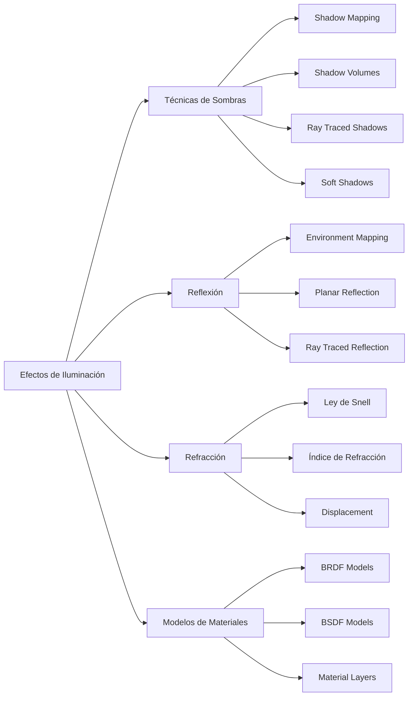

# Modelado y Programación - Graficación por computadora

## 6.8 Sombras, reflexión y refracción.

---

Los efectos de **sombras, reflexión y refracción** son cruciales para lograr realismo en gráficos por computadora. Estos fenómenos simulan el comportamiento físico de la luz al interactuar con superficies y materiales, añadiendo profundidad y credibilidad a las escenas renderizadas.

### Sistema de Efectos de Iluminación



### Fundamentos Físicos de la Luz

#### Ley de Reflexión

El ángulo de incidencia es igual al ángulo de reflexión:

$$ \theta_i = \theta_r $$

#### Ley de Snell (Refracción)

$$ n_1 \sin(\theta_1) = n_2 \sin(\theta_2) $$
donde $n_1$ y $n_2$ son los índices de refracción de los medios.

#### Coeficientes de Fresnel

La reflectancia $R$ en la interfaz entre dos medios:

$$ R = \frac{1}{2} \left( \left( \frac{n_1 \cos \theta_i - n_2 \cos \theta_t}{n_1 \cos \theta_i + n_2 \cos \theta_t} \right)^2 + \left( \frac{n_1 \cos \theta_t - n_2 \cos \theta_i}{n_1 \cos \theta_t + n_2 \cos \theta_i} \right)^2 \right) $$

### Algoritmos de Sombras

#### Shadow Mapping

```python
class ShadowMapper:
    def __init__(self, width, height):
        self.width = width
        self.height = height
        self.shadow_map = np.full((height, width), float('inf'))
        self.light_view_matrix = None
        self.light_proj_matrix = None

    def create_shadow_map(self, light_pos, light_dir, scene):
        """
        Crea un shadow map desde la perspectiva de la luz
        """
        # Configurar matrices de luz
        self.light_view_matrix = self._look_at(light_pos, light_dir)
        self.light_proj_matrix = self._orthographic_projection(-10, 10, -10, 10, 0.1, 50)

        # Renderizar la escena desde la luz
        for obj in scene.objects:
            self._render_to_shadow_map(obj)

    def _render_to_shadow_map(self, obj):
        """
        Renderiza un objeto al shadow map
        """
        vertices = obj.mesh.vertices
        for i in range(0, len(vertices), 3):
            v0, v1, v2 = vertices[i], vertices[i+1], vertices[i+2]

            # Transformar a espacio de luz
            v0_light = self._transform_to_light_space(v0)
            v1_light = self._transform_to_light_space(v1)
            v2_light = self._transform_to_light_space(v2)

            # Rasterizar y almacenar profundidad
            self._rasterize_triangle_depth(v0_light, v1_light, v2_light)

    def is_in_shadow(self, world_pos):
        """
        Verifica si un punto está en sombra
        """
        # Transformar a espacio de luz
        light_pos = self._transform_to_light_space(world_pos)

        if 0 <= light_pos[0] < 1 and 0 <= light_pos[1] < 1:
            x = int(light_pos[0] * self.width)
            y = int(light_pos[1] * self.height)
            depth = light_pos[2]

            # Comparar con depth almacenado (con bias para evitar acne)
            return depth > self.shadow_map[y, x] + 0.001
        return False
```

#### Shadow Volumes (Stencil Shadows)

```python
class ShadowVolume:
    def __init__(self):
        self.volume_vertices = []
        self.silhouette_edges = []

    def create_from_mesh(self, mesh, light_pos):
        """
        Crea shadow volume para una malla y posición de luz
        """
        # Encontrar aristas silhouette
        self._find_silhouette_edges(mesh, light_pos)

        # Extruir aristas silhouette away from light
        self._extrude_edges(light_pos)

    def _find_silhouette_edges(self, mesh, light_pos):
        """
        Encuentra aristas que forman el silhouette desde la luz
        """
        self.silhouette_edges = []

        for face in mesh.faces:
            # Calcular normal de la cara
            normal = self._calculate_face_normal(face)

            # Vector hacia la luz
            to_light = light_pos - face.centroid
            to_light = to_light.normalize()

            # Verificar si la cara está frente a la luz
            if normal.dot(to_light) > 0:
                # Añadir aristas de esta cara
                for edge in face.edges:
                    if edge in self.silhouette_edges:
                        self.silhouette_edges.remove(edge)  # Backface
                    else:
                        self.silhouette_edges.append(edge)

    def _extrude_edges(self, light_pos, extrusion_distance=100):
        """
        Extruye las aristas silhouette lejos de la luz
        """
        self.volume_vertices = []

        for edge in self.silhouette_edges:
            v1 = edge.v1
            v2 = edge.v2

            # Calcular dirección de extrusión
            dir1 = (v1 - light_pos).normalize()
            dir2 = (v2 - light_pos).normalize()

            # Puntos extruidos
            v1_extruded = v1 + dir1 * extrusion_distance
            v2_extruded = v2 + dir2 * extrusion_distance

            # Crear quad para esta arista extruida
            self.volume_vertices.extend([v1, v2, v2_extruded])
            self.volume_vertices.extend([v2_extruded, v1_extruded, v1])
```

### Reflexión

#### Environment Mapping (Reflexiones Approximadas)

```python
class EnvironmentMapper:
    def __init__(self, cubemap_size=512):
        self.cubemap_size = cubemap_size
        self.cubemap = {
            'right': None, 'left': None,
            'top': None, 'bottom': None,
            'front': None, 'back': None
        }

    def calculate_reflection(self, view_dir, normal):
        """
        Calcula dirección de reflexión
        """
        # R = I - 2(N·I)N
        reflection_dir = view_dir - 2 * normal.dot(view_dir) * normal
        return reflection_dir.normalize()

    def sample_cubemap(self, reflection_dir):
        """
        Muestrea el cubemap en la dirección de reflexión
        """
        # Determinar cara del cubemap
        abs_dir = np.abs(reflection_dir)
        max_axis = max(abs_dir[0], abs_dir[1], abs_dir[2])

        if max_axis == abs_dir[0]:
            face = 'right' if reflection_dir[0] > 0 else 'left'
        elif max_axis == abs_dir[1]:
            face = 'top' if reflection_dir[1] > 0 else 'bottom'
        else:
            face = 'front' if reflection_dir[2] > 0 else 'back'

        # Convertir dirección a coordenadas UV
        u, v = self._direction_to_uv(reflection_dir, face)

        # Muestrear textura
        return self._sample_texture(self.cubemap[face], u, v)

    def _direction_to_uv(self, direction, face):
        """
        Convierte dirección 3D a coordenadas UV de cubemap
        """
        # Implementación específica para cada cara
        if face == 'right':
            sc = 0.5 / abs(direction[0])
            u = direction[2] * sc + 0.5
            v = direction[1] * sc + 0.5
        # ... implementar otras caras

        return np.clip(u, 0, 1), np.clip(v, 0, 1)
```

#### Planar Reflections

```python
class PlanarReflection:
    def __init__(self, plane_normal, plane_point):
        self.plane_normal = plane_normal.normalize()
        self.plane_point = plane_point
        self.reflection_matrix = self._calculate_reflection_matrix()

    def _calculate_reflection_matrix(self):
        """
        Calcula matriz de reflexión para un plano
        """
        a, b, c = self.plane_normal
        d = -self.plane_normal.dot(self.plane_point)

        return np.array([
            [1 - 2*a*a, -2*a*b, -2*a*c, -2*a*d],
            [-2*a*b, 1 - 2*b*b, -2*b*c, -2*b*d],
            [-2*a*c, -2*b*c, 1 - 2*c*c, -2*c*d],
            [0, 0, 0, 1]
        ])

    def reflect_point(self, point):
        """
        Refleja un punto através del plano
        """
        homogeneous = np.array([point[0], point[1], point[2], 1])
        reflected = self.reflection_matrix @ homogeneous
        return reflected[:3] / reflected[3]

    def render_reflection(self, scene, camera):
        """
        Renderiza escena reflejada
        """
        # Guardar estado original
        original_camera = camera.position
        original_objects = []

        for obj in scene.objects:
            original_objects.append({
                'position': obj.position.copy(),
                'rotation': obj.rotation.copy()
            })

            # Reflejar objeto
            obj.position = self.reflect_point(obj.position)
            obj.rotation = self._reflect_rotation(obj.rotation)

        # Reflejar cámara
        camera.position = self.reflect_point(camera.position)
        camera.target = self.reflect_point(camera.target)

        # Renderizar escena reflejada
        reflected_image = renderer.render(scene, camera)

        # Restaurar estado
        camera.position = original_camera
        for i, obj in enumerate(scene.objects):
            obj.position = original_objects[i]['position']
            obj.rotation = original_objects[i]['rotation']

        return reflected_image
```

### Refracción

#### Implementación de Refracción

```python
class RefractionSystem:
    def __init__(self):
        self.ior_library = {
            'air': 1.0003,
            'water': 1.333,
            'glass': 1.52,
            'diamond': 2.42
        }

    def calculate_refraction(self, incident, normal, ior_in, ior_out):
        """
        Calcula dirección de refracción usando Ley de Snell
        """
        cos_theta_i = -normal.dot(incident)
        eta = ior_in / ior_out

        # Calcular sin^2(theta_t)
        sin2_theta_t = eta * eta * (1 - cos_theta_i * cos_theta_i)

        # Verificar reflexión interna total
        if sin2_theta_t > 1:
            return self.calculate_reflection(incident, normal)  # Reflexión total

        cos_theta_t = math.sqrt(1 - sin2_theta_t)

        # Calcular dirección refractada
        refracted = eta * incident + (eta * cos_theta_i - cos_theta_t) * normal
        return refracted.normalize()

    def fresnel_reflectance(self, incident, normal, ior_in, ior_out):
        """
        Calcula coeficiente de Fresnel para reflexión/refracción
        """
        cos_theta_i = -normal.dot(incident)
        eta = ior_in / ior_out

        sin2_theta_t = eta * eta * (1 - cos_theta_i * cos_theta_i)
        if sin2_theta_t > 1:
            return 1.0  # Reflexión interna total

        cos_theta_t = math.sqrt(1 - sin2_theta_t)

        # Coeficientes de Fresnel para polarización s y p
        r_s = (ior_in * cos_theta_i - ior_out * cos_theta_t) / \
              (ior_in * cos_theta_i + ior_out * cos_theta_t)
        r_p = (ior_out * cos_theta_i - ior_in * cos_theta_t) / \
              (ior_out * cos_theta_i + ior_in * cos_theta_t)

        # Reflectancia promedio (no polarizada)
        reflectance = 0.5 * (r_s * r_s + r_p * r_p)
        return max(0, min(1, reflectance))

    def render_transparent_object(self, obj, scene, camera):
        """
        Renderiza objeto transparente con refracción
        """
        # Calcular refracción para cada rayo
        refraction_color = np.zeros(3)
        reflection_color = np.zeros(3)

        for ray in camera.generate_rays():
            intersection = self._find_intersection(ray, obj)

            if intersection:
                # Calcular Fresnel
                fresnel = self.fresnel_reflectance(
                    ray.direction,
                    intersection.normal,
                    self.ior_library['air'],
                    obj.material.ior
                )

                # Calcular reflexión y refracción
                if fresnel < 1.0:
                    refracted_dir = self.calculate_refraction(
                        ray.direction,
                        intersection.normal,
                        self.ior_library['air'],
                        obj.material.ior
                    )
                    refraction_color += self._trace_ray(refracted_dir, scene)

                reflected_dir = self.calculate_reflection(
                    ray.direction,
                    intersection.normal
                )
                reflection_color += self._trace_ray(reflected_dir, scene)

                # Combinar con coeficiente de Fresnel
                final_color = fresnel * reflection_color + (1 - fresnel) * refraction_color

        return final_color
```

### Sistema Integrado de Shading

```python
class AdvancedShadingSystem:
    def __init__(self):
        self.shadow_mapper = ShadowMapper(2048, 2048)
        self.environment_mapper = EnvironmentMapper()
        self.refraction_system = RefractionSystem()

    def calculate_shading(self, point, normal, view_dir, material, light, scene):
        """
        Calcula shading completo con todos los efectos
        """
        # Componente difusa básica
        diffuse = self._calculate_diffuse(point, normal, light)

        # Componente especular
        specular = self._calculate_specular(point, normal, view_dir, light, material)

        # Sombras
        shadow_factor = 1.0
        if self.shadow_mapper.is_in_shadow(point):
            shadow_factor = 0.3  # Factor de atenuación de sombra

        # Reflexión
        reflection_color = np.zeros(3)
        if material.reflectivity > 0:
            reflection_dir = self.environment_mapper.calculate_reflection(view_dir, normal)
            reflection_color = self.environment_mapper.sample_cubemap(reflection_dir)

        # Refracción
        refraction_color = np.zeros(3)
        if material.transparency > 0:
            refraction_dir = self.refraction_system.calculate_refraction(
                view_dir, normal, 1.0, material.ior
            )
            refraction_color = self._trace_refraction_ray(point, refraction_dir, scene)

        # Combinar todos los componentes
        fresnel = self.refraction_system.fresnel_reflectance(
            view_dir, normal, 1.0, material.ior
        )

        final_color = (diffuse + specular) * shadow_factor * (1 - material.reflectivity)
        final_color += reflection_color * material.reflectivity * fresnel
        final_color += refraction_color * material.transparency * (1 - fresnel)

        return final_color
```

### Ejercicios Propuestos

1. **Ejercicio 1**: Implementa Percentage-Closer Filtering (PCF) para suavizar bordes de sombras.

2. **Ejercicio 2**: Desarrolla un sistema de reflexiones en tiempo real usando render-to-texture.

3. **Ejercicio 3**: Crea un material de vidrio con dispersión cromática (diferente refracción por longitud de onda).

4. **Ejercicio 4**: Implementa Screen Space Reflections (SSR) para reflexiones aproximadas en tiempo real.

5. **Ejercicio 5**: Desarrolla un sistema de refracción volumétrica para materiales como agua o vidrio grueso.

### Referencias Bibliográficas

1. Pharr, M., Jakob, W., & Humphreys, G. (2016). _Physically Based Rendering: From Theory to Implementation_.
2. Akenine-Möller, T., Haines, E., & Hoffman, N. (2018). _Real-Time Rendering_ (4th ed.).
3. Cook, R. L., & Torrance, K. E. (1982). _A Reflectance Model for Computer Graphics_.
4. Williams, L. (1978). _Casting Curved Shadows on Curved Surfaces_.

### Recursos Adicionales

- [NVIDIA GPU Gems: Advanced Lighting](https://developer.nvidia.com/gpugems/gpugems/contributors)
- [Learn OpenGL: Advanced Lighting](https://learnopengl.com/Advanced-Lighting/Advanced-Lighting)
- [Ray Tracing in One Weekend Series](https://raytracing.github.io/)
- [Shadertoy: Advanced Shading Examples](https://www.shadertoy.com/)
