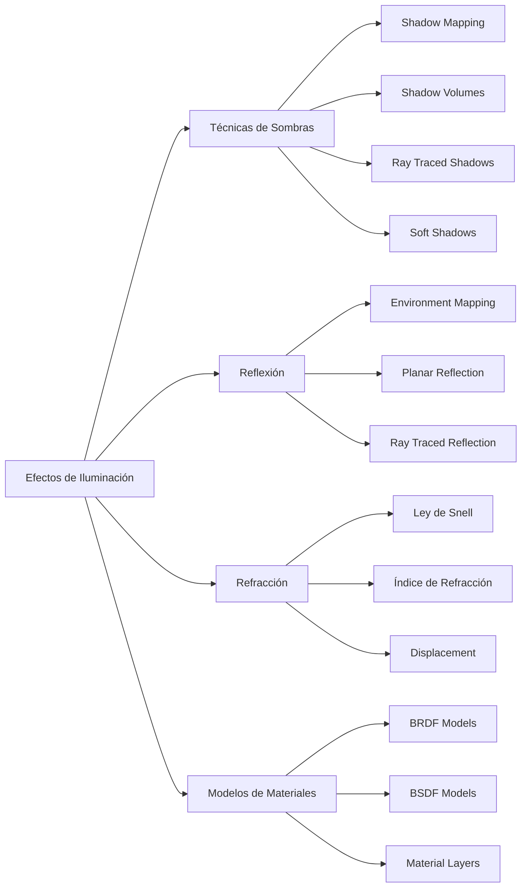

# Modelado y Programación - Graficación por computadora

## 6.8 Sombras, reflexión y refracción.

---

Los efectos de **sombras, reflexión y refracción** son cruciales para lograr realismo en gráficos por computadora. Estos fenómenos simulan el comportamiento físico de la luz al interactuar con superficies y materiales, añadiendo profundidad y credibilidad a las escenas renderizadas.

### Sistema de Efectos de Iluminación



### Fundamentos Físicos de la Luz

#### Ley de Reflexión

El ángulo de incidencia es igual al ángulo de reflexión:

$$ \theta_i = \theta_r $$

#### Ley de Snell (Refracción)

$$ n_1 \sin(\theta_1) = n_2 \sin(\theta_2) $$

donde $n_1$ y $n_2$ son los índices de refracción de los medios.

#### Coeficientes de Fresnel

La reflectancia $R$ en la interfaz entre dos medios:

$$ R = \frac{1}{2} \left( \left( \frac{n_1 \cos \theta_i - n_2 \cos \theta_t}{n_1 \cos \theta_i + n_2 \cos \theta_t} \right)^2 + \left( \frac{n_1 \cos \theta_t - n_2 \cos \theta_i}{n_1 \cos \theta_t + n_2 \cos \theta_i} \right)^2 \right) $$

Los dos términos corresponden a las dos polarizaciones de la luz (s y p); para luz no polarizada se promedian. Por conservación de la energía, en un dieléctrico sin absorción la fracción transmitida es $T = 1 - R.$ La reflectancia depende mucho del ángulo: el vidrio refleja solo el 4% de la luz que le llega de frente, pero casi toda la que le llega en ángulo rasante; por eso un lago refleja el cielo cuando se le mira a lo lejos y deja ver el fondo cuando se mira hacia abajo.

En tiempo real se usa la **aproximación de Schlick**, mucho más barata:

$$ R(\theta_i) ≈ R_0 + (1 - R_0)(1 - \cos\theta_i)^5, \qquad R_0 = \left(\frac{n_1 - n_2}{n_1 + n_2}\right)^2 $$

```python
import math

def fresnel_exacto(cos_i, n1, n2):
    sin2_t = (n1 / n2) ** 2 * (1 - cos_i ** 2)
    if sin2_t > 1:
        return 1.0                                   # reflexión interna total
    cos_t = math.sqrt(1 - sin2_t)
    rs = (n1 * cos_i - n2 * cos_t) / (n1 * cos_i + n2 * cos_t)
    rp = (n1 * cos_t - n2 * cos_i) / (n1 * cos_t + n2 * cos_i)
    return 0.5 * (rs * rs + rp * rp)

def schlick(cos_i, n1, n2):
    r0 = ((n1 - n2) / (n1 + n2)) ** 2
    return r0 + (1 - r0) * (1 - cos_i) ** 5

for grados in (0, 45, 70, 85):
    c = math.cos(math.radians(grados))
    print(grados, round(fresnel_exacto(c, 1.0, 1.5), 3), round(schlick(c, 1.0, 1.5), 3))
# 0 0.04 0.04
# 45 0.05 0.042
# 70 0.171 0.158
# 85 0.613 0.648
```

### Algoritmos de Sombras

#### Shadow Mapping

El *shadow mapping* (Williams, 1978) se hace en dos pasadas:

1. Se dibuja la escena **desde la luz**, guardando solo la profundidad del objeto más cercano a la luz en cada píxel: el **mapa de sombras**.
2. Al dibujar desde la cámara, cada punto se transforma al espacio de la luz y su profundidad se compara con la del mapa. Si es mayor, algún objeto está entre el punto y la luz, y el punto está en sombra.

Se usa una proyección ortográfica para luces direccionales, como el sol, y una perspectiva para luces puntuales o de foco. Sus problemas típicos son el **acné de sombra**, manchas causadas por comparar una superficie consigo misma con precisión limitada (se corrige con un pequeño *bias*), y los bordes escalonados por la resolución finita del mapa (se suavizan con PCF, ejercicio 1).

El siguiente código es un esqueleto: `_look_at`, `_orthographic_projection`, `_transform_to_light_space` y `_rasterize_triangle_depth` son las funciones de los temas 6.5 y 6.7.

```python
class ShadowMapper:
    def __init__(self, width, height):
        self.width = width
        self.height = height
        self.shadow_map = np.full((height, width), float('inf'))
        self.light_view_matrix = None
        self.light_proj_matrix = None

    def create_shadow_map(self, light_pos, light_dir, scene):
        """
        Crea un shadow map desde la perspectiva de la luz
        """
        # Configurar matrices de luz
        self.light_view_matrix = self._look_at(light_pos, light_dir)
        self.light_proj_matrix = self._orthographic_projection(-10, 10, -10, 10, 0.1, 50)

        # Renderizar la escena desde la luz
        for obj in scene.objects:
            self._render_to_shadow_map(obj)

    def _render_to_shadow_map(self, obj):
        """
        Renderiza un objeto al shadow map
        """
        vertices = obj.mesh.vertices
        for i in range(0, len(vertices), 3):
            v0, v1, v2 = vertices[i], vertices[i+1], vertices[i+2]

            # Transformar a espacio de luz
            v0_light = self._transform_to_light_space(v0)
            v1_light = self._transform_to_light_space(v1)
            v2_light = self._transform_to_light_space(v2)

            # Rasterizar y almacenar profundidad
            self._rasterize_triangle_depth(v0_light, v1_light, v2_light)

    def is_in_shadow(self, world_pos):
        """
        Verifica si un punto está en sombra
        """
        # Transformar a espacio de luz
        light_pos = self._transform_to_light_space(world_pos)

        if 0 <= light_pos[0] < 1 and 0 <= light_pos[1] < 1:
            x = int(light_pos[0] * self.width)
            y = int(light_pos[1] * self.height)
            depth = light_pos[2]

            # Comparar con depth almacenado (con bias para evitar acne)
            return depth > self.shadow_map[y, x] + 0.001
        return False
```

#### Shadow Volumes (Stencil Shadows)

```python
class ShadowVolume:
    def __init__(self):
        self.volume_vertices = []
        self.silhouette_edges = []

    def create_from_mesh(self, mesh, light_pos):
        """
        Crea shadow volume para una malla y posición de luz
        """
        # Encontrar aristas silhouette
        self._find_silhouette_edges(mesh, light_pos)

        # Extruir aristas silhouette away from light
        self._extrude_edges(light_pos)

    def _find_silhouette_edges(self, mesh, light_pos):
        """
        Encuentra aristas que forman el silhouette desde la luz.
        Una arista es de silueta si separa una cara que mira a la luz de una
        que no: entre las caras iluminadas, aparece una sola vez. Las aristas
        se representan con sus índices ordenados, para que (a, b) y (b, a)
        sean la misma.
        """
        self.silhouette_edges = []

        for face in mesh.faces:
            # Calcular normal de la cara
            normal = self._calculate_face_normal(face)

            # Vector hacia la luz
            to_light = light_pos - face.centroid
            to_light = to_light.normalize()

            # Verificar si la cara está frente a la luz
            if normal.dot(to_light) > 0:
                # Añadir aristas de esta cara
                for edge in face.edges:
                    if edge in self.silhouette_edges:
                        # Arista compartida por dos caras iluminadas: es interior
                        self.silhouette_edges.remove(edge)
                    else:
                        self.silhouette_edges.append(edge)

    def _extrude_edges(self, light_pos, extrusion_distance=100):
        """
        Extruye las aristas silhouette lejos de la luz
        """
        self.volume_vertices = []

        for edge in self.silhouette_edges:
            v1 = edge.v1
            v2 = edge.v2

            # Calcular dirección de extrusión
            dir1 = (v1 - light_pos).normalize()
            dir2 = (v2 - light_pos).normalize()

            # Puntos extruidos
            v1_extruded = v1 + dir1 * extrusion_distance
            v2_extruded = v2 + dir2 * extrusion_distance

            # Crear quad para esta arista extruida
            self.volume_vertices.extend([v1, v2, v2_extruded])
            self.volume_vertices.extend([v2_extruded, v1_extruded, v1])
```

El volumen de sombra es la región del espacio que el objeto tapa a la luz. Para saber si un píxel visible está dentro de él, se dibujan las caras del volumen en el *stencil buffer* sin escribir color: cada cara delantera del volumen que está frente al píxel suma 1 y cada cara trasera resta 1. Si la cuenta final es distinta de 0, el rayo de la cámara al píxel entró al volumen sin salir, y el píxel está en sombra. Da sombras con bordes exactos sin problemas de resolución, pero dibujar los volúmenes consume mucho *fill rate*, y por eso hoy se prefiere el *shadow mapping*. Doom 3 (2004) es el ejemplo clásico de su uso.

### Reflexión

#### Environment Mapping (Reflexiones Approximadas)

```python
class EnvironmentMapper:
    def __init__(self, cubemap_size=512):
        self.cubemap_size = cubemap_size
        self.cubemap = {
            'right': None, 'left': None,
            'top': None, 'bottom': None,
            'front': None, 'back': None
        }

    def calculate_reflection(self, view_dir, normal):
        """
        Calcula dirección de reflexión
        """
        # R = I - 2(N·I)N
        reflection_dir = view_dir - 2 * normal.dot(view_dir) * normal
        return reflection_dir.normalize()

    def sample_cubemap(self, reflection_dir):
        """
        Muestrea el cubemap en la dirección de reflexión
        """
        # Determinar cara del cubemap
        abs_dir = np.abs(reflection_dir)
        max_axis = max(abs_dir[0], abs_dir[1], abs_dir[2])

        if max_axis == abs_dir[0]:
            face = 'right' if reflection_dir[0] > 0 else 'left'
        elif max_axis == abs_dir[1]:
            face = 'top' if reflection_dir[1] > 0 else 'bottom'
        else:
            face = 'front' if reflection_dir[2] > 0 else 'back'

        # Convertir dirección a coordenadas UV
        u, v = self._direction_to_uv(reflection_dir, face)

        # Muestrear textura
        return self._sample_texture(self.cubemap[face], u, v)

    def _direction_to_uv(self, direction, face):
        """
        Convierte dirección 3D a coordenadas UV de cubemap
        """
        # Implementación específica para cada cara
        if face == 'right':
            sc = 0.5 / abs(direction[0])
            u = direction[2] * sc + 0.5
            v = direction[1] * sc + 0.5
        # ... implementar otras caras

        return np.clip(u, 0, 1), np.clip(v, 0, 1)
```

Un *cubemap* guarda la imagen del entorno vista desde un punto en seis direcciones, una por cara de un cubo. Para consultar la dirección $\vec{d},$ se elige la cara correspondiente a la componente de mayor valor absoluto y se dividen las otras dos entre ella para obtener $(u, v).$ Como la consulta solo depende de la **dirección** y no de la posición, la reflexión es exacta solo para objetos lejanos; un objeto cercano reflejado se ve en el lugar equivocado. Es la técnica habitual para reflejar el cielo en carros y objetos metálicos.

#### Planar Reflections

```python
class PlanarReflection:
    def __init__(self, plane_normal, plane_point):
        self.plane_normal = plane_normal.normalize()
        self.plane_point = plane_point
        self.reflection_matrix = self._calculate_reflection_matrix()

    def _calculate_reflection_matrix(self):
        """
        Calcula matriz de reflexión para un plano
        """
        # Plano n·p + d = 0. Reflejar es restar dos veces la distancia con signo:
        # p' = p - 2 (n·p + d) n
        a, b, c = self.plane_normal
        d = -self.plane_normal.dot(self.plane_point)

        return np.array([
            [1 - 2*a*a, -2*a*b, -2*a*c, -2*a*d],
            [-2*a*b, 1 - 2*b*b, -2*b*c, -2*b*d],
            [-2*a*c, -2*b*c, 1 - 2*c*c, -2*c*d],
            [0, 0, 0, 1]
        ])

    def reflect_point(self, point):
        """
        Refleja un punto através del plano
        """
        homogeneous = np.array([point[0], point[1], point[2], 1])
        reflected = self.reflection_matrix @ homogeneous
        return reflected[:3] / reflected[3]

    def render_reflection(self, scene, camera):
        """
        Renderiza escena reflejada
        """
        # Guardar estado original
        original_camera = camera.position
        original_objects = []

        for obj in scene.objects:
            original_objects.append({
                'position': obj.position.copy(),
                'rotation': obj.rotation.copy()
            })

            # Reflejar objeto
            obj.position = self.reflect_point(obj.position)
            obj.rotation = self._reflect_rotation(obj.rotation)

        # Reflejar cámara
        camera.position = self.reflect_point(camera.position)
        camera.target = self.reflect_point(camera.target)

        # Renderizar escena reflejada
        reflected_image = renderer.render(scene, camera)

        # Restaurar estado
        camera.position = original_camera
        for i, obj in enumerate(scene.objects):
            obj.position = original_objects[i]['position']
            obj.rotation = original_objects[i]['rotation']

        return reflected_image
```

La reflexión plana es **exacta** para espejos planos, como pisos pulidos o superficies de agua tranquila, pero obliga a dibujar la escena una vez más por cada plano reflejante. Detalles prácticos: la matriz de reflexión tiene determinante $-1,$ así que invierte la orientación de los triángulos y hay que invertir también el criterio de *backface culling*; y hay que recortar lo que queda detrás del plano para que no aparezca en el reflejo. En una implementación real no se mueven los objetos: basta multiplicar la matriz de vista por la de reflexión. El código anterior es un esqueleto: `renderer` y `_reflect_rotation` dependen del motor.

### Refracción

#### Implementación de Refracción

```python
class RefractionSystem:
    def __init__(self):
        self.ior_library = {
            'air': 1.0003,
            'water': 1.333,
            'glass': 1.52,
            'diamond': 2.42
        }

    @staticmethod
    def calculate_reflection(incident, normal):
        return incident - 2 * normal.dot(incident) * normal

    def calculate_refraction(self, incident, normal, ior_in, ior_out):
        """
        Calcula dirección de refracción usando Ley de Snell
        """
        cos_theta_i = -normal.dot(incident)
        eta = ior_in / ior_out

        # Calcular sin^2(theta_t)
        sin2_theta_t = eta * eta * (1 - cos_theta_i * cos_theta_i)

        # Verificar reflexión interna total
        if sin2_theta_t > 1:
            return self.calculate_reflection(incident, normal)  # Reflexión total

        cos_theta_t = math.sqrt(1 - sin2_theta_t)

        # Calcular dirección refractada
        refracted = eta * incident + (eta * cos_theta_i - cos_theta_t) * normal
        return refracted.normalize()

    def fresnel_reflectance(self, incident, normal, ior_in, ior_out):
        """
        Calcula coeficiente de Fresnel para reflexión/refracción
        """
        cos_theta_i = -normal.dot(incident)
        eta = ior_in / ior_out

        sin2_theta_t = eta * eta * (1 - cos_theta_i * cos_theta_i)
        if sin2_theta_t > 1:
            return 1.0  # Reflexión interna total

        cos_theta_t = math.sqrt(1 - sin2_theta_t)

        # Coeficientes de Fresnel para polarización s y p
        r_s = (ior_in * cos_theta_i - ior_out * cos_theta_t) / \
              (ior_in * cos_theta_i + ior_out * cos_theta_t)
        r_p = (ior_out * cos_theta_i - ior_in * cos_theta_t) / \
              (ior_out * cos_theta_i + ior_in * cos_theta_t)

        # Reflectancia promedio (no polarizada)
        reflectance = 0.5 * (r_s * r_s + r_p * r_p)
        return max(0, min(1, reflectance))

    def shade_transparent_hit(self, ray_direction, hit, scene, trace_ray):
        """
        Color de un rayo que golpea un objeto transparente: se combinan el rayo
        reflejado y el refractado con el coeficiente de Fresnel. trace_ray es la
        función recursiva del ray tracer (tema 6.3).
        """
        fresnel = self.fresnel_reflectance(
            ray_direction, hit.normal, self.ior_library['air'], hit.material.ior)

        reflected_dir = self.calculate_reflection(ray_direction, hit.normal)
        color = fresnel * trace_ray(hit.point, reflected_dir, scene)

        if fresnel < 1.0:                      # si no hay reflexión interna total
            refracted_dir = self.calculate_refraction(
                ray_direction, hit.normal, self.ior_library['air'], hit.material.ior)
            color += (1 - fresnel) * trace_ray(hit.point, refracted_dir, scene)

        return color
```

Prueba de la ley de Snell con la función de refracción, usando un pequeño tipo vector con los métodos `dot` y `normalize` que usa la clase:

```python
import numpy as np

class Vec(np.ndarray):
    def __new__(cls, *xs):
        return np.asarray(xs, dtype=float).view(cls)
    def dot(self, other):
        return float(np.dot(self, other))
    def normalize(self):
        return self / np.linalg.norm(self)

rs = RefractionSystem()
normal = Vec(0, 1, 0)
incidente = Vec(math.sin(math.radians(30)), -math.cos(math.radians(30)), 0)   # 30° con la normal
t = rs.calculate_refraction(incidente, normal, 1.0, 1.5)
theta_t = math.degrees(math.asin(abs(t[0])))
print(round(theta_t, 2), round(1.0 * math.sin(math.radians(30)), 4), round(1.5 * math.sin(math.radians(theta_t)), 4))
# 19.47 0.5 0.5
print(round(rs.fresnel_reflectance(incidente, normal, 1.0, 1.5), 4))   # 0.0415
```

Se cumple $n_1 \sin\theta_1 = n_2 \sin\theta_2:$ el rayo se acerca a la normal al entrar al vidrio, de 30° a 19.47°.

### Sistema Integrado de Shading

```python
class AdvancedShadingSystem:
    def __init__(self):
        self.shadow_mapper = ShadowMapper(2048, 2048)
        self.environment_mapper = EnvironmentMapper()
        self.refraction_system = RefractionSystem()

    def calculate_shading(self, point, normal, view_dir, material, light, scene):
        """
        Calcula shading completo con todos los efectos
        """
        # Componente difusa básica
        diffuse = self._calculate_diffuse(point, normal, light)

        # Componente especular
        specular = self._calculate_specular(point, normal, view_dir, light, material)

        # Sombras
        shadow_factor = 1.0
        if self.shadow_mapper.is_in_shadow(point):
            shadow_factor = 0.3  # Factor de atenuación de sombra

        # Reflexión
        reflection_color = np.zeros(3)
        if material.reflectivity > 0:
            reflection_dir = self.environment_mapper.calculate_reflection(view_dir, normal)
            reflection_color = self.environment_mapper.sample_cubemap(reflection_dir)

        # Refracción
        refraction_color = np.zeros(3)
        if material.transparency > 0:
            refraction_dir = self.refraction_system.calculate_refraction(
                view_dir, normal, 1.0, material.ior
            )
            refraction_color = self._trace_refraction_ray(point, refraction_dir, scene)

        # Combinar todos los componentes
        fresnel = self.refraction_system.fresnel_reflectance(
            view_dir, normal, 1.0, material.ior
        )

        final_color = (diffuse + specular) * shadow_factor * (1 - material.reflectivity)
        final_color += reflection_color * material.reflectivity * fresnel
        final_color += refraction_color * material.transparency * (1 - fresnel)

        return final_color
```

Este método muestra cómo se combinan las técnicas, pero mezcla modelos: en un modelo físicamente correcto, la suma de las fracciones de luz reflejada, transmitida y difundida no puede superar 1. Por eso los motores modernos usan materiales basados en física (PBR), con parámetros como *metalness* y *roughness*, donde el coeficiente de Fresnel decide cuánto de la luz se refleja especularmente y el resto se difunde o se transmite. El factor de sombra 0.3 tampoco es físico: lo correcto es eliminar la luz directa de esa fuente y conservar solo la iluminación ambiental o indirecta.

### Ejercicios Propuestos

1. **Ejercicio 1**: Implementa Percentage-Closer Filtering (PCF) para suavizar bordes de sombras.

2. **Ejercicio 2**: Desarrolla un sistema de reflexiones en tiempo real usando render-to-texture.

3. **Ejercicio 3**: Crea un material de vidrio con dispersión cromática (diferente refracción por longitud de onda).

4. **Ejercicio 4**: Implementa Screen Space Reflections (SSR) para reflexiones aproximadas en tiempo real.

5. **Ejercicio 5**: Desarrolla un sistema de refracción volumétrica para materiales como agua o vidrio grueso.

### Soluciones a los Ejercicios

**Ejercicio 1: PCF.** En lugar de una sola comparación con el mapa de sombras, se hacen varias con los texels vecinos y se promedian los **resultados** (no las profundidades, que daría un valor sin sentido). El resultado es la fracción iluminada, un número entre 0 y 1 que suaviza el borde.

```python
def pcf(shadow_map, x, y, profundidad, radio=1, bias=0.005):
    h, w = shadow_map.shape
    iluminados = total = 0
    for dy in range(-radio, radio + 1):
        for dx in range(-radio, radio + 1):
            sx, sy = min(max(x + dx, 0), w - 1), min(max(y + dy, 0), h - 1)
            iluminados += profundidad - bias <= shadow_map[sy, sx]
            total += 1
    return iluminados / total

mapa = np.ones((8, 8))
mapa[:, :4] = 0.3                 # un objeto a profundidad 0.3 tapa la mitad izquierda
print([round(float(pcf(mapa, x, 4, 0.8)), 2) for x in range(2, 7)])   # [0.0, 0.33, 0.67, 1.0, 1.0]
```

En el borde, la luz pasa gradualmente de 0 a 1 en vez de cambiar de golpe. Con un radio mayor el borde es más suave pero cuesta $(2r + 1)^2$ comparaciones; las GPU hacen la comparación con filtrado bilineal en hardware.

**Ejercicio 2: reflexiones con *render-to-texture*.** Para un espejo plano: (1) se crea una textura y un *framebuffer* que dibuja en ella; (2) se dibuja la escena con la cámara reflejada por el plano (sección de reflexiones planas), recortando lo que queda detrás del espejo; (3) al dibujar el espejo desde la cámara normal, cada fragmento proyecta su posición a la pantalla y lee la textura en esas coordenadas. Para un objeto curvo, se dibuja un *cubemap* dinámico: seis vistas de 90° desde el centro del objeto, actualizadas cada cuadro o cada pocos cuadros, y se consulta con la dirección reflejada.

**Ejercicio 3: dispersión cromática.** El índice de refracción depende de la longitud de onda $\lambda;$ la ecuación de Cauchy lo aproxima como $n(\lambda) = A + \frac{B}{\lambda^2}.$ La forma más simple de simularlo es trazar tres rayos refractados, uno por canal, con índices distintos.

```python
def n_cauchy(lambda_nm, A=1.5046, B=4200.0):     # parámetros típicos de vidrio crown
    return A + B / lambda_nm ** 2

ior_canal = {"R": n_cauchy(650), "G": n_cauchy(530), "B": n_cauchy(450)}
print({c: round(n, 4) for c, n in ior_canal.items()})   # {'R': 1.5145, 'G': 1.5196, 'B': 1.5253}
for canal, n in ior_canal.items():
    t = rs.calculate_refraction(incidente, normal, 1.0, n)
    print(canal, round(math.degrees(math.asin(abs(t[0]))), 3))
```

El azul se desvía más que el rojo, y por eso un prisma separa la luz blanca. Una versión más fiel muestrea muchas longitudes de onda y convierte el resultado a RGB.

**Ejercicio 4: *Screen Space Reflections*.** SSR solo usa lo que ya está en pantalla: (1) para cada píxel reflejante se lee su posición y normal del *G-buffer*; (2) se calcula la dirección reflejada y se avanza por ella en pasos (*ray marching*), proyectando cada punto a la pantalla; (3) cuando la profundidad del punto queda detrás de la del *depth buffer* en ese píxel, hay un impacto y se toma el color de ese píxel; (4) si el rayo sale de la pantalla sin impacto, se usa un *cubemap* como respaldo. Es barato y funciona bien en pisos mojados, pero no puede reflejar objetos fuera de la pantalla ni las caras ocultas de los objetos, y por eso los reflejos se desvanecen en los bordes de la imagen.

**Ejercicio 5: refracción volumétrica.** En un material grueso, la luz se refracta al **entrar** y al **salir**, y entre ambos puntos es absorbida según la ley de Beer-Lambert:

$$ T(d) = e^{-\sigma d} $$

donde $d$ es la distancia recorrida dentro del medio y $\sigma$ el coeficiente de absorción, distinto por canal. El agua absorbe más el rojo, así que el agua profunda se ve azul verdosa.

```python
def transmitancia(distancia, sigma=(0.45, 0.06, 0.03)):   # absorción por canal R, G, B por metro
    return tuple(round(math.exp(-s * distancia), 3) for s in sigma)

for d in (0.1, 1, 5):
    print(d, transmitancia(d))
# 0.1 (0.956, 0.994, 0.997)
# 1 (0.638, 0.942, 0.97)
# 5 (0.105, 0.741, 0.861)
```

En un ray tracer, al salir del objeto se conoce la distancia recorrida $d = t_{salida},$ y el color que trae el rayo se multiplica por $T(d).$ Si además el medio dispersa la luz, como la niebla o el agua turbia, se necesita integrar la luz que se dispersa hacia el rayo a lo largo del camino (*volumetric path tracing*).

### Referencias Bibliográficas

1. Pharr, M., Jakob, W., & Humphreys, G. (2016). _Physically Based Rendering: From Theory to Implementation_.
2. Akenine-Möller, T., Haines, E., & Hoffman, N. (2018). _Real-Time Rendering_ (4th ed.).
3. Cook, R. L., & Torrance, K. E. (1982). _A Reflectance Model for Computer Graphics_.
4. Williams, L. (1978). _Casting Curved Shadows on Curved Surfaces_.

### Recursos Adicionales

- [NVIDIA GPU Gems: Advanced Lighting](https://developer.nvidia.com/gpugems/gpugems/contributors)
- [Learn OpenGL: Advanced Lighting](https://learnopengl.com/Advanced-Lighting/Advanced-Lighting)
- [Ray Tracing in One Weekend Series](https://raytracing.github.io/)
- [Shadertoy: Advanced Shading Examples](https://www.shadertoy.com/)
