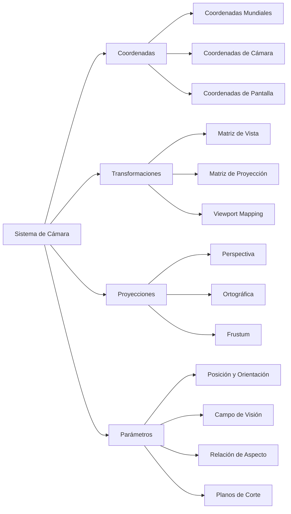

# Modelado y Programación - Graficación por computadora

## 6.9 Posición de la cámara y relación de aspecto.

---

La **posición de la cámara** y la **relación de aspecto** son fundamentales en graficación por computadora, ya que determinan cómo se proyecta la escena 3D en una imagen 2D. Estos conceptos definen la perspectiva, el campo de visión y las proporciones correctas de los objetos renderizados.

### Sistema de Coordenadas y Transformaciones de Cámara



### Sistema de Coordenadas

#### Coordenadas Mundiales vs. Coordenadas de Cámara

- **Coordenadas Mundiales**: Sistema global donde existen todos los objetos
- **Coordenadas de Cámara**: Sistema local donde la cámara está en el origen

#### Transformación entre Sistemas

$$ P_{camera} = M_{view} \times P_{world} $$
donde $M_{view}$ es la matriz de vista que transforma del espacio mundial al espacio de cámara.

### Parámetros de la Cámara

#### Posición y Orientación

La cámara se define por:

- **Posición**: $C = (C_x, C_y, C_z)$
- **Vector de mira**: $F = (F_x, F_y, F_z)$
- **Vector arriba**: $U = (U_x, U_y, U_z)$

#### Relación de Aspecto

$$ \text{Aspect Ratio} = \frac{\text{Ancho}}{\text{Alto}} $$

#### Campo de Visión (FOV)

$$ \tan\left(\frac{\text{FOV}}{2}\right) = \frac{\text{Altura del plano de vista}}{2 \times \text{distancia}} $$

### Matrices de Transformación

#### Matriz de Vista (LookAt)

La matriz de vista posiciona la cámara en el espacio:

```python
def look_at(eye, target, up):
    """
    Calcula la matriz de vista LookAt
    """
    # Calcular vectores base del espacio de cámara
    forward = normalize(target - eye)
    right = normalize(cross(forward, up))
    new_up = cross(right, forward)

    # Construir matriz de vista
    view_matrix = np.array([
        [right[0], right[1], right[2], -np.dot(right, eye)],
        [new_up[0], new_up[1], new_up[2], -np.dot(new_up, eye)],
        [-forward[0], -forward[1], -forward[2], np.dot(forward, eye)],
        [0, 0, 0, 1]
    ])

    return view_matrix
```

#### Matriz de Proyección Perspectiva

$$ M_{persp} = \begin{bmatrix} \frac{2n}{r-l} & 0 & \frac{r+l}{r-l} & 0 \\\ 0 & \frac{2n}{t-b} & \frac{t+b}{t-b} & 0 \\\ 0 & 0 & -\frac{f+n}{f-n} & -\frac{2fn}{f-n} \\\ 0 & 0 & -1 & 0 \end{bmatrix} $$

```python
def perspective_projection(fov, aspect_ratio, near, far):
    """
    Calcula matriz de proyección perspectiva
    """
    f = 1.0 / math.tan(math.radians(fov) / 2.0)

    return np.array([
        [f / aspect_ratio, 0, 0, 0],
        [0, f, 0, 0],
        [0, 0, (far + near) / (near - far), (2 * far * near) / (near - far)],
        [0, 0, -1, 0]
    ])
```

#### Matriz de Proyección Ortográfica

$$ M_{ortho} = \begin{bmatrix} \frac{2}{r-l} & 0 & 0 & -\frac{r+l}{r-l} \\\ 0 & \frac{2}{t-b} & 0 & -\frac{t+b}{t-b} \\\ 0 & 0 & -\frac{2}{f-n} & -\frac{f+n}{f-n} \\\ 0 & 0 & 0 & 1 \end{bmatrix} $$

```python
def orthographic_projection(left, right, bottom, top, near, far):
    """
    Calcula matriz de proyección ortográfica
    """
    return np.array([
        [2.0 / (right - left), 0, 0, -(right + left) / (right - left)],
        [0, 2.0 / (top - bottom), 0, -(top + bottom) / (top - bottom)],
        [0, 0, -2.0 / (far - near), -(far + near) / (far - near)],
        [0, 0, 0, 1]
    ])
```

### Implementación del Sistema de Cámara

#### Clase Cámara Completa

```python
import numpy as np
import math

class Camera:
    def __init__(self, width, height):
        # Parámetros de posición y orientación
        self.position = np.array([0.0, 0.0, 5.0])
        self.target = np.array([0.0, 0.0, 0.0])
        self.up = np.array([0.0, 1.0, 0.0])

        # Parámetros de proyección
        self.fov = 60.0  # grados
        self.aspect_ratio = width / height
        self.near_plane = 0.1
        self.far_plane = 100.0

        # Matrices
        self.view_matrix = np.identity(4)
        self.projection_matrix = np.identity(4)
        self.view_projection_matrix = np.identity(4)

        # Actualizar matrices
        self.update_matrices()

    def update_matrices(self):
        """Actualiza todas las matrices de la cámara"""
        self.view_matrix = self._calculate_view_matrix()
        self.projection_matrix = self._calculate_projection_matrix()
        self.view_projection_matrix = self.projection_matrix @ self.view_matrix

    def _calculate_view_matrix(self):
        """Calcula la matriz de vista LookAt"""
        forward = normalize(self.target - self.position)
        right = normalize(np.cross(forward, self.up))
        up = np.cross(right, forward)

        return np.array([
            [right[0], right[1], right[2], -np.dot(right, self.position)],
            [up[0], up[1], up[2], -np.dot(up, self.position)],
            [-forward[0], -forward[1], -forward[2], np.dot(forward, self.position)],
            [0, 0, 0, 1]
        ])

    def _calculate_projection_matrix(self):
        """Calcula matriz de proyección perspectiva"""
        f = 1.0 / math.tan(math.radians(self.fov) / 2.0)
        aspect = self.aspect_ratio

        return np.array([
            [f / aspect, 0, 0, 0],
            [0, f, 0, 0],
            [0, 0, (self.far_plane + self.near_plane) /
                   (self.near_plane - self.far_plane),
             (2 * self.far_plane * self.near_plane) /
             (self.near_plane - self.far_plane)],
            [0, 0, -1, 0]
        ])

    def set_position(self, x, y, z):
        """Establece la posición de la cámara"""
        self.position = np.array([x, y, z])
        self.update_matrices()

    def set_target(self, x, y, z):
        """Establece el target de la cámara"""
        self.target = np.array([x, y, z])
        self.update_matrices()

    def set_fov(self, fov):
        """Establece el campo de visión"""
        self.fov = max(1.0, min(fov, 179.0))  # Limitar entre 1° y 179°
        self.update_matrices()

    def set_aspect_ratio(self, width, height):
        """Actualiza la relación de aspecto"""
        if height > 0:
            self.aspect_ratio = width / height
            self.update_matrices()

    def get_ray(self, screen_x, screen_y, screen_width, screen_height):
        """
        Genera un rayo desde la cámara a través de un punto en la pantalla
        """
        # Convertir coordenadas de pantalla a coordenadas NDC (-1 a 1)
        ndc_x = (2.0 * screen_x) / screen_width - 1.0
        ndc_y = 1.0 - (2.0 * screen_y) / screen_height

        # Invertir proyección
        inv_view_proj = np.linalg.inv(self.view_projection_matrix)

        # Puntos near y far en espacio de pantalla
        near_point = np.array([ndc_x, ndc_y, -1.0, 1.0])
        far_point = np.array([ndc_x, ndc_y, 1.0, 1.0])

        # Convertir a espacio mundial
        near_world = inv_view_proj @ near_point
        far_world = inv_view_proj @ far_point
        near_world /= near_world[3]
        far_world /= far_world[3]

        # Crear rayo
        origin = near_world[:3]
        direction = normalize(far_world[:3] - origin)

        return Ray(origin, direction)

    def get_frustum_planes(self):
        """
        Calcula los 6 planos del frustum de la cámara
        """
        vp_matrix = self.view_projection_matrix
        planes = []

        # Extraer planos desde la matriz view-projection
        planes.append(self._extract_plane(vp_matrix, 0))  # Left
        planes.append(self._extract_plane(vp_matrix, 1))  # Right
        planes.append(self._extract_plane(vp_matrix, 2))  # Bottom
        planes.append(self._extract_plane(vp_matrix, 3))  # Top
        planes.append(self._extract_plane(vp_matrix, 4))  # Near
        planes.append(self._extract_plane(vp_matrix, 5))  # Far

        return planes

    def _extract_plane(self, matrix, plane_index):
        """
        Extrae un plano del frustum desde la matriz
        """
        if plane_index == 0:    # Left
            row = matrix[3, :] + matrix[0, :]
        elif plane_index == 1:  # Right
            row = matrix[3, :] - matrix[0, :]
        elif plane_index == 2:  # Bottom
            row = matrix[3, :] + matrix[1, :]
        elif plane_index == 3:  # Top
            row = matrix[3, :] - matrix[1, :]
        elif plane_index == 4:  # Near
            row = matrix[3, :] + matrix[2, :]
        else:                   # Far
            row = matrix[3, :] - matrix[2, :]

        # Normalizar el plano
        length = np.linalg.norm(row[:3])
        return row / length

# Funciones utilitarias
def normalize(vector):
    """Normaliza un vector"""
    norm = np.linalg.norm(vector)
    if norm > 0:
        return vector / norm
    return vector

class Ray:
    def __init__(self, origin, direction):
        self.origin = origin
        self.direction = direction
```

### Manejo de Relación de Aspecto

#### Corrección de Relación de Aspecto

```python
def handle_aspect_ratio(camera, window_width, window_height):
    """
    Maneja diferentes relaciones de aspecto y modos de visualización
    """
    modes = ['stretch', 'letterbox', 'pillarbox', 'fill', 'fit']
    current_mode = 'letterbox'

    target_aspect = 16.0 / 9.0  # Relación de aspecto objetivo
    current_aspect = window_width / window_height

    if current_mode == 'stretch':
        # Estirar la imagen (distorsión)
        camera.set_aspect_ratio(window_width, window_height)

    elif current_mode == 'letterbox':
        # Letterbox (barras negras arriba/abajo)
        if current_aspect > target_aspect:
            # Pantalla más ancha que el objetivo
            render_width = window_height * target_aspect
            bars = (window_width - render_width) / 2
            set_viewport(bars, 0, render_width, window_height)
        else:
            # Pantalla más alta que el objetivo
            render_height = window_width / target_aspect
            bars = (window_height - render_height) / 2
            set_viewport(0, bars, window_width, render_height)

    elif current_mode == 'pillarbox':
        # Pillarbox (barras negras a los lados)
        # Implementación similar a letterbox pero inversa

    elif current_mode == 'fill':
        # Llenar pantalla (recorte)
        if current_aspect > target_aspect:
            render_height = window_width / target_aspect
            offset = (window_height - render_height) / 2
            set_viewport(0, -offset, window_width, render_height)
        else:
            render_width = window_height * target_aspect
            offset = (window_width - render_width) / 2
            set_viewport(-offset, 0, render_width, window_height)

    camera.set_aspect_ratio(window_width, window_height)
```

### Movimiento y Control de Cámara

#### Sistema de Control FPS (First Person Shooter)

```python
class FPSCameraController:
    def __init__(self, camera, window):
        self.camera = camera
        self.window = window
        self.mouse_sensitivity = 0.1
        self.move_speed = 2.5
        self.yaw = -90.0  # Ángulo horizontal
        self.pitch = 0.0   # Ángulo vertical

        # Configurar callbacks
        glfw.set_cursor_pos_callback(window, self._mouse_callback)
        glfw.set_scroll_callback(window, self._scroll_callback)

    def _mouse_callback(self, window, xpos, ypos):
        """Maneja el movimiento del mouse"""
        if self.first_mouse:
            self.last_x = xpos
            self.last_y = ypos
            self.first_mouse = False

        xoffset = (xpos - self.last_x) * self.mouse_sensitivity
        yoffset = (self.last_y - ypos) * self.mouse_sensitivity
        self.last_x = xpos
        self.last_y = ypos

        # Actualizar ángulos
        self.yaw += xoffset
        self.pitch += yoffset

        # Limitar ángulo vertical
        self.pitch = max(-89.0, min(89.0, self.pitch))

        # Actualizar dirección de la cámara
        self._update_camera_vectors()

    def _update_camera_vectors(self):
        """Actualiza los vectores de dirección de la cámara"""
        front = np.array([
            math.cos(math.radians(self.yaw)) * math.cos(math.radians(self.pitch)),
            math.sin(math.radians(self.pitch)),
            math.sin(math.radians(self.yaw)) * math.cos(math.radians(self.pitch))
        ])
        self.camera.target = self.camera.position + normalize(front)

    def _scroll_callback(self, window, xoffset, yoffset):
        """Maneja la rueda del mouse (zoom)"""
        self.camera.fov -= yoffset
        self.camera.fov = max(1.0, min(45.0, self.camera.fov))
        self.camera.update_matrices()

    def process_keyboard(self, delta_time):
        """Maneja el movimiento por teclado"""
        velocity = self.move_speed * delta_time

        if glfw.get_key(self.window, glfw.KEY_W) == glfw.PRESS:
            self.camera.position += self.camera.target * velocity
        if glfw.get_key(self.window, glfw.KEY_S) == glfw.PRESS:
            self.camera.position -= self.camera.target * velocity
        if glfw.get_key(self.window, glfw.KEY_A) == glfw.PRESS:
            self.camera.position -= normalize(np.cross(
                self.camera.target, self.camera.up)) * velocity
        if glfw.get_key(self.window, glfw.KEY_D) == glfw.PRESS:
            self.camera.position += normalize(np.cross(
                self.camera.target, self.camera.up)) * velocity

        self.camera.update_matrices()
```

### Ejercicios Propuestos

1. **Ejercicio 1**: Implementa una cámara que siga a un objeto (third-person camera) con suavizado de movimiento.

2. **Ejercicio 2**: Crea un sistema de cámaras múltiples con split-screen para modo multijugador.

3. **Ejercicio 3**: Desarrolla un controlador de cámara orbital que gire alrededor de un objeto focus.

4. **Ejercicio 4**: Implementa frustum culling usando los planos del frustum para optimizar el renderizado.

5. **Ejercicio 5**: Crea un sistema de cinemáticas de cámara con waypoints y curvas de Bézier para movimientos suaves.

### Referencias Bibliográficas

1. Shirley, P., & Marschner, S. (2009). _Fundamentals of Computer Graphics_.
2. Dunn, F., & Parberry, I. (2011). _3D Math Primer for Graphics and Game Development_.
3. Hughes, J. F., et al. (2013). _Computer Graphics: Principles and Practice_.
4. OpenGL Architecture Review Board (2004). _OpenGL Programming Guide_.

### Recursos Adicionales

- [LearnOpenGL: Camera](https://learnopengl.com/Getting-started/Camera)
- [3D Game Programming with DirectX 12: Camera Systems](https://www.d3dcoder.net/d3d12.htm)
- [GPU Gems: Camera Design](https://developer.nvidia.com/gpugems/gpugems3/part-i-geometry/chapter-1-generating-complex-procedural-terrains-using-gpu)
- [Camera Transformation Tutorial](https://www.scratchapixel.com/lessons/3d-basic-rendering/computing-pixel-coordinates-of-3d-point/mathematics-computing-2d-coordinates-of-3d-points)
