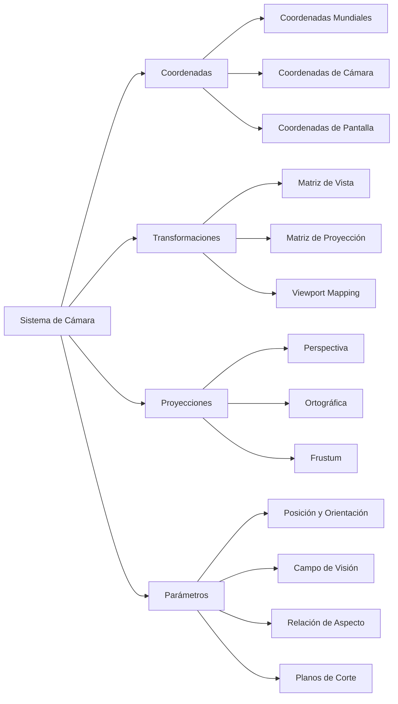

# Modelado y Programación - Graficación por computadora

## 6.9 Posición de la cámara y relación de aspecto.

---

La **posición de la cámara** y la **relación de aspecto** son fundamentales en graficación por computadora, ya que determinan cómo se proyecta la escena 3D en una imagen 2D. Estos conceptos definen la perspectiva, el campo de visión y las proporciones correctas de los objetos renderizados.

### Sistema de Coordenadas y Transformaciones de Cámara



### Sistema de Coordenadas

#### Coordenadas Mundiales vs. Coordenadas de Cámara

- **Coordenadas Mundiales**: Sistema global donde existen todos los objetos
- **Coordenadas de Cámara**: Sistema local donde la cámara está en el origen

#### Transformación entre Sistemas

$$ P_{camera} = M_{view} \times P_{world} $$

donde $M_{view}$ es la matriz de vista que transforma del espacio mundial al espacio de cámara.

### Parámetros de la Cámara

#### Posición y Orientación

La cámara se define por:

- **Posición**: $C = (C_x, C_y, C_z)$
- **Vector de mira**: $F = (F_x, F_y, F_z)$
- **Vector arriba**: $U = (U_x, U_y, U_z)$

#### Relación de Aspecto

$$ \text{Aspect Ratio} = \frac{\text{Ancho}}{\text{Alto}} $$

#### Campo de Visión (FOV)

$$ \tan\left(\frac{\text{FOV}}{2}\right) = \frac{\text{Altura del plano de vista}}{2 \times \text{distancia}} $$

Un FOV pequeño equivale a un teleobjetivo: muestra poco de la escena, ampliado, y aplana la perspectiva. Un FOV grande es un gran angular: muestra mucho y exagera la perspectiva, con deformación visible en los bordes por encima de unos 100°. Reducir el FOV es la forma de hacer *zoom* sin mover la cámara. En fotografía, una lente de distancia focal $f$ en un sensor de altura $h$ tiene $\text{FOV}_v = 2\arctan\frac{h}{2f}.$

### Matrices de Transformación

#### Matriz de Vista (LookAt)

La matriz de vista posiciona la cámara en el espacio:

```python
def look_at(eye, target, up):
    """
    Calcula la matriz de vista LookAt
    """
    # Calcular vectores base del espacio de cámara
    forward = normalize(target - eye)
    right = normalize(cross(forward, up))
    new_up = cross(right, forward)

    # Construir matriz de vista
    view_matrix = np.array([
        [right[0], right[1], right[2], -np.dot(right, eye)],
        [new_up[0], new_up[1], new_up[2], -np.dot(new_up, eye)],
        [-forward[0], -forward[1], -forward[2], np.dot(forward, eye)],
        [0, 0, 0, 1]
    ])

    return view_matrix
```

#### Matriz de Proyección Perspectiva

$$ M_{persp} = \begin{bmatrix} \frac{2n}{r-l} & 0 & \frac{r+l}{r-l} & 0 \\ 0 & \frac{2n}{t-b} & \frac{t+b}{t-b} & 0 \\ 0 & 0 & -\frac{f+n}{f-n} & -\frac{2fn}{f-n} \\ 0 & 0 & -1 & 0 \end{bmatrix} $$

```python
def perspective_projection(fov, aspect_ratio, near, far):
    """
    Calcula matriz de proyección perspectiva
    """
    f = 1.0 / math.tan(math.radians(fov) / 2.0)

    return np.array([
        [f / aspect_ratio, 0, 0, 0],
        [0, f, 0, 0],
        [0, 0, (far + near) / (near - far), (2 * far * near) / (near - far)],
        [0, 0, -1, 0]
    ])
```

#### Matriz de Proyección Ortográfica

$$ M_{ortho} = \begin{bmatrix} \frac{2}{r-l} & 0 & 0 & -\frac{r+l}{r-l} \\ 0 & \frac{2}{t-b} & 0 & -\frac{t+b}{t-b} \\ 0 & 0 & -\frac{2}{f-n} & -\frac{f+n}{f-n} \\ 0 & 0 & 0 & 1 \end{bmatrix} $$

```python
def orthographic_projection(left, right, bottom, top, near, far):
    """
    Calcula matriz de proyección ortográfica
    """
    return np.array([
        [2.0 / (right - left), 0, 0, -(right + left) / (right - left)],
        [0, 2.0 / (top - bottom), 0, -(top + bottom) / (top - bottom)],
        [0, 0, -2.0 / (far - near), -(far + near) / (far - near)],
        [0, 0, 0, 1]
    ])
```

### Implementación del Sistema de Cámara

#### Clase Cámara Completa

```python
import numpy as np
import math

class Camera:
    def __init__(self, width, height):
        # Parámetros de posición y orientación
        self.position = np.array([0.0, 0.0, 5.0])
        self.target = np.array([0.0, 0.0, 0.0])
        self.up = np.array([0.0, 1.0, 0.0])

        # Parámetros de proyección
        self.fov = 60.0  # grados
        self.aspect_ratio = width / height
        self.near_plane = 0.1
        self.far_plane = 100.0

        # Matrices
        self.view_matrix = np.identity(4)
        self.projection_matrix = np.identity(4)
        self.view_projection_matrix = np.identity(4)

        # Actualizar matrices
        self.update_matrices()

    def update_matrices(self):
        """Actualiza todas las matrices de la cámara"""
        self.view_matrix = self._calculate_view_matrix()
        self.projection_matrix = self._calculate_projection_matrix()
        self.view_projection_matrix = self.projection_matrix @ self.view_matrix

    def _calculate_view_matrix(self):
        """Calcula la matriz de vista LookAt"""
        forward = normalize(self.target - self.position)
        right = normalize(np.cross(forward, self.up))
        up = np.cross(right, forward)

        return np.array([
            [right[0], right[1], right[2], -np.dot(right, self.position)],
            [up[0], up[1], up[2], -np.dot(up, self.position)],
            [-forward[0], -forward[1], -forward[2], np.dot(forward, self.position)],
            [0, 0, 0, 1]
        ])

    def _calculate_projection_matrix(self):
        """Calcula matriz de proyección perspectiva"""
        f = 1.0 / math.tan(math.radians(self.fov) / 2.0)
        aspect = self.aspect_ratio

        return np.array([
            [f / aspect, 0, 0, 0],
            [0, f, 0, 0],
            [0, 0, (self.far_plane + self.near_plane) /
                   (self.near_plane - self.far_plane),
             (2 * self.far_plane * self.near_plane) /
             (self.near_plane - self.far_plane)],
            [0, 0, -1, 0]
        ])

    def set_position(self, x, y, z):
        """Establece la posición de la cámara"""
        self.position = np.array([x, y, z])
        self.update_matrices()

    def set_target(self, x, y, z):
        """Establece el target de la cámara"""
        self.target = np.array([x, y, z])
        self.update_matrices()

    def set_fov(self, fov):
        """Establece el campo de visión"""
        self.fov = max(1.0, min(fov, 179.0))  # Limitar entre 1° y 179°
        self.update_matrices()

    def set_aspect_ratio(self, width, height):
        """Actualiza la relación de aspecto"""
        if height > 0:
            self.aspect_ratio = width / height
            self.update_matrices()

    def get_ray(self, screen_x, screen_y, screen_width, screen_height):
        """
        Genera un rayo desde la cámara a través de un punto en la pantalla
        """
        # Centro del píxel en coordenadas NDC (-1 a 1)
        ndc_x = (2.0 * (screen_x + 0.5)) / screen_width - 1.0
        ndc_y = 1.0 - (2.0 * (screen_y + 0.5)) / screen_height

        # Invertir proyección
        inv_view_proj = np.linalg.inv(self.view_projection_matrix)

        # Puntos near y far en espacio de pantalla
        near_point = np.array([ndc_x, ndc_y, -1.0, 1.0])
        far_point = np.array([ndc_x, ndc_y, 1.0, 1.0])

        # Convertir a espacio mundial
        near_world = inv_view_proj @ near_point
        far_world = inv_view_proj @ far_point
        near_world /= near_world[3]
        far_world /= far_world[3]

        # Crear rayo
        origin = near_world[:3]
        direction = normalize(far_world[:3] - origin)

        return Ray(origin, direction)

    def get_frustum_planes(self):
        """
        Calcula los 6 planos del frustum de la cámara
        """
        vp_matrix = self.view_projection_matrix
        planes = []

        # Extraer planos desde la matriz view-projection
        planes.append(self._extract_plane(vp_matrix, 0))  # Left
        planes.append(self._extract_plane(vp_matrix, 1))  # Right
        planes.append(self._extract_plane(vp_matrix, 2))  # Bottom
        planes.append(self._extract_plane(vp_matrix, 3))  # Top
        planes.append(self._extract_plane(vp_matrix, 4))  # Near
        planes.append(self._extract_plane(vp_matrix, 5))  # Far

        return planes

    def _extract_plane(self, matrix, plane_index):
        """
        Extrae un plano del frustum desde la matriz
        """
        if plane_index == 0:    # Left
            row = matrix[3, :] + matrix[0, :]
        elif plane_index == 1:  # Right
            row = matrix[3, :] - matrix[0, :]
        elif plane_index == 2:  # Bottom
            row = matrix[3, :] + matrix[1, :]
        elif plane_index == 3:  # Top
            row = matrix[3, :] - matrix[1, :]
        elif plane_index == 4:  # Near
            row = matrix[3, :] + matrix[2, :]
        else:                   # Far
            row = matrix[3, :] - matrix[2, :]

        # Normalizar el plano
        length = np.linalg.norm(row[:3])
        return row / length

# Funciones utilitarias
def normalize(vector):
    """Normaliza un vector"""
    norm = np.linalg.norm(vector)
    if norm > 0:
        return vector / norm
    return vector

class Ray:
    def __init__(self, origin, direction):
        self.origin = origin
        self.direction = direction

cam = Camera(800, 600)
rayo = cam.get_ray(399.5, 299.5, 800, 600)       # el centro exacto de la imagen
print(np.round(rayo.direction, 3) + 0.0)          # [ 0.  0. -1.]: hacia el objetivo
```

`get_ray` obtiene el rayo invirtiendo la matriz de vista-proyección: los puntos de NDC con $z = -1$ y $z = 1$ son los puntos del plano cercano y del lejano que se ven en ese píxel, y la recta que los une es el rayo. Es la forma de saber qué objeto está bajo el cursor del ratón (*picking*), y produce los mismos rayos que el ray tracer del tema 6.3.

### Manejo de Relación de Aspecto

#### Corrección de Relación de Aspecto

Si la relación de aspecto de la proyección no coincide con la de la ventana, los objetos se deforman: un círculo se ve como elipse. Cuando el contenido está diseñado para una relación fija, por ejemplo 16:9, y la ventana tiene otra, hay varias estrategias:

| Modo | Qué hace | Costo |
| --- | --- | --- |
| *stretch* | usa toda la ventana con la relación del contenido | deforma la imagen |
| *letterbox* | barras arriba y abajo, si la ventana es más **alta** que el contenido | se desperdicia espacio |
| *pillarbox* | barras a los lados, si la ventana es más **ancha** que el contenido | se desperdicia espacio |
| *fit* | elige automáticamente letterbox o pillarbox | se desperdicia espacio |
| *fill* | llena la ventana y recorta lo que sobra | se pierde parte de la imagen |
| expandir | ajusta la proyección a la relación de la ventana | se ve más o menos escena según la ventana |

La función siguiente calcula el *viewport* (la región de la ventana donde se dibuja, como `(x, y, ancho, alto)`) y la relación de aspecto que debe usar la cámara en cada modo:

```python
def calcular_viewport(modo, ancho_v, alto_v, aspecto_objetivo=16 / 9):
    aspecto_v = ancho_v / alto_v
    if modo == "stretch":
        return (0, 0, ancho_v, alto_v), aspecto_objetivo        # se deforma
    if modo == "expandir":
        return (0, 0, ancho_v, alto_v), aspecto_v               # sin deformar, otra vista
    if modo == "fit":
        modo = "pillarbox" if aspecto_v > aspecto_objetivo else "letterbox"
    if modo == "pillarbox":                                     # barras a los lados
        w = alto_v * aspecto_objetivo
        return ((ancho_v - w) / 2, 0, w, alto_v), aspecto_objetivo
    if modo == "letterbox":                                     # barras arriba y abajo
        h = ancho_v / aspecto_objetivo
        return (0, (alto_v - h) / 2, ancho_v, h), aspecto_objetivo
    if modo == "fill":                                          # recortar lo que sobra
        if aspecto_v > aspecto_objetivo:
            h = ancho_v / aspecto_objetivo
            return (0, (alto_v - h) / 2, ancho_v, h), aspecto_objetivo
        w = alto_v * aspecto_objetivo
        return ((ancho_v - w) / 2, 0, w, alto_v), aspecto_objetivo
    raise ValueError(modo)

print(calcular_viewport("fit", 2560, 1080))    # ((320.0, 0, 1920.0, 1080), 1.77...): pillarbox
print(calcular_viewport("fit", 1024, 768))     # ((0, 96.0, 1024, 576.0), 1.77...): letterbox
print(calcular_viewport("fill", 2560, 1080)[0])  # (0, -180.0, 2560, 1440.0): se recortan 180 px arriba y abajo
```

En *fill* el *viewport* es más grande que la ventana y queda parcialmente fuera de ella, así que lo que sobra simplemente no se ve. En el modo "expandir", que es el que usan casi todos los juegos 3D, se suele fijar el campo de visión **vertical** y dejar que el horizontal crezca con la relación de aspecto, de modo que una pantalla más ancha muestra más escena a los lados:

$$ \text{fov}_h = 2\arctan\left(a \tan\frac{\text{fov}_v}{2}\right) $$

Con $\text{fov}_v = 60°,$ en 16:9 el campo horizontal es $2\arctan(1.778 \cdot 0.577) ≈ 91.5°,$ y en 4:3 es de unos $75.2°.$

### Movimiento y Control de Cámara

#### Sistema de Control FPS (First Person Shooter)

La orientación de una cámara en primera persona se describe con dos ángulos: el **yaw** $\psi$ (giro horizontal) y el **pitch** $\varphi$ (inclinación). La dirección de vista es, en coordenadas esféricas con el eje $y$ hacia arriba,

$$ \vec{f} = (\cos\psi\cos\varphi, \; \sin\varphi, \; \sin\psi\cos\varphi) $$

El pitch se limita a $\pm 89°:$ en $\pm 90°$ la dirección de vista sería paralela al vector `up` y el producto cruz que define el vector derecho valdría cero. La lógica se separa de la biblioteca de ventanas: los manejadores de eventos de GLFW, SDL u otra biblioteca solo llaman a `mover_raton` y `procesar_teclado`.

```python
class FPSCameraController:
    def __init__(self, camera, mouse_sensitivity=0.1, move_speed=2.5):
        self.camera = camera
        self.mouse_sensitivity = mouse_sensitivity
        self.move_speed = move_speed
        self.yaw = -90.0   # mirar hacia -z
        self.pitch = 0.0
        self.last_x = self.last_y = None
        self._update_camera_vectors()

    def mover_raton(self, xpos, ypos):
        if self.last_x is None:                  # primer evento: no hay desplazamiento
            self.last_x, self.last_y = xpos, ypos
        xoffset = (xpos - self.last_x) * self.mouse_sensitivity
        yoffset = (self.last_y - ypos) * self.mouse_sensitivity   # y de pantalla crece hacia abajo
        self.last_x, self.last_y = xpos, ypos
        self.yaw += xoffset
        self.pitch = max(-89.0, min(89.0, self.pitch + yoffset))
        self._update_camera_vectors()

    def _update_camera_vectors(self):
        y, p = math.radians(self.yaw), math.radians(self.pitch)
        self.front = normalize(np.array([math.cos(y) * math.cos(p),
                                         math.sin(p),
                                         math.sin(y) * math.cos(p)]))
        self.right = normalize(np.cross(self.front, self.camera.up))
        self.camera.target = self.camera.position + self.front
        self.camera.update_matrices()

    def zoom(self, yoffset):
        self.camera.set_fov(max(1.0, min(45.0, self.camera.fov - yoffset)))

    def procesar_teclado(self, teclas, delta_time):
        """teclas: conjunto con las teclas presionadas, por ejemplo {'W', 'D'}."""
        velocity = self.move_speed * delta_time
        desplazamiento = np.zeros(3)
        if 'W' in teclas: desplazamiento += self.front
        if 'S' in teclas: desplazamiento -= self.front
        if 'D' in teclas: desplazamiento += self.right
        if 'A' in teclas: desplazamiento -= self.right
        if np.linalg.norm(desplazamiento) > 0:
            # Normalizar evita moverse más rápido en diagonal
            self.camera.position = self.camera.position + normalize(desplazamiento) * velocity
        self.camera.target = self.camera.position + self.front   # la cámara sigue mirando igual
        self.camera.update_matrices()

cam = Camera(800, 600)
ctrl = FPSCameraController(cam)
ctrl.procesar_teclado({'W'}, delta_time=1.0)                  # avanzar 2.5 unidades hacia -z
print(np.round(cam.position, 3))                              # [0.  0.  2.5]
ctrl.mover_raton(0, 0); ctrl.mover_raton(900, 0)              # 90 grados a la derecha
print(np.round(ctrl.front, 3) + 0.0)                          # [1. 0. 0.]
```

Multiplicar la velocidad por `delta_time`, el tiempo transcurrido desde el cuadro anterior, hace que el movimiento sea igual de rápido a 30 o a 144 cuadros por segundo. La dirección de movimiento es `front`, un vector, y no `target`, que es un **punto**: sumar un punto a la posición no tiene sentido geométrico.

### Soluciones a los Ejercicios

**Ejercicio 1: cámara en tercera persona.** La posición deseada está detrás y arriba del objeto, por ejemplo $\vec{p}_{obj} - 6\vec{f}_{obj} + 2\hat{y}.$ Para que la cámara no siga cada sacudida del objeto, se acerca a la posición deseada con **suavizado exponencial**: en cada cuadro avanza una fracción $\alpha = 1 - e^{-k\,\Delta t}$ de la distancia que le falta. Escribirlo con la exponencial, y no con una fracción fija, hace que el resultado no dependa de los cuadros por segundo.

```python
def seguir(pos_camara, pos_objetivo, k, dt):
    alfa = 1 - math.exp(-k * dt)
    return pos_camara + alfa * (pos_objetivo - pos_camara)

pos = np.array([0.0, 0.0, 0.0])
for _ in range(60):                                     # un segundo a 60 FPS
    pos = seguir(pos, np.array([10.0, 0.0, 0.0]), k=5, dt=1 / 60)
print(round(float(pos[0]), 3))                          # 9.933: casi alcanzó al objetivo
```

Hay que verificar además que no haya paredes entre el objeto y la cámara, lanzando un rayo del objeto a la cámara; si lo hay, se acerca la cámara al punto de impacto.

**Ejercicio 2: pantalla dividida.** Cada jugador tiene su propia cámara y su propio *viewport*. Con dos jugadores en una ventana de $1920 \times 1080$ divididos verticalmente, cada *viewport* es de $960 \times 1080,$ así que la relación de aspecto de **cada** cámara debe ser $\frac{960}{1080} ≈ 0.89$ y no la de la ventana; si no, la imagen se aplasta. La escena se dibuja una vez por cámara, cada vez con su *viewport*.

```python
def viewports_split(n, ancho, alto):
    if n == 1:
        return [(0, 0, ancho, alto)]
    if n == 2:
        return [(0, 0, ancho / 2, alto), (ancho / 2, 0, ancho / 2, alto)]
    w, h = ancho / 2, alto / 2                          # 3 o 4 jugadores: cuadrícula de 2 x 2
    return [(x, y, w, h) for y in (0, h) for x in (0, w)][:n]

for vp in viewports_split(2, 1920, 1080):
    print(vp, round(vp[2] / vp[3], 3))                 # aspecto de cada cámara: 0.889
```

**Ejercicio 3: cámara orbital.** La cámara se describe con coordenadas esféricas alrededor del objeto: distancia $r,$ azimut $\theta$ y elevación $\varphi.$ Arrastrar el ratón cambia los ángulos y la rueda cambia $r;$ el objetivo es siempre el centro.

$$ \vec{p} = \vec{c} + r(\cos\varphi\sin\theta, \; \sin\varphi, \; \cos\varphi\cos\theta) $$

```python
class CamaraOrbital:
    def __init__(self, camera, centro, r=5.0):
        self.camera, self.centro, self.r = camera, np.array(centro, float), r
        self.theta, self.phi = 0.0, 0.0

    def orbitar(self, d_theta, d_phi):
        self.theta += d_theta
        self.phi = max(-1.5, min(1.5, self.phi + d_phi))      # evitar los polos
        c = math.cos(self.phi)
        self.camera.position = self.centro + self.r * np.array(
            [c * math.sin(self.theta), math.sin(self.phi), c * math.cos(self.theta)])
        self.camera.target = self.centro
        self.camera.update_matrices()

orb = CamaraOrbital(Camera(800, 600), (0, 0, 0))
orb.orbitar(math.pi / 2, 0)
print(np.round(orb.camera.position, 3) + 0.0)            # [5. 0. 0.]
```

**Ejercicio 4: *frustum culling*.** `get_frustum_planes` ya obtiene los seis planos, con normales hacia adentro, a partir de la matriz de vista-proyección. Un objeto con esfera envolvente de centro $\vec{c}$ y radio $r$ se descarta si para algún plano $(a, b, c, d)$ se cumple $a c_x + b c_y + c c_z + d < -r.$

```python
def visible(camera, centro, radio):
    for plano in camera.get_frustum_planes():
        if plano[:3] @ centro + plano[3] < -radio:
            return False
    return True

cam = Camera(800, 600)       # en (0, 0, 5) mirando al origen
print(visible(cam, np.array([0, 0, 0]), 1), visible(cam, np.array([0, 0, 10]), 1))   # True False
```

El tema 6.5 (ejercicio 5) explica de dónde salen los planos y cómo combinar la prueba con una jerarquía de volúmenes.

**Ejercicio 5: cinemáticas.** Una trayectoria suave que **pasa** por los puntos de control (*waypoints*) se obtiene con una spline de **Catmull-Rom**: entre $P_1$ y $P_2,$ cada tramo es una curva de Bézier cúbica con puntos de control $P_1,$ $P_1 + \frac{P_2 - P_0}{6},$ $P_2 - \frac{P_3 - P_1}{6}$ y $P_2,$ lo que da tangentes continuas en las uniones. Se interpola de la misma forma el punto al que mira la cámara.

```python
def catmull_rom(p0, p1, p2, p3, t):
    b1, b2 = p1 + (p2 - p0) / 6, p2 - (p3 - p1) / 6
    return ((1 - t) ** 3) * p1 + 3 * ((1 - t) ** 2) * t * b1 + 3 * (1 - t) * t * t * b2 + t ** 3 * p2

def recorrido(waypoints, pasos_por_tramo=4):
    pts = [np.array(w, float) for w in waypoints]
    pts = [pts[0]] + pts + [pts[-1]]                    # repetir extremos
    camino = []
    for i in range(1, len(pts) - 2):
        for k in range(pasos_por_tramo):
            camino.append(catmull_rom(pts[i - 1], pts[i], pts[i + 1], pts[i + 2], k / pasos_por_tramo))
    camino.append(pts[-2])
    return camino

camino = recorrido([(0, 0, 0), (4, 2, 0), (8, 0, 0)])
print(len(camino), np.round(camino[4], 3) + 0.0)        # 9 [4. 2. 0.]: pasa por el waypoint
```

Para que la cámara se mueva con velocidad constante, el parámetro $t$ no debe avanzar uniformemente sino según la longitud de arco, que se precalcula muestreando la curva; además, al inicio y al final de cada toma se usa una función de suavizado (*ease in/out*) para que la cámara acelere y frene sin saltos.

### Ejercicios Propuestos

1. **Ejercicio 1**: Implementa una cámara que siga a un objeto (third-person camera) con suavizado de movimiento.

2. **Ejercicio 2**: Crea un sistema de cámaras múltiples con split-screen para modo multijugador.

3. **Ejercicio 3**: Desarrolla un controlador de cámara orbital que gire alrededor de un objeto focus.

4. **Ejercicio 4**: Implementa frustum culling usando los planos del frustum para optimizar el renderizado.

5. **Ejercicio 5**: Crea un sistema de cinemáticas de cámara con waypoints y curvas de Bézier para movimientos suaves.

### Referencias Bibliográficas

1. Shirley, P., & Marschner, S. (2009). _Fundamentals of Computer Graphics_.
2. Dunn, F., & Parberry, I. (2011). _3D Math Primer for Graphics and Game Development_.
3. Hughes, J. F., et al. (2013). _Computer Graphics: Principles and Practice_.
4. OpenGL Architecture Review Board (2004). _OpenGL Programming Guide_.

### Recursos Adicionales

- [LearnOpenGL: Camera](https://learnopengl.com/Getting-started/Camera)
- [3D Game Programming with DirectX 12: Camera Systems](https://www.d3dcoder.net/d3d12.htm)
- [GPU Gems: Camera Design](https://developer.nvidia.com/gpugems/gpugems3/part-i-geometry/chapter-1-generating-complex-procedural-terrains-using-gpu)
- [Camera Transformation Tutorial](https://www.scratchapixel.com/lessons/3d-basic-rendering/computing-pixel-coordinates-of-3d-point/mathematics-computing-2d-coordinates-of-3d-points)
