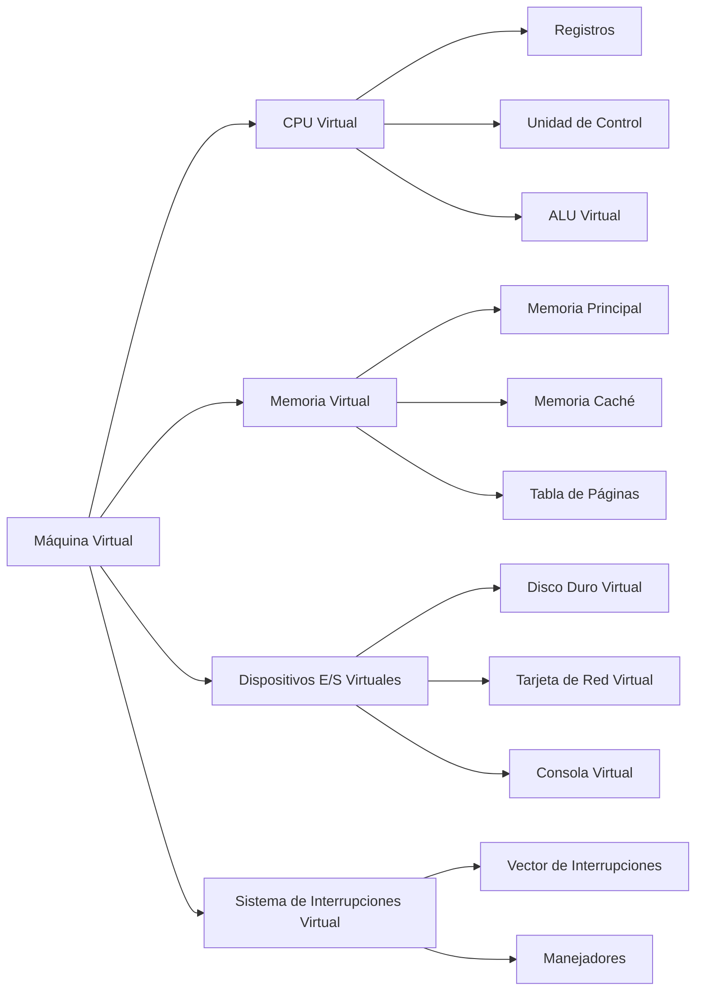
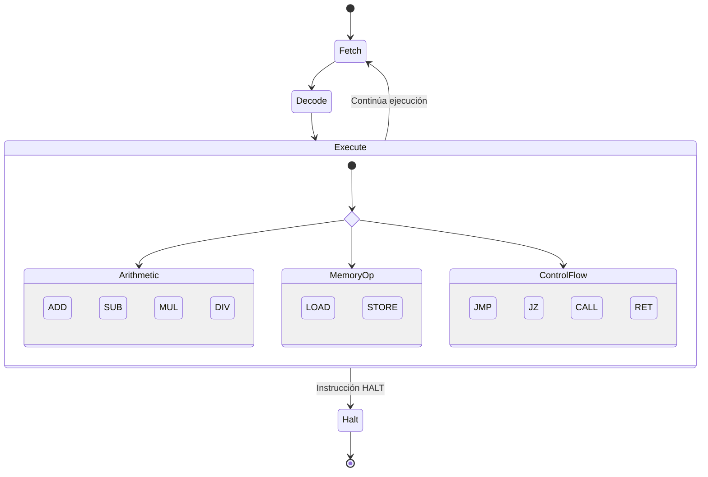

# Modelado y Programación - Emulación de máquinas virtuales

## 7.1 Descripción de una máquina virtual.

---

Una **máquina virtual (VM)** es una abstracción software que emula el hardware de una computadora física, permitiendo ejecutar sistemas operativos y aplicaciones como si se estuvieran ejecutando en hardware real.

### Definición Fundamental

Una máquina virtual es **una implementación software de una máquina que ejecuta programas como una máquina física**. Esta emulación se logra mediante:

- Un **conjunto de componentes virtualizados** (CPU, memoria, dispositivos)
- Un **mecanismo de traducción** de instrucciones
- Un **sistema de gestión** de recursos

### Componentes de una Máquina Virtual



### Arquitectura de una Máquina Virtual Básica

#### CPU Virtual

La CPU virtual emula el ciclo de fetch-decode-execute:

$$
\text{Ciclo} = \{\text{Fetch}, \text{Decode}, \text{Execute}, \text{Store}\}
$$

**Registros virtuales típicos:**

- `PC` - Contador de programa: $\text{PC} = \text{dirección de la siguiente instrucción}$
- `SP` - Puntero de pila: $\text{SP} = \text{dirección del tope de la pila}$
- `ACC` - Acumulador: $\text{ACC} = \text{resultado de operaciones}$

#### Memoria Virtual

La memoria se representa como un array de bytes/celdas:

$$
\text{Memoria}[i] = \text{valor en la dirección } i \quad \text{para } i = 0, 1, 2, \ldots, N-1
$$

#### Sistema de Instrucciones

Cada instrucción tiene un código de operación (opcode) y operandos:

$$
\text{Instrucción} = (\text{opcode}, \text{operando}_1, \text{operando}_2, \ldots)
$$

### Implementación Básica en C++

La siguiente VM es una **máquina de acumulador**: casi todas las operaciones usan el registro `ACC` como operando implícito. Para que el código sea legible y correcto se fijan algunas decisiones de diseño:

- La memoria tiene $2^{16}$ celdas de un byte, así que las **direcciones** ocupan 2 bytes, en orden *little endian* (primero el byte bajo).
- Las instrucciones con operando **inmediato** llevan un byte con el valor; las que se refieren a memoria llevan una dirección de 2 bytes.
- La pila crece hacia direcciones menores y guarda direcciones de retorno de 2 bytes.

| Opcode | Mnemónico | Operando | Efecto |
| --- | --- | --- | --- |
| `0x00` | `HALT` | | detiene la máquina |
| `0x01` | `LOAD` | inmediato | `ACC = n` |
| `0x02` | `STORE` | dirección | `mem[a] = ACC` |
| `0x03` | `ADD` | inmediato | `ACC += n` |
| `0x04` | `SUB` | inmediato | `ACC -= n` |
| `0x05` | `JMP` | dirección | `PC = a` |
| `0x06` | `CALL` | dirección | apila `PC`, `PC = a` |
| `0x07` | `RET` | | `PC = desapilar()` |
| `0x08` | `JZ` | dirección | si `ACC == 0`, `PC = a` |
| `0x09` | `LOADM` | dirección | `ACC = mem[a]` |
| `0x0A` | `SUBM` | dirección | `ACC -= mem[a]` |
| `0x0B` | `PRINT` | | escribe `ACC` |

```cpp
#include <algorithm>
#include <cstdint>
#include <iostream>
#include <stdexcept>
#include <vector>

class VirtualMachine {
private:
    // Registros
    uint16_t PC;    // Contador de programa
    uint16_t SP;    // Puntero de pila
    int16_t ACC;    // Acumulador

    // Memoria
    std::vector<uint8_t> memory;

    // Estado
    bool running;
    long cycles = 0;

    uint8_t fetchByte() { return memory[PC++]; }

    uint16_t fetchAddress() {              // little endian: byte bajo primero
        uint16_t lo = fetchByte();
        uint16_t hi = fetchByte();
        return static_cast<uint16_t>(lo | (hi << 8));
    }

    void push16(uint16_t value) {
        memory[--SP] = value >> 8;
        memory[--SP] = value & 0xFF;
    }

    uint16_t pop16() {
        uint16_t lo = memory[SP++];
        uint16_t hi = memory[SP++];
        return static_cast<uint16_t>(lo | (hi << 8));
    }

public:
    explicit VirtualMachine(size_t memorySize = 65536)
        : PC(0), SP(static_cast<uint16_t>(memorySize - 1)), ACC(0),
          memory(memorySize, 0), running(false) {}

    // Un ciclo: fetch, decode y execute de una instrucción
    void executeCycle() {
        uint8_t opcode = fetchByte();                    // Fetch
        switch (opcode) {                                // Decode y Execute
            case 0x00: running = false; break;                           // HALT
            case 0x01: ACC = static_cast<int8_t>(fetchByte()); break;    // LOAD
            case 0x02: memory[fetchAddress()] = ACC & 0xFF; break;       // STORE
            case 0x03: ACC += static_cast<int8_t>(fetchByte()); break;   // ADD
            case 0x04: ACC -= static_cast<int8_t>(fetchByte()); break;   // SUB
            case 0x05: PC = fetchAddress(); break;                       // JMP
            case 0x06: { uint16_t a = fetchAddress(); push16(PC); PC = a; break; } // CALL
            case 0x07: PC = pop16(); break;                              // RET
            case 0x08: { uint16_t a = fetchAddress(); if (ACC == 0) PC = a; break; } // JZ
            case 0x09: ACC = memory[fetchAddress()]; break;              // LOADM
            case 0x0A: ACC -= memory[fetchAddress()]; break;             // SUBM
            case 0x0B: std::cout << ACC << "\n"; break;                  // PRINT
            default:
                throw std::runtime_error("Opcode inválido en PC=" + std::to_string(PC - 1));
        }
        ++cycles;
    }

    void run() {
        running = true;
        while (running) executeCycle();
    }

    void loadProgram(const std::vector<uint8_t>& program, uint16_t startAddress) {
        for (size_t i = 0; i < program.size(); ++i)
            memory[startAddress + i] = program[i];
        PC = startAddress;
    }

    uint8_t peek(uint16_t address) const { return memory[address]; }
    int16_t acc() const { return ACC; }
    long executedCycles() const { return cycles; }
};

int main() {
    // Programa que suma 5 + 3 y almacena el resultado en 0x0050
    std::vector<uint8_t> program = {
        0x01, 5,          // LOAD 5
        0x03, 3,          // ADD 3
        0x02, 0x50, 0x00, // STORE 0x0050
        0x00              // HALT
    };
    VirtualMachine vm;
    vm.loadProgram(program, 0x0100);
    vm.run();
    std::cout << "mem[0x50] = " << int(vm.peek(0x50)) << "\n";   // mem[0x50] = 8

    // Cuenta regresiva con un ciclo: imprime 3, 2, 1
    std::vector<uint8_t> countdown = {
        0x01, 3,          // 0x00: LOAD 3
        0x0B,             // 0x02: PRINT          <- inicio del ciclo
        0x04, 1,          // 0x03: SUB 1
        0x08, 0x0B, 0x00, // 0x05: JZ 0x000B      (fin)
        0x05, 0x02, 0x00, // 0x08: JMP 0x0002
        0x00              // 0x0B: HALT
    };
    VirtualMachine vm2;
    vm2.loadProgram(countdown, 0x0000);
    vm2.run();
    std::cout << "ciclos ejecutados: " << vm2.executedCycles() << "\n";   // 13

    // Subrutina llamada dos veces con CALL/RET: imprime 4 y 3
    std::vector<uint8_t> conSubrutina(0x24, 0x00);
    std::vector<uint8_t> principal = {0x01, 5, 0x06, 0x20, 0x00, 0x06, 0x20, 0x00, 0x00};
    std::vector<uint8_t> decrementa = {0x04, 1, 0x0B, 0x07};
    std::copy(principal.begin(), principal.end(), conSubrutina.begin());
    std::copy(decrementa.begin(), decrementa.end(), conSubrutina.begin() + 0x20);
    VirtualMachine vm3;
    vm3.loadProgram(conSubrutina, 0x0000);
    vm3.run();
}
```

Algunas observaciones sobre la implementación:

- El ciclo **fetch-decode-execute** es literalmente el `switch`: se lee el opcode, se elige el caso y se ejecuta. Cada `fetchByte` avanza el `PC`, así que al terminar una instrucción el `PC` ya apunta a la siguiente.
- Los inmediatos se interpretan como `int8_t`, para poder escribir números negativos en un byte.
- Un opcode desconocido lanza una excepción en lugar de ignorarse: una VM que ignora errores es muy difícil de depurar.
- Con direcciones de un byte, como en una versión más simple, solo se podrían alcanzar las primeras 256 celdas: un programa cargado en `0x0100` no podría saltar dentro de sí mismo.

### Modelo Matemático de una Máquina Virtual

Una VM puede representarse como una tupla de 7 elementos:

$$ \text{VM} = (S, I, O, \delta, \lambda, s_0, F) $$

Donde:

- $S:$ Conjunto de estados (registros + memoria)
- $I:$ Conjunto de entradas
- $O:$ Conjunto de salidas
- $\delta:$ Función de transición de estados: $\delta: S \times I \rightarrow S$
- $\lambda:$ Función de salida: $\lambda: S \times I \rightarrow O$
- $s_0:$ Estado inicial
- $F:$ Conjunto de estados finales

Es una **máquina de Mealy** finita: aunque el número de estados es enorme, es finito. Para la VM anterior, un estado es el valor de `PC`, `SP`, `ACC` y los 65 536 bytes de memoria, así que $|S| = 2^{16} \cdot 2^{16} \cdot 2^{16} \cdot 2^{8 \cdot 65536}.$ Cada instrucción es una aplicación de $\delta;$ ejecutar un programa es iterar $\delta$ desde $s_0$ hasta llegar a un estado de $F,$ los que tienen `running = false`. Esta visión permite razonar formalmente: dos VM son equivalentes si producen las mismas salidas para las mismas entradas, y un emulador es correcto si su $\delta$ coincide con la de la máquina real.

### Tipos de Máquinas Virtuales

#### 1. Máquinas de Stack vs Register

**Máquina de Stack:**

Las instrucciones toman sus operandos de la cima de una pila y dejan ahí el resultado, así que casi no necesitan operandos explícitos y el código es compacto. La JVM, la CLR de .NET, la VM de CPython y WebAssembly son máquinas de pila.

```text
# Ejemplo: 3 + 4 * 2
PUSH 3
PUSH 4
PUSH 2
MUL     # 4 * 2 = 8
ADD     # 3 + 8 = 11
```

**Máquina de Registro:**

Las instrucciones nombran explícitamente sus registros. El código es más largo en bytes pero ejecuta **menos instrucciones**, porque no hay que mover datos a la pila y de regreso; como en un intérprete cada instrucción cuesta un `switch`, eso suele hacerla más rápida. Lua 5 y Dalvik, la VM original de Android, son máquinas de registros.

```text
LOAD R1, 3
LOAD R2, 4
LOAD R3, 2
MUL R4, R2, R3  # R4 = 4 * 2 = 8
ADD R5, R1, R4  # R5 = 3 + 8 = 11
```

### Tipos de Virtualización

El término "máquina virtual" se usa para dos cosas distintas (Smith y Nair, 2005):

- **VM de proceso**: ejecuta **un programa**, ofreciéndole una arquitectura abstracta independiente del hardware real. Ejemplos: la JVM, la CLR, el intérprete de Python, WebAssembly. Su objetivo es la portabilidad: "escribe una vez, ejecuta en cualquier lugar".
- **VM de sistema**: ejecuta **un sistema operativo completo** sobre un hipervisor. Un hipervisor de **tipo 1** corre directamente sobre el hardware (Xen, VMware ESXi, Hyper-V, KVM); uno de **tipo 2** corre como programa dentro de otro sistema operativo (VirtualBox, VMware Workstation).

Y para ejecutar las instrucciones de la máquina invitada hay tres técnicas:

- **Emulación por interpretación**: cada instrucción se decodifica y simula en software, como en la VM de este tema. Permite ejecutar código de una arquitectura distinta, por ejemplo un juego de una consola antigua, pero es de 10 a 100 veces más lenta.
- **Traducción binaria**: se traducen bloques de código invitado a código nativo y se guardan para reutilizarlos (QEMU, Rosetta 2).
- **Virtualización por hardware**: si invitado y anfitrión tienen la misma arquitectura, la mayoría de las instrucciones se ejecutan directamente en el procesador real, y solo las instrucciones privilegiadas se interceptan. Popek y Goldberg (1974) demostraron que esto es posible si todas las instrucciones **sensibles** (las que leen o cambian el estado privilegiado) son también **privilegiadas** (provocan una trampa en modo usuario). La arquitectura x86 original no lo cumplía, y por eso Intel VT-x y AMD-V agregaron soporte de hardware en 2005-2006.

#### 2. Máquinas CISC vs RISC

**CISC (Complex Instruction Set Computer):**

- Instrucciones complejas
- Menos instrucciones por programa
- Ejemplo: `MOV [AX], [BX]`

**RISC (Reduced Instruction Set Computer):**

- Instrucciones simples
- Más instrucciones por programa
- Ejemplo: `LOAD R1, [AX]` + `STORE [BX], R1`

### Ejercicios Propuestos

#### Ejercicio 1: Diseño de Conjunto de Instrucciones

Diseña un conjunto mínimo de instrucciones para una máquina virtual que pueda:

- Realizar operaciones aritméticas básicas
- Acceder a memoria
- Controlar flujo del programa

**Solución propuesta:**

```text
LOAD addr     # Carga valor de memoria en ACC
STORE addr    # Almacena ACC en memoria
ADD imm/addr  # Suma inmediato o valor de memoria
SUB imm/addr  # Resta inmediato o valor de memoria
JMP addr      # Salto incondicional
JZ addr       # Salto si ACC == 0
HALT          # Detiene ejecución
```

Este conjunto es **Turing completo** (dada memoria suficiente): con `SUB` y `JZ` se puede comparar cualquier par de valores, con `JMP` y `JZ` se construyen ciclos y condicionales, y con `LOAD` y `STORE` se lee y escribe memoria arbitraria. Multiplicación y división no hacen falta como instrucciones: se programan con ciclos de sumas y restas, aunque incluirlas mejora mucho la eficiencia. Las instrucciones `CALL` y `RET` tampoco son estrictamente necesarias, pero sin ellas cada subrutina tendría que recibir a mano la dirección a la que debe regresar.

#### Ejercicio 2: Implementación de CALL/RET

Extiende la VM anterior para soportar llamadas a subrutinas con `CALL` y `RET`.

**Solución.** La VM de este tema ya las incluye (opcodes `0x06` y `0x07`):

```cpp
case 0x06: { // CALL addr
    uint16_t a = fetchAddress();  // leer el destino; ahora PC apunta a la siguiente instrucción
    push16(PC);                   // guardar la dirección de retorno (2 bytes)
    PC = a;                       // saltar a la subrutina
    break;
}
case 0x07:   // RET
    PC = pop16();                 // continuar después del CALL
    break;
```

Dos detalles son importantes. Primero, la dirección de retorno se guarda **después** de leer el operando, para que apunte a la instrucción siguiente al `CALL`; guardar `PC + 1` antes de leer un operando de 2 bytes regresaría a la mitad de la instrucción. Segundo, una dirección ocupa 16 bits y cada celda 8, así que se apilan **dos** bytes; guardarla en una sola celda la truncaría. Como la dirección de retorno vive en la pila, las subrutinas pueden llamar a otras subrutinas, e incluso a sí mismas, sin perder el camino de regreso.

Por ejemplo, este programa llama dos veces a la subrutina `DECREMENTA` en `0x0020`, que resta 1 al acumulador y lo imprime:

```text
0x0000: LOAD 5
0x0002: CALL 0x0020    ; apila 0x0005
0x0005: CALL 0x0020    ; apila 0x0008
0x0008: HALT
0x0020: SUB 1          ; DECREMENTA
0x0022: PRINT
0x0023: RET
```

Imprime 4 y luego 3; está incluido como tercer programa en el `main` de la VM.

#### Ejercicio 3: Simulación de Ejecución

Simula la ejecución manual del siguiente programa, donde `LOAD` y `ADD` usan operandos inmediatos y `SUB [0x50]` resta el contenido de la celda `0x50` (la instrucción `SUBM` de la tabla):

```text
LOAD 5
ADD 3
STORE 0x50
LOAD 10
SUB [0x50]
HALT
```

**Paso a paso**, con la codificación de la tabla (instrucciones de 2 bytes con inmediato y de 3 bytes con dirección):

| Paso | PC antes | Instrucción | Efecto | PC después |
| --- | --- | --- | --- | --- |
| 1 | 0 | `LOAD 5` | ACC = 5 | 2 |
| 2 | 2 | `ADD 3` | ACC = 8 | 4 |
| 3 | 4 | `STORE 0x50` | mem[0x50] = 8 | 7 |
| 4 | 7 | `LOAD 10` | ACC = 10 | 9 |
| 5 | 9 | `SUB [0x50]` | ACC = 10 - 8 = 2 | 12 |
| 6 | 12 | `HALT` | fin | 13 |

Al terminar, `ACC = 2` y `mem[0x50] = 8`. Si cada instrucción ocupara dos bytes, como en una codificación con direcciones de un byte, los valores de `PC` serían 0, 2, 4, 6, 8 y 10; el `PC` depende siempre del tamaño de cada instrucción.

### Diagrama de Estados de la CPU Virtual



### Optimizaciones en Máquinas Virtuales

#### 1. Caching de Instrucciones

Almacenar instrucciones decodificadas para reutilización: en lugar de decodificar los mismos bytes cada vez que se ejecuta un ciclo, se guarda la instrucción ya decodificada (por ejemplo, un puntero a la función que la ejecuta y sus operandos) indexada por dirección. La eficacia se mide con la tasa de aciertos:

$$ \text{CacheHitRate} = \frac{\text{Número de hits}}{\text{Total de accesos}} \times 100\% $$

Si el programa modifica su propio código, las entradas afectadas de la caché deben invalidarse.

#### 2. Prefetching

Cargar instrucciones antes de ser necesitadas: mientras se ejecuta la instrucción en `PC`, se leen las que están en `PC + Offset`, de modo que ya estén disponibles cuando se necesiten. En un intérprete de software la idea equivalente es el **threaded code**: cada manejador de instrucción termina saltando directamente al manejador de la siguiente, en lugar de regresar al `switch` central, lo que ayuda al predictor de saltos del procesador real.

#### 3. JIT Compilation (Just-In-Time)

Compilar código bytecode a código nativo durante ejecución:

```cpp
// Pseudocódigo JIT
if (isHotCode(instructionSequence)) {
    nativeCode = compileToNative(instructionSequence);
    executeNative(nativeCode);
} else {
    interpret(instructionSequence);
}
```

Un JIT detecta el código "caliente" contando cuántas veces se ejecuta cada función o ciclo; cuando pasa de un umbral, lo traduce a código máquina, que puede ser de 10 a 100 veces más rápido que interpretarlo. La JVM HotSpot, el motor V8 de JavaScript y PyPy funcionan así, y empiezan interpretando porque compilar todo el programa de antemano retrasaría el arranque.

### Referencias y Bibliografía

1. **"Virtual Machines: Versatile Platforms for Systems and Processes"** - James E. Smith & Ravi Nair
2. **"Programming Language Pragmatics"** - Michael L. Scott (Capítulo sobre implementación)
3. **"Computer Organization and Design"** - David A. Patterson & John L. Hennessy
4. **Artículo seminal**: "Formal Requirements for Virtualizable Third Generation Architectures" - Gerald J. Popek y Robert P. Goldberg

### Ejercicio Final: Diseña tu Propia VM

Diseña e implementa una máquina virtual con las siguientes características:

- 16 registros de propósito general
- Memoria de 64KB
- Conjunto de al menos 15 instrucciones
- Soporte para interrupciones
- Sistema de E/S básico

**Criterios de evaluación:**

- Completitud del conjunto de instrucciones
- Eficiencia de implementación
- Claridad del diseño
- Documentación adecuada

### Conclusión

La descripción de una máquina virtual implica entender múltiples capas de abstracción, desde el hardware virtualizado hasta los mecanismos de ejecución. El dominio de estos conceptos es fundamental para áreas como compiladores, sistemas operativos y computación en la nube.

**Palabras clave:** Virtualización, Emulación, Bytecode, JIT, Interpretación, Ciclo Fetch-Decode-Execute.
