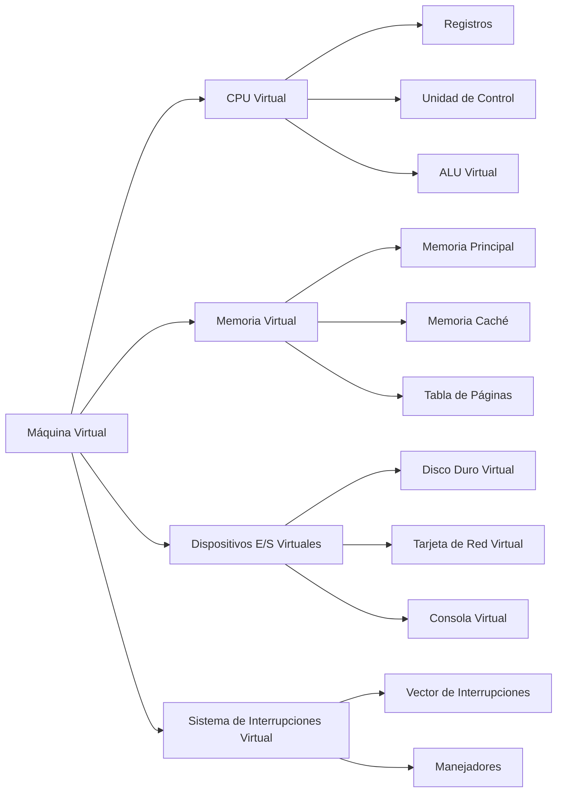
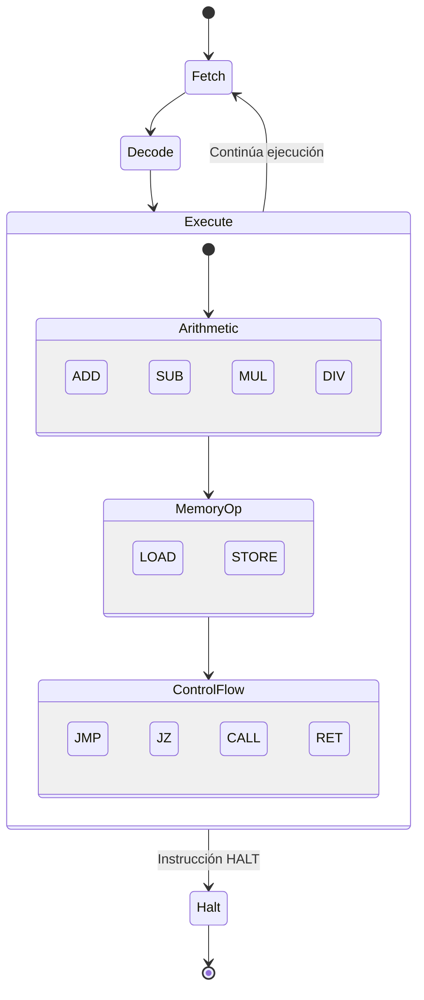

# Modelado y Programación - Emulación de máquinas virtuales

## 7.1 Descripción de una máquina virtual.

---

Una **máquina virtual (VM)** es una abstracción software que emula el hardware de una computadora física, permitiendo ejecutar sistemas operativos y aplicaciones como si se estuvieran ejecutando en hardware real.

### Definición Fundamental

Una máquina virtual es **una implementación software de una máquina que ejecuta programas como una máquina física**. Esta emulación se logra mediante:

- Un **conjunto de componentes virtualizados** (CPU, memoria, dispositivos)
- Un **mecanismo de traducción** de instrucciones
- Un **sistema de gestión** de recursos

### Componentes de una Máquina Virtual



### Arquitectura de una Máquina Virtual Básica

#### CPU Virtual

La CPU virtual emula el ciclo de fetch-decode-execute:

$$
\text{Ciclo} = \{\text{Fetch}, \text{Decode}, \text{Execute}, \text{Store}\}
$$

**Registros virtuales típicos:**

- `PC` - Contador de programa: $\text{PC} = \text{dirección de la siguiente instrucción}$
- `SP` - Puntero de pila: $\text{SP} = \text{dirección del tope de la pila}$
- `ACC` - Acumulador: $\text{ACC} = \text{resultado de operaciones}$

#### Memoria Virtual

La memoria se representa como un array de bytes/celdas:

$$
\text{Memoria}[i] = \text{valor en la dirección } i \quad \text{para } i = 0, 1, 2, \ldots, N-1
$$

#### Sistema de Instrucciones

Cada instrucción tiene un código de operación (opcode) y operandos:

$$
\text{Instrucción} = (\text{opcode}, \text{operando}_1, \text{operando}_2, \ldots)
$$

### Implementación Básica en C++

```cpp
#include <iostream>
#include <vector>
#include <cstdint>

class VirtualMachine {
private:
    // Registros
    uint16_t PC;    // Contador de programa
    uint16_t SP;    // Puntero de pila
    int16_t ACC;    // Acumulador

    // Memoria
    std::vector<uint8_t> memory;

    // Estado
    bool running;

public:
    VirtualMachine(size_t memorySize = 65536) :
        PC(0), SP(memorySize - 1), ACC(0),
        memory(memorySize, 0), running(false) {}

    // Ciclo de ejecución principal
    void executeCycle() {
        if (!running) return;

        // Fetch
        uint8_t opcode = memory[PC++];

        // Decode y Execute
        switch (opcode) {
            case 0x01: // LOAD
                ACC = memory[PC++];
                break;
            case 0x02: // STORE
                memory[memory[PC++]] = ACC;
                break;
            case 0x03: // ADD
                ACC += memory[PC++];
                break;
            case 0x04: // SUB
                ACC -= memory[PC++];
                break;
            case 0x05: // JMP
                PC = memory[PC];
                break;
            case 0x00: // HALT
                running = false;
                break;
        }
    }

    void run() {
        running = true;
        while (running) {
            executeCycle();
        }
    }

    void loadProgram(const std::vector<uint8_t>& program, uint16_t startAddress) {
        for (size_t i = 0; i < program.size(); ++i) {
            memory[startAddress + i] = program[i];
        }
        PC = startAddress;
    }
};
```

### Ejemplo: Programa Simple para la VM

```cpp
// Programa que suma 5 + 3 y almacena el resultado
std::vector<uint8_t> program = {
    0x01, 5,       // LOAD 5
    0x03, 3,       // ADD 3
    0x02, 0x50,    // STORE en dirección 0x50
    0x00           // HALT
};

int main() {
    VirtualMachine vm;
    vm.loadProgram(program, 0x100);
    vm.run();
    return 0;
}
```

### Modelo Matemático de una Máquina Virtual

Una VM puede representarse como una tupla de 7 elementos:

$$
\text{VM} = (S, I, O, \delta, \lambda, s_0, F)
$$

Donde:

- $S$: Conjunto de estados (registros + memoria)
- $I$: Conjunto de entradas
- $O$: Conjunto de salidas
- $\delta$: Función de transición de estados: $\delta: S \times I \rightarrow S$
- $\lambda$: Función de salida: $\lambda: S \times I \rightarrow O$
- $s_0$: Estado inicial
- $F$: Conjunto de estados finales

### Tipos de Máquinas Virtuales

#### 1. Máquinas de Stack vs Register

**Máquina de Stack:**

```python
# Ejemplo: 3 + 4 * 2
PUSH 3
PUSH 4
PUSH 2
MUL     # 4 * 2 = 8
ADD     # 3 + 8 = 11
```

**Máquina de Registro:**

```python
LOAD R1, 3
LOAD R2, 4
LOAD R3, 2
MUL R4, R2, R3  # R4 = 4 * 2 = 8
ADD R5, R1, R4  # R5 = 3 + 8 = 11
```

#### 2. Máquinas CISC vs RISC

**CISC (Complex Instruction Set Computer):**

- Instrucciones complejas
- Menos instrucciones por programa
- Ejemplo: `MOV [AX], [BX]`

**RISC (Reduced Instruction Set Computer):**

- Instrucciones simples
- Más instrucciones por programa
- Ejemplo: `LOAD R1, [AX]` + `STORE [BX], R1`

### Ejercicios Propuestos

#### Ejercicio 1: Diseño de Conjunto de Instrucciones

Diseña un conjunto mínimo de instrucciones para una máquina virtual que pueda:

- Realizar operaciones aritméticas básicas
- Acceder a memoria
- Controlar flujo del programa

**Solución propuesta:**

```
LOAD addr     # Carga valor de memoria en ACC
STORE addr    # Almacena ACC en memoria
ADD imm/addr  # Suma inmediato o valor de memoria
SUB imm/addr  # Resta inmediato o valor de memoria
JMP addr      # Salto incondicional
JZ addr       # Salto si ACC == 0
HALT          # Detiene ejecución
```

#### Ejercicio 2: Implementación de CALL/RET

Extiende la VM anterior para soportar llamadas a subrutinas con `CALL` y `RET`.

```cpp
case 0x06: // CALL
    memory[--SP] = PC + 1;  // Guardar dirección de retorno
    PC = memory[PC];        // Saltar a subrutina
    break;

case 0x07: // RET
    PC = memory[SP++];      // Recuperar dirección de retorno
    break;
```

#### Ejercicio 3: Simulación de Ejecución

Simula la ejecución manual del siguiente programa:

```
LOAD 5
ADD 3
STORE 0x50
LOAD 10
SUB [0x50]
HALT
```

**Paso a paso:**

1. PC=0: LOAD 5 → ACC=5, PC=2
2. PC=2: ADD 3 → ACC=8, PC=4
3. PC=4: STORE 0x50 → Mem[0x50]=8, PC=6
4. PC=6: LOAD 10 → ACC=10, PC=8
5. PC=8: SUB [0x50] → ACC=10-8=2, PC=10
6. PC=10: HALT → Fin

### Diagrama de Estados de la CPU Virtual



### Optimizaciones en Máquinas Virtuales

#### 1. Caching de Instrucciones

Almacenar instrucciones decodificadas para reutilización:

$$
\text{CacheHitRate} = \frac{\text{Número de hits}}{\text{Total de accesos}} \times 100\%
$$

#### 2. Prefetching

Cargar instrucciones antes de ser necesitadas:

$$
\text{PrefetchDistance} = \text{PC} + \text{Offset}
$$

#### 3. JIT Compilation (Just-In-Time)

Compilar código bytecode a código nativo durante ejecución:

```cpp
// Pseudocódigo JIT
if (isHotCode(instructionSequence)) {
    nativeCode = compileToNative(instructionSequence);
    executeNative(nativeCode);
} else {
    interpret(instructionSequence);
}
```

### Referencias y Bibliografía

1. **"Virtual Machines: Versatile Platforms for Systems and Processes"** - James E. Smith & Ravi Nair
2. **"Programming Language Pragmatics"** - Michael L. Scott (Capítulo sobre implementación)
3. **"Computer Organization and Design"** - David A. Patterson & John L. Hennessy
4. **Artículo seminal**: "Formal Requirements for Virtualizable Third Generation Architectures" - Gerald J. Popek y Robert P. Goldberg

### Ejercicio Final: Diseña tu Propia VM

Diseña e implementa una máquina virtual con las siguientes características:

- 16 registros de propósito general
- Memoria de 64KB
- Conjunto de al menos 15 instrucciones
- Soporte para interrupciones
- Sistema de E/S básico

**Criterios de evaluación:**

- Completitud del conjunto de instrucciones
- Eficiencia de implementación
- Claridad del diseño
- Documentación adecuada

### Conclusión

La descripción de una máquina virtual implica entender múltiples capas de abstracción, desde el hardware virtualizado hasta los mecanismos de ejecución. El dominio de estos conceptos es fundamental para áreas como compiladores, sistemas operativos y computación en la nube.

**Palabras clave:** Virtualización, Emulación, Bytecode, JIT, Interpretación, Ciclo Fetch-Decode-Execute.
