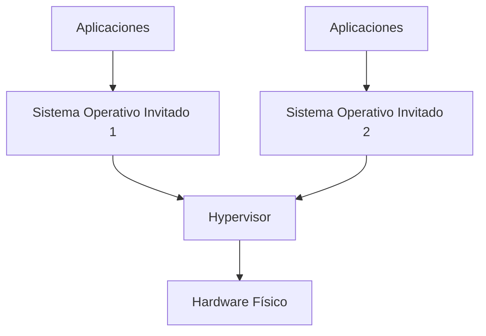
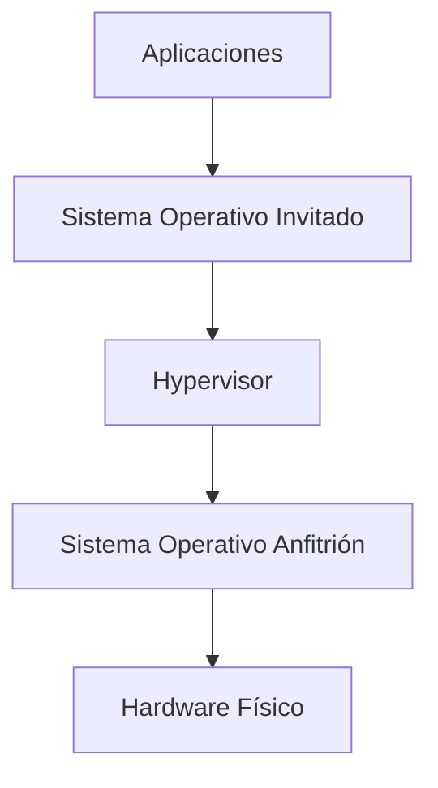
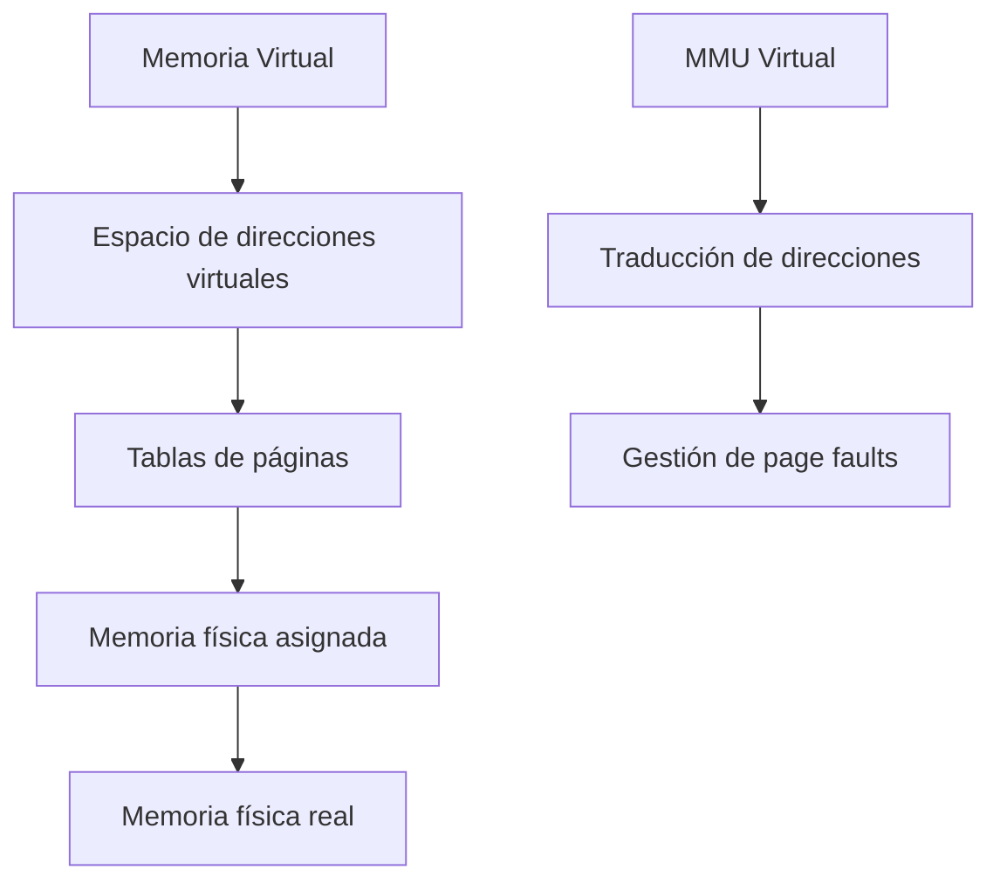
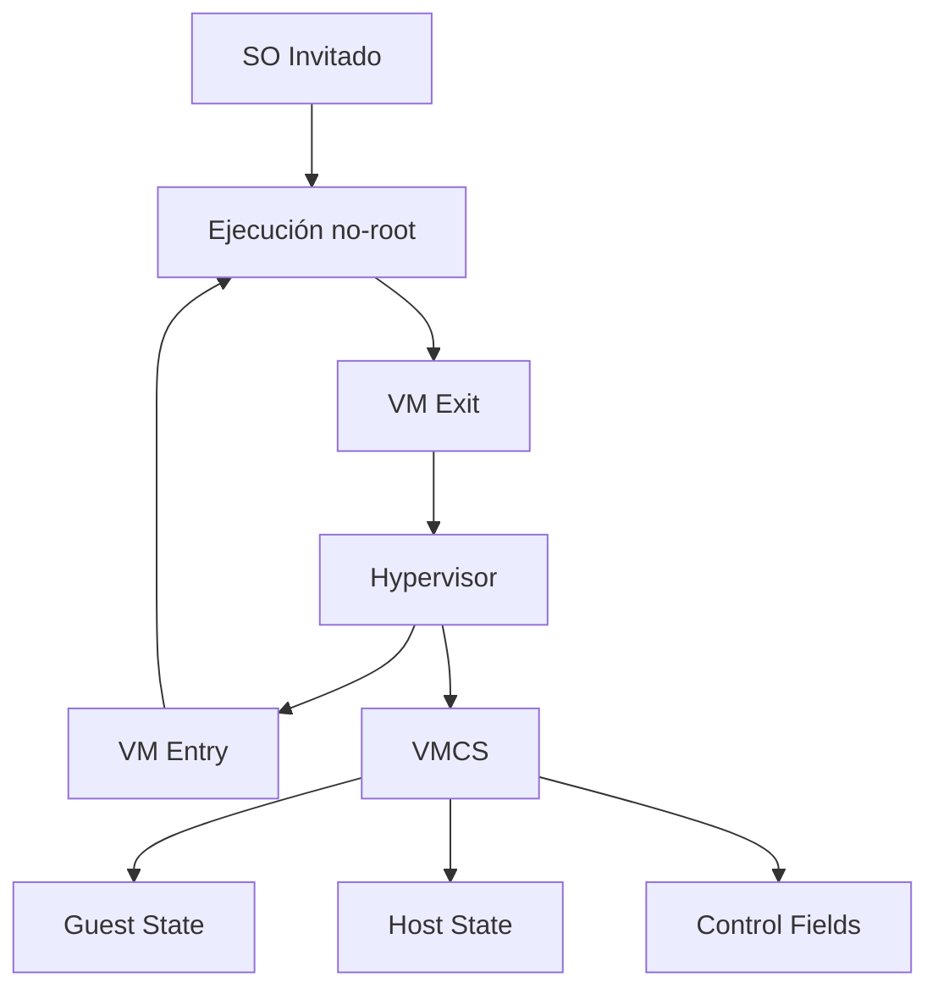
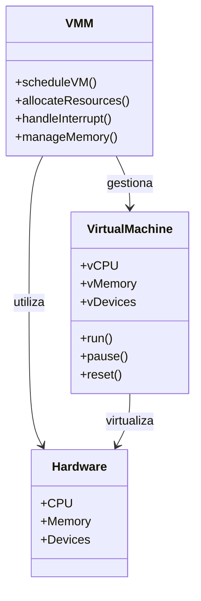
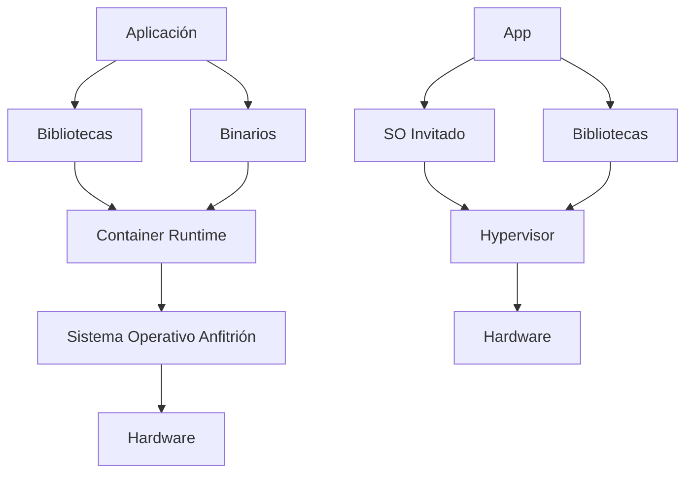

# Modelado y Programación - Emulación de máquinas virtuales

## 7.2 Arquitectura.

---

La **arquitectura de una máquina virtual** define la estructura y organización de los componentes que permiten la emulación de un sistema computacional completo. Comprender esta arquitectura es fundamental para diseñar e implementar sistemas de virtualización eficientes.

### Definición Fundamental

La arquitectura de una máquina virtual es **el diseño estructural y organizativo que define cómo los componentes de hardware virtualizados interactúan entre sí y con el hardware físico subyacente**, permitiendo la ejecución de sistemas operativos y aplicaciones en un entorno aislado.

### Modelos de Arquitectura de Máquinas Virtuales

#### 1. Arquitectura Tipo I (Hypervisor o Bare-Metal)



**Características:**

- El hypervisor se ejecuta directamente sobre el hardware físico
- Mayor eficiencia y rendimiento
- Ejemplos: VMware ESXi, Xen, Microsoft Hyper-V

#### 2. Arquitectura Tipo II (Hosted)



**Características:**

- El hypervisor se ejecuta como una aplicación sobre un SO anfitrión
- Mayor facilidad de implementación
- Ejemplos: VMware Workstation, VirtualBox, QEMU

La frontera no siempre es nítida: KVM convierte al propio núcleo de Linux en un hipervisor, así que suele clasificarse como tipo 1 aunque Linux siga ejecutando programas normales a su lado. Lo esencial es **quién controla el hardware**: en el tipo 1 es el hipervisor; en el tipo 2, el sistema anfitrión, y el hipervisor le pide recursos como cualquier otro programa.

### Componentes Arquitectónicos Clave

#### 1. Virtual CPU (vCPU)

La vCPU emula el comportamiento de una CPU física. En un emulador por interpretación, el tiempo de ejecutar $n$ instrucciones es la suma de los tiempos de cada ciclo:

$$ T_{\text{ejecución}} = \sum_{i=1}^{n} (T_{\text{fetch}, i} + T_{\text{decode}, i} + T_{\text{execute}, i}) $$

Con virtualización por hardware, en cambio, la vCPU no es un programa que simula instrucciones: es un **contexto** (registros, estado de control) que el hipervisor carga en un núcleo real para que este ejecute directamente el código invitado. El siguiente esqueleto corresponde al caso del emulador; `Memory`, `Instruction` y las funciones `fetch`, `decode` y `execute` se implementan como en la VM del tema 7.1.

**Implementación básica de vCPU:**

```cpp
class VirtualCPU {
private:
    // Registros
    uint64_t registers[16];
    uint64_t PC;  // Contador de programa
    uint64_t SP;  // Puntero de pila
    uint64_t FLAGS; // Registro de flags

    // Memoria asociada
    Memory* memory;

    // Ciclo de ejecución
    void executeCycle() {
        Instruction instr = fetch();
        DecodedInstruction decoded = decode(instr);
        execute(decoded);
    }

public:
    void run() {
        while (!halted) {
            executeCycle();
        }
    }
};
```

#### 2. Virtual Memory System

El sistema de memoria virtual gestiona la traducción de direcciones:

$$ \text{Dirección física} = f(\text{Dirección virtual}, \text{Tabla de páginas}) $$

En una máquina virtual hay **dos** traducciones: el sistema invitado traduce direcciones virtuales del invitado a lo que cree que son direcciones físicas (*guest physical*), y el hipervisor traduce estas a direcciones físicas reales (*host physical*). Hay dos formas de hacerlo:

- **Tablas de páginas sombra** (*shadow page tables*): el hipervisor mantiene, por cada tabla del invitado, una tabla combinada de virtual del invitado a física real, que es la que usa el hardware. Cada vez que el invitado modifica sus tablas, el hipervisor debe enterarse (marcándolas como de solo lectura) y actualizar la sombra, lo que provoca muchas salidas al hipervisor.
- **Paginación anidada** (EPT en Intel, NPT o RVI en AMD): el hardware recorre las dos tablas por sí solo. Elimina esas salidas, pero un fallo de TLB puede costar hasta 24 accesos a memoria con tablas de 4 niveles en ambas capas, porque cada uno de los 4 niveles de la tabla del invitado requiere a su vez recorrer los 4 niveles de la del anfitrión, más el paso final; por eso las páginas grandes, de 2 MB o 1 GB, ayudan mucho en máquinas virtuales.

**Jerarquía de memoria virtual:**



#### 3. Virtual I/O System

Sistema que emula dispositivos de entrada/salida:

```cpp
#include <cstdint>
#include <cstring>
#include <iostream>
#include <stdexcept>
#include <vector>

class VirtualIODevice {
public:
    virtual uint32_t read(uint32_t address) = 0;
    virtual void write(uint32_t address, uint32_t value) = 0;
    virtual void reset() = 0;
    virtual ~VirtualIODevice() = default;
};

class VirtualDisk : public VirtualIODevice {
private:
    std::vector<uint8_t> storage;
    uint32_t sectorSize;

    void check(uint32_t address) const {
        if (address + 4 > storage.size())
            throw std::out_of_range("Dirección fuera del disco virtual");
    }

public:
    VirtualDisk(uint32_t size, uint32_t sectorSize = 512)
        : storage(size, 0), sectorSize(sectorSize) {}

    // Lee una palabra de 32 bits en la dirección dada
    uint32_t read(uint32_t address) override {
        check(address);
        uint32_t value;
        std::memcpy(&value, &storage[address], sizeof value);
        return value;
    }

    void write(uint32_t address, uint32_t value) override {
        check(address);
        std::memcpy(&storage[address], &value, sizeof value);
    }

    void reset() override { std::fill(storage.begin(), storage.end(), 0); }

    uint32_t sectorOf(uint32_t address) const { return address / sectorSize; }
};

int main() {
    VirtualDisk disk(4096);
    disk.write(1024, 0xCAFE);
    std::cout << std::hex << disk.read(1024) << std::dec
              << " en el sector " << disk.sectorOf(1024) << "\n";   // cafe en el sector 2
}
```

Los dispositivos se exponen al invitado de dos formas: por **E/S mapeada en memoria**, donde ciertas direcciones no son RAM sino registros del dispositivo y cada acceso del invitado provoca una salida al hipervisor que lo despacha al `read` o `write` del dispositivo virtual, o por **puertos de E/S**, con instrucciones especiales como `in` y `out` en x86. Emular un dispositivo real, como un disco IDE, exige atrapar muchos accesos por cada operación; por eso existen dispositivos **paravirtualizados** (virtio), diseñados para virtualizarse con pocas salidas.

### Arquitectura de Traducción de Instrucciones

#### 1. Interpretación

Proceso de ejecución instrucción por instrucción:

$$ T_{\text{interpretación}} = n \times (T_{\text{fetch}} + T_{\text{decode}} + T_{\text{execute}}) $$

donde los tiempos son promedios por instrucción. Cada instrucción invitada cuesta decenas de instrucciones del anfitrión, porque se decodifica **cada vez** que se ejecuta.

#### 2. Binary Translation

Traducción de código binario en tiempo de ejecución. Se traduce un **bloque básico** de instrucciones invitadas (una secuencia sin saltos internos) a código nativo equivalente, se guarda en una caché indexada por la dirección invitada y la siguiente vez se ejecuta directamente. Si $n$ ejecuciones de un bloque cuestan $T_{tr}$ de traducción más $n\,T_{nat},$ frente a $n\,T_{int}$ interpretando, la traducción conviene cuando $n > \frac{T_{tr}}{T_{int} - T_{nat}},$ es decir, para el código que se repite. El siguiente es un esqueleto; en la práctica la clave de la caché es la dirección invitada del bloque y hay que invalidar entradas si el invitado modifica su código.

```cpp
class BinaryTranslator {
private:
    std::unordered_map<uint64_t, NativeCodeBlock*> cache;   // dirección invitada -> código nativo

public:
    NativeCodeBlock* translate(Instruction* instructions, size_t count) {
        uint64_t hash = computeHash(instructions, count);

        if (cache.find(hash) != cache.end()) {
            return cache[hash];
        }

        NativeCodeBlock* nativeCode = generateNativeCode(instructions, count);
        cache[hash] = nativeCode;
        return nativeCode;
    }
};
```

#### 3. Paravirtualización

Modificación del sistema operativo invitado para optimizar la virtualización. En lugar de ejecutar instrucciones privilegiadas que el hipervisor tiene que atrapar y emular una por una, el invitado sabe que está virtualizado y pide los servicios directamente al hipervisor con **hiperllamadas**, como un programa hace llamadas al sistema. Xen la popularizó en 2003, cuando x86 todavía no tenía soporte de hardware para virtualizar. Su desventaja es que requiere modificar el núcleo invitado, imposible con sistemas cerrados; hoy se usa sobre todo para los **controladores** de dispositivos (virtio), combinada con virtualización por hardware para la CPU.

### Arquitectura de Comunicación entre Componentes

#### 1. Hypercalls (Hypervisor Calls)

Mecanismo de comunicación entre el SO invitado y el hypervisor. En x86 con VT-x, el invitado ejecuta la instrucción `VMCALL` (`VMMCALL` en AMD), con el número de servicio y los argumentos en registros, como en una llamada al sistema. La instrucción provoca una salida de la VM: el procesador pasa del modo **VMX no-root**, donde corre el invitado, al modo **VMX root**, donde corre el hipervisor, que atiende la petición y regresa con `VMRESUME`. En ARM la instrucción equivalente es `HVC`, que pasa de EL1 a EL2.

#### 2. Virtual Machine Control Structure (VMCS)

Estructura de datos que mantiene el estado de la máquina virtual:

```cpp
struct VMCS {
    uint64_t guestState[GUEST_STATE_FIELDS];
    uint64_t hostState[HOST_STATE_FIELDS];
    uint64_t controlFields[CONTROL_FIELDS];
    uint64_t exitReason;
    uint64_t exitQualification;
    // ... más campos
};
```

#### 3. VM Exits

Eventos que causan la transferencia de control al hypervisor: ejecutar ciertas instrucciones privilegiadas o sensibles (`CPUID`, `HLT`, accesos a registros de control, `in` y `out`), interrupciones externas, ciertas excepciones, fallos de EPT y hiperllamadas. Los campos de control de la VMCS indican cuáles de estos eventos provocan salida.

Cada salida y reentrada cuesta del orden de cientos a miles de ciclos, porque hay que guardar el estado del invitado, cargar el del hipervisor, atender la causa y volver. El costo total de la virtualización es aproximadamente

$$ \text{Overhead} ≈ \frac{\text{salidas por segundo} \times \text{costo de cada salida}}{\text{ciclos por segundo}} $$

Con $10^5$ salidas por segundo de $2\,000$ ciclos cada una, en un núcleo de 3 GHz, el costo es $\frac{2 \times 10^8}{3 \times 10^9} ≈ 6.7\%$ del tiempo de CPU. Por eso la optimización consiste sobre todo en **reducir el número de salidas**.

### Ejemplos de Arquitecturas Específicas

#### 1. Arquitectura x86 con Intel VT-x



#### 2. Arquitectura ARM con Virtualization Extensions

**Estructura de niveles de ejecución:**

- EL0: Aplicaciones de usuario
- EL1: Sistema operativo
- EL2: Hypervisor
- EL3: Secure monitor

### Ejercicios Propuestos

#### Ejercicio 1: Diseño de vCPU

Diseña una vCPU con 16 registros de propósito general que soporte:

- Modos de ejecución múltiples (usuario, supervisor)
- Sistema de interrupciones virtuales
- Gestión de memoria con MMU virtual

**Solución.** Al llegar una interrupción, la vCPU debe guardar el contexto de lo que estaba ejecutando, pasar a modo supervisor y saltar al manejador indicado en una **tabla de vectores**; una instrucción `IRET` restaura todo. Las interrupciones solo se atienden entre instrucciones y si están habilitadas, y una instrucción privilegiada en modo usuario provoca una excepción en lugar de ejecutarse:

```cpp
#include <array>
#include <cstdint>
#include <iostream>
#include <stdexcept>

enum class Modo : uint8_t { Usuario = 0, Supervisor = 1 };

class AdvancedVCPU {
public:
    std::array<uint64_t, 16> registers{};
    uint64_t PC = 0;
    Modo mode = Modo::Usuario;
    bool interruptsEnabled = true;
    std::array<uint64_t, 256> interruptTable{};   // vector -> dirección del manejador

private:
    struct Contexto { std::array<uint64_t, 16> regs; uint64_t pc; Modo modo; };
    Contexto saved{};
    bool pending = false;
    uint8_t pendingVector = 0;

public:
    // El controlador de interrupciones marca una interrupción pendiente
    void raiseInterrupt(uint8_t vector) { pending = true; pendingVector = vector; }

    // Se llama entre instrucciones, nunca a la mitad de una
    void checkInterrupts() {
        if (!pending || !interruptsEnabled) return;
        pending = false;
        saved = {registers, PC, mode};            // guardar el contexto completo
        mode = Modo::Supervisor;
        interruptsEnabled = false;                // el manejador no se interrumpe a sí mismo
        PC = interruptTable[pendingVector];
    }

    void iret() {                                 // regreso de la interrupción
        if (mode != Modo::Supervisor) throw std::runtime_error("IRET en modo usuario");
        registers = saved.regs;
        PC = saved.pc;
        mode = saved.modo;
        interruptsEnabled = true;
    }
};

int main() {
    AdvancedVCPU cpu;
    cpu.interruptTable[32] = 0x8000;              // manejador del temporizador
    cpu.PC = 0x1234;
    cpu.registers[0] = 7;
    cpu.raiseInterrupt(32);
    cpu.checkInterrupts();
    std::cout << std::hex << cpu.PC << " modo " << int(cpu.mode) << "\n";   // 8000 modo 1
    cpu.registers[0] = 99;                        // el manejador usa registros
    cpu.iret();
    std::cout << cpu.PC << " r0=" << std::dec << cpu.registers[0] << "\n";  // 1234 r0=7
}
```

La MMU virtual se integra en el `fetch` y en cada acceso a memoria, como en el ejercicio 2, y un fallo de página se entrega como una excepción más, con su propio vector.

#### Ejercicio 2: Sistema de Memoria Virtual

Implementa un sistema de memoria virtual con paginación de dos niveles.

**Solución.** Como en x86 de 32 bits, una dirección virtual se divide en 10 bits de índice en el **directorio**, 10 bits de índice en la **tabla de páginas** y 12 bits de desplazamiento dentro de una página de 4 KB. El directorio dice dónde está cada tabla y la tabla dice en qué marco físico está cada página: hay que consultar **ambos** niveles.

```cpp
#include <array>
#include <cstdint>
#include <iostream>
#include <memory>
#include <stdexcept>

constexpr uint32_t PAGE_SIZE = 4096;

struct PageTableEntry { bool present = false; bool writable = false; uint32_t frame = 0; };
struct PageTable { std::array<PageTableEntry, 1024> entries{}; };
struct PageDirectory { std::array<std::unique_ptr<PageTable>, 1024> tables{}; };

struct PageFault : std::runtime_error {
    uint32_t address;
    explicit PageFault(uint32_t a) : std::runtime_error("page fault"), address(a) {}
};

class VirtualMMU {
    PageDirectory dir;
public:
    void map(uint32_t virtualPage, uint32_t frame, bool writable = true) {
        uint32_t d = virtualPage >> 10, t = virtualPage & 0x3FF;
        if (!dir.tables[d]) dir.tables[d] = std::make_unique<PageTable>();   // tabla bajo demanda
        dir.tables[d]->entries[t] = {true, writable, frame};
    }

    uint32_t translateAddress(uint32_t virtualAddress, bool write = false) const {
        uint32_t dirIndex = (virtualAddress >> 22) & 0x3FF;
        uint32_t tableIndex = (virtualAddress >> 12) & 0x3FF;
        uint32_t offset = virtualAddress & 0xFFF;

        const auto& table = dir.tables[dirIndex];             // nivel 1: directorio
        if (!table) throw PageFault(virtualAddress);
        const PageTableEntry& e = table->entries[tableIndex]; // nivel 2: tabla de páginas
        if (!e.present || (write && !e.writable)) throw PageFault(virtualAddress);

        return e.frame * PAGE_SIZE + offset;
    }
};

int main() {
    VirtualMMU mmu;
    mmu.map(0x00401, 0x12);                     // página virtual 0x00401 -> marco 0x12
    mmu.map(0x00402, 0x13, /*writable=*/false);
    std::cout << std::hex << mmu.translateAddress(0x00401ABC) << "\n";   // 12abc
    try {
        mmu.translateAddress(0x00402000, /*write=*/true);
    } catch (const PageFault& f) {
        std::cout << "page fault en " << f.address << "\n";             // page fault en 402000
    }
}
```

Con dos niveles, un proceso que usa pocas regiones de memoria solo necesita el directorio (4 KB) y unas cuantas tablas, en lugar de una tabla lineal de $2^{20}$ entradas (4 MB) por proceso. A cambio, cada traducción requiere dos accesos a memoria; la **TLB** guarda las traducciones recientes para evitarlos casi siempre.

#### Ejercicio 3: Optimización de VM Exits

Analiza y optimiza la frecuencia de VM Exits para una carga de trabajo específica:

$$
\text{VM Exit Rate} = \frac{\text{Número de VM Exits}}{\text{Número de instrucciones ejecutadas}}
$$

**Estrategias de optimización:**

- Shadow page tables
- APIC virtualization
- EPT (Extended Page Tables)

**Solución.** El primer paso es **medir**: herramientas como `perf kvm stat` agrupan las salidas por causa. Para una carga típica de servidor web, las causas dominantes suelen ser las interrupciones (de red y del temporizador), los accesos al controlador de interrupciones (APIC), la E/S de dispositivos emulados y, sin EPT, los fallos de página. Cada causa tiene su remedio:

| Causa dominante | Optimización | Efecto |
| --- | --- | --- |
| Cambios en las tablas de páginas del invitado | EPT/NPT en lugar de *shadow page tables* | el hardware hace la doble traducción sin salir |
| Accesos al APIC e interrupciones | APIC virtualization (APICv, AVIC), *posted interrupts* | el hardware entrega interrupciones sin salir |
| E/S emulada (discos y red) | dispositivos virtio, o asignación directa del dispositivo (VFIO, SR-IOV) | menos salidas por operación |
| `HLT` en vCPU inactivas | sondeo breve antes de dormir (*halt polling*) | menos latencia al despertar |

Por ejemplo, si una VM ejecuta $10^9$ instrucciones por segundo con $2 \times 10^5$ salidas, la tasa es $2 \times 10^{-4}$ salidas por instrucción; si el 60% se debe a interrupciones y se eliminan con *posted interrupts*, la tasa baja a $8 \times 10^{-5}$ y, con un costo de 2 000 ciclos por salida a 3 GHz, el overhead baja de cerca de 13% a cerca de 5%.

### Patrones Arquitectónicos Comunes

#### 1. Monitor de Máquina Virtual (VMM)



#### 2. Arquitectura Microkernel para Hypervisors

**Ventajas:**

- Mayor seguridad y estabilidad
- Menor superficie de ataque
- Facilidad de mantenimiento

**Desventajas:**

- Mayor overhead de comunicación
- Complejidad de implementación

### Métricas de Performance Arquitectónica

#### 1. Overhead de Virtualización

$$
\text{Overhead} = \frac{T_{\text{virtualizado}} - T_{\text{nativo}}}{T_{\text{nativo}}} \times 100\%
$$

Por ejemplo, si una compilación tarda 100 s en el hardware real y 108 s en una VM, el overhead es de 8%. Con virtualización por hardware y EPT, las cargas de cálculo suelen tener overheads de pocos puntos porcentuales; las cargas con mucha E/S, mayores.

#### 2. Razón de Sobreasignación

Como las VM rara vez usan todos sus recursos al mismo tiempo, se pueden asignar más recursos virtuales que físicos:

$$ \text{Sobreasignación de CPU} = \frac{\text{vCPU asignadas}}{\text{núcleos físicos}} $$

Un servidor de 32 núcleos con 20 VM de 4 vCPU tiene una razón de $\frac{80}{32} = 2.5.$ Con razones altas, si todas las VM se activan a la vez, las vCPU esperan su turno (*steal time*). Con la memoria la sobreasignación es más delicada, porque quedarse sin memoria obliga al hipervisor a paginar a disco; se usan técnicas como *ballooning* y compartir páginas idénticas entre VM.

#### 3. Densidad de Consolidación

Es el número de VM que un servidor físico puede alojar cumpliendo sus requisitos de rendimiento:

$$ \text{Densidad} = \min\left(\left\lfloor \frac{\text{CPU física} \cdot \text{sobreasignación permitida}}{\text{CPU por VM}} \right\rfloor, \left\lfloor \frac{\text{memoria física}}{\text{memoria por VM}} \right\rfloor\right) $$

Con 32 núcleos, sobreasignación de 3, 256 GB de memoria y VM de 4 vCPU y 16 GB, la CPU permitiría 24 VM pero la memoria solo 16: la densidad es 16, limitada por la memoria, que es lo más común.

### Tendencias Arquitectónicas Modernas

#### 1. Containers vs Virtual Machines



En el lado izquierdo, los **contenedores** comparten el núcleo del sistema anfitrión: aíslan procesos con mecanismos del núcleo (en Linux, *namespaces* y *cgroups*), arrancan en milisegundos y ocupan poca memoria, pero todos usan el mismo núcleo, así que no pueden ejecutar otro sistema operativo y un fallo de seguridad del núcleo afecta a todos. En el lado derecho, cada **VM** tiene su propio sistema operativo completo: el aislamiento es más fuerte, a costa de más memoria y arranques más lentos. Las *microVM*, como Firecracker, que usa AWS Lambda, buscan lo mejor de ambos: VM mínimas que arrancan en una fracción de segundo.

#### 2. Serverless Architectures

- Abstracción completa del hardware
- Ejecución por eventos
- Modelo de pago por uso

#### 3. Hardware Accelerated Virtualization

- Uso de extensiones de virtualización hardware (Intel VT-x, AMD-V)
- GPU virtualization (NVIDIA vGPU, AMD MxGPU)
- SmartNICs y DPUs para offloading

### Ejercicio Final: Diseño Arquitectónico Completo

Diseña la arquitectura completa de un sistema de virtualización que soporte:

1. Múltiples VMs con diferentes sistemas operativos
2. Sistema de networking virtual avanzado
3. Almacenamiento distribuido
4. Migración en caliente
5. Alta disponibilidad

**Entrega esperada:**

- Diagramas arquitectónicos detallados
- Especificación de componentes
- Protocolos de comunicación
- Estrategias de optimización

### Referencias y Bibliografía

1. **"Virtual Machines: Versatile Platforms for Systems and Processes"** - James E. Smith & Ravi Nair
2. **"Professional Xen Virtualization"** - William von Hagen
3. **"Intel® 64 and IA-32 Architectures Software Developer's Manual"** - Volumen 3C
4. **"ARM Architecture Reference Manual"** - ARMv8-A virtualization extensions
5. **"VMware vSphere Design"** - Forbes Guthrie, Scott Lowe, and Kendrick Coleman

### Conclusión

La arquitectura de máquinas virtuales representa un campo complejo y en evolución constante. El diseño adecuado de estos sistemas requiere comprender profundamente tanto el hardware subyacente como los principios de virtualización. Las tendencias modernas apuntan hacia una mayor integración hardware-software y hacia arquitecturas más especializadas y eficientes.

**Palabras clave:** Hypervisor, vCPU, Virtual MMU, VM Exit, Paravirtualización, Binary Translation, Hardware Acceleration.
