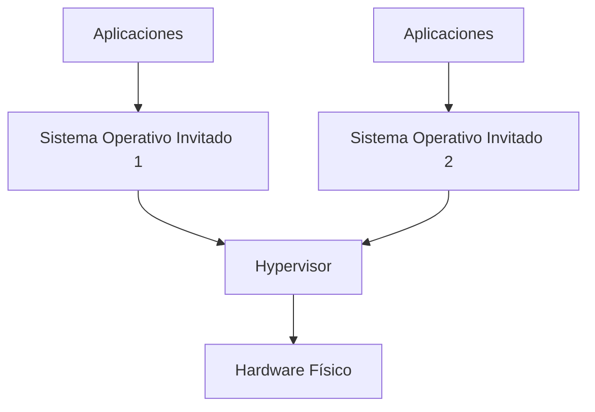
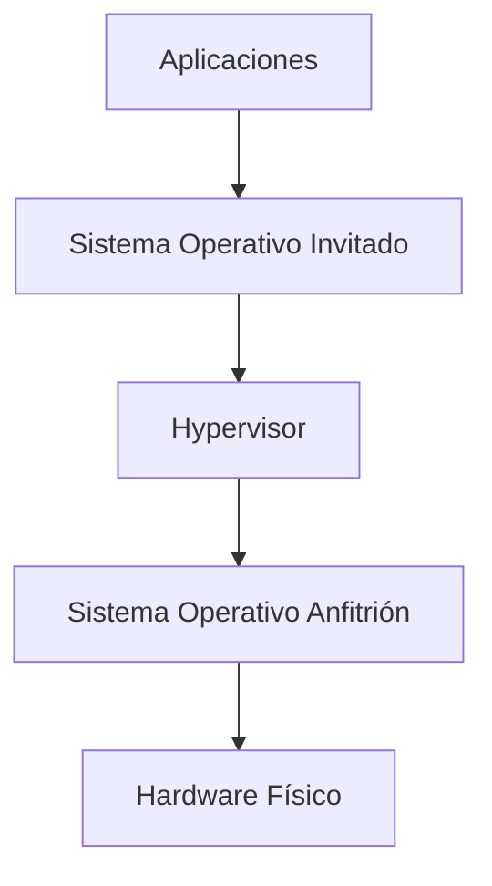
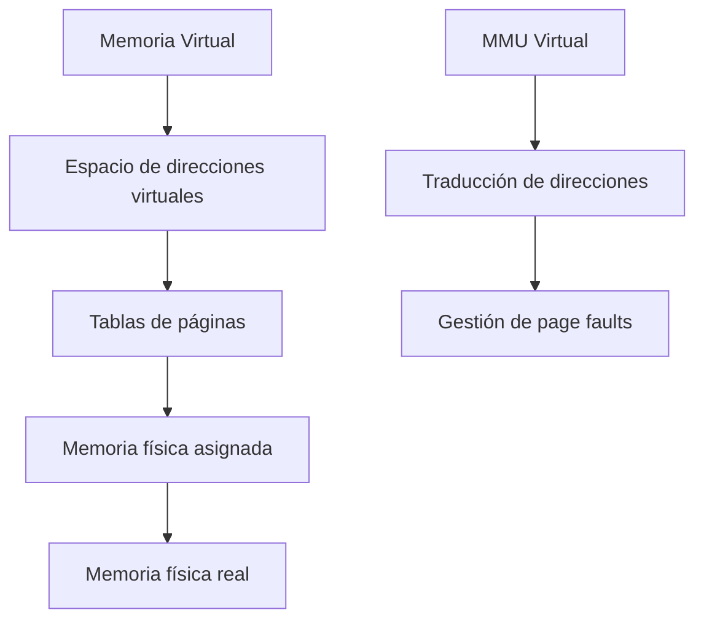
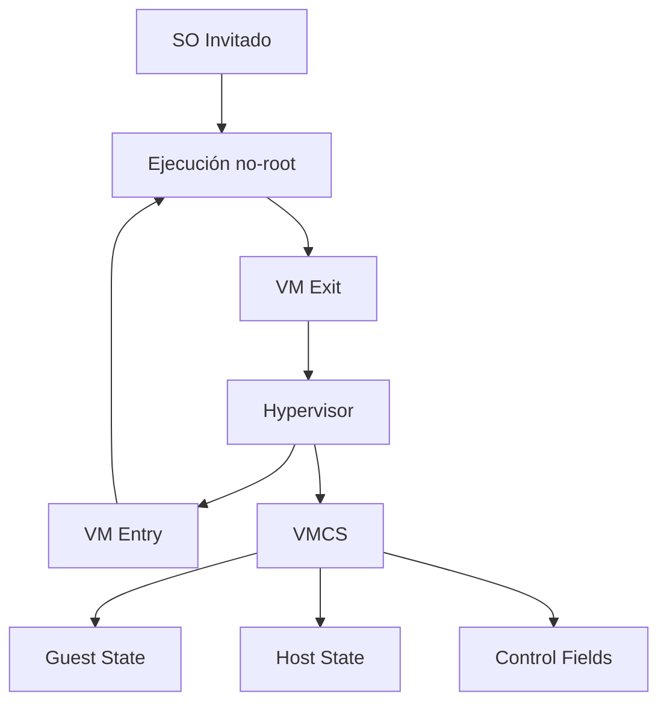
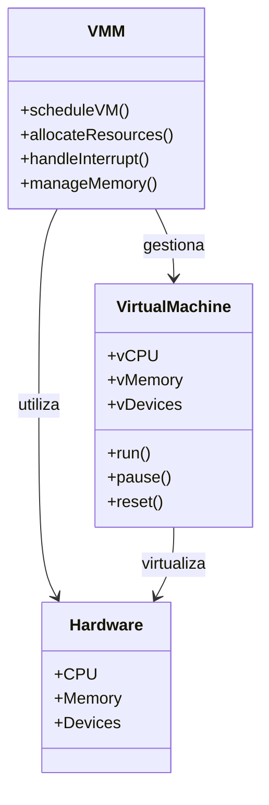
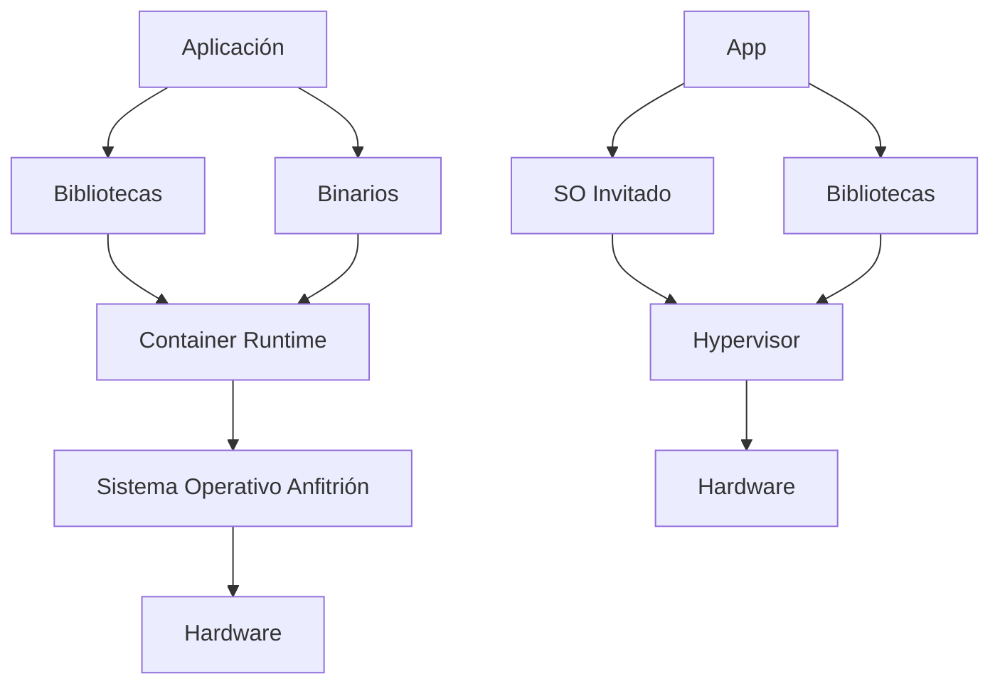

# Modelado y Programación - Emulación de máquinas virtuales

## 7.2 Arquitectura.

---

La **arquitectura de una máquina virtual** define la estructura y organización de los componentes que permiten la emulación de un sistema computacional completo. Comprender esta arquitectura es fundamental para diseñar e implementar sistemas de virtualización eficientes.

### Definición Fundamental

La arquitectura de una máquina virtual es **el diseño estructural y organizativo que define cómo los componentes de hardware virtualizados interactúan entre sí y con el hardware físico subyacente**, permitiendo la ejecución de sistemas operativos y aplicaciones en un entorno aislado.

### Modelos de Arquitectura de Máquinas Virtuales

#### 1. Arquitectura Tipo I (Hypervisor o Bare-Metal)



**Características:**

- El hypervisor se ejecuta directamente sobre el hardware físico
- Mayor eficiencia y rendimiento
- Ejemplos: VMware ESXi, Xen, Microsoft Hyper-V

#### 2. Arquitectura Tipo II (Hosted)



**Características:**

- El hypervisor se ejecuta como una aplicación sobre un SO anfitrión
- Mayor facilidad de implementación
- Ejemplos: VMware Workstation, VirtualBox, QEMU

### Componentes Arquitectónicos Clave

#### 1. Virtual CPU (vCPU)

La vCPU emula el comportamiento de una CPU física mediante:

$$
\text{Ciclo de ejecución} = \sum_{i=1}^{n} (\text{Fetch}_i + \text{Decode}_i + \text{Execute}_i)
$$

**Implementación básica de vCPU:**

```cpp
class VirtualCPU {
private:
    // Registros
    uint64_t registers[16];
    uint64_t PC;  // Contador de programa
    uint64_t SP;  // Puntero de pila
    uint64_t FLAGS; // Registro de flags

    // Memoria asociada
    Memory* memory;

    // Ciclo de ejecución
    void executeCycle() {
        Instruction instr = fetch();
        DecodedInstruction decoded = decode(instr);
        execute(decoded);
    }

public:
    void run() {
        while (!halted) {
            executeCycle();
        }
    }
};
```

#### 2. Virtual Memory System

El sistema de memoria virtual gestiona la traducción de direcciones:

$$
\text{Dirección física} = f(\text{Dirección virtual}, \text{Tabla de páginas})
$$

**Jerarquía de memoria virtual:**



#### 3. Virtual I/O System

Sistema que emula dispositivos de entrada/salida:

```cpp
class VirtualIODevice {
public:
    virtual uint32_t read(uint32_t address) = 0;
    virtual void write(uint32_t address, uint32_t value) = 0;
    virtual void reset() = 0;
};

class VirtualDisk : public VirtualIODevice {
private:
    std::vector<uint8_t> storage;
    uint32_t sectorSize;

public:
    VirtualDisk(uint32_t size, uint32_t sectorSize = 512)
        : storage(size), sectorSize(sectorSize) {}

    uint32_t read(uint32_t address) override {
        uint32_t sector = address / sectorSize;
        uint32_t offset = address % sectorSize;
        // Lógica de lectura...
    }

    void write(uint32_t address, uint32_t value) override {
        // Lógica de escritura...
    }
};
```

### Arquitectura de Traducción de Instrucciones

#### 1. Interpretación

Proceso de ejecución instrucción por instrucción:

$$
T_{\text{interpretación}} = n \times (T_{\text{fetch}} + T_{\text{decode}} + T_{\text{execute}})
$$

#### 2. Binary Translation

Traducción de código binario en tiempo de ejecución:

```cpp
class BinaryTranslator {
private:
    std::unordered_map<uint64_t, NativeCodeBlock> cache;

public:
    NativeCodeBlock* translate(Instruction* instructions, size_t count) {
        uint64_t hash = computeHash(instructions, count);

        if (cache.find(hash) != cache.end()) {
            return cache[hash];
        }

        NativeCodeBlock* nativeCode = generateNativeCode(instructions, count);
        cache[hash] = nativeCode;
        return nativeCode;
    }
};
```

#### 3. Paravirtualización

Modificación del sistema operativo invitado para optimizar la virtualización:

$$ \text{Rendimiento}_{\text{paravirtualización}} = \frac{\text{Rendimiento}_{\text{nativo}} \times (1 - \alpha)}{1 + \beta} $$

Donde:

- $\alpha:$ Overhead de las hyperllamadas
- $\beta:$ Costo de las modificaciones del SO

### Arquitectura de Comunicación entre Componentes

#### 1. Hypercalls (Hypervisor Calls)

Mecanismo de comunicación entre el SO invitado y el hypervisor:

$$
\text{Hypercall} = \text{INT} \times 1A \rightarrow \text{VMX} \rightarrow \text{Root Mode}
$$

#### 2. Virtual Machine Control Structure (VMCS)

Estructura de datos que mantiene el estado de la máquina virtual:

```cpp
struct VMCS {
    uint64_t guestState[GUEST_STATE_FIELDS];
    uint64_t hostState[HOST_STATE_FIELDS];
    uint64_t controlFields[CONTROL_FIELDS];
    uint64_t exitReason;
    uint64_t exitQualification;
    // ... más campos
};
```

#### 3. VM Exits

Eventos que causan la transferencia de control al hypervisor:

$$
P(\text{VM Exit}) = \sum_{i=1}^{n} P(\text{Instrucción privilegiada}_i) + P(\text{Interrupción}) + P(\text{Excepción})
$$

### Ejemplos de Arquitecturas Específicas

#### 1. Arquitectura x86 con Intel VT-x



#### 2. Arquitectura ARM con Virtualization Extensions

**Estructura de niveles de ejecución:**

- EL0: Aplicaciones de usuario
- EL1: Sistema operativo
- EL2: Hypervisor
- EL3: Secure monitor

### Ejercicios Propuestos

#### Ejercicio 1: Diseño de vCPU

Diseña una vCPU con 16 registros de propósito general que soporte:

- Modos de ejecución múltiples (usuario, supervisor)
- Sistema de interrupciones virtuales
- Gestión de memoria con MMU virtual

**Solución conceptual:**

```cpp
class AdvancedVCPU : public VirtualCPU {
private:
    uint64_t bankedRegisters[4][16]; // Registros por modo
    uint8_t currentMode;
    VirtualMMU* mmu;
    InterruptController* interruptController;

public:
    void handleInterrupt(uint8_t vector) {
        // Guardar estado
        bankedRegisters[currentMode] = registers;
        // Cambiar modo
        currentMode = SUPERVISOR_MODE;
        // Saltar al manejador
        PC = interruptTable[vector];
    }
};
```

#### Ejercicio 2: Sistema de Memoria Virtual

Implementa un sistema de memoria virtual con paginación de dos niveles:

```cpp
class VirtualMMU {
private:
    PageDirectory* currentDirectory;
    PhysicalMemory* physicalMemory;

    uint32_t translateAddress(uint32_t virtualAddress) {
        uint32_t dirIndex = (virtualAddress >> 22) & 0x3FF;
        uint32_t tableIndex = (virtualAddress >> 12) & 0x3FF;
        uint32_t offset = virtualAddress & 0xFFF;

        PageTableEntry* entry = currentDirectory->entries[dirIndex];
        if (!entry->present) {
            raisePageFault(virtualAddress);
        }

        return (entry->frame * PAGE_SIZE) + offset;
    }
};
```

#### Ejercicio 3: Optimización de VM Exits

Analiza y optimiza la frecuencia de VM Exits para una carga de trabajo específica:

$$
\text{VM Exit Rate} = \frac{\text{Número de VM Exits}}{\text{Número de instrucciones ejecutadas}}
$$

**Estrategias de optimización:**

- Shadow page tables
- APIC virtualization
- EPT (Extended Page Tables)

### Patrones Arquitectónicos Comunes

#### 1. Monitor de Máquina Virtual (VMM)



#### 2. Arquitectura Microkernel para Hypervisors

**Ventajas:**

- Mayor seguridad y estabilidad
- Menor superficie de ataque
- Facilidad de mantenimiento

**Desventajas:**

- Mayor overhead de comunicación
- Complejidad de implementación

### Métricas de Performance Arquitectónica

#### 1. Overhead de Virtualización

$$
\text{Overhead} = \frac{T_{\text{virtualizado}} - T_{\text{nativo}}}{T_{\text{nativo}}} \times 100\%
$$

#### 2. Efficiency Ratio

$$
\text{Efficiency} = \frac{\text{Instrucciones útiles}}{\text{Instrucciones totales}} \times \frac{\text{Recursos utilizados}}{\text{Recursos totales}}
$$

#### 3. Densidad de Consolidación

$$
\text{Densidad} = \frac{\text{Número de VMs}}{\text{Recursos físicos}} \times \text{Factor de utilización}
$$

### Tendencias Arquitectónicas Modernas

#### 1. Containers vs Virtual Machines



#### 2. Serverless Architectures

- Abstractación completa del hardware
- Ejecución por eventos
- Modelo de pago por uso

#### 3. Hardware Accelerated Virtualization

- Uso de extensiones de virtualización hardware (Intel VT-x, AMD-V)
- GPU virtualization (NVIDIA vGPU, AMD MxGPU)
- SmartNICs y DPUs para offloading

### Ejercicio Final: Diseño Arquitectónico Completo

Diseña la arquitectura completa de un sistema de virtualización que soporte:

1. Múltiples VMs con diferentes sistemas operativos
2. Sistema de networking virtual avanzado
3. Almacenamiento distribuido
4. Migración en caliente
5. Alta disponibilidad

**Entrega esperada:**

- Diagramas arquitectónicos detallados
- Especificación de componentes
- Protocolos de comunicación
- Estrategias de optimización

### Referencias y Bibliografía

1. **"Virtual Machines: Versatile Platforms for Systems and Processes"** - James E. Smith & Ravi Nair
2. **"Professional Xen Virtualization"** - William von Hagen
3. **"Intel® 64 and IA-32 Architectures Software Developer's Manual"** - Volumen 3C
4. **"ARM Architecture Reference Manual"** - ARMv8-A virtualization extensions
5. **"VMware vSphere Design"** - Forbes Guthrie, Scott Lowe, and Kendrick Coleman

### Conclusión

La arquitectura de máquinas virtuales representa un campo complejo y en evolución constante. El diseño adecuado de estos sistemas requiere comprender profundamente tanto el hardware subyacente como los principios de virtualización. Las tendencias modernas apuntan hacia una mayor integración hardware-software y hacia arquitecturas más especializadas y eficientes.

**Palabras clave:** Hypervisor, vCPU, Virtual MMU, VM Exit, Paravirtualización, Binary Translation, Hardware Acceleration.
