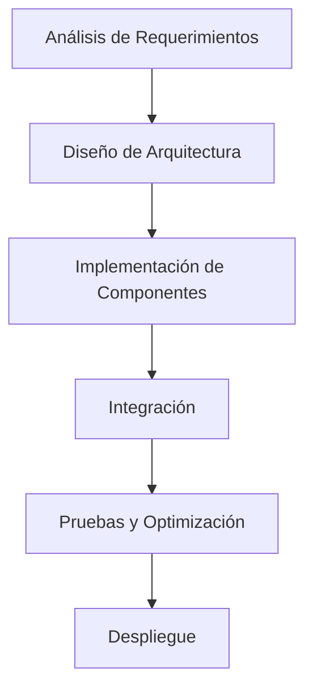

# Modelado y Programación - Emulación de máquinas virtuales

## 7.3 Construcción de la máquina virtual.

---

La **construcción de una máquina virtual** es el proceso de implementación práctica de todos los componentes necesarios para emular un sistema computacional completo. Este proceso involucra desde el diseño de la arquitectura hasta la implementación de cada componente virtualizado.

### Fases de Construcción de una Máquina Virtual

#### 1. Diseño de la Arquitectura



En la práctica conviene construir la VM **incrementalmente**, con un programa de prueba en cada paso: primero la memoria y un ciclo de CPU con tres o cuatro instrucciones, luego el resto del conjunto de instrucciones, después los dispositivos mapeados en memoria y al final las interrupciones. Cada componente se comunica con los demás por interfaces pequeñas (leer y escribir memoria, levantar una interrupción), lo que permite probarlos por separado.

### Componentes Fundamentales para la Construcción

#### 1. Núcleo de la Máquina Virtual (VM Core)

**Estructura básica del core.** El núcleo coordina los componentes; el siguiente es un esqueleto cuyos tipos (`CPUEmulator`, `MemoryManager`, etc.) se desarrollan en las secciones siguientes. Al final del tema hay una VM completa que compila y se ejecuta.

```cpp
class VirtualMachineCore {
private:
    // Estado de la VM
    VMState state;
    
    // Componentes principales
    CPUEmulator* cpu;
    MemoryManager* memory;
    DeviceManager* devices;
    InstructionDecoder* decoder;
    
public:
    VirtualMachineCore(const VMConfig& config) {
        // Inicialización de componentes
        memory = new MemoryManager(config.memorySize);
        cpu = new CPUEmulator(memory, config.cpuArch);
        devices = new DeviceManager();
        decoder = new InstructionDecoder(config.isa);
    }
    
    void executeCycle() {
        if (state != VMState::RUNNING) return;
        
        // Ciclo fetch-decode-execute
        uint32_t instruction = fetch();
        DecodedInstruction decoded = decode(instruction);
        execute(decoded);
        
        // Manejo de interrupciones
        checkInterrupts();
    }
    
    void run() {
        state = VMState::RUNNING;
        while (state == VMState::RUNNING) {
            executeCycle();
        }
    }
};
```

#### 2. Sistema de Memoria Virtual

**Implementación de memoria con gestión de páginas:**

```cpp
class MemoryManager {
private:
    std::vector<uint8_t> physicalMemory;
    PageTable* pageTable;
    uint32_t pageSize;
    uint32_t totalPages;
    
public:
    MemoryManager(uint32_t size, uint32_t pageSize = 4096) 
        : physicalMemory(size), pageSize(pageSize) {
        totalPages = size / pageSize;
        pageTable = new PageTable(totalPages);
    }
    
    uint8_t readByte(uint32_t virtualAddress) {
        uint32_t physicalAddress = translateAddress(virtualAddress);
        if (physicalAddress >= physicalMemory.size()) {
            throw MemoryAccessException("Dirección inválida");
        }
        return physicalMemory[physicalAddress];
    }
    
    void writeByte(uint32_t virtualAddress, uint8_t value) {
        uint32_t physicalAddress = translateAddress(virtualAddress);
        if (physicalAddress >= physicalMemory.size()) {
            throw MemoryAccessException("Dirección inválida");
        }
        physicalMemory[physicalAddress] = value;
    }
    
    uint32_t translateAddress(uint32_t virtualAddress) {
        uint32_t pageNumber = virtualAddress / pageSize;
        uint32_t offset = virtualAddress % pageSize;
        
        if (!pageTable->isPresent(pageNumber)) {
            handlePageFault(pageNumber);
        }
        
        return pageTable->getFrame(pageNumber) * pageSize + offset;
    }
};
```

#### 3. Emulación de CPU

**Ciclo de ejecución con pipeline virtual.** El tiempo promedio que el emulador tarda por instrucción invitada es

$$ \bar{T} = \frac{1}{n} \sum_{i=1}^{n} (T_{\text{fetch}, i} + T_{\text{decode}, i} + T_{\text{execute}, i} + T_{\text{memory}, i}) $$

En un procesador real, la segmentación (*pipeline*) solapa las etapas de instrucciones consecutivas para terminar, idealmente, una instrucción por ciclo (CPI = 1). En un emulador, simular el pipeline no lo acelera: sirve para reproducir con exactitud el **comportamiento temporal** de la máquina original, por ejemplo cuántos ciclos tarda cada instrucción, lo que importa al emular consolas de videojuegos cuyo software dependía de ello.

```cpp
class CPUEmulator {
private:
    // Registros
    std::array<uint32_t, 16> registers;
    uint32_t PC; // Program Counter
    uint32_t SP; // Stack Pointer
    uint32_t FLAGS; // Status flags
    
    // Referencia a memoria
    MemoryManager* memory;
    
    // Pipeline stages
    struct Pipeline {
        uint32_t fetchedInstruction;
        DecodedInstruction decoded;
        ExecutionState executed;
    } pipeline;
    
public:
    void fetchStage() {
        pipeline.fetchedInstruction = memory->readWord(PC);
        PC += 4;
    }
    
    void decodeStage() {
        pipeline.decoded = instructionDecoder.decode(pipeline.fetchedInstruction);
    }
    
    void executeStage() {
        switch (pipeline.decoded.opcode) {
            case OP_ADD:
                registers[pipeline.decoded.rd] = 
                    registers[pipeline.decoded.rs1] + registers[pipeline.decoded.rs2];
                break;
            case OP_LOAD:
                registers[pipeline.decoded.rd] = 
                    memory->readWord(registers[pipeline.decoded.rs1] + pipeline.decoded.imm);
                break;
            // ... más instrucciones
        }
    }
    
    void runCycle() {
        // Las etapas se simulan en orden inverso para que cada una use
        // el resultado que la etapa anterior produjo en el ciclo PREVIO
        executeStage();
        decodeStage();
        fetchStage();
    }
};
```

Simular las etapas de atrás hacia adelante es un truco estándar: si se ejecutara `fetchStage` primero, sobrescribiría `fetchedInstruction` antes de que `decodeStage` usara la del ciclo anterior. Un pipeline real además debe manejar **riesgos** (*hazards*): si una instrucción usa un registro que la anterior todavía no escribe, hay que esperar o reenviar el dato; y tras un salto tomado, las instrucciones ya buscadas y decodificadas deben descartarse.

### Sistema de Instrucciones y Decodificación

#### 1. Decodificador de Instrucciones

```cpp
class InstructionDecoder {
private:
    InstructionSet architecture;
    std::unordered_map<uint8_t, InstructionHandler> opcodeHandlers;
    
public:
    DecodedInstruction decode(uint32_t instruction) {
        uint8_t opcode = instruction & 0x7F;   // los 7 bits bajos, como en RISC-V
        auto handler = opcodeHandlers.find(opcode);
        
        if (handler != opcodeHandlers.end()) {
            return handler->second(instruction);
        } else {
            throw IllegalInstructionException("Opcode no soportado");
        }
    }
    
    void registerHandler(uint8_t opcode, InstructionHandler handler) {
        opcodeHandlers[opcode] = handler;
    }
};

// Ejemplo de handler para instrucción ADD
InstructionHandler addHandler = [](uint32_t instruction) -> DecodedInstruction {
    DecodedInstruction decoded;
    decoded.opcode = OP_ADD;
    decoded.rd = (instruction >> 7) & 0x1F;
    decoded.rs1 = (instruction >> 15) & 0x1F;
    decoded.rs2 = (instruction >> 20) & 0x1F;
    return decoded;
};
```

Los campos se extraen con desplazamientos y máscaras: `(instruction >> 7) & 0x1F` toma los 5 bits que empiezan en el bit 7, que es la posición del registro destino en el formato R de RISC-V. Una tabla de manejadores indexada por opcode tiene costo $O(1)$ y permite agregar instrucciones sin modificar el decodificador.

#### 2. Conjunto de Instrucciones Básico

**ISA minimalista (ejemplo):**

| Opcode | Instrucción | Formato | Descripción |
|--------|-------------|---------|-------------|
| 0x01 | LOAD | R[dest] = M[addr] | Carga desde memoria |
| 0x02 | STORE | M[addr] = R[src] | Almacena en memoria |
| 0x03 | ADD | R[dest] = R[s1] + R[s2] | Suma registros |
| 0x04 | SUB | R[dest] = R[s1] - R[s2] | Resta registros |
| 0x05 | JMP | PC = address | Salto incondicional |
| 0x06 | JZ | if R[cond] == 0: PC = address | Salto condicional |

### Sistema de Dispositivos Virtuales

#### 1. Framework de Dispositivos Virtuales

```cpp
class VirtualDevice {
public:
    virtual uint32_t read(uint32_t address) = 0;
    virtual void write(uint32_t address, uint32_t value) = 0;
    virtual void reset() = 0;
    virtual std::string getName() const = 0;
};

class DeviceManager {
private:
    struct Region { uint32_t base; uint32_t size; VirtualDevice* device; };
    std::map<uint32_t, Region> regions;     // ordenado por dirección base

    // Busca la región que contiene la dirección: la última con base <= address
    const Region& find(uint32_t address) const {
        auto it = regions.upper_bound(address);
        if (it != regions.begin()) {
            --it;
            if (address < it->second.base + it->second.size) return it->second;
        }
        throw std::out_of_range("Dispositivo no encontrado");
    }

public:
    void mapDevice(uint32_t baseAddress, uint32_t size, VirtualDevice* device) {
        regions[baseAddress] = {baseAddress, size, device};
    }

    uint32_t readIO(uint32_t address) {
        const Region& r = find(address);
        return r.device->read(address - r.base);    // desplazamiento DENTRO del dispositivo
    }

    void writeIO(uint32_t address, uint32_t value) {
        const Region& r = find(address);
        r.device->write(address - r.base, value);
    }
};
```

Cada dispositivo recibe el **desplazamiento** dentro de su región y no la dirección absoluta: así el mismo dispositivo funciona en cualquier dirección base. Guardar las regiones en un mapa ordenado y buscar con `upper_bound` cuesta $O(\log k)$ para $k$ dispositivos, sin crear una entrada por cada byte mapeado.

#### 2. Implementación de Dispositivos Específicos

**Console Output Device:**

```cpp
class ConsoleDevice : public VirtualDevice {
private:
    std::ostream& outputStream;
    
public:
    ConsoleDevice(std::ostream& os = std::cout) : outputStream(os) {}
    
    uint32_t read(uint32_t address) override {
        // Dispositivo de solo escritura
        return 0;
    }
    
    void write(uint32_t address, uint32_t value) override {
        if (address == 0) { // Registro de datos
            outputStream << static_cast<char>(value & 0xFF);
        } else if (address == 4) { // Registro de control
            if (value == 1) {
                outputStream.flush();
            }
        }
    }
    
    void reset() override {
        // No operation
    }
    
    std::string getName() const override {
        return "Console Output Device";
    }
};
```

### Sistema de Interrupciones Virtuales

#### 1. Controlador de Interrupciones Programable (PIC)

```cpp
class VirtualPIC : public VirtualDevice {
private:
    std::vector<bool> irqStatus;
    std::vector<bool> irqMask;
    uint8_t currentPriority;
    
public:
    VirtualPIC(uint8_t numIrqs = 8) : irqStatus(numIrqs, false), irqMask(numIrqs, false) {}
    
    uint32_t read(uint32_t address) override {
        switch (address) {
            case 0x00: // IRR (Interrupt Request Register)
                return getIRR();
            case 0x04: // ISR (In-Service Register)
                return getISR();
            case 0x08: // IMR (Interrupt Mask Register)
                return getIMR();
            default:
                return 0;
        }
    }
    
    void write(uint32_t address, uint32_t value) override {
        switch (address) {
            case 0x00: // EOI (End of Interrupt)
                handleEOI(value);
                break;
            case 0x04: // Set mask
                setMask(value);
                break;
            case 0x08: // Clear mask
                clearMask(value);
                break;
        }
    }
    
    void raiseInterrupt(uint8_t irq) {
        if (irq < irqStatus.size()) {
            irqStatus[irq] = true;
        }
    }
    
    void lowerInterrupt(uint8_t irq) {
        if (irq < irqStatus.size()) {
            irqStatus[irq] = false;
        }
    }
};
```

El PIC tiene tres registros clásicos (como el Intel 8259): **IRR**, las interrupciones solicitadas; **ISR**, las que se están atendiendo; e **IMR**, las enmascaradas. Cuando la CPU acepta una interrupción, el bit pasa de IRR a ISR; el manejador escribe un **EOI** (*end of interrupt*) al terminar para que el PIC pueda entregar otra del mismo nivel o de menor prioridad. Los métodos `getIRR`, `handleEOI`, etc. se dejan como ejercicio; la VM completa al final del tema implementa una versión simplificada.

### Gestión de Recursos y Scheduling

#### 1. Gestor de Recursos de la VM

```cpp
class VMResourceManager {
private:
    struct ResourceLimits {
        uint64_t maxMemory;
        uint32_t cpuTimeSlice;
        uint32_t maxDevices;
    } limits;
    
    struct ResourceUsage {
        uint64_t memoryUsed;
        uint64_t cpuCycles;
        std::vector<VirtualDevice*> activeDevices;
    } usage;
    
public:
    bool allocateMemory(uint32_t size) {
        if (usage.memoryUsed + size > limits.maxMemory) {
            return false;
        }
        usage.memoryUsed += size;
        return true;
    }
    
    void releaseMemory(uint32_t size) {
        usage.memoryUsed -= size;
    }
    
    bool attachDevice(VirtualDevice* device) {
        if (usage.activeDevices.size() >= limits.maxDevices) {
            return false;
        }
        usage.activeDevices.push_back(device);
        return true;
    }
};
```

### Ejercicios Propuestos

#### Ejercicio 1: Implementación de un CPU Básico
Implementa una CPU virtual que soporte un conjunto de 10 instrucciones básicas.

**Requerimientos:**
- 8 registros de propósito general
- Soporte para operaciones aritméticas y lógicas
- Manejo básico de memoria
- Sistema de interrupciones

La solución completa, junto con la del ejercicio 3, está en la sección "Una VM Completa" al final del tema.

#### Ejercicio 2: Sistema de Paginación
Implementa un sistema de paginación de dos niveles con manejo de page faults.

**Pseudocódigo:**

```text
FUNCIÓN translate_address(virtual_address):
    dir_index = (virtual_address >> 22) & 0x3FF
    table_index = (virtual_address >> 12) & 0x3FF
    offset = virtual_address & 0xFFF
    
    SI page_directory[dir_index].presente ES FALSO:
        generar_page_fault()
    
    page_table = page_directory[dir_index].address
    SI page_table[table_index].presente ES FALSO:
        generar_page_fault()
    
    physical_address = (page_table[table_index].frame * 4096) + offset
    RETORNAR physical_address
```

La implementación en C++ de este pseudocódigo, con el directorio, las tablas creadas bajo demanda y los fallos de página como excepciones, es la solución del ejercicio 2 del tema 7.2. El manejo del fallo consiste en buscar un marco libre (o elegir una víctima con una política como LRU o reloj, escribiéndola a disco si fue modificada), cargar la página, actualizar la tabla y **reintentar** la instrucción que falló.

#### Ejercicio 3: Dispositivo de Timer Virtual
Implementa un dispositivo de timer que genere interrupciones periódicas.

```cpp
class TimerDevice : public VirtualDevice {
private:
    uint64_t ticks;
    uint64_t interval;
    bool enabled;
    VirtualPIC* pic;
    
public:
    TimerDevice(VirtualPIC* pic) : ticks(0), interval(1000000), enabled(false), pic(pic) {}
    
    void tick() {
        if (!enabled) return;
        
        ticks++;
        if (ticks % interval == 0) {
            pic->raiseInterrupt(TIMER_IRQ);
        }
    }
    
    void write(uint32_t address, uint32_t value) override {
        switch (address) {
            case 0x00: // Interval register
                interval = value;
                break;
            case 0x04: // Control register
                enabled = (value & 0x1) != 0;
                break;
        }
    }
};
```

El temporizador no tiene un hilo propio: la VM llama a `tick()` una vez por instrucción ejecutada (o por cada ciclo simulado), así que el tiempo de la VM se mide en instrucciones y la ejecución es **determinista**, lo que facilita mucho la depuración. Le faltan `read`, `reset` y `getName` para ser un `VirtualDevice` concreto; la VM completa del final incluye una versión que compila.

### Técnicas de Optimización

#### 1. Caching de Traducción de Direcciones (TLB)

$$ \text{Hit Rate} = \frac{\text{TLB Hits}}{\text{Total Accesses}} \times 100\% $$

```cpp
class TLB {
private:
    struct TLBEntry {
        uint32_t virtualPage;
        uint32_t physicalFrame;
        bool valid;
        uint8_t age;
    };
    
    std::vector<TLBEntry> entries;
    uint8_t currentAge;
    
public:
    uint32_t lookup(uint32_t virtualPage) {
        for (auto& entry : entries) {
            if (entry.valid && entry.virtualPage == virtualPage) {
                entry.age = currentAge++;
                return entry.physicalFrame;
            }
        }
        return TLB_MISS;
    }
    
    void insert(uint32_t virtualPage, uint32_t physicalFrame) {
        // Implementar política de reemplazo (LRU)
    }
};
```

Una TLB pequeña acierta casi siempre porque los programas tienen **localidad**: con páginas de 4 KB, recorrer un arreglo de 4 096 bytes provoca un solo fallo de TLB y 4 095 aciertos. El tiempo efectivo de acceso a memoria es $T = h\,T_{TLB} + (1 - h)(T_{TLB} + T_{tablas}) + T_{mem};$ con $h = 0.99,$ una búsqueda en la TLB de 1 ns, un recorrido de tablas de 100 ns y un acceso de 100 ns, el promedio es $1 + 0.01 \cdot 100 + 100 = 102$ ns, frente a 200 ns sin TLB. Una implementación de la política LRU:

```cpp
#include <cstdint>
#include <iostream>
#include <list>
#include <optional>
#include <unordered_map>

class TLBLRU {
    size_t capacity;
    std::list<std::pair<uint32_t, uint32_t>> order;      // más reciente al frente
    std::unordered_map<uint32_t, decltype(order)::iterator> index;
public:
    long hits = 0, misses = 0;
    explicit TLBLRU(size_t cap) : capacity(cap) {}

    std::optional<uint32_t> lookup(uint32_t page) {
        auto it = index.find(page);
        if (it == index.end()) { ++misses; return std::nullopt; }
        order.splice(order.begin(), order, it->second);  // mover al frente: O(1)
        ++hits;
        return it->second->second;
    }

    void insert(uint32_t page, uint32_t frame) {
        if (index.size() == capacity) {                  // expulsar la menos reciente
            index.erase(order.back().first);
            order.pop_back();
        }
        order.emplace_front(page, frame);
        index[page] = order.begin();
    }
};

int main() {
    TLBLRU tlb(4);
    for (int rep = 0; rep < 100; ++rep)
        for (uint32_t page : {1u, 2u, 3u, 1u, 2u, 3u})  // trabajo que cabe en la TLB
            if (!tlb.lookup(page)) tlb.insert(page, page + 100);
    std::cout << "aciertos " << tlb.hits << ", fallos " << tlb.misses << "\n";   // 597 y 3
}
```

La lista doblemente enlazada mantiene el orden de uso y el diccionario da acceso en $O(1)$ a cada nodo, así que tanto la búsqueda como la inserción y la expulsión cuestan $O(1).$ Las TLB de hardware son asociativas y aproximan LRU con unos pocos bits por entrada.

#### 2. Binary Translation Caching

```cpp
class TranslationCache {
private:
    std::unordered_map<uint64_t, NativeCodeBlock> cache;
    size_t maxSize;
    
public:
    NativeCodeBlock* getTranslatedCode(uint64_t address) {
        auto it = cache.find(address);
        if (it != cache.end()) {
            return &it->second;
        }
        return nullptr;
    }
    
    void storeTranslatedCode(uint64_t address, NativeCodeBlock code) {
        if (cache.size() >= maxSize) {
            evictOldEntries();
        }
        cache[address] = std::move(code);
    }
};
```

### Pruebas y Verificación

#### 1. Framework de Testing para la VM

Cada instrucción se prueba con programas mínimos que fijan el estado inicial, ejecutan y comparan el estado final con el esperado. Las pruebas más valiosas son las de **casos límite**: desbordamientos, la bandera de cero, saltos al principio y al final de la memoria, accesos fuera de rango e interrupciones que llegan en medio de una subrutina. Una técnica muy usada en emuladores reales es la **comparación con una referencia**: se ejecuta el mismo programa en la máquina real (o en un emulador de confianza) y en el propio, registrando el estado después de cada instrucción, y se busca la primera diferencia. La función `pruebas()` de la VM completa siguiente muestra el estilo con `assert`.

### Una VM Completa

El siguiente programa reúne los componentes del tema en una VM pequeña pero completa, y resuelve los ejercicios 1 y 3: 8 registros, 12 instrucciones, banderas, dispositivos mapeados en memoria (una consola y un temporizador), un controlador de interrupciones y una tabla de vectores. Cada instrucción ocupa 4 bytes: opcode, registro destino, registro fuente y un inmediato de 8 bits (o 16 bits para direcciones, usando los dos últimos bytes).

```cpp
#include <array>
#include <cassert>
#include <cstdint>
#include <iostream>
#include <map>
#include <sstream>
#include <stdexcept>
#include <string>
#include <vector>

// ----- Dispositivos -----
struct VirtualDevice {
    virtual uint32_t read(uint32_t offset) = 0;
    virtual void write(uint32_t offset, uint32_t value) = 0;
    virtual ~VirtualDevice() = default;
};

struct ConsoleDevice : VirtualDevice {
    std::ostream& out;
    explicit ConsoleDevice(std::ostream& o) : out(o) {}
    uint32_t read(uint32_t) override { return 0; }
    void write(uint32_t offset, uint32_t v) override { if (offset == 0) out << char(v & 0xFF); }
};

struct PIC {                                    // controlador de interrupciones simplificado
    uint8_t irr = 0, imr = 0;                   // solicitadas y enmascaradas
    void raise(int irq) { irr |= uint8_t(1u << irq); }
    int next() {                                // la de menor número tiene más prioridad
        uint8_t ready = irr & ~imr;
        for (int i = 0; i < 8; ++i)
            if (ready & (1u << i)) { irr &= uint8_t(~(1u << i)); return i; }
        return -1;
    }
};

struct TimerDevice : VirtualDevice {            // ejercicio 3
    PIC& pic; uint32_t interval = 0, count = 0; bool enabled = false;
    static constexpr int IRQ = 0;
    explicit TimerDevice(PIC& p) : pic(p) {}
    uint32_t read(uint32_t offset) override { return offset == 0 ? interval : enabled; }
    void write(uint32_t offset, uint32_t v) override {
        if (offset == 0) interval = v; else if (offset == 4) { enabled = v & 1; count = 0; }
    }
    void tick() { if (enabled && interval && ++count % interval == 0) pic.raise(IRQ); }
};

// ----- CPU y memoria -----
enum Op : uint8_t { HALT, LI, ADD, SUB, AND_, OR_, LD, ST, JMP, JZ, OUT, IRET };

class VM {
public:
    std::array<int32_t, 8> R{};                  // R0..R7
    uint16_t PC = 0;
    bool Z = false, N = false;                   // banderas cero y negativo
    bool running = false, interruptsOn = true, inHandler = false;
    std::vector<uint8_t> mem = std::vector<uint8_t>(0x10000, 0);
    std::array<uint16_t, 8> vectors{};           // IRQ -> dirección del manejador
    PIC pic;
    std::map<uint32_t, std::pair<uint32_t, VirtualDevice*>> mmio;   // base -> (tamaño, dispositivo)
    TimerDevice* timer = nullptr;
    long steps = 0;

    void map(uint32_t base, uint32_t size, VirtualDevice* d) { mmio[base] = {size, d}; }

    VirtualDevice* device(uint32_t addr, uint32_t& offset) {
        auto it = mmio.upper_bound(addr);
        if (it == mmio.begin()) return nullptr;
        --it;
        if (addr >= it->first + it->second.first) return nullptr;
        offset = addr - it->first;
        return it->second.second;
    }
    int32_t load(uint32_t a) {
        uint32_t off;
        if (auto d = device(a, off)) return int32_t(d->read(off));
        return int32_t(mem.at(a) | mem.at(a + 1) << 8 | mem.at(a + 2) << 16 | mem.at(a + 3) << 24);
    }
    void store(uint32_t a, int32_t v) {
        uint32_t off;
        if (auto d = device(a, off)) { d->write(off, uint32_t(v)); return; }
        for (int i = 0; i < 4; ++i) mem.at(a + i) = uint8_t(v >> (8 * i));
    }
    void flags(int32_t v) { Z = v == 0; N = v < 0; }

    uint16_t savedPC = 0;
    void step() {
        uint8_t op = mem[PC], rd = mem[PC + 1], rs = mem[PC + 2], imm = mem[PC + 3];
        uint16_t addr = uint16_t(rs | imm << 8);   // en saltos y memoria: 16 bits
        PC += 4;
        switch (op) {
            case HALT: running = false; break;
            case LI:   R[rd] = int8_t(imm); flags(R[rd]); break;
            case ADD:  R[rd] += R[rs]; flags(R[rd]); break;
            case SUB:  R[rd] -= R[rs]; flags(R[rd]); break;
            case AND_: R[rd] &= R[rs]; flags(R[rd]); break;
            case OR_:  R[rd] |= R[rs]; flags(R[rd]); break;
            case LD:   R[rd] = load(addr); break;
            case ST:   store(addr, R[rd]); break;
            case JMP:  PC = addr; break;
            case JZ:   if (Z) PC = addr; break;
            case OUT:  store(0xF000, R[rd]); break;                     // escribe en la consola
            case IRET: PC = savedPC; inHandler = false; break;
            default: throw std::runtime_error("instrucción ilegal");
        }
        ++steps;
        if (timer) timer->tick();
        // Las interrupciones se atienden entre instrucciones
        if (interruptsOn && !inHandler) {
            int irq = pic.next();
            if (irq >= 0) { savedPC = PC; PC = vectors[irq]; inHandler = true; }
        }
    }
    void run(long maxSteps = 100000) {
        running = true;
        while (running && steps < maxSteps) step();
    }
    void load_program(uint16_t at, const std::vector<std::array<uint8_t, 4>>& prog) {
        for (size_t i = 0; i < prog.size(); ++i)
            for (int j = 0; j < 4; ++j) mem[at + 4 * i + j] = prog[i][j];
    }
};

// ----- Pruebas -----
void pruebas() {
    VM vm;
    vm.load_program(0, {{LI, 1, 0, 7}, {LI, 2, 0, 7}, {SUB, 1, 2, 0}, {HALT, 0, 0, 0}});
    vm.run();
    assert(vm.R[1] == 0 && vm.Z);                // 7 - 7 = 0 enciende la bandera Z

    VM m2;
    m2.load_program(0, {{LI, 3, 0, uint8_t(-5)}, {ST, 3, 0x00, 0x02}, {LD, 4, 0x00, 0x02}, {HALT, 0, 0, 0}});
    m2.run();
    assert(m2.R[4] == -5 && m2.load(0x200) == -5);   // memoria de 32 bits little endian
    std::cout << "pruebas superadas\n";
}

int main() {
    pruebas();

    std::ostringstream pantalla;
    ConsoleDevice consola(pantalla);
    VM vm;
    vm.timer = new TimerDevice(vm.pic);
    vm.map(0xF000, 4, &consola);
    vm.map(0xF010, 8, vm.timer);

    // Programa principal: configura el temporizador cada 20 instrucciones y
    // cuenta en R1 dentro de un ciclo hasta que el manejador pone R7 en cero.
    vm.load_program(0x0000, {
        {LI, 5, 0, 20},  {ST, 5, 0x10, 0xF0},     // interval = 20
        {LI, 5, 0, 1},   {ST, 5, 0x14, 0xF0},     // enabled = 1
        {LI, 7, 0, 3},                            // R7: interrupciones que faltan
        {LI, 6, 0, 1},                            // R6 = 1
        {ADD, 1, 6, 0},                           // 0x18: R1 += 1   <- ciclo
        {OR_, 7, 7, 0},                           // actualizar Z según R7
        {JZ, 0, 0x28, 0x00},                      // si R7 == 0, terminar
        {JMP, 0, 0x18, 0x00},
        {HALT, 0, 0, 0},                          // 0x28
    });
    // Manejador del temporizador en 0x0100: imprime 'T' y decrementa R7
    vm.load_program(0x0100, {
        {LI, 0, 0, 'T'}, {OUT, 0, 0, 0},
        {SUB, 7, 6, 0},
        {IRET, 0, 0, 0},
    });
    vm.vectors[TimerDevice::IRQ] = 0x0100;
    vm.run();

    std::cout << "consola: " << pantalla.str() << "\n";          // consola: TTT
    std::cout << "R1 = " << vm.R[1] << ", instrucciones = " << vm.steps << "\n";
    delete vm.timer;
}
```

Algunos puntos de diseño que vale la pena notar:

- La CPU no sabe nada de la consola ni del temporizador: solo lee y escribe direcciones, y `device` decide si la dirección es memoria o un dispositivo. Agregar un dispositivo es llamar a `map`.
- El temporizador avanza una vez por instrucción y las interrupciones solo se aceptan **entre** instrucciones, así que la ejecución es determinista: el programa imprime siempre `TTT` y termina con el mismo número de instrucciones.
- El manejador no puede ser interrumpido (`inHandler`) y regresa con `IRET` al punto exacto donde se interrumpió el programa. En una CPU real también se guardarían las banderas y los registros que el manejador modifique.
- `mem.at` comprueba los límites, así que un acceso fuera de la memoria lanza una excepción en lugar de corromper el emulador.

### Ejercicio Final: VM Completa

Construye una máquina virtual completa que incluya:

1. CPU con pipeline de 3 etapas
2. Sistema de memoria con paginación
3. 3 dispositivos virtuales (console, timer, disk)
4. Sistema de interrupciones
5. Monitor de performance

**Criterios de evaluación:**
- Correcta ejecución de programas de prueba
- Manejo adecuado de excepciones
- Eficiencia en el uso de recursos
- Documentación completa

### Referencias y Bibliografía

1. **"Virtual Machine Design and Implementation in C/C++"** - Bill Blunden
2. **"Programming Language Pragmatics"** - Michael L. Scott
3. **"Computer Organization and Design"** - David A. Patterson & John L. Hennessy
4. **Intel® 64 and IA-32 Architectures Software Developer Manuals**
5. **"Advanced Programming in the UNIX Environment"** - W. Richard Stevens

### Conclusión

La construcción de una máquina virtual es un proyecto complejo que integra múltiples áreas de la ciencia de la computación. Un diseño cuidadoso y una implementación modular son clave para el éxito. Las técnicas modernas de optimización como el binary translation y el caching son esenciales para lograr un rendimiento aceptable.

**Palabras clave:** VM Core, Memory Management, Instruction Decoding, Virtual Devices, Interrupt Handling, Binary Translation, TLB, Resource Management.
