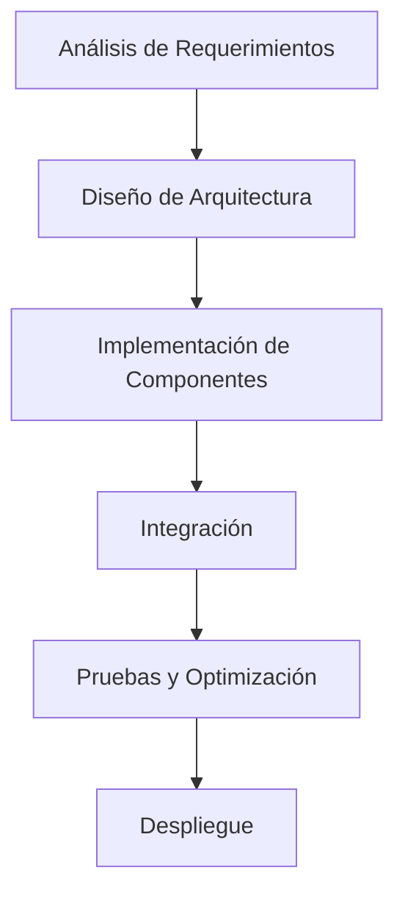

# Modelado y Programación - Emulación de máquinas virtuales
## 7.3 Construcción de la máquina virtual.

---

La **construcción de una máquina virtual** es el proceso de implementación práctica de todos los componentes necesarios para emular un sistema computacional completo. Este proceso involucra desde el diseño de la arquitectura hasta la implementación de cada componente virtualizado.

### Fases de Construcción de una Máquina Virtual

#### 1. Diseño de la Arquitectura



### Componentes Fundamentales para la Construcción

#### 1. Núcleo de la Máquina Virtual (VM Core)

**Estructura básica del core:**

```cpp
class VirtualMachineCore {
private:
    // Estado de la VM
    VMState state;
    
    // Componentes principales
    CPUEmulator* cpu;
    MemoryManager* memory;
    DeviceManager* devices;
    InstructionDecoder* decoder;
    
public:
    VirtualMachineCore(const VMConfig& config) {
        // Inicialización de componentes
        memory = new MemoryManager(config.memorySize);
        cpu = new CPUEmulator(memory, config.cpuArch);
        devices = new DeviceManager();
        decoder = new InstructionDecoder(config.isa);
    }
    
    void executeCycle() {
        if (state != VMState::RUNNING) return;
        
        // Ciclo fetch-decode-execute
        uint32_t instruction = fetch();
        DecodedInstruction decoded = decode(instruction);
        execute(decoded);
        
        // Manejo de interrupciones
        checkInterrupts();
    }
    
    void run() {
        state = VMState::RUNNING;
        while (state == VMState::RUNNING) {
            executeCycle();
        }
    }
};
```

#### 2. Sistema de Memoria Virtual

**Implementación de memoria con gestión de páginas:**

```cpp
class MemoryManager {
private:
    std::vector<uint8_t> physicalMemory;
    PageTable* pageTable;
    uint32_t pageSize;
    uint32_t totalPages;
    
public:
    MemoryManager(uint32_t size, uint32_t pageSize = 4096) 
        : physicalMemory(size), pageSize(pageSize) {
        totalPages = size / pageSize;
        pageTable = new PageTable(totalPages);
    }
    
    uint8_t readByte(uint32_t virtualAddress) {
        uint32_t physicalAddress = translateAddress(virtualAddress);
        if (physicalAddress >= physicalMemory.size()) {
            throw MemoryAccessException("Dirección inválida");
        }
        return physicalMemory[physicalAddress];
    }
    
    void writeByte(uint32_t virtualAddress, uint8_t value) {
        uint32_t physicalAddress = translateAddress(virtualAddress);
        if (physicalAddress >= physicalMemory.size()) {
            throw MemoryAccessException("Dirección inválida");
        }
        physicalMemory[physicalAddress] = value;
    }
    
    uint32_t translateAddress(uint32_t virtualAddress) {
        uint32_t pageNumber = virtualAddress / pageSize;
        uint32_t offset = virtualAddress % pageSize;
        
        if (!pageTable->isPresent(pageNumber)) {
            handlePageFault(pageNumber);
        }
        
        return pageTable->getFrame(pageNumber) * pageSize + offset;
    }
};
```

#### 3. Emulación de CPU

**Ciclo de ejecución con pipeline virtual:**

$$ \text{CPI}_{\text{virtual}} = \frac{1}{n} \sum_{i=1}^{n} (T_{\text{fetch}_i} + T_{\text{decode}_i} + T_{\text{execute}_i} + T_{\text{memory}_i}) $$

```cpp
class CPUEmulator {
private:
    // Registros
    std::array<uint32_t, 16> registers;
    uint32_t PC; // Program Counter
    uint32_t SP; // Stack Pointer
    uint32_t FLAGS; // Status flags
    
    // Referencia a memoria
    MemoryManager* memory;
    
    // Pipeline stages
    struct Pipeline {
        uint32_t fetchedInstruction;
        DecodedInstruction decoded;
        ExecutionState executed;
    } pipeline;
    
public:
    void fetchStage() {
        pipeline.fetchedInstruction = memory->readWord(PC);
        PC += 4;
    }
    
    void decodeStage() {
        pipeline.decoded = instructionDecoder.decode(pipeline.fetchedInstruction);
    }
    
    void executeStage() {
        switch (pipeline.decoded.opcode) {
            case OP_ADD:
                registers[pipeline.decoded.rd] = 
                    registers[pipeline.decoded.rs1] + registers[pipeline.decoded.rs2];
                break;
            case OP_LOAD:
                registers[pipeline.decoded.rd] = 
                    memory->readWord(registers[pipeline.decoded.rs1] + pipeline.decoded.imm);
                break;
            // ... más instrucciones
        }
    }
    
    void runCycle() {
        // Pipeline execution
        executeStage();
        decodeStage();
        fetchStage();
    }
};
```

### Sistema de Instrucciones y Decodificación

#### 1. Decodificador de Instrucciones

```cpp
class InstructionDecoder {
private:
    InstructionSet architecture;
    std::unordered_map<uint8_t, InstructionHandler> opcodeHandlers;
    
public:
    DecodedInstruction decode(uint32_t instruction) {
        DecodedResult result;
        
        uint8_t opcode = instruction & 0x7F;
        auto handler = opcodeHandlers.find(opcode);
        
        if (handler != opcodeHandlers.end()) {
            return handler->second(instruction);
        } else {
            throw IllegalInstructionException("Opcode no soportado");
        }
    }
    
    void registerHandler(uint8_t opcode, InstructionHandler handler) {
        opcodeHandlers[opcode] = handler;
    }
};

// Ejemplo de handler para instrucción ADD
InstructionHandler addHandler = [](uint32_t instruction) -> DecodedInstruction {
    DecodedInstruction decoded;
    decoded.opcode = OP_ADD;
    decoded.rd = (instruction >> 7) & 0x1F;
    decoded.rs1 = (instruction >> 15) & 0x1F;
    decoded.rs2 = (instruction >> 20) & 0x1F;
    return decoded;
};
```

#### 2. Conjunto de Instrucciones Básico

**ISA minimalista (ejemplo):**

| Opcode | Instrucción | Formato | Descripción |
|--------|-------------|---------|-------------|
| 0x01 | LOAD | R[dest] = M[addr] | Carga desde memoria |
| 0x02 | STORE | M[addr] = R[src] | Almacena en memoria |
| 0x03 | ADD | R[dest] = R[s1] + R[s2] | Suma registros |
| 0x04 | SUB | R[dest] = R[s1] - R[s2] | Resta registros |
| 0x05 | JMP | PC = address | Salto incondicional |
| 0x06 | JZ | if R[cond] == 0: PC = address | Salto condicional |

### Sistema de Dispositivos Virtuales

#### 1. Framework de Dispositivos Virtuales

```cpp
class VirtualDevice {
public:
    virtual uint32_t read(uint32_t address) = 0;
    virtual void write(uint32_t address, uint32_t value) = 0;
    virtual void reset() = 0;
    virtual std::string getName() const = 0;
};

class DeviceManager {
private:
    std::vector<VirtualDevice*> devices;
    std::unordered_map<uint32_t, VirtualDevice*> addressMap;
    
public:
    void mapDevice(uint32_t baseAddress, uint32_t size, VirtualDevice* device) {
        for (uint32_t i = 0; i < size; i++) {
            addressMap[baseAddress + i] = device;
        }
        devices.push_back(device);
    }
    
    uint32_t readIO(uint32_t address) {
        auto device = addressMap.find(address);
        if (device != addressMap.end()) {
            return device->second->read(address - device->first);
        }
        throw IOAccessException("Dispositivo no encontrado");
    }
    
    void writeIO(uint32_t address, uint32_t value) {
        auto device = addressMap.find(address);
        if (device != addressMap.end()) {
            device->second->write(address - device->first, value);
            return;
        }
        throw IOAccessException("Dispositivo no encontrado");
    }
};
```

#### 2. Implementación de Dispositivos Específicos

**Console Output Device:**

```cpp
class ConsoleDevice : public VirtualDevice {
private:
    std::ostream& outputStream;
    
public:
    ConsoleDevice(std::ostream& os = std::cout) : outputStream(os) {}
    
    uint32_t read(uint32_t address) override {
        // Dispositivo de solo escritura
        return 0;
    }
    
    void write(uint32_t address, uint32_t value) override {
        if (address == 0) { // Registro de datos
            outputStream << static_cast<char>(value & 0xFF);
        } else if (address == 4) { // Registro de control
            if (value == 1) {
                outputStream.flush();
            }
        }
    }
    
    void reset() override {
        // No operation
    }
    
    std::string getName() const override {
        return "Console Output Device";
    }
};
```

### Sistema de Interrupciones Virtuales

#### 1. Controlador de Interrupciones Programable (PIC)

```cpp
class VirtualPIC : public VirtualDevice {
private:
    std::vector<bool> irqStatus;
    std::vector<bool> irqMask;
    uint8_t currentPriority;
    
public:
    VirtualPIC(uint8_t numIrqs = 8) : irqStatus(numIrqs, false), irqMask(numIrqs, false) {}
    
    uint32_t read(uint32_t address) override {
        switch (address) {
            case 0x00: // IRR (Interrupt Request Register)
                return getIRR();
            case 0x04: // ISR (In-Service Register)
                return getISR();
            case 0x08: // IMR (Interrupt Mask Register)
                return getIMR();
            default:
                return 0;
        }
    }
    
    void write(uint32_t address, uint32_t value) override {
        switch (address) {
            case 0x00: // EOI (End of Interrupt)
                handleEOI(value);
                break;
            case 0x04: // Set mask
                setMask(value);
                break;
            case 0x08: // Clear mask
                clearMask(value);
                break;
        }
    }
    
    void raiseInterrupt(uint8_t irq) {
        if (irq < irqStatus.size()) {
            irqStatus[irq] = true;
        }
    }
    
    void lowerInterrupt(uint8_t irq) {
        if (irq < irqStatus.size()) {
            irqStatus[irq] = false;
        }
    }
};
```

### Gestión de Recursos y Scheduling

#### 1. Gestor de Recursos de la VM

```cpp
class VMResourceManager {
private:
    struct ResourceLimits {
        uint64_t maxMemory;
        uint32_t cpuTimeSlice;
        uint32_t maxDevices;
    } limits;
    
    struct ResourceUsage {
        uint64_t memoryUsed;
        uint64_t cpuCycles;
        std::vector<VirtualDevice*> activeDevices;
    } usage;
    
public:
    bool allocateMemory(uint32_t size) {
        if (usage.memoryUsed + size > limits.maxMemory) {
            return false;
        }
        usage.memoryUsed += size;
        return true;
    }
    
    void releaseMemory(uint32_t size) {
        usage.memoryUsed -= size;
    }
    
    bool attachDevice(VirtualDevice* device) {
        if (usage.activeDevices.size() >= limits.maxDevices) {
            return false;
        }
        usage.activeDevices.push_back(device);
        return true;
    }
};
```

### Ejercicios Propuestos

#### Ejercicio 1: Implementación de un CPU Básico
Implementa una CPU virtual que soporte un conjunto de 10 instrucciones básicas.

**Requerimientos:**
- 8 registros de propósito general
- Soporte para operaciones aritméticas y lógicas
- Manejo básico de memoria
- Sistema de interrupciones

```cpp
// Esqueleto de solución
class BasicCPU {
public:
    void executeADD(uint8_t rd, uint8_t rs1, uint8_t rs2) {
        registers[rd] = registers[rs1] + registers[rs2];
        updateFlags(registers[rd]);
    }
    
    void executeLOAD(uint8_t rd, uint32_t address) {
        registers[rd] = memory->readWord(address);
    }
    
    // Implementar otras instrucciones...
};
```

#### Ejercicio 2: Sistema de Paginación
Implementa un sistema de paginación de dos niveles con manejo de page faults.

**Pseudocódigo:**
```
FUNCIÓN translate_address(virtual_address):
    dir_index = (virtual_address >> 22) & 0x3FF
    table_index = (virtual_address >> 12) & 0x3FF
    offset = virtual_address & 0xFFF
    
    SI page_directory[dir_index].presente ES FALSO:
        generar_page_fault()
    
    page_table = page_directory[dir_index].address
    SI page_table[table_index].presente ES FALSO:
        generar_page_fault()
    
    physical_address = (page_table[table_index].frame * 4096) + offset
    RETORNAR physical_address
```

#### Ejercicio 3: Dispositivo de Timer Virtual
Implementa un dispositivo de timer que genere interrupciones periódicas.

```cpp
class TimerDevice : public VirtualDevice {
private:
    uint64_t ticks;
    uint64_t interval;
    bool enabled;
    VirtualPIC* pic;
    
public:
    TimerDevice(VirtualPIC* pic) : ticks(0), interval(1000000), enabled(false), pic(pic) {}
    
    void tick() {
        if (!enabled) return;
        
        ticks++;
        if (ticks % interval == 0) {
            pic->raiseInterrupt(TIMER_IRQ);
        }
    }
    
    void write(uint32_t address, uint32_t value) override {
        switch (address) {
            case 0x00: // Interval register
                interval = value;
                break;
            case 0x04: // Control register
                enabled = (value & 0x1) != 0;
                break;
        }
    }
};
```

### Técnicas de Optimización

#### 1. Caching de Traducción de Direcciones (TLB)

$$ \text{Hit Rate} = \frac{\text{TLB Hits}}{\text{Total Accesses}} \times 100\% $$

```cpp
class TLB {
private:
    struct TLBEntry {
        uint32_t virtualPage;
        uint32_t physicalFrame;
        bool valid;
        uint8_t age;
    };
    
    std::vector<TLBEntry> entries;
    uint8_t currentAge;
    
public:
    uint32_t lookup(uint32_t virtualPage) {
        for (auto& entry : entries) {
            if (entry.valid && entry.virtualPage == virtualPage) {
                entry.age = currentAge++;
                return entry.physicalFrame;
            }
        }
        return TLB_MISS;
    }
    
    void insert(uint32_t virtualPage, uint32_t physicalFrame) {
        // Implementar política de reemplazo (LRU)
    }
};
```

#### 2. Binary Translation Caching

```cpp
class TranslationCache {
private:
    std::unordered_map<uint64_t, NativeCodeBlock> cache;
    size_t maxSize;
    
public:
    NativeCodeBlock* getTranslatedCode(uint64_t address) {
        auto it = cache.find(address);
        if (it != cache.end()) {
            return &it->second;
        }
        return nullptr;
    }
    
    void storeTranslatedCode(uint64_t address, NativeCodeBlock code) {
        if (cache.size() >= maxSize) {
            evictOldEntries();
        }
        cache[address] = std::move(code);
    }
};
```

### Pruebas y Verificación

#### 1. Framework de Testing para la VM

```cpp
class VMTestFramework {
public:
    static void testCPUInstructions() {
        VirtualMachine vm;
        vm.loadTestProgram({
            0x01010002, // ADD R1, R0, R2
            0x02030001, // STORE R3, [R1]
            0x03020000  // LOAD R2, [R0]
        });
        
        vm.run();
        assert(vm.getRegister(1) == 2);
    }
    
    static void testMemoryManagement() {
        // Pruebas de paginación y manejo de memoria
    }
    
    static void testDeviceEmulation() {
        // Pruebas de dispositivos virtuales
    }
};
```

### Ejercicio Final: VM Completa

Construye una máquina virtual completa que incluya:

1. CPU con pipeline de 3 etapas
2. Sistema de memoria con paginación
3. 3 dispositivos virtuales (console, timer, disk)
4. Sistema de interrupciones
5. Monitor de performance

**Criterios de evaluación:**
- Correcta ejecución de programas de prueba
- Manejo adecuado de excepciones
- Eficiencia en el uso de recursos
- Documentación completa

### Referencias y Bibliografía

1. **"Virtual Machine Design and Implementation in C/C++"** - Bill Blunden
2. **"Programming Language Pragmatics"** - Michael L. Scott
3. **"Computer Organization and Design"** - David A. Patterson & John L. Hennessy
4. **Intel® 64 and IA-32 Architectures Software Developer Manuals**
5. **"Advanced Programming in the UNIX Environment"** - W. Richard Stevens

### Conclusión

La construcción de una máquina virtual es un proyecto complejo que integra múltiples áreas de la ciencia de la computación. Un diseño cuidadoso y una implementación modular son clave para el éxito. Las técnicas modernas de optimización como el binary translation y el caching son esenciales para lograr un rendimiento aceptable.

**Palabras clave:** VM Core, Memory Management, Instruction Decoding, Virtual Devices, Interrupt Handling, Binary Translation, TLB, Resource Management.
