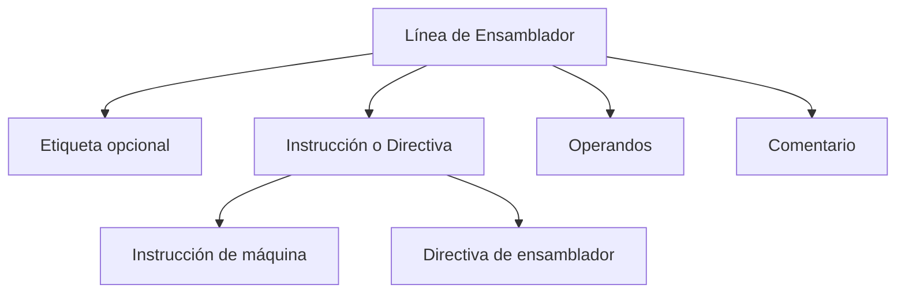
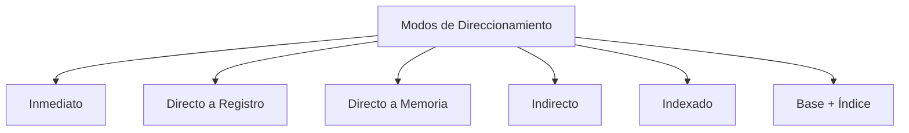

# Modelado y Programación - Emulación de máquinas virtuales

## 7.4 Definición del lenguaje ensamblador.

---

El **lenguaje ensamblador** es una representación simbólica de bajo nivel del código máquina que proporciona una interfaz más legible para los humanos mientras mantiene una correspondencia directa con las instrucciones del procesador.

### Definición Fundamental

Un lenguaje ensamblador es **una notación simbólica que representa el código máquina de una arquitectura específica**, donde cada instrucción corresponde típicamente a una única operación del procesador.

$$ \text{Código fuente} \xrightarrow{\text{ensamblador}} \text{Código máquina} \xrightarrow{\text{carga}} \text{Memoria} \xrightarrow{\text{ejecución}} \text{Resultados} $$

La palabra "ensamblador" nombra dos cosas: el **lenguaje** y el **programa** que lo traduce. A diferencia de un compilador, la traducción es casi uno a uno: cada línea produce una instrucción de máquina. El ensamblador se encarga de lo tedioso: convertir mnemónicos en opcodes, números en bytes y, sobre todo, **nombres simbólicos** (etiquetas) en direcciones, para que el programador no tenga que recalcularlas cada vez que agrega una instrucción.

### Componentes de un Lenguaje Ensamblador

#### 1. Sintaxis Básica



**Estructura típica:**

```text
[etiqueta:] mnemónico [operando1[, operando2[, ...]]] [; comentario]
```

#### 2. Elementos Principales

| Componente     | Descripción                              | Ejemplo                 |
| -------------- | ---------------------------------------- | ----------------------- |
| **Mnemonico**  | Nombre simbólico de la operación         | `ADD`, `MOV`, `JMP`     |
| **Operandos**  | Datos sobre los que opera la instrucción | `AX`, `42`, `[BX+SI]`   |
| **Etiquetas**  | Marcadores de posición para direcciones  | `loop:`, `start:`       |
| **Directivas** | Instrucciones para el ensamblador        | `.data`, `.equ`, `.org` |

### Diseño de un Lenguaje Ensamblador para VM

#### 1. Conjunto de Instrucciones Básico

```cpp
// Definición de opcodes para nuestra VM
enum Opcode {
    OP_NOP = 0x00,    // No operation
    OP_LOAD = 0x01,   // Carga de constante
    OP_MOV = 0x02,    // Movimiento entre registros
    OP_ADD = 0x03,    // Suma
    OP_SUB = 0x04,    // Resta
    OP_JMP = 0x05,    // Salto incondicional
    OP_JZ = 0x06,     // Salto si cero
    OP_CALL = 0x07,   // Llamada a subrutina
    OP_RET = 0x08,    // Retorno de subrutina
    OP_HALT = 0xFF    // Fin de ejecución
};
```

#### 2. Estructura de Instrucciones

**Formato general de instrucción.** Una instrucción es la **concatenación** de su opcode y sus operandos, cada uno en un campo de bits; su longitud es la suma de las longitudes de los campos:

$$ \text{longitud} = \ell_{\text{opcode}} + \sum_{i=1}^{n} \ell_{\text{operando}_i} $$

**Campos de bits típicos** de una codificación de longitud fija, de 32 bits:

```text
31       24 23       16 15        8 7         0
+----------+-----------+-----------+-----------+
|  opcode  |   reg1    |   reg2    |  reg3/im  |
+----------+-----------+-----------+-----------+
```

Por ejemplo, con los opcodes anteriores, `add R1, R2, R3` se codificaría como `0x03010203`. Las codificaciones de **longitud fija** (RISC-V, ARM) simplifican el decodificador y permiten buscar la siguiente instrucción sin decodificar la actual; las de **longitud variable** (x86, la VM del tema 7.1) producen código más compacto.

### Implementación de un Ensamblador Básico

#### 1. Clase Principal del Ensamblador

```cpp
class Assembler {
private:
    std::unordered_map<std::string, uint8_t> opcodeTable;
    std::unordered_map<std::string, uint16_t> symbolTable;
    std::vector<uint8_t> outputCode;
    uint16_t currentAddress;

public:
    Assembler() : currentAddress(0) {
        // Inicializar tabla de opcodes
        initializeOpcodes();
    }

    void initializeOpcodes() {
        opcodeTable["nop"] = OP_NOP;
        opcodeTable["load"] = OP_LOAD;
        opcodeTable["mov"] = OP_MOV;
        opcodeTable["add"] = OP_ADD;
        opcodeTable["sub"] = OP_SUB;
        opcodeTable["jmp"] = OP_JMP;
        opcodeTable["jz"] = OP_JZ;
        opcodeTable["call"] = OP_CALL;
        opcodeTable["ret"] = OP_RET;
        opcodeTable["halt"] = OP_HALT;
    }

    bool assemble(const std::string& sourceFile);
    bool parseLine(const std::string& line);
    void resolveSymbols();
};
```

#### 2. Analizador Léxico y Sintáctico

```cpp
struct Token {
    enum Type { LABEL, MNEMONIC, REGISTER, IMMEDIATE, DIRECTIVE, COMMENT };
    Type type;
    std::string value;
    uint16_t numericValue;
};

class Parser {
private:
    std::vector<Token> tokenize(const std::string& line) {
        std::vector<Token> tokens;
        std::istringstream stream(line);
        std::string token;

        while (stream >> token) {
            if (token.empty()) continue;

            Token t;
            if (token.back() == ':') {
                t.type = Token::LABEL;
                t.value = token.substr(0, token.size() - 1);
            } else if (token[0] == ';') {
                break; // Comentario, ignorar el resto
            } else if (token[0] == '.') {
                t.type = Token::DIRECTIVE;
                t.value = token;
            } else if (token[0] == 'R' && isdigit(token[1])) {
                t.type = Token::REGISTER;
                t.value = token;
                t.numericValue = std::stoi(token.substr(1));
            } else if (isdigit(token[0]) || token[0] == '-') {
                t.type = Token::IMMEDIATE;
                t.value = token;
                t.numericValue = std::stoi(token);
            } else {
                t.type = Token::MNEMONIC;
                t.value = token;
            }
            tokens.push_back(t);
        }
        return tokens;
    }
};
```

### Directivas de Ensamblador

#### 1. Directivas Comunes

```cpp
void handleDirective(const std::string& directive, const std::vector<Token>& operands) {
    if (directive == ".org") {
        currentAddress = operands[0].numericValue;
    } else if (directive == ".db") {
        for (const auto& op : operands) {
            outputCode.push_back(op.numericValue & 0xFF);
            currentAddress++;
        }
    } else if (directive == ".dw") {
        for (const auto& op : operands) {
            uint16_t value = op.numericValue;
            outputCode.push_back(value & 0xFF);
            outputCode.push_back((value >> 8) & 0xFF);
            currentAddress += 2;
        }
    } else if (directive == ".equ") {
        symbolTable[operands[0].value] = operands[1].numericValue;
    }
}
```

#### 2. Secciones de Datos y Código

```text
; Sección de datos
.data
    buffer: .db 0, 0, 0, 0    ; 4 bytes inicializados a 0
    message: .db "Hola", 0    ; Cadena terminada en null
    value: .dw 0x1234         ; Word de 16 bits

; Sección de código
.code
    org 0x1000                ; Dirección de inicio
start:
    load R1, value           ; Cargar valor
    ; ... más código
```

### Sistema de Direccionamiento

#### 1. Modos de Direccionamiento



| Modo | Sintaxis | Valor del operando | Uso típico |
| --- | --- | --- | --- |
| Inmediato | `load R1, 5` | el número 5 | constantes |
| Registro | `mov R1, R2` | contenido de R2 | variables temporales |
| Directo | `load R1, [0x200]` | `mem[0x200]` | variables globales |
| Indirecto | `load R1, [R2]` | `mem[R2]` | punteros |
| Indexado | `load R1, [R2+4]` | `mem[R2 + 4]` | campos de una estructura, variables locales |
| Base + índice | `load R1, [R2+R3*2]` | `mem[R2 + 2·R3]` | elementos de un arreglo |

El ensamblador distingue el modo por la sintaxis del operando y lo codifica en la instrucción, ya sea con un opcode distinto por modo, como `LOAD` y `LOADM` en la VM del tema 7.1, o con bits de modo.

#### 2. Implementación de Modos de Direccionamiento

```cpp
uint16_t resolveOperand(const Token& token, uint16_t currentAddr) {
    switch (token.type) {
        case Token::IMMEDIATE:
            return token.numericValue;

        case Token::REGISTER:
            return token.numericValue; // Número de registro

        case Token::MNEMONIC: // Símbolo/etiqueta
            if (symbolTable.find(token.value) != symbolTable.end()) {
                return symbolTable[token.value];
            } else {
                // Etiqueta forward reference, dejar para resolver después
                return 0xFFFF; // Marcador temporal
            }

        default:
            throw AssemblerException("Operando no válido");
    }
}
```

### Ejemplos de Programas en Ensamblador

#### 1. Hola Mundo Básico

```text
; Programa que muestra un mensaje
.org 0x1000

.data
    message: .db "Hola, mundo!", 0

.code
start:
    load R1, message    ; Cargar dirección del mensaje
    call print_string    ; Llamar a rutina de impresión
    halt

; Rutina de impresión
print_string:
    ; Implementación de impresión...
    ret
```

#### 2. Suma de Arreglo

Este ejemplo usa un conjunto de instrucciones extendido, con `cmp`, `inc`, `store` y direccionamiento base + índice:

```text
; Suma los elementos de un arreglo
.org 0x2000

.data
    array: .dw 1, 2, 3, 4, 5
    length: .equ 5
    result: .dw 0

.code
start:
    load R1, array      ; Dirección del arreglo
    load R2, length     ; Longitud
    mov R3, 0           ; Acumulador
    mov R4, 0           ; Índice

loop:
    cmp R4, R2          ; ¿Fin del arreglo?
    jz done
    load R5, [R1+R4*2]  ; Cargar elemento (words de 2 bytes)
    add R3, R5          ; Sumar al acumulador
    inc R4              ; Siguiente elemento
    jmp loop

done:
    store result, R3    ; Guardar resultado
    halt
```

La etiqueta `done` se usa en `jz done` **antes** de definirse: es una **referencia hacia adelante**. Cuando el ensamblador llega a esa línea todavía no sabe la dirección de `done`, y por eso se ensambla en dos pasos.

### Proceso de Ensamblaje de Dos Pasos

- **Primer paso**: se recorre el código fuente solo para calcular direcciones. Se lleva un contador de ubicación; cada etiqueta recibe su valor actual y cada instrucción o directiva lo avanza según su tamaño. Al terminar, la **tabla de símbolos** está completa.
- **Segundo paso**: se recorre otra vez y se genera el código, sustituyendo cada símbolo por su dirección.

Para que funcione, el tamaño de cada instrucción debe poder calcularse en el primer paso sin conocer el valor de los símbolos. La alternativa de **un solo paso** genera el código de inmediato, deja huecos para las referencias hacia adelante, anota dónde están y los rellena (*backpatching*) cuando se define el símbolo.

#### 1. Primer Paso: Análisis y Tabla de Símbolos

```cpp
void firstPass(const std::vector<std::string>& lines) {
    for (const auto& line : lines) {
        auto tokens = tokenize(line);
        if (tokens.empty()) continue;

        // Procesar etiquetas
        if (tokens[0].type == Token::LABEL) {
            symbolTable[tokens[0].value] = currentAddress;
            tokens.erase(tokens.begin());
        }

        // Procesar instrucciones/directivas
        if (!tokens.empty()) {
            if (tokens[0].type == Token::DIRECTIVE) {
                handleDirective(tokens[0].value,
                               std::vector<Token>(tokens.begin() + 1, tokens.end()));
            } else {
                currentAddress += instructionSize(tokens[0].value);
            }
        }
    }
}
```

#### 2. Segundo Paso: Generación de Código

```cpp
void secondPass(const std::vector<std::string>& lines) {
    currentAddress = 0;

    for (const auto& line : lines) {
        auto tokens = tokenize(line);
        if (tokens.empty()) continue;

        // Saltar etiquetas (ya procesadas)
        if (tokens[0].type == Token::LABEL) {
            tokens.erase(tokens.begin());
        }

        if (!tokens.empty()) {
            if (tokens[0].type == Token::DIRECTIVE) {
                handleDirective(tokens[0].value,
                               std::vector<Token>(tokens.begin() + 1, tokens.end()));
            } else {
                generateInstruction(tokens);
            }
        }
    }
}
```

### Macroensamblador

#### 1. Sistema de Macros

```cpp
class MacroProcessor {
private:
    struct Macro {
        std::vector<std::string> body;
        std::vector<std::string> parameters;
    };
    std::unordered_map<std::string, Macro> macroTable;

public:
    void defineMacro(const std::string& name,
                    const std::vector<std::string>& parameters,
                    const std::vector<std::string>& body) {
        macroTable[name] = {body, parameters};
    }

    std::vector<std::string> expandMacro(const std::string& name,
                                        const std::vector<std::string>& arguments) {
        if (macroTable.find(name) == macroTable.end()) {
            throw AssemblerException("Macro no definida: " + name);
        }

        auto& macro = macroTable[name];
        std::vector<std::string> expanded;

        for (const auto& line : macro.body) {
            std::string expandedLine = line;
            for (size_t i = 0; i < macro.parameters.size(); ++i) {
                replaceAll(expandedLine, macro.parameters[i], arguments[i]);
            }
            expanded.push_back(expandedLine);
        }

        return expanded;
    }
};
```

Una macro es **sustitución textual**: antes de ensamblar, cada uso se reemplaza por el cuerpo con los parámetros sustituidos por los argumentos. A diferencia de una subrutina, no hay `call` ni `ret` en tiempo de ejecución, así que no cuesta tiempo, pero cada uso copia el código. Un detalle delicado: si el cuerpo define una etiqueta, cada expansión la duplicaría; los macroensambladores generan nombres únicos para las etiquetas locales.

#### 2. Ejemplo de Macros

```text
; Definición de macro para push múltiple
.macro pushall
    push R1
    push R2
    push R3
    push R4
.endmacro

; Definición de macro con parámetros
.macro loadpair reg1, reg2, addr
    load reg1, [addr]
    load reg2, [addr+2]
.endmacro

; Uso de macros
.code
    pushall              ; Expande a múltiples push
    loadpair R1, R2, data ; Carga par de registros
```

### Ejercicios Propuestos

#### Ejercicio 1: Implementar un Ensamblador Básico

Implementa un ensamblador que soporte 10 instrucciones básicas y directivas simples.

**Requerimientos:**

- Soporte para etiquetas
- Directivas `.org`, `.db`, `.dw`
- Modos de direccionamiento inmediato y directo

**Solución.** El siguiente ensamblador de dos pasos genera código para la VM de acumulador del tema 7.1, cuyas instrucciones miden 1 byte (sin operando), 2 bytes (con inmediato) o 3 bytes (con dirección). Soporta etiquetas con referencias hacia adelante, números decimales y hexadecimales, las directivas `.org`, `.db` y `.dw`, y reporta errores con el número de línea.

```cpp
#include <cstdint>
#include <iomanip>
#include <iostream>
#include <map>
#include <sstream>
#include <stdexcept>
#include <string>
#include <vector>

class BasicAssembler {
    struct Info { uint8_t opcode; int size; };    // size: 1, 2 (inmediato) o 3 (dirección)
    const std::map<std::string, Info> isa = {
        {"halt", {0x00, 1}}, {"load", {0x01, 2}}, {"store", {0x02, 3}}, {"add", {0x03, 2}},
        {"sub", {0x04, 2}},  {"jmp", {0x05, 3}},  {"call", {0x06, 3}},  {"ret", {0x07, 1}},
        {"jz", {0x08, 3}},   {"loadm", {0x09, 3}}, {"subm", {0x0A, 3}}, {"print", {0x0B, 1}}};
    std::map<std::string, uint16_t> symbols;

    struct Line { int number; std::string label, op; std::vector<std::string> args; };

    static std::vector<Line> parse(const std::string& source) {
        std::vector<Line> lines;
        std::istringstream in(source);
        std::string text;
        int n = 0;
        while (std::getline(in, text)) {
            ++n;
            text = text.substr(0, text.find(';'));             // quitar comentario
            for (char& c : text) if (c == ',') c = ' ';
            std::istringstream words(text);
            Line l{n, "", "", {}};
            std::string w;
            while (words >> w) {
                if (l.op.empty() && l.label.empty() && w.back() == ':') l.label = w.substr(0, w.size() - 1);
                else if (l.op.empty()) l.op = w;
                else l.args.push_back(w);
            }
            if (!l.label.empty() || !l.op.empty()) lines.push_back(l);
        }
        return lines;
    }

    long value(const std::string& token, int line) const {
        if (isdigit(static_cast<unsigned char>(token[0])) || token[0] == '-')
            return std::stol(token, nullptr, 0);               // base 0: acepta 0x...
        auto it = symbols.find(token);
        if (it == symbols.end())
            throw std::runtime_error("línea " + std::to_string(line) + ": símbolo no definido '" + token + "'");
        return it->second;
    }

    static int sizeOf(const Line& l, const std::map<std::string, Info>& isa) {
        if (l.op.empty()) return 0;
        if (l.op == ".db") return int(l.args.size());
        if (l.op == ".dw") return 2 * int(l.args.size());
        auto it = isa.find(l.op);
        if (it == isa.end()) throw std::runtime_error("línea " + std::to_string(l.number) + ": instrucción desconocida '" + l.op + "'");
        return it->second.size;
    }

public:
    // Devuelve la memoria como mapa dirección -> byte
    std::map<uint16_t, uint8_t> assemble(const std::string& source) {
        auto lines = parse(source);
        symbols.clear();

        // Primer paso: direcciones de las etiquetas
        uint16_t pc = 0;
        for (const auto& l : lines) {
            if (l.op == ".org") { pc = uint16_t(std::stol(l.args.at(0), nullptr, 0)); }
            if (!l.label.empty()) {
                if (symbols.count(l.label))
                    throw std::runtime_error("línea " + std::to_string(l.number) + ": etiqueta repetida '" + l.label + "'");
                symbols[l.label] = pc;
            }
            if (l.op != ".org") pc += uint16_t(sizeOf(l, isa));
        }

        // Segundo paso: generación de código
        std::map<uint16_t, uint8_t> out;
        pc = 0;
        for (const auto& l : lines) {
            if (l.op.empty()) continue;
            if (l.op == ".org") { pc = uint16_t(value(l.args.at(0), l.number)); continue; }
            if (l.op == ".db") { for (auto& a : l.args) out[pc++] = uint8_t(value(a, l.number)); continue; }
            if (l.op == ".dw") {
                for (auto& a : l.args) { long v = value(a, l.number); out[pc++] = v & 0xFF; out[pc++] = (v >> 8) & 0xFF; }
                continue;
            }
            const Info& info = isa.at(l.op);
            if (int(l.args.size()) != (info.size == 1 ? 0 : 1))
                throw std::runtime_error("línea " + std::to_string(l.number) + ": número de operandos incorrecto");
            out[pc++] = info.opcode;
            if (info.size == 2) {
                long v = value(l.args[0], l.number);
                if (v < -128 || v > 255) throw std::runtime_error("línea " + std::to_string(l.number) + ": inmediato fuera de rango");
                out[pc++] = uint8_t(v);
            } else if (info.size == 3) {
                long a = value(l.args[0], l.number);
                out[pc++] = a & 0xFF;                           // little endian
                out[pc++] = (a >> 8) & 0xFF;
            }
        }
        return out;
    }

    const std::map<std::string, uint16_t>& symbolTable() const { return symbols; }
};

int main() {
    // La cuenta regresiva del tema 7.1, ahora escrita en ensamblador
    const std::string programa = R"(
        .org 0
start:  load 3          ; contador
loop:   print
        sub 1
        jz fin          ; referencia hacia adelante
        jmp loop
fin:    halt
)";
    BasicAssembler as;
    auto mem = as.assemble(programa);
    for (auto& [addr, byte] : mem)
        std::cout << std::hex << std::setw(2) << std::setfill('0') << int(byte) << " ";
    std::cout << "\n";       // 01 03 0b 04 01 08 0b 00 05 02 00 00
    for (auto& [name, addr] : as.symbolTable())
        std::cout << name << " = 0x" << std::hex << addr << "\n";   // fin = 0xb, loop = 0x2, start = 0x0

    try {
        as.assemble("jmp destino\n");
    } catch (const std::exception& e) {
        std::cout << e.what() << "\n";   // línea 1: símbolo no definido 'destino'
    }
}
```

Los bytes generados coinciden exactamente con los que se escribieron a mano para la cuenta regresiva del tema 7.1, pero aquí el ensamblador calculó solo que `fin` está en `0x0B` y `loop` en `0x02`. Si se agrega una instrucción antes del ciclo, basta volver a ensamblar.

#### Ejercicio 2: Traductor de Instrucciones

Crea un traductor que convierta entre diferentes sintaxis de ensamblador.

**Pseudocódigo:**

```text
FUNCIÓN translate_instruction(instruction, source_syntax, target_syntax):
    SI source_syntax == target_syntax:
        RETORNAR instruction

    parsed = parse_instruction(instruction, source_syntax)
    translated = convert_syntax(parsed, target_syntax)
    RETORNAR format_instruction(translated, target_syntax)
```

**Solución.** La clave es la representación intermedia `parsed`: el traductor nunca convierte texto en texto directamente, sino que analiza la instrucción en una estructura (mnemónico, lista de operandos con su tipo) y la vuelve a escribir. El caso clásico es x86 en sintaxis **Intel** (Microsoft, NASM) y **AT&T** (GNU):

| Aspecto | Intel | AT&T |
| --- | --- | --- |
| Orden de operandos | destino, fuente: `mov eax, 5` | fuente, destino: `movl $5, %eax` |
| Registros | `eax` | `%eax` |
| Inmediatos | `5` | `$5` |
| Tamaño | por el operando o `dword ptr` | sufijo en el mnemónico: `b`, `w`, `l`, `q` |
| Memoria | `[ebx + ecx*4 + 8]` | `8(%ebx, %ecx, 4)` |

Así, `add eax, [ebx+8]` se traduce a `addl 8(%ebx), %eax`: se invierte el orden, se marca el registro con `%` y la dirección base + desplazamiento se reescribe con la forma `desplazamiento(base)`. El sufijo de tamaño `l` se deduce del registro `eax`, de 32 bits.

#### Ejercicio 3: Optimizador de Código

Implementa un optimizador básico que elimine instrucciones redundantes.

**Solución.** Optimizar directamente sobre los **bytes**, como sugiere un primer intento, es peligroso: al borrar bytes cambian las direcciones de todo lo que sigue y los saltos ya codificados apuntarían a lugares equivocados. Se optimiza en cambio sobre la lista de instrucciones **antes** de asignar direcciones, en el ensamblador, con una **optimización de mirilla** (*peephole*): se mira una ventana de dos o tres instrucciones consecutivas y se sustituyen patrones conocidos por equivalentes más cortos. Ejemplos para la VM de acumulador:

- `store X` seguido de `loadm X`: el valor ya está en el acumulador, se elimina `loadm`.
- `add 0` o `sub 0`: no hacen nada, se eliminan (salvo que su efecto en la bandera de cero importe).
- `jmp L` donde `L` es la instrucción siguiente: se elimina.
- `add a` seguido de `add b`: se combinan en `add (a + b)` si cabe en un byte.

Hay que respetar una restricción: no se puede combinar a través de una **etiqueta**, porque otra parte del programa puede saltar a la mitad del patrón.

```cpp
#include <iostream>
#include <string>
#include <vector>

struct Instr { std::string label, op, arg; };

std::vector<Instr> peephole(std::vector<Instr> code) {
    bool cambio = true;
    while (cambio) {                                   // repetir hasta que no haya cambios
        cambio = false;
        std::vector<Instr> out;
        for (size_t i = 0; i < code.size(); ++i) {
            const Instr& a = code[i];
            const Instr* b = i + 1 < code.size() ? &code[i + 1] : nullptr;
            if ((a.op == "add" || a.op == "sub") && a.arg == "0" && a.label.empty()) { cambio = true; continue; }
            if (b && b->label.empty() && a.op == "store" && b->op == "loadm" && a.arg == b->arg) {
                out.push_back(a); ++i; cambio = true; continue;          // quitar el loadm
            }
            if (b && b->label.empty() && a.op == "add" && b->op == "add") {
                int s = std::stoi(a.arg) + std::stoi(b->arg);
                if (s >= -128 && s <= 127) { out.push_back({a.label, "add", std::to_string(s)}); ++i; cambio = true; continue; }
            }
            if (b && a.op == "jmp" && a.arg == b->label) { cambio = true; continue; }   // salto a la siguiente
            out.push_back(a);
        }
        code = out;
    }
    return code;
}

int main() {
    std::vector<Instr> prog = {
        {"", "load", "5"}, {"", "add", "2"}, {"", "add", "3"}, {"", "store", "x"},
        {"", "loadm", "x"}, {"", "sub", "0"}, {"", "jmp", "fin"}, {"fin", "print", ""}, {"", "halt", ""}};
    for (auto& i : peephole(prog))
        std::cout << (i.label.empty() ? "" : i.label + ": ") << i.op << " " << i.arg << "\n";
    // load 5 / add 5 / store x / fin: print / halt
}
```

El ciclo `while (cambio)` es necesario porque una sustitución puede crear un patrón nuevo: después de quitar `sub 0`, el `jmp fin` queda justo antes de `fin` y también puede eliminarse.

### Herramientas y Utilidades

#### 1. Desensamblador

```cpp
class Disassembler {
private:
    std::unordered_map<uint8_t, std::string> opcodeNames;
    std::unordered_map<uint16_t, std::string> symbolNames;

public:
    std::string disassembleInstruction(uint16_t address, const std::vector<uint8_t>& code) {
        uint8_t opcode = code[address];
        std::stringstream ss;

        ss << std::hex << std::setw(4) << std::setfill('0') << address << ": ";
        ss << opcodeNames[opcode] << " ";   // requiere <iomanip> y <sstream>

        // Decodificar operandos según el opcode
        switch (opcode) {
            case OP_LOAD:
                ss << "R" << static_cast<int>(code[address+1]) << ", ";
                ss << "0x" << std::hex << (code[address+2] | (code[address+3] << 8));
                break;
            // ... más casos
        }

        return ss.str();
    }
};
```

El desensamblador hace el camino inverso del ensamblador. Su dificultad está en la longitud variable: para saber dónde empieza la siguiente instrucción hay que decodificar la actual, y si se empieza en una dirección equivocada (por ejemplo, en medio de datos mezclados con código) se obtiene basura. Por eso los desensambladores recorren el código siguiendo los saltos desde el punto de entrada, en lugar de leer linealmente, y usan la tabla de símbolos, si se conserva, para mostrar nombres en lugar de direcciones.

#### 2. Linker Básico

```cpp
class Linker {
public:
    std::vector<uint8_t> link(const std::vector<ObjectFile>& objects,
                             uint16_t baseAddress) {
        std::vector<uint8_t> executable;
        std::unordered_map<std::string, uint16_t> globalSymbols;

        // Resolver símbolos externos
        resolveSymbols(objects, globalSymbols);

        // Combinar secciones
        for (const auto& obj : objects) {
            relocateCode(obj, baseAddress, globalSymbols);
            executable.insert(executable.end(),
                             obj.code.begin(), obj.code.end());
        }

        return executable;
    }
};
```

El enlazador combina varios archivos objeto ensamblados por separado. Cada archivo exporta algunos símbolos (sus funciones públicas) e importa otros que no define. El enlazador asigna a cada módulo una dirección base, construye la tabla global de símbolos y aplica las **reubicaciones**: el ensamblador dejó anotado en cada archivo qué bytes contienen direcciones, y el enlazador les suma la dirección base del módulo o escribe la dirección del símbolo externo. Un símbolo indefinido o definido dos veces es un error de enlace.

### Referencias y Bibliografía

1. **"The Art of Assembly Language"** - Randall Hyde
2. **"Computer Organization and Design"** - David A. Patterson & John L. Hennessy
3. **"Assemblers and Loaders"** - David Salomon
4. **"Linkers and Loaders"** - John R. Levine
5. **Intel® 64 and IA-32 Architectures Software Developer Manuals**

### Ejercicio Final: Suite de Herramientas de Ensamblaje

Desarrolla un conjunto completo de herramientas que incluya:

1. Ensamblador con soporte para macros
2. Desensamblador
3. Linker para múltiples módulos
4. Librería de rutinas estándar

**Criterios de evaluación:**

- Correcto ensamblaje de programas complejos
- Soporte para múltiples modos de direccionamiento
- Manejo adecuado de errores
- Documentación completa

### Conclusión

La definición de un lenguaje ensamblador es un paso crucial en el desarrollo de máquinas virtuales, ya que proporciona la interfaz entre el programador y el hardware virtualizado. Un diseño cuidadoso del conjunto de instrucciones, los modos de direccionamiento y las directivas del ensamblador es esencial para crear un sistema productivo y eficiente.

**Palabras clave:** Mnemónico, Opcode, Modo de Direccionamiento, Directiva, Macroensamblador, Tabla de Símbolos, Linker, Desensamblador.
