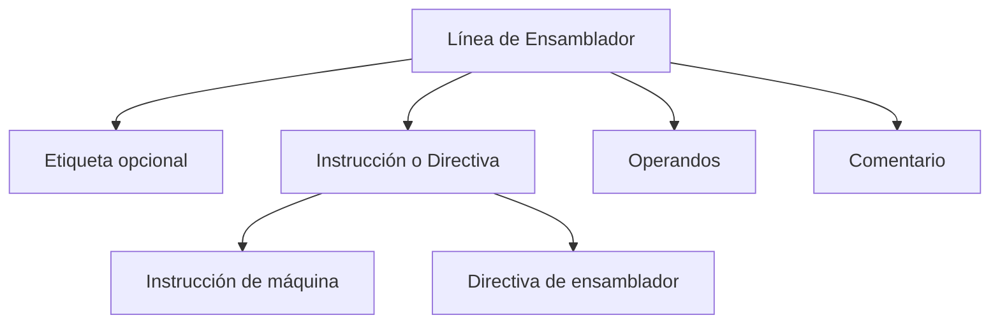
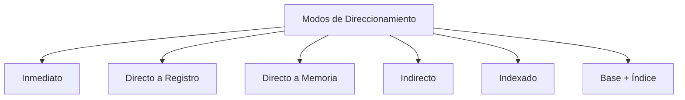

# Modelado y Programación - Emulación de máquinas virtuales

## 7.4 Definición del lenguaje ensamblador.

---

El **lenguaje ensamblador** es una representación simbólica de bajo nivel del código máquina que proporciona una interfaz más legible para los humanos mientras mantiene una correspondencia directa con las instrucciones del procesador.

### Definición Fundamental

,color:#000c
Un lenguaje ensamblador es **una notación simbólica que representa el código máquina de una arquitectura específica**, donde cada instrucción corresponde típicamente a una única operación del procesador.

$$ \text{Ensamblador} \xrightarrow{\text{ensamblador}} \text{Código máquina} \xrightarrow{\text{carga}} \text{Memoria} \xrightarrow{\text{ejecución}} \text{Resultados} $$

### Componentes de un Lenguaje Ensamblador

#### 1. Sintaxis Básica



**Estructura típica:**

```
[etiqueta:] mnemónico [operando1[, operando2[, ...]]] [; comentario]
```

#### 2. Elementos Principales

| Componente     | Descripción                              | Ejemplo                 |
| -------------- | ---------------------------------------- | ----------------------- |
| **Mnemonico**  | Nombre simbólico de la operación         | `ADD`, `MOV`, `JMP`     |
| **Operandos**  | Datos sobre los que opera la instrucción | `AX`, `42`, `[BX+SI]`   |
| **Etiquetas**  | Marcadores de posición para direcciones  | `loop:`, `start:`       |
| **Directivas** | Instrucciones para el ensamblador        | `.data`, `.equ`, `.org` |

### Diseño de un Lenguaje Ensamblador para VM

#### 1. Conjunto de Instrucciones Básico

```cpp
// Definición de opcodes para nuestra VM
enum Opcode {
    OP_NOP = 0x00,    // No operation
    OP_LOAD = 0x01,   // Carga de constante
    OP_MOV = 0x02,    // Movimiento entre registros
    OP_ADD = 0x03,    // Suma
    OP_SUB = 0x04,    // Resta
    OP_JMP = 0x05,    // Salto incondicional
    OP_JZ = 0x06,     // Salto si cero
    OP_CALL = 0x07,   // Llamada a subrutina
    OP_RET = 0x08,    // Retorno de subrutina
    OP_HALT = 0xFF    // Fin de ejecución
};
```

#### 2. Estructura de Instrucciones

**Formato general de instrucción:**

$$ \text{Instrucción} = \text{opcode} + \sum_{i=1}^{n} \text{operando}_i $$

**Campos de bits típicos:**

```
31       24 23       16 15        8 7         0
+----------+-----------+-----------+-----------+
|  opcode  |   reg1    |   reg2    |  reg3/im  |
+----------+-----------+-----------+-----------+
```

### Implementación de un Ensamblador Básico

#### 1. Clase Principal del Ensamblador

```cpp
class Assembler {
private:
    std::unordered_map<std::string, uint8_t> opcodeTable;
    std::unordered_map<std::string, uint16_t> symbolTable;
    std::vector<uint8_t> outputCode;
    uint16_t currentAddress;

public:
    Assembler() : currentAddress(0) {
        // Inicializar tabla de opcodes
        initializeOpcodes();
    }

    void initializeOpcodes() {
        opcodeTable["nop"] = OP_NOP;
        opcodeTable["load"] = OP_LOAD;
        opcodeTable["mov"] = OP_MOV;
        opcodeTable["add"] = OP_ADD;
        opcodeTable["sub"] = OP_SUB;
        opcodeTable["jmp"] = OP_JMP;
        opcodeTable["jz"] = OP_JZ;
        opcodeTable["call"] = OP_CALL;
        opcodeTable["ret"] = OP_RET;
        opcodeTable["halt"] = OP_HALT;
    }

    bool assemble(const std::string& sourceFile);
    bool parseLine(const std::string& line);
    void resolveSymbols();
};
```

#### 2. Analizador Léxico y Sintáctico

```cpp
struct Token {
    enum Type { LABEL, MNEMONIC, REGISTER, IMMEDIATE, DIRECTIVE, COMMENT };
    Type type;
    std::string value;
    uint16_t numericValue;
};

class Parser {
private:
    std::vector<Token> tokenize(const std::string& line) {
        std::vector<Token> tokens;
        std::istringstream stream(line);
        std::string token;

        while (stream >> token) {
            if (token.empty()) continue;

            Token t;
            if (token.back() == ':') {
                t.type = Token::LABEL;
                t.value = token.substr(0, token.size() - 1);
            } else if (token[0] == ';') {
                break; // Comentario, ignorar el resto
            } else if (token[0] == '.') {
                t.type = Token::DIRECTIVE;
                t.value = token;
            } else if (token[0] == 'R' && isdigit(token[1])) {
                t.type = Token::REGISTER;
                t.value = token;
                t.numericValue = std::stoi(token.substr(1));
            } else if (isdigit(token[0]) || token[0] == '-') {
                t.type = Token::IMMEDIATE;
                t.value = token;
                t.numericValue = std::stoi(token);
            } else {
                t.type = Token::MNEMONIC;
                t.value = token;
            }
            tokens.push_back(t);
        }
        return tokens;
    }
};
```

### Directivas de Ensamblador

#### 1. Directivas Comunes

```cpp
void handleDirective(const std::string& directive, const std::vector<Token>& operands) {
    if (directive == ".org") {
        currentAddress = operands[0].numericValue;
    } else if (directive == ".db") {
        for (const auto& op : operands) {
            outputCode.push_back(op.numericValue & 0xFF);
            currentAddress++;
        }
    } else if (directive == ".dw") {
        for (const auto& op : operands) {
            uint16_t value = op.numericValue;
            outputCode.push_back(value & 0xFF);
            outputCode.push_back((value >> 8) & 0xFF);
            currentAddress += 2;
        }
    } else if (directive == ".equ") {
        symbolTable[operands[0].value] = operands[1].numericValue;
    }
}
```

#### 2. Secciones de Datos y Código

```
; Sección de datos
.data
    buffer: .db 0, 0, 0, 0    ; 4 bytes inicializados a 0
    message: .db "Hola", 0    ; Cadena terminada en null
    value: .dw 0x1234         ; Word de 16 bits

; Sección de código
.code
    org 0x1000                ; Dirección de inicio
start:
    load R1, value           ; Cargar valor
    ; ... más código
```

### Sistema de Direccionamiento

#### 1. Modos de Direccionamiento



#### 2. Implementación de Modos de Direccionamiento

```cpp
uint16_t resolveOperand(const Token& token, uint16_t currentAddr) {
    switch (token.type) {
        case Token::IMMEDIATE:
            return token.numericValue;

        case Token::REGISTER:
            return token.numericValue; // Número de registro

        case Token::MNEMONIC: // Símbolo/etiqueta
            if (symbolTable.find(token.value) != symbolTable.end()) {
                return symbolTable[token.value];
            } else {
                // Etiqueta forward reference, dejar para resolver después
                return 0xFFFF; // Marcador temporal
            }

        default:
            throw AssemblerException("Operando no válido");
    }
}
```

### Ejemplos de Programas en Ensamblador

#### 1. Hola Mundo Básico

```
; Programa que muestra un mensaje
.org 0x1000

.data
    message: .db "Hola, mundo!", 0

.code
start:
    load R1, message    ; Cargar dirección del mensaje
    call print_string    ; Llamar a rutina de impresión
    halt

; Rutina de impresión
print_string:
    ; Implementación de impresión...
    ret
```

#### 2. Suma de Arreglo

```
; Suma los elementos de un arreglo
.org 0x2000

.data
    array: .dw 1, 2, 3, 4, 5
    length: .equ 5
    result: .dw 0

.code
start:
    load R1, array      ; Dirección del arreglo
    load R2, length     ; Longitud
    mov R3, 0           ; Acumulador
    mov R4, 0           ; Índice

loop:
    cmp R4, R2          ; ¿Fin del arreglo?
    jz done
    load R5, [R1+R4*2]  ; Cargar elemento (words de 2 bytes)
    add R3, R5          ; Sumar al acumulador
    inc R4              ; Siguiente elemento
    jmp loop

done:
    store result, R3    ; Guardar resultado
    halt
```

### Proceso de Ensamblaje de Dos Pasos

#### 1. Primer Paso: Análisis y Tabla de Símbolos

```cpp
void firstPass(const std::vector<std::string>& lines) {
    for (const auto& line : lines) {
        auto tokens = tokenize(line);
        if (tokens.empty()) continue;

        // Procesar etiquetas
        if (tokens[0].type == Token::LABEL) {
            symbolTable[tokens[0].value] = currentAddress;
            tokens.erase(tokens.begin());
        }

        // Procesar instrucciones/directivas
        if (!tokens.empty()) {
            if (tokens[0].type == Token::DIRECTIVE) {
                handleDirective(tokens[0].value,
                               std::vector<Token>(tokens.begin() + 1, tokens.end()));
            } else {
                currentAddress += instructionSize(tokens[0].value);
            }
        }
    }
}
```

#### 2. Segundo Paso: Generación de Código

```cpp
void secondPass(const std::vector<std::string>& lines) {
    currentAddress = 0;

    for (const auto& line : lines) {
        auto tokens = tokenize(line);
        if (tokens.empty()) continue;

        // Saltar etiquetas (ya procesadas)
        if (tokens[0].type == Token::LABEL) {
            tokens.erase(tokens.begin());
        }

        if (!tokens.empty()) {
            if (tokens[0].type == Token::DIRECTIVE) {
                handleDirective(tokens[0].value,
                               std::vector<Token>(tokens.begin() + 1, tokens.end()));
            } else {
                generateInstruction(tokens);
            }
        }
    }
}
```

### Macroensamblador

#### 1. Sistema de Macros

```cpp
class MacroProcessor {
private:
    std::unordered_map<std::string, std::vector<std::string>> macroTable;

public:
    void defineMacro(const std::string& name,
                    const std::vector<std::string>& parameters,
                    const std::vector<std::string>& body) {
        macroTable[name] = {body, parameters};
    }

    std::vector<std::string> expandMacro(const std::string& name,
                                        const std::vector<std::string>& arguments) {
        if (macroTable.find(name) == macroTable.end()) {
            throw AssemblerException("Macro no definida: " + name);
        }

        auto& macro = macroTable[name];
        std::vector<std::string> expanded;

        for (const auto& line : macro.body) {
            std::string expandedLine = line;
            for (size_t i = 0; i < macro.parameters.size(); ++i) {
                replaceAll(expandedLine, macro.parameters[i], arguments[i]);
            }
            expanded.push_back(expandedLine);
        }

        return expanded;
    }
};
```

#### 2. Ejemplo de Macros

```
; Definición de macro para push múltiple
.macro pushall
    push R1
    push R2
    push R3
    push R4
.endmacro

; Definición de macro con parámetros
.macro loadpair reg1, reg2, addr
    load reg1, [addr]
    load reg2, [addr+2]
.endmacro

; Uso de macros
.code
    pushall              ; Expande a múltiples push
    loadpair R1, R2, data ; Carga par de registros
```

### Ejercicios Propuestos

#### Ejercicio 1: Implementar un Ensamblador Básico

Implementa un ensamblador que soporte 10 instrucciones básicas y directivas simples.

**Requerimientos:**

- Soporte para etiquetas
- Directivas `.org`, `.db`, `.dw`
- Modos de direccionamiento inmediato y directo

```cpp
// Esqueleto de solución
class BasicAssembler {
public:
    void assemble(const std::string& input, const std::string& output) {
        // Implementar dos pasos de ensamblaje
    }

private:
    void firstPass(const std::vector<std::string>& lines);
    void secondPass(const std::vector<std::string>& lines);
};
```

#### Ejercicio 2: Traductor de Instrucciones

Crea un traductor que convierta entre diferentes sintaxis de ensamblador.

**Pseudocódigo:**

```
FUNCIÓN translate_instruction(instruction, source_syntax, target_syntax):
    SI source_syntax == target_syntax:
        RETORNAR instruction

    parsed = parse_instruction(instruction, source_syntax)
    translated = convert_syntax(parsed, target_syntax)
    RETORNAR format_instruction(translated, target_syntax)
```

#### Ejercicio 3: Optimizador de Código

Implementa un optimizador básico que elimine instrucciones redundantes.

```cpp
class CodeOptimizer {
public:
    std::vector<uint8_t> optimize(const std::vector<uint8_t>& code) {
        std::vector<uint8_t> optimized;
        size_t i = 0;

        while (i < code.size()) {
            uint8_t opcode = code[i];
            // Detectar patrones optimizables
            if (isRedundantSequence(code, i)) {
                i += skipRedundantCode(code, i);
            } else {
                optimized.push_back(code[i++]);
            }
        }
        return optimized;
    }

private:
    bool isRedundantSequence(const std::vector<uint8_t>& code, size_t pos);
    size_t skipRedundantCode(const std::vector<uint8_t>& code, size_t pos);
};
```

### Herramientas y Utilidades

#### 1. Desensamblador

```cpp
class Disassembler {
private:
    std::unordered_map<uint8_t, std::string> opcodeNames;
    std::unordered_map<uint16_t, std::string> symbolNames;

public:
    std::string disassembleInstruction(uint16_t address, const std::vector<uint8_t>& code) {
        uint8_t opcode = code[address];
        std::stringstream ss;

        ss << std::hex << std::setw(4) << std::setfill('0') << address << ": ";
        ss << opcodeNames[opcode] << " ";

        // Decodificar operandos según el opcode
        switch (opcode) {
            case OP_LOAD:
                ss << "R" << static_cast<int>(code[address+1]) << ", ";
                ss << "0x" << std::hex << (code[address+2] | (code[address+3] << 8));
                break;
            // ... más casos
        }

        return ss.str();
    }
};
```

#### 2. Linker Básico

```cpp
class Linker {
public:
    std::vector<uint8_t> link(const std::vector<ObjectFile>& objects,
                             uint16_t baseAddress) {
        std::vector<uint8_t> executable;
        std::unordered_map<std::string, uint16_t> globalSymbols;

        // Resolver símbolos externos
        resolveSymbols(objects, globalSymbols);

        // Combinar secciones
        for (const auto& obj : objects) {
            relocateCode(obj, baseAddress, globalSymbols);
            executable.insert(executable.end(),
                             obj.code.begin(), obj.code.end());
        }

        return executable;
    }
};
```

### Referencias y Bibliografía

1. **"The Art of Assembly Language"** - Randall Hyde
2. **"Computer Organization and Design"** - David A. Patterson & John L. Hennessy
3. **"Assemblers and Loaders"** - David Salomon
4. **"Linkers and Loaders"** - John R. Levine
5. **Intel® 64 and IA-32 Architectures Software Developer Manuals**

### Ejercicio Final: Suite de Herramientas de Ensamblaje

Desarrolla un conjunto completo de herramientas que incluya:

1. Ensamblador con soporte para macros
2. Desensamblador
3. Linker para múltiples módulos
4. Librería de rutinas estándar

**Criterios de evaluación:**

- Correcto ensamblaje de programas complejos
- Soporte para múltiples modos de direccionamiento
- Manejo adecuado de errores
- Documentación completa

### Conclusión

La definición de un lenguaje ensamblador es un paso crucial en el desarrollo de máquinas virtuales, ya que proporciona la interfaz entre el programador y el hardware virtualizado. Un diseño cuidadoso del conjunto de instrucciones, los modos de direccionamiento y las directivas del ensamblador es esencial para crear un sistema productivo y eficiente.

**Palabras clave:** Mnemónico, Opcode, Modo de Direccionamiento, Directiva, Macroensamblador, Tabla de Símbolos, Linker, Desensamblador.
