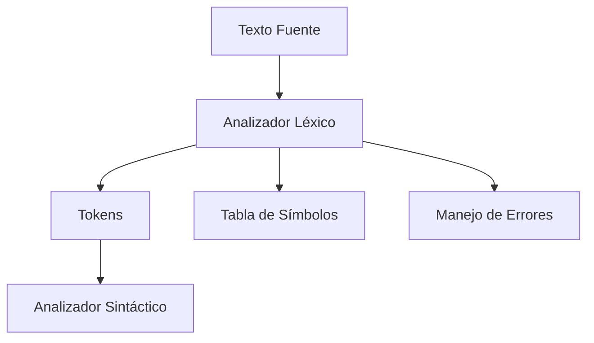
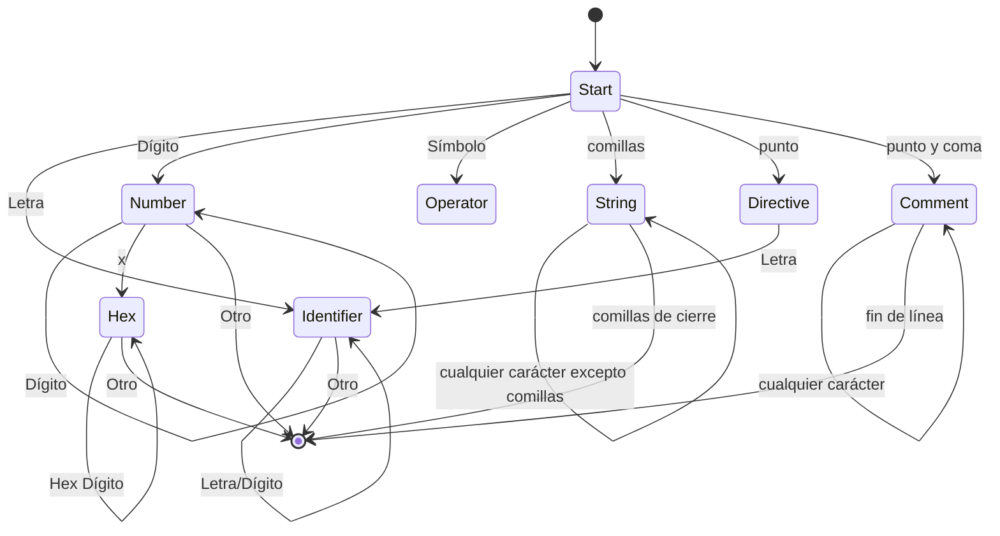

# Modelado y Programación - Emulación de máquinas virtuales

## 7.5 Construcción del analizador léxico.

---

El **analizador léxico** (lexer o scanner) es la primera fase en el proceso de compilación o ensamblaje, responsable de convertir el flujo de caracteres de entrada en tokens significativos que serán procesados por el analizador sintáctico.

### Definición Fundamental

Un analizador léxico es **un proceso que transforma una secuencia de caracteres en una secuencia de tokens**, donde cada token representa una unidad léxica significativa del lenguaje.

$$ \text{Lexer}: \Sigma^* \rightarrow \text{Token}^* $$

Donde $\Sigma$ es el alfabeto de entrada y $\text{Token}$ es el conjunto de tokens válidos.

Separar el análisis léxico del sintáctico simplifica ambos: el analizador sintáctico trabaja con unidades como `NÚMERO` o `IDENTIFICADOR` en lugar de caracteres sueltos, y no tiene que preocuparse por espacios, comentarios ni por cómo se escribe un número hexadecimal. Además, los tokens se describen con **expresiones regulares**, que se reconocen con autómatas finitos en tiempo lineal, mientras que la sintaxis necesita gramáticas libres de contexto.

Dos reglas resuelven las ambigüedades:

- **Coincidencia más larga** (*maximal munch*): se elige el lexema más largo posible. `loop1` es un identificador y no la palabra `loop` seguida del número `1`; `>=` es un operador y no `>` seguido de `=`.
- **Prioridad**: si dos patrones reconocen el mismo lexema más largo, gana el que se definió primero. Por eso las palabras reservadas se revisan antes que los identificadores: `load` coincide con ambos patrones y debe ser `KEYWORD`.

### Componentes del Analizador Léxico

#### 1. Arquitectura General



#### 2. Estructura de un Token

```cpp
struct Token {
    enum Type {
        IDENTIFIER,     // Identificadores y etiquetas
        KEYWORD,        // Palabras reservadas
        OPERATOR,       // Operadores
        PUNCTUATION,    // Signos de puntuación
        LITERAL_NUMBER, // Literales numéricos
        LITERAL_STRING, // Literales de cadena
        DIRECTIVE,      // Directivas del ensamblador
        COMMENT,        // Comentarios
        END_OF_FILE,    // Fin de archivo
        ERROR           // Token de error
    };

    Type type;
    std::string value;
    uint32_t line;
    uint32_t column;
    uint32_t numericValue; // Para literales numéricas
};
```

### Implementación del Analizador Léxico

#### 1. Clase Principal del Lexer

```cpp
class Lexer {
private:
    std::string source;
    size_t position;
    size_t line;
    size_t column;
    std::unordered_map<std::string, Token::Type> keywords;
    std::unordered_map<std::string, Token::Type> operators;
    SymbolTable& symbolTable;

public:
    Lexer(const std::string& src, SymbolTable& symTab)
        : source(src), position(0), line(1), column(1), symbolTable(symTab) {
        initializeKeywords();
        initializeOperators();
    }

    Token getNextToken();
    void skipWhitespace();
    void skipComment();

private:
    Token scanIdentifier();
    Token scanNumber();
    Token scanString();
    Token scanOperator();
    Token scanDirective();
};
```

#### 2. Inicialización de Tablas de Símbolos

```cpp
void Lexer::initializeKeywords() {
    keywords = {
        {"load", Token::KEYWORD},
        {"store", Token::KEYWORD},
        {"add", Token::KEYWORD},
        {"sub", Token::KEYWORD},
        {"jmp", Token::KEYWORD},
        {"jz", Token::KEYWORD},
        {"call", Token::KEYWORD},
        {"ret", Token::KEYWORD},
        {"halt", Token::KEYWORD},
        {"mov", Token::KEYWORD},
        {"cmp", Token::KEYWORD},
        {"push", Token::KEYWORD},
        {"pop", Token::KEYWORD}
    };
}

void Lexer::initializeOperators() {
    operators = {
        {"+", Token::OPERATOR},
        {"-", Token::OPERATOR},
        {"*", Token::OPERATOR},
        {"/", Token::OPERATOR},
        {"=", Token::OPERATOR},
        {"[", Token::PUNCTUATION},
        {"]", Token::PUNCTUATION},
        {",", Token::PUNCTUATION},
        {":", Token::PUNCTUATION}
    };
}
```

### Algoritmo Principal de Análisis Léxico

#### 1. Máquina de Estados Finitos



Cada estado final del autómata corresponde a un tipo de token. El lexer avanza mientras haya una transición posible; cuando ninguna aplica, el token termina en el último estado de aceptación visitado, lo que implementa la regla de la coincidencia más larga. En la práctica, cada estado se programa como un ciclo `while` dentro de una función de escaneo, como en las funciones siguientes.

#### 2. Implementación del Algoritmo Principal

```cpp
Token Lexer::getNextToken() {
    // Saltar espacios en blanco y comentarios
    skipWhitespace();
    if (position >= source.length()) {
        return Token{Token::END_OF_FILE, "", line, column};
    }

    char current = source[position];

    // Identificadores y palabras clave
    if (isalpha(current) || current == '_') {
        return scanIdentifier();
    }

    // Números
    if (isdigit(current)) {
        return scanNumber();
    }

    // Strings
    if (current == '"') {
        return scanString();
    }

    // Directivas
    if (current == '.') {
        return scanDirective();
    }

    // Comentarios
    if (current == ';') {
        skipComment();
        return getNextToken(); // Obtener siguiente token después del comentario
    }

    // Operadores y puntuación
    if (ispunct(current)) {
        return scanOperator();
    }

    // Carácter no reconocido
    return Token{Token::ERROR, std::string(1, current), line, column};
}
```

### Funciones de Escaneo Específicas

#### 1. Escaneo de Identificadores

```cpp
Token Lexer::scanIdentifier() {
    size_t start = position;
    size_t startLine = line;
    size_t startColumn = column;

    while (position < source.length() &&
           (isalnum(source[position]) || source[position] == '_')) {
        advance();
    }

    std::string value = source.substr(start, position - start);

    // Verificar si es palabra clave
    auto it = keywords.find(value);
    if (it != keywords.end()) {
        return Token{it->second, value, startLine, startColumn};
    }

    // Es un identificador regular
    return Token{Token::IDENTIFIER, value, startLine, startColumn};
}
```

#### 2. Escaneo de Números

```cpp
Token Lexer::scanNumber() {
    size_t start = position;
    size_t startLine = line;
    size_t startColumn = column;

    bool isHex = false;

    // Prefijo hexadecimal "0x": hay que detectarlo ANTES del ciclo, porque
    // 'x' no es un dígito y el ciclo se detendría en ella
    if (source[position] == '0' && position + 1 < source.length() &&
        tolower(source[position + 1]) == 'x') {
        isHex = true;
        advance();
        advance();
    }

    // Escanear dígitos
    while (position < source.length() &&
           (isHex ? isxdigit(source[position]) : isdigit(source[position]))) {
        advance();
    }

    std::string valueStr = source.substr(start, position - start);
    uint32_t value;

    try {
        // stoul con base 16 acepta el prefijo 0x; "0x" sin dígitos lanza una excepción
        value = std::stoul(valueStr, nullptr, isHex ? 16 : 10);
    } catch (const std::exception&) {
        return Token{Token::ERROR, valueStr, startLine, startColumn};
    }

    Token token{Token::LITERAL_NUMBER, valueStr, startLine, startColumn};
    token.numericValue = value;
    return token;
}
```

#### 3. Escaneo de Strings y Operadores

```cpp
Token Lexer::scanString() {
    size_t start = position;
    size_t startLine = line;
    size_t startColumn = column;

    advance(); // Saltar la comilla inicial
    std::string value;

    while (position < source.length() && source[position] != '"') {
        // Manejar caracteres de escape
        if (source[position] == '\\') {
            advance();
            switch (source[position]) {
                case 'n': value += '\n'; break;
                case 't': value += '\t'; break;
                case '"': value += '"'; break;
                case '\\': value += '\\'; break;
                default: value += '\\'; value += source[position]; break;
            }
        } else {
            value += source[position];
        }
        advance();
    }

    if (position >= source.length() || source[position] != '"') {
        return Token{Token::ERROR, "Unterminated string", startLine, startColumn};
    }

    advance(); // Saltar la comilla final
    return Token{Token::LITERAL_STRING, value, startLine, startColumn};
}

Token Lexer::scanOperator() {
    size_t start = position;
    size_t startLine = line;
    size_t startColumn = column;

    std::string op(1, source[position]);
    advance();

    // Verificar operadores de múltiples caracteres
    if (position < source.length()) {
        std::string potentialOp = op + source[position];
        if (operators.find(potentialOp) != operators.end()) {
            op = potentialOp;
            advance();
        }
    }

    auto it = operators.find(op);
    if (it != operators.end()) {
        return Token{it->second, op, startLine, startColumn};
    }

    return Token{Token::ERROR, op, startLine, startColumn};
}
```

### Manejo de Errores Léxicos

#### 1. Sistema de Reporte de Errores

```cpp
class LexicalError : public std::exception {
private:
    std::string message;
    uint32_t errorLine;
    uint32_t errorColumn;

public:
    LexicalError(const std::string& msg, uint32_t ln, uint32_t col)
        : message(msg), errorLine(ln), errorColumn(col) {}

    const char* what() const noexcept override {
        return message.c_str();
    }

    std::string getFullMessage() const {
        return "Error léxico en línea " + std::to_string(errorLine) +
               ", columna " + std::to_string(errorColumn) + ": " + message;
    }
};
```

#### 2. Recuperación de Errores

Hay dos estrategias para un error léxico: **detenerse** en el primer error, lo más simple; o **reportarlo y seguir** (modo pánico), saltando caracteres hasta un punto seguro, como un espacio o un fin de línea, para encontrar más errores en una sola pasada. El segundo es más útil para el programador, pero debe evitar reportar errores en cascada causados por el primero.

```cpp
Token Lexer::getNextToken() {
    try {
        // ... lógica normal de escaneo
    } catch (const LexicalError& error) {
        // Estrategia de recuperación: saltar hasta el próximo token válido
        while (position < source.length() &&
               !isspace(source[position]) &&
               !isalnum(source[position])) {
            advance();
        }
        // Reportar error y continuar
        std::cerr << error.getFullMessage() << std::endl;
        return getNextToken();
    }
}
```

### Optimizaciones del Analizador Léxico

#### 1. Lookahead y Buffering

```cpp
class BufferedLexer {
private:
    std::istream& input;
    std::vector<Token> tokenBuffer;
    size_t bufferIndex;
    static const size_t BUFFER_SIZE = 1024;

    void fillBuffer() {
        tokenBuffer.clear();
        for (size_t i = 0; i < BUFFER_SIZE; ++i) {
            Token token = readNextToken();
            if (token.type == Token::END_OF_FILE) break;
            tokenBuffer.push_back(token);
        }
        bufferIndex = 0;
    }

public:
    Token peekToken(size_t lookahead = 0) {
        if (bufferIndex + lookahead >= tokenBuffer.size()) {
            fillBuffer();
        }
        return tokenBuffer[bufferIndex + lookahead];
    }

    Token consumeToken() {
        Token token = peekToken();
        bufferIndex++;
        return token;
    }
};
```

#### 2. Expresiones Regulares para Tokenización

**Definiciones regulares para tokens:**

El **analizador léxico (scanner)** toma el **programa fuente** y lo divide en **tokens**, que son las unidades léxicas mínimas significativas para el analizador sintáctico.

Un **token** está formado por:

- **Tipo de token (categoría léxica):** palabra reservada, identificador, número, operador, etc.
- **Lexema:** la cadena de caracteres específica en el código.
- **Patrón:** expresión regular que describe cómo reconocer dicho token.

Usamos **expresiones regulares (ER)** para definir tokens. Ejemplos:

- **Identificadores:**

$$ ID = [a\text{-}zA\text{-}Z][a\text{-}zA\text{-}Z0\text{-}9]^* $$

Ejemplo de lexemas válidos: `x`, `var1`, `totalSuma`.

- **Números enteros:**

$$ NUM = [0-9]+ $$

Ejemplo: `0`, `12345`.

- **Números reales (flotantes):**

$$ REAL = [0\text{-}9]^+ \, \backslash. \, [0\text{-}9]^+ $$

El punto se escapa porque, sin escape, en una expresión regular significa "cualquier carácter".

Ejemplo: `3.14`, `0.001`.

- **Operadores aritméticos:**

$$ OP\_ARIT = [+\backslash\text{-}*/] $$

El guion se escapa porque, entre corchetes, `+-*` se interpretaría como el **rango** de caracteres entre `+` y `*`.

Ejemplo: `+`, `-`, `*`, `/`.

- **Paréntesis:**

$$ LPAREN = ( \quad\quad RPAREN = ) $$

Ejemplo: `(` y `)`.

- **Palabras reservadas (ejemplo en un lenguaje simple):**

```text
if, else, while, return
```

Estas suelen definirse como tokens fijos (no con ER genérica, sino como coincidencias exactas).

#### Tabla de Tokens de Ejemplo

| Token      | Definición Regular     | Ejemplo    |
| ---------- | ---------------------- | ---------- |
| `ID`       | `[a-zA-Z][a-zA-Z0-9]*` | `contador` |
| `NUM`      | `[0-9]+`               | `123`      |
| `REAL`     | `[0-9]+\.[0-9]+`       | `3.1416`   |
| `OP_ARIT`  | `[+\-*/]`              | `+`        |
| `LPAREN`   | `\(`                   | `(`        |
| `RPAREN`   | `\)`                   | `)`        |
| `KW_IF`    | `if`                   | `if`       |
| `KW_WHILE` | `while`                | `while`    |

#### Tokenización de una Expresión

Dada la expresión:

```text
x + 23 * (y - 5)
```

La secuencia de tokens sería:

```text
ID(x), OP_ARIT(+), NUM(23), OP_ARIT(*), LPAREN(()), ID(y), OP_ARIT(-), NUM(5), RPAREN())
```

### Integración con la Tabla de Símbolos

#### 1. Gestión de Símbolos durante el Análisis Léxico

```cpp
class SymbolTable {
public:
    struct SymbolEntry {
        std::string name;
        uint32_t value;
        uint32_t lineDefined;
        bool isDefined;
        bool isExternal;
    };

private:
    std::unordered_map<std::string, SymbolEntry> symbols;   // SymbolEntry ya está declarado

public:
    bool addSymbol(const std::string& name, uint32_t value, uint32_t line, bool isExternal = false) {
        if (symbols.find(name) != symbols.end()) {
            return false; // Símbolo ya existe
        }
        symbols[name] = {name, value, line, true, isExternal};
        return true;
    }

    std::optional<SymbolEntry> lookup(const std::string& name) {
        auto it = symbols.find(name);
        if (it != symbols.end()) {
            return it->second;
        }
        return std::nullopt;
    }
};
```

Conviene que el lexer solo **reconozca** identificadores y que sea el ensamblador quien decida si son definiciones de etiquetas (seguidos de `:`) o usos; así la tabla de símbolos se llena con el número de línea correcto y el lexer queda independiente del significado de los tokens.

### Ejercicios Propuestos

#### Ejercicio 1: Implementar un Lexer Completo

Implementa un analizador léxico para el lenguaje ensamblador de la máquina virtual.

**Requerimientos:**

- Soporte para todos los tipos de tokens definidos
- Manejo de errores robusto
- Integración con tabla de símbolos

**Solución.** Un lexer completo y autocontenido para el ensamblador de la VM, con números decimales y hexadecimales, cadenas con escapes, directivas, registros, palabras reservadas, posición de cada token y recuperación de errores:

```cpp
#include <cassert>
#include <cctype>
#include <iostream>
#include <set>
#include <string>
#include <vector>

struct Tok {
    enum Type { IDENT, KEYWORD, REGISTER, NUMBER, STRING, DIRECTIVE, PUNCT, NEWLINE, END, ERROR };
    Type type; std::string text; long value; int line, col;
};

class VMLexer {
    std::string src; size_t pos = 0; int line = 1, col = 1;
    const std::set<std::string> keywords = {"load", "store", "add", "sub", "jmp", "jz", "call",
                                            "ret", "halt", "loadm", "subm", "print"};
    char peek(size_t k = 0) const { return pos + k < src.size() ? src[pos + k] : '\0'; }
    char advance() { char c = src[pos++]; if (c == '\n') { ++line; col = 1; } else ++col; return c; }
public:
    std::vector<std::string> errors;
    explicit VMLexer(std::string s) : src(std::move(s)) {}

    Tok next() {
        while (peek() == ' ' || peek() == '\t' || peek() == '\r') advance();
        if (peek() == ';') while (peek() && peek() != '\n') advance();     // comentario
        int l = line, c = col;
        if (!peek()) return {Tok::END, "", 0, l, c};
        if (peek() == '\n') { advance(); return {Tok::NEWLINE, "\\n", 0, l, c}; }

        size_t start = pos;
        if (isalpha(peek()) || peek() == '_' || peek() == '.') {          // identificadores, directivas
            bool directive = peek() == '.';
            advance();
            while (isalnum(peek()) || peek() == '_') advance();
            std::string w = src.substr(start, pos - start);
            if (directive) return {Tok::DIRECTIVE, w, 0, l, c};
            if (keywords.count(w)) return {Tok::KEYWORD, w, 0, l, c};
            if ((w[0] == 'R' || w[0] == 'r') && w.size() > 1 &&
                w.find_first_not_of("0123456789", 1) == std::string::npos)
                return {Tok::REGISTER, w, std::stol(w.substr(1)), l, c};
            return {Tok::IDENT, w, 0, l, c};
        }
        if (isdigit(peek()) || (peek() == '-' && isdigit(peek(1)))) {   // números
            if (peek() == '-') advance();
            bool hex = peek() == '0' && (peek(1) == 'x' || peek(1) == 'X');
            if (hex) { advance(); advance(); }
            while (hex ? isxdigit(peek()) : isdigit(peek())) advance();
            std::string t = src.substr(start, pos - start);
            if (isalpha(peek()) || (hex && t.size() <= 2)) {                // 12abc o 0x sin dígitos
                while (isalnum(peek())) advance();
                t = src.substr(start, pos - start);
                errors.push_back("línea " + std::to_string(l) + ", col " + std::to_string(c) + ": número mal formado '" + t + "'");
                return {Tok::ERROR, t, 0, l, c};
            }
            return {Tok::NUMBER, t, std::stol(t, nullptr, 0), l, c};
        }
        if (peek() == '"') {                                              // cadenas
            advance();
            std::string v;
            while (peek() && peek() != '"' && peek() != '\n') {
                char ch = advance();
                if (ch == '\\') { char e = advance(); v += e == 'n' ? '\n' : e == 't' ? '\t' : e; }
                else v += ch;
            }
            if (peek() != '"') {
                errors.push_back("línea " + std::to_string(l) + ": cadena sin cerrar");
                return {Tok::ERROR, v, 0, l, c};
            }
            advance();
            return {Tok::STRING, v, 0, l, c};
        }
        if (std::string(",:[]+").find(peek()) != std::string::npos) {
            std::string p(1, advance());
            return {Tok::PUNCT, p, 0, l, c};
        }
        std::string bad(1, advance());                                   // recuperación: saltar el carácter
        errors.push_back("línea " + std::to_string(l) + ", col " + std::to_string(c) + ": carácter inesperado '" + bad + "'");
        return {Tok::ERROR, bad, 0, l, c};
    }

    std::vector<Tok> all() {
        std::vector<Tok> v;
        for (Tok t = next(); ; t = next()) { v.push_back(t); if (t.type == Tok::END) break; }
        return v;
    }
};

const char* nombre(Tok::Type t) {
    static const char* n[] = {"IDENT", "KEYWORD", "REGISTER", "NUMBER", "STRING", "DIRECTIVE",
                              "PUNCT", "NEWLINE", "END", "ERROR"};
    return n[t];
}

int main() {
    VMLexer lx("loop: load 0x1F   ; comentario\n  jz fin\n.db \"Hola\\n\", -3, R7\n");
    for (const Tok& t : lx.all())
        if (t.type != Tok::NEWLINE)
            std::cout << t.line << ":" << t.col << " " << nombre(t.type) << " '" << t.text << "'"
                      << (t.type == Tok::NUMBER || t.type == Tok::REGISTER ? " = " + std::to_string(t.value) : "") << "\n";

    // Pruebas, incluidos casos límite
    assert(VMLexer("0x").all()[0].type == Tok::ERROR);
    assert(VMLexer("12abc").all()[0].type == Tok::ERROR);
    assert(VMLexer("loop1").all()[0].type == Tok::IDENT);        // coincidencia más larga
    VMLexer conError("load @ 5");
    auto toks = conError.all();
    assert(toks[1].type == Tok::ERROR && toks[2].value == 5);    // se recupera y sigue
    std::cout << conError.errors[0] << "\n";
    std::cout << "pruebas superadas\n";
}
```

La recuperación de errores es mínima pero efectiva: un carácter inesperado produce un token `ERROR`, se registra el mensaje con su posición y el análisis continúa con el carácter siguiente, así que se pueden reportar todos los errores de un archivo en una sola pasada.

#### Ejercicio 2: Analizador Léxico con Expresiones Regulares

Implementa un lexer usando expresiones regulares para la identificación de tokens.

```cpp
class RegexLexer {
private:
    std::vector<std::pair<std::regex, Token::Type>> tokenPatterns;

public:
    RegexLexer() {
        tokenPatterns = {
            {std::regex(R"([a-zA-Z_][a-zA-Z0-9_]*)"), Token::IDENTIFIER},
            {std::regex(R"([0-9]+)"), Token::LITERAL_NUMBER},
            {std::regex(R"(0[xX][0-9a-fA-F]+)"), Token::LITERAL_NUMBER},
            {std::regex(R"("([^"\\]|\\.)*")"), Token::LITERAL_STRING},
            {std::regex(R"(\.[a-zA-Z_][a-zA-Z0-9_]*)"), Token::DIRECTIVE},
            {std::regex(R"(;[^\n]*)"), Token::COMMENT},
            // ... más patrones
        };
    }

    Token getNextToken() {
        // Implementar matching con expresiones regulares
    }
};
```

**Solución.** En cada posición se prueban todos los patrones **anclados** al punto actual y se elige la coincidencia más larga; en caso de empate, gana el patrón que aparece primero en la lista. Por eso el patrón hexadecimal debe probarse junto con el decimal: si solo se tomara el primero que coincide, `0x1F` se partiría en `0` y `x1F`.

```cpp
#include <iostream>
#include <regex>
#include <string>
#include <utility>
#include <vector>

int main() {
    const std::vector<std::pair<std::string, std::regex>> patrones = {
        {"ESPACIO",   std::regex(R"([ \t]+)")},
        {"COMENTARIO",std::regex(R"(;[^\n]*)")},
        {"KEYWORD",   std::regex(R"((load|store|add|sub|jmp|jz|halt)\b)")},
        {"DIRECTIVA", std::regex(R"(\.[a-zA-Z_][a-zA-Z0-9_]*)")},
        {"IDENT",     std::regex(R"([a-zA-Z_][a-zA-Z0-9_]*)")},
        {"HEX",       std::regex(R"(0[xX][0-9a-fA-F]+)")},
        {"NUM",       std::regex(R"([0-9]+)")},
        {"CADENA",    std::regex(R"("([^"\\]|\\.)*")")},
        {"PUNCT",     std::regex(R"([,:\[\]])")},
        {"NEWLINE",   std::regex(R"(\n)")},
    };
    std::string src = "inicio: load 0x1F ; carga\n  jz inicio\n";
    size_t pos = 0;
    while (pos < src.size()) {
        std::string mejorTipo; size_t mejorLong = 0;
        for (const auto& [tipo, re] : patrones) {
            std::smatch m;
            auto desde = src.cbegin() + pos;
            if (std::regex_search(desde, src.cend(), m, re, std::regex_constants::match_continuous)
                && size_t(m.length(0)) > mejorLong) {       // la más larga; en empate, la primera
                mejorTipo = tipo; mejorLong = m.length(0);
            }
        }
        if (mejorLong == 0) { std::cout << "error en " << pos << "\n"; ++pos; continue; }
        if (mejorTipo != "ESPACIO" && mejorTipo != "COMENTARIO" && mejorTipo != "NEWLINE")
            std::cout << mejorTipo << "(" << src.substr(pos, mejorLong) << ") ";
        pos += mejorLong;
    }
    std::cout << "\n";
    // IDENT(inicio) PUNCT(:) KEYWORD(load) HEX(0x1F) KEYWORD(jz) IDENT(inicio)
}
```

Es fácil de escribir y de modificar, pero lento: en cada posición se prueban todos los patrones con el motor de expresiones regulares. Los generadores de lexers resuelven eso compilando todos los patrones en un solo autómata (ejercicio 3).

#### Ejercicio 3: Generador de Lexers

Crea un generador de analizadores léxicos similar a Lex/Flex.

**Pseudocódigo:**

```text
FUNCIÓN generar_lexer(especificaciones_lexicas):
    CREAR archivo de salida
    ESCRIBIR encabezado
    PARA cada especificación de token:
        ESCRIBIR código de reconocimiento
    ESCRIBIR funciones auxiliares
    ESCRIBIR pie de archivo
    RETORNAR archivo generado
```

**Solución.** Lo que hace Lex/Flex en el paso "código de reconocimiento" es convertir las expresiones regulares en **un solo autómata finito determinista**:

1. Cada expresión regular se convierte en un AFN con la **construcción de Thompson**: un fragmento de autómata por cada operador (concatenación, unión, estrella de Kleene) unidos con transiciones $\varepsilon.$
2. Los AFN de todos los tokens se unen con un nuevo estado inicial con transiciones $\varepsilon$ a cada uno; cada estado final se etiqueta con su token y su prioridad (el orden en la especificación).
3. La **construcción de subconjuntos** convierte el AFN en un AFD: cada estado del AFD es el conjunto de estados del AFN alcanzables con la misma entrada. Si un estado del AFD contiene varios estados finales, se etiqueta con el token de mayor prioridad.
4. Se **minimiza** el AFD (algoritmo de Hopcroft) y se escribe como una tabla `transicion[estado][caracter]` más una tabla de estados de aceptación.

El código generado es un ciclo genérico que no depende del lenguaje: avanza por la tabla carácter por carácter, recuerda el último estado de aceptación visitado y su posición, y cuando no hay transición regresa a esa posición y emite el token correspondiente. Así se reconoce cualquier conjunto de tokens en tiempo lineal en el tamaño de la entrada, con una sola consulta a la tabla por carácter. Construir el AFD puede ser costoso, porque en el peor caso tiene un número exponencial de estados, pero se hace una sola vez, al generar el lexer.

### Pruebas y Verificación

#### 1. Suite de Pruebas para el Lexer

```cpp
class LexerTestSuite {
public:
    static void runAllTests() {
        testIdentifierRecognition();
        testNumberRecognition();
        testStringRecognition();
        testErrorHandling();
        testKeywordRecognition();
    }

    static void testIdentifierRecognition() {
        SymbolTable symTab;
        Lexer lexer("test_label mov R1", symTab);

        Token t1 = lexer.getNextToken();
        assert(t1.type == Token::IDENTIFIER);
        assert(t1.value == "test_label");

        Token t2 = lexer.getNextToken();
        assert(t2.type == Token::KEYWORD);
        assert(t2.value == "mov");
    }

    // ... más tests
};
```

#### 2. Medición de Performance

```cpp
class LexerBenchmark {
public:
    static double benchmarkLexing(const std::string& source, size_t iterations) {
        SymbolTable symTab;
        auto start = std::chrono::high_resolution_clock::now();

        for (size_t i = 0; i < iterations; ++i) {
            Lexer lexer(source, symTab);
            while (lexer.getNextToken().type != Token::END_OF_FILE) {}
        }

        auto end = std::chrono::high_resolution_clock::now();
        return std::chrono::duration<double>(end - start).count();
    }
};
```

### Referencias y Bibliografía

1. **"Compilers: Principles, Techniques, and Tools"** - Alfred V. Aho, Monica S. Lam, Ravi Sethi, Jeffrey D. Ullman (Dragon Book)
2. **"Modern Compiler Implementation in C"** - Andrew W. Appel
3. **"Flex & Bison"** - John Levine
4. **"Engineering a Compiler"** - Keith D. Cooper and Linda Torczon
5. **"Introduction to Automata Theory, Languages, and Computation"** - John E. Hopcroft, Rajeev Motwani, Jeffrey D. Ullman

### Ejercicio Final: Lexer para Ensamblador de VM

Desarrolla un analizador léxico completo para el lenguaje ensamblador de la máquina virtual que incluya:

1. Reconocimiento de todos los tipos de tokens
2. Manejo robusto de errores con recuperación
3. Soporte para diferentes bases numéricas
4. Integración con tabla de símbolos
5. Suite completa de pruebas

**Criterios de evaluación:**

- Correcto reconocimiento de todos los tokens
- Manejo adecuado de casos límite
- Eficiencia en el análisis
- Calidad del código y documentación

### Conclusión

El analizador léxico es un componente fundamental en el proceso de ensamblaje para máquinas virtuales. Su correcta implementación asegura que el código fuente sea transformado adecuadamente en tokens que puedan ser procesados por las etapas posteriores del ensamblador. Un diseño robusto del lexer contribuye significativamente a la calidad y confiabilidad de todo el sistema de desarrollo para la máquina virtual.

**Palabras clave:** Token, Analizador Léxico, Autómata Finito, Expresiones Regulares, Tabla de Símbolos, Manejo de Errores, Lookahead.
