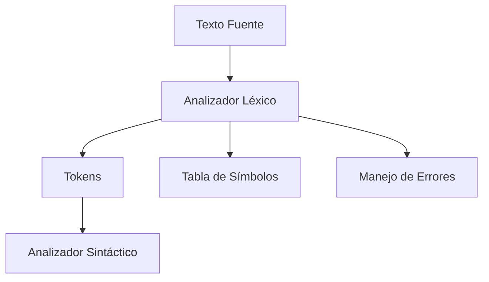
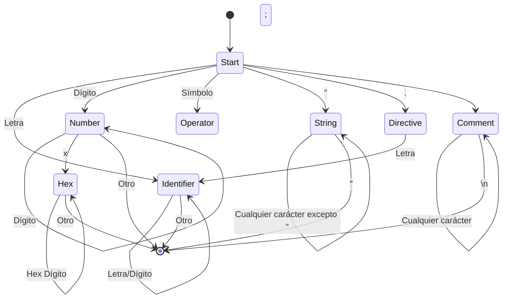

# Modelado y Programación - Emulación de máquinas virtuales

## 7.5 Construcción del analizador léxico.

---

El **analizador léxico** (lexer o scanner) es la primera fase en el proceso de compilación o ensamblaje, responsable de convertir el flujo de caracteres de entrada en tokens significativos que serán procesados por el analizador sintáctico.

### Definición Fundamental

Un analizador léxico es **un proceso que transforma una secuencia de caracteres en una secuencia de tokens**, donde cada token representa una unidad léxica significativa del lenguaje.

$$ \text{Lexer}: \Sigma^* \rightarrow \text{Token}^* $$

Donde $\Sigma$ es el alfabeto de entrada y $\text{Token}$ es el conjunto de tokens válidos.

### Componentes del Analizador Léxico

#### 1. Arquitectura General



#### 2. Estructura de un Token

```cpp
struct Token {
    enum Type {
        IDENTIFIER,     // Identificadores y etiquetas
        KEYWORD,        // Palabras reservadas
        OPERATOR,       // Operadores
        PUNCTUATION,    // Signos de puntuación
        LITERAL_NUMBER, // Literales numéricos
        LITERAL_STRING, // Literales de cadena
        DIRECTIVE,      // Directivas del ensamblador
        COMMENT,        // Comentarios
        END_OF_FILE,    // Fin de archivo
        ERROR           // Token de error
    };

    Type type;
    std::string value;
    uint32_t line;
    uint32_t column;
    uint32_t numericValue; // Para literales numéricas
};
```

### Implementación del Analizador Léxico

#### 1. Clase Principal del Lexer

```cpp
class Lexer {
private:
    std::string source;
    size_t position;
    size_t line;
    size_t column;
    std::unordered_map<std::string, Token::Type> keywords;
    std::unordered_map<std::string, Token::Type> operators;
    SymbolTable& symbolTable;

public:
    Lexer(const std::string& src, SymbolTable& symTab)
        : source(src), position(0), line(1), column(1), symbolTable(symTab) {
        initializeKeywords();
        initializeOperators();
    }

    Token getNextToken();
    void skipWhitespace();
    void skipComment();

private:
    Token scanIdentifier();
    Token scanNumber();
    Token scanString();
    Token scanOperator();
    Token scanDirective();
};
```

#### 2. Inicialización de Tablas de Símbolos

```cpp
void Lexer::initializeKeywords() {
    keywords = {
        {"load", Token::KEYWORD},
        {"store", Token::KEYWORD},
        {"add", Token::KEYWORD},
        {"sub", Token::KEYWORD},
        {"jmp", Token::KEYWORD},
        {"jz", Token::KEYWORD},
        {"call", Token::KEYWORD},
        {"ret", Token::KEYWORD},
        {"halt", Token::KEYWORD},
        {"mov", Token::KEYWORD},
        {"cmp", Token::KEYWORD},
        {"push", Token::KEYWORD},
        {"pop", Token::KEYWORD}
    };
}

void Lexer::initializeOperators() {
    operators = {
        {"+", Token::OPERATOR},
        {"-", Token::OPERATOR},
        {"*", Token::OPERATOR},
        {"/", Token::OPERATOR},
        {"=", Token::OPERATOR},
        {"[", Token::PUNCTUATION},
        {"]", Token::PUNCTUATION},
        {",", Token::PUNCTUATION},
        {":", Token::PUNCTUATION}
    };
}
```

### Algoritmo Principal de Análisis Léxico

#### 1. Máquina de Estados Finitos



#### 2. Implementación del Algoritmo Principal

```cpp
Token Lexer::getNextToken() {
    // Saltar espacios en blanco y comentarios
    skipWhitespace();
    if (position >= source.length()) {
        return Token{Token::END_OF_FILE, "", line, column};
    }

    char current = source[position];

    // Identificadores y palabras clave
    if (isalpha(current) || current == '_') {
        return scanIdentifier();
    }

    // Números
    if (isdigit(current)) {
        return scanNumber();
    }

    // Strings
    if (current == '"') {
        return scanString();
    }

    // Directivas
    if (current == '.') {
        return scanDirective();
    }

    // Comentarios
    if (current == ';') {
        skipComment();
        return getNextToken(); // Obtener siguiente token después del comentario
    }

    // Operadores y puntuación
    if (ispunct(current)) {
        return scanOperator();
    }

    // Carácter no reconocido
    return Token{Token::ERROR, std::string(1, current), line, column};
}
```

### Funciones de Escaneo Específicas

#### 1. Escaneo de Identificadores

```cpp
Token Lexer::scanIdentifier() {
    size_t start = position;
    size_t startLine = line;
    size_t startColumn = column;

    while (position < source.length() &&
           (isalnum(source[position]) || source[position] == '_')) {
        advance();
    }

    std::string value = source.substr(start, position - start);

    // Verificar si es palabra clave
    auto it = keywords.find(value);
    if (it != keywords.end()) {
        return Token{it->second, value, startLine, startColumn};
    }

    // Es un identificador regular
    return Token{Token::IDENTIFIER, value, startLine, startColumn};
}
```

#### 2. Escaneo de Números

```cpp
Token Lexer::scanNumber() {
    size_t start = position;
    size_t startLine = line;
    size_t startColumn = column;

    uint32_t base = 10;
    bool isHex = false;

    // Escanear dígitos enteros
    while (position < source.length() &&
           (isdigit(source[position]) ||
            (isHex && isxdigit(source[position])))) {

        // Detectar prefijo hexadecimal
        if (position == start + 1 && source[start] == '0' &&
            tolower(source[position]) == 'x') {
            isHex = true;
            base = 16;
        }

        advance();
    }

    std::string valueStr = source.substr(start, position - start);
    uint32_t value;

    try {
        if (isHex) {
            value = std::stoul(valueStr, nullptr, 16);
        } else {
            value = std::stoul(valueStr, nullptr, 10);
        }
    } catch (const std::exception&) {
        return Token{Token::ERROR, valueStr, startLine, startColumn};
    }

    Token token{Token::LITERAL_NUMBER, valueStr, startLine, startColumn};
    token.numericValue = value;
    return token;
}
```

#### 3. Escaneo de Strings y Operadores

```cpp
Token Lexer::scanString() {
    size_t start = position;
    size_t startLine = line;
    size_t startColumn = column;

    advance(); // Saltar la comilla inicial
    std::string value;

    while (position < source.length() && source[position] != '"') {
        // Manejar caracteres de escape
        if (source[position] == '\\') {
            advance();
            switch (source[position]) {
                case 'n': value += '\n'; break;
                case 't': value += '\t'; break;
                case '"': value += '"'; break;
                case '\\': value += '\\'; break;
                default: value += '\\'; value += source[position]; break;
            }
        } else {
            value += source[position];
        }
        advance();
    }

    if (position >= source.length() || source[position] != '"') {
        return Token{Token::ERROR, "Unterminated string", startLine, startColumn};
    }

    advance(); // Saltar la comilla final
    return Token{Token::LITERAL_STRING, value, startLine, startColumn};
}

Token Lexer::scanOperator() {
    size_t start = position;
    size_t startLine = line;
    size_t startColumn = column;

    std::string op(1, source[position]);
    advance();

    // Verificar operadores de múltiples caracteres
    if (position < source.length()) {
        std::string potentialOp = op + source[position];
        if (operators.find(potentialOp) != operators.end()) {
            op = potentialOp;
            advance();
        }
    }

    auto it = operators.find(op);
    if (it != operators.end()) {
        return Token{it->second, op, startLine, startColumn};
    }

    return Token{Token::ERROR, op, startLine, startColumn};
}
```

### Manejo de Errores Léxicos

#### 1. Sistema de Reporte de Errores

```cpp
class LexicalError : public std::exception {
private:
    std::string message;
    uint32_t errorLine;
    uint32_t errorColumn;

public:
    LexicalError(const std::string& msg, uint32_t ln, uint32_t col)
        : message(msg), errorLine(ln), errorColumn(col) {}

    const char* what() const noexcept override {
        return message.c_str();
    }

    std::string getFullMessage() const {
        return "Error léxico en línea " + std::to_string(errorLine) +
               ", columna " + std::to_string(errorColumn) + ": " + message;
    }
};
```

#### 2. Recuperación de Errores

```cpp
Token Lexer::getNextToken() {
    try {
        // ... lógica normal de escaneo
    } catch (const LexicalError& error) {
        // Estrategia de recuperación: saltar hasta el próximo token válido
        while (position < source.length() &&
               !isspace(source[position]) &&
               !isalnum(source[position])) {
            advance();
        }
        // Reportar error y continuar
        std::cerr << error.getFullMessage() << std::endl;
        return getNextToken();
    }
}
```

### Optimizaciones del Analizador Léxico

#### 1. Lookahead y Buffering

```cpp
class BufferedLexer {
private:
    std::istream& input;
    std::vector<Token> tokenBuffer;
    size_t bufferIndex;
    static const size_t BUFFER_SIZE = 1024;

    void fillBuffer() {
        tokenBuffer.clear();
        for (size_t i = 0; i < BUFFER_SIZE; ++i) {
            Token token = readNextToken();
            if (token.type == Token::END_OF_FILE) break;
            tokenBuffer.push_back(token);
        }
        bufferIndex = 0;
    }

public:
    Token peekToken(size_t lookahead = 0) {
        if (bufferIndex + lookahead >= tokenBuffer.size()) {
            fillBuffer();
        }
        return tokenBuffer[bufferIndex + lookahead];
    }

    Token consumeToken() {
        Token token = peekToken();
        bufferIndex++;
        return token;
    }
};
```

#### 2. Expresiones Regulares para Tokenización

**Definiciones regulares para tokens:**

El **analizador léxico (scanner)** toma el **programa fuente** y lo divide en **tokens**, que son las unidades léxicas mínimas significativas para el analizador sintáctico.

Un **token** está formado por:

- **Tipo de token (categoría léxica):** palabra reservada, identificador, número, operador, etc.
- **Lexema:** la cadena de caracteres específica en el código.
- **Patrón:** expresión regular que describe cómo reconocer dicho token.

Usamos **expresiones regulares (ER)** para definir tokens. Ejemplos:

- **Identificadores:**

$$ ID = [a\_zA\_Z][a\_zA\_Z0\_9]* $$

Ejemplo de lexemas válidos: `x`, `var1`, `totalSuma`.

- **Números enteros:**

$$ NUM = [0-9]+ $$

Ejemplo: `0`, `12345`.

- **Números reales (flotantes):**

$$ REAL = \text{[0-9]+.[0-9]+} $$

Ejemplo: `3.14`, `0.001`.

- **Operadores aritméticos:**

$$ OP\_ARIT = \text{[+-*/]} $$

Ejemplo: `+`, `-`, `*`, `/`.

- **Paréntesis:**

$$ LPAREN = ( \quad\quad RPAREN = ) $$

Ejemplo: `(` y `)`.

- **Palabras reservadas (ejemplo en un lenguaje simple):**

```
if, else, while, return
```

Estas suelen definirse como tokens fijos (no con ER genérica, sino como coincidencias exactas).

#### Tabla de Tokens de Ejemplo

| Token      | Definición Regular     | Ejemplo    |
| ---------- | ---------------------- | ---------- |
| `ID`       | `[a-zA-Z][a-zA-Z0-9]*` | `contador` |
| `NUM`      | `[0-9]+`               | `123`      |
| `REAL`     | `[0-9]+\.[0-9]+`       | `3.1416`   |
| `OP_ARIT`  | `[+\-*/]`              | `+`        |
| `LPAREN`   | `\(`                   | `(`        |
| `RPAREN`   | `\)`                   | `)`        |
| `KW_IF`    | `if`                   | `if`       |
| `KW_WHILE` | `while`                | `while`    |

#### Tokenización de una Expresión

Dada la expresión:

```
x + 23 * (y - 5)
```

La secuencia de tokens sería:

```
ID(x), OP_ARIT(+), NUM(23), OP_ARIT(*), LPAREN(()), ID(y), OP_ARIT(-), NUM(5), RPAREN())
```

### Integración con la Tabla de Símbolos

#### 1. Gestión de Símbolos durante el Análisis Léxico

```cpp
class SymbolTable {
private:
    std::unordered_map<std::string, SymbolEntry> symbols;
    uint32_t currentAddress;

public:
    struct SymbolEntry {
        std::string name;
        uint32_t value;
        uint32_t lineDefined;
        bool isDefined;
        bool isExternal;
    };

    bool addSymbol(const std::string& name, uint32_t value, bool isExternal = false) {
        if (symbols.find(name) != symbols.end()) {
            return false; // Símbolo ya existe
        }
        symbols[name] = {name, value, currentLine, true, isExternal};
        return true;
    }

    std::optional<SymbolEntry> lookup(const std::string& name) {
        auto it = symbols.find(name);
        if (it != symbols.end()) {
            return it->second;
        }
        return std::nullopt;
    }
};
```

### Ejercicios Propuestos

#### Ejercicio 1: Implementar un Lexer Completo

Implementa un analizador léxico para el lenguaje ensamblador de la máquina virtual.

**Requerimientos:**

- Soporte para todos los tipos de tokens definidos
- Manejo de errores robusto
- Integración con tabla de símbolos

```cpp
// Esqueleto de solución
class VMLexer : public Lexer {
public:
    VMLexer(const std::string& source, SymbolTable& symTab)
        : Lexer(source, symTab) {}

    Token getNextToken() override {
        // Implementación específica para el ensamblador de la VM
    }
};
```

#### Ejercicio 2: Analizador Léxico con Expresiones Regulares

Implementa un lexer usando expresiones regulares para la identificación de tokens.

```cpp
class RegexLexer {
private:
    std::vector<std::pair<std::regex, Token::Type>> tokenPatterns;

public:
    RegexLexer() {
        tokenPatterns = {
            {std::regex(R"([a-zA-Z_][a-zA-Z0-9_]*)"), Token::IDENTIFIER},
            {std::regex(R"([0-9]+)"), Token::LITERAL_NUMBER},
            {std::regex(R"(0[xX][0-9a-fA-F]+)"), Token::LITERAL_NUMBER},
            {std::regex(R"("([^"\\]|\\.)*")"), Token::LITERAL_STRING},
            {std::regex(R"(\.[a-zA-Z_][a-zA-Z0-9_]*)"), Token::DIRECTIVE},
            {std::regex(R"(;[^\n]*)"), Token::COMMENT},
            // ... más patrones
        };
    }

    Token getNextToken() {
        // Implementar matching con expresiones regulares
    }
};
```

#### Ejercicio 3: Generador de Lexers

Crea un generador de analizadores léxicos similar a Lex/Flex.

**Pseudocódigo:**

```
FUNCIÓN generar_lexer(especificaciones_lexicas):
    CREAR archivo de salida
    ESCRIBIR encabezado
    PARA cada especificación de token:
        ESCRIBIR código de reconocimiento
    ESCRIBIR funciones auxiliares
    ESCRIBIR pie de archivo
    RETORNAR archivo generado
```

### Pruebas y Verificación

#### 1. Suite de Pruebas para el Lexer

```cpp
class LexerTestSuite {
public:
    static void runAllTests() {
        testIdentifierRecognition();
        testNumberRecognition();
        testStringRecognition();
        testErrorHandling();
        testKeywordRecognition();
    }

    static void testIdentifierRecognition() {
        SymbolTable symTab;
        Lexer lexer("test_label mov R1", symTab);

        Token t1 = lexer.getNextToken();
        assert(t1.type == Token::IDENTIFIER);
        assert(t1.value == "test_label");

        Token t2 = lexer.getNextToken();
        assert(t2.type == Token::KEYWORD);
        assert(t2.value == "mov");
    }

    // ... más tests
};
```

#### 2. Medición de Performance

```cpp
class LexerBenchmark {
public:
    static double benchmarkLexing(const std::string& source, size_t iterations) {
        SymbolTable symTab;
        auto start = std::chrono::high_resolution_clock::now();

        for (size_t i = 0; i < iterations; ++i) {
            Lexer lexer(source, symTab);
            while (lexer.getNextToken().type != Token::END_OF_FILE) {}
        }

        auto end = std::chrono::high_resolution_clock::now();
        return std::chrono::duration<double>(end - start).count();
    }
};
```

### Referencias y Bibliografía

1. **"Compilers: Principles, Techniques, and Tools"** - Alfred V. Aho, Monica S. Lam, Ravi Sethi, Jeffrey D. Ullman (Dragon Book)
2. **"Modern Compiler Implementation in C"** - Andrew W. Appel
3. **"Flex & Bison"** - John Levine
4. **"Engineering a Compiler"** - Keith D. Cooper and Linda Torczon
5. **"Introduction to Automata Theory, Languages, and Computation"** - John E. Hopcroft, Rajeev Motwani, Jeffrey D. Ullman

### Ejercicio Final: Lexer para Ensamblador de VM

Desarrolla un analizador léxico completo para el lenguaje ensamblador de la máquina virtual que incluya:

1. Reconocimiento de todos los tipos de tokens
2. Manejo robusto de errores con recuperación
3. Soporte para diferentes bases numéricas
4. Integración con tabla de símbolos
5. Suite completa de pruebas

**Criterios de evaluación:**

- Correcto reconocimiento de todos los tokens
- Manejo adecuado de casos límite
- Eficiencia en el análisis
- Calidad del código y documentación

### Conclusión

El analizador léxico es un componente fundamental en el proceso de ensamblaje para máquinas virtuales. Su correcta implementación asegura que el código fuente sea transformado adecuadamente en tokens que puedan ser procesados por las etapas posteriores del ensamblador. Un diseño robusto del lexer contribuye significativamente a la calidad y confiabilidad de todo el sistema de desarrollo para la máquina virtual.

**Palabras clave:** Token, Analizador Léxico, Autómata Finito, Expresiones Regulares, Tabla de Símbolos, Manejo de Errores, Lookahead.
