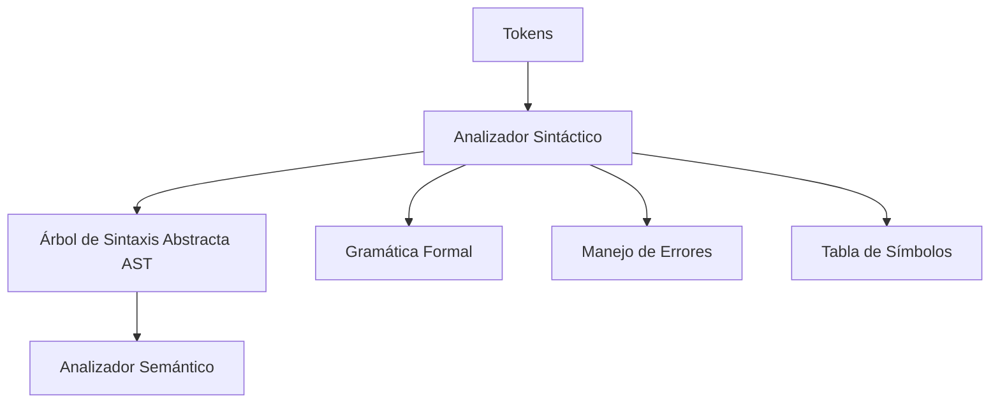
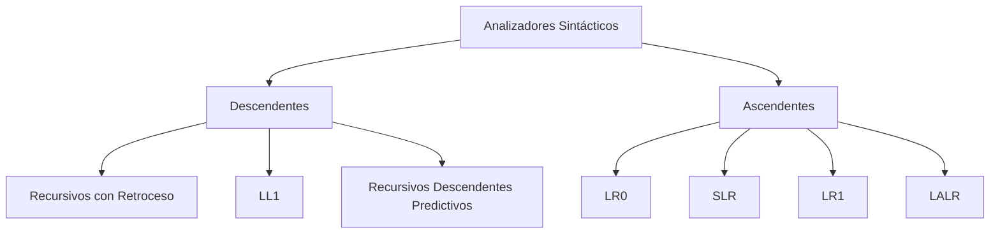

# Modelado y Programación - Emulación de máquinas virtuales

## 7.6 Construcción del analizador sintáctico.

---

El **analizador sintáctico** (parser) es la fase del proceso de compilación que verifica si la secuencia de tokens generada por el analizador léxico cumple con las reglas gramaticales del lenguaje, construyendo una estructura jerárquica (árbol sintáctico) que representa la sintaxis del programa.

### Definición Fundamental

Un analizador sintáctico es **un proceso que toma una secuencia de tokens y produce un árbol de sintaxis abstracta (AST)** verificando que la secuencia cumple con la gramática formal del lenguaje.

$$ \text{Parser}: \text{Token}^* \rightarrow \text{AST} \cup \{\text{Error}\} $$

El **árbol de sintaxis abstracta** conserva solo lo que importa para las fases siguientes: en `load [base + 4]`, la instrucción `load` con un operando de memoria cuya dirección es la suma de `base` y 4. Los corchetes, las comas y los paréntesis sirvieron para reconocer esa estructura pero ya no aparecen en el árbol; en eso se distingue del **árbol de derivación**, que tiene un nodo por cada símbolo de la gramática.

### Componentes del Analizador Sintáctico

#### 1. Arquitectura General



#### 2. Estructura del Árbol de Sintaxis Abstracta (AST)

```cpp
// Nodo base del AST
class ASTNode {
public:
    enum Type {
        PROGRAM,
        INSTRUCTION,
        OPERAND,
        DIRECTIVE,
        LABEL_DEF,
        LABEL_REF,
        EXPRESSION
    };
    
    Type type;
    uint32_t line;
    uint32_t column;
    virtual ~ASTNode() = default;
};

// Programa completo
class ProgramNode : public ASTNode {
public:
    std::vector<std::unique_ptr<ASTNode>> statements;
};

// Instrucción individual
class InstructionNode : public ASTNode {
public:
    std::string mnemonic;
    std::vector<std::unique_ptr<ASTNode>> operands;
    uint8_t opcode;
    uint32_t size;
};

// Operandos
class OperandNode : public ASTNode {
public:
    enum OperandType {
        REGISTER,
        IMMEDIATE,
        MEMORY,
        LABEL
    };
    
    OperandType operandType;
    std::string value;
    uint32_t numericValue;
};
```

### Gramáticas Formales para Ensamblador

#### 1. Gramática Libre de Contexto (CFG)

**Gramática para lenguaje ensamblador de VM**, en notación EBNF: `*` significa cero o más repeticiones, `?` opcional, y `|` alternativa.

```text
      Program → Line*
         Line → LabelDef? (Instruction | Directive)? NEWLINE
     LabelDef → IDENTIFIER ":"
  Instruction → MNEMONIC (Operand ("," Operand)*)?
      Operand → REGISTER | Expression | MemoryRef
    MemoryRef → "[" Expression "]"
   Expression → Term (("+" | "-") Term)*
         Term → Factor (("*" | "/") Factor)*
       Factor → NUMBER | IDENTIFIER | REGISTER | "(" Expression ")" | "-" Factor
    Directive → DIRECTIVE (Operand ("," Operand)*)?
```

Los comentarios no aparecen en la gramática porque el analizador léxico ya los eliminó. La estructura de `Expression`, `Term` y `Factor` codifica la **precedencia**: como `Term` está más abajo, `*` y `/` se agrupan antes que `+` y `-`. Y escribir `Term (("+" | "-") Term)*` en lugar de la regla recursiva por la izquierda `Expression → Expression "+" Term` evita la recursión infinita en un analizador descendente, conservando la asociatividad por la izquierda al construir el árbol dentro del ciclo.

#### 2. Tipos de Analizadores Sintácticos



- Los **descendentes** construyen el árbol de la raíz a las hojas: en cada paso eligen qué regla aplicar mirando el siguiente token. Un analizador **LL(1)** decide con un solo token de anticipación; los recursivos descendentes predictivos son la forma de programarlo a mano, con una función por no terminal.
- Los **ascendentes** construyen el árbol de las hojas a la raíz: apilan tokens (*shift*) y, cuando la cima de la pila coincide con el lado derecho de una regla, la sustituyen por el lado izquierdo (*reduce*). Reconocen una clase de gramáticas más amplia, incluidas las recursivas por la izquierda, pero sus tablas casi siempre se generan con herramientas como Yacc o Bison, que producen analizadores LALR(1).

Para un lenguaje ensamblador, cuya sintaxis es casi plana, un analizador descendente recursivo escrito a mano es lo más práctico y da mejores mensajes de error.

### Implementación de Parser Predictivo Recursivo

#### 1. Clase Principal del Parser

```cpp
class Parser {
private:
    Lexer& lexer;
    Token currentToken;
    SymbolTable& symbolTable;
    std::unique_ptr<ProgramNode> ast;
    
public:
    Parser(Lexer& lex, SymbolTable& symTab) 
        : lexer(lex), symbolTable(symTab) {
        currentToken = lexer.getNextToken();
        ast = std::make_unique<ProgramNode>();
    }
    
    std::unique_ptr<ProgramNode> parse();
    
private:
    void advance();
    void match(Token::Type expectedType);
    void parseProgram();
    std::unique_ptr<ASTNode> parseStatement();
    std::unique_ptr<InstructionNode> parseInstruction();
    std::unique_ptr<OperandNode> parseOperand();
    std::unique_ptr<ASTNode> parseExpression();
    std::unique_ptr<ASTNode> parseDirective();
};

void Parser::advance() {
    currentToken = lexer.getNextToken();
}

void Parser::match(Token::Type expectedType) {
    if (currentToken.type == expectedType) {
        advance();
    } else {
        throw SyntaxError("Token inesperado", currentToken.line, currentToken.column);
    }
}
```

#### 2. Análisis de Programa y Sentencias

```cpp
std::unique_ptr<ProgramNode> Parser::parse() {
    parseProgram();
    return std::move(ast);
}

void Parser::parseProgram() {
    while (currentToken.type != Token::END_OF_FILE) {
        try {
            auto statement = parseStatement();
            if (statement) {
                ast->statements.push_back(std::move(statement));
            }
        } catch (const SyntaxError& error) {
            // Recuperación de errores: saltar hasta siguiente línea
            skipToNextLine();
        }
    }
}

std::unique_ptr<ASTNode> Parser::parseStatement() {
    switch (currentToken.type) {
        case Token::IDENTIFIER:
            // Puede ser etiqueta o instrucción
            return parseLabelOrInstruction();
        case Token::KEYWORD:
            return parseInstruction();
        case Token::DIRECTIVE:
            return parseDirective();
        case Token::COMMENT:
            advance(); // Ignorar comentarios
            return nullptr;
        default:
            throw SyntaxError("Declaración inválida", currentToken.line, currentToken.column);
    }
}
```

#### 3. Análisis de Instrucciones y Operandos

```cpp
std::unique_ptr<InstructionNode> Parser::parseInstruction() {
    auto instruction = std::make_unique<InstructionNode>();
    instruction->line = currentToken.line;
    instruction->column = currentToken.column;
    instruction->mnemonic = currentToken.value;
    
    // Buscar opcode en tabla
    auto opcodeIt = opcodeTable.find(instruction->mnemonic);
    if (opcodeIt == opcodeTable.end()) {
        throw SyntaxError("Instrucción no válida", currentToken.line, currentToken.column);
    }
    
    instruction->opcode = opcodeIt->second;
    advance();
    
    // Parsear operandos
    while (currentToken.type != Token::END_OF_FILE && 
           currentToken.type != Token::COMMENT) {
        instruction->operands.push_back(parseOperand());
        
        // Verificar coma separadora
        if (currentToken.type == Token::PUNCTUATION && 
            currentToken.value == ",") {
            advance();
        } else {
            break;
        }
    }
    
    return instruction;
}

std::unique_ptr<OperandNode> Parser::parseOperand() {
    auto operand = std::make_unique<OperandNode>();
    operand->line = currentToken.line;
    operand->column = currentToken.column;
    
    if (currentToken.type == Token::REGISTER) {
        operand->operandType = OperandNode::REGISTER;
        operand->value = currentToken.value;
        advance();
    } else if (currentToken.type == Token::LITERAL_NUMBER) {
        operand->operandType = OperandNode::IMMEDIATE;
        operand->value = currentToken.value;
        operand->numericValue = currentToken.numericValue;
        advance();
    } else if (currentToken.type == Token::IDENTIFIER) {
        operand->operandType = OperandNode::LABEL;
        operand->value = currentToken.value;
        advance();
    } else if (currentToken.type == Token::PUNCTUATION && 
               currentToken.value == "[") {
        // Direccionamiento indirecto [expr]
        advance();
        operand->operandType = OperandNode::MEMORY;
        operand->value = parseExpression()->toString();
        match(Token::PUNCTUATION); // Esperar "]"
    } else {
        throw SyntaxError("Operando no válido", currentToken.line, currentToken.column);
    }
    
    return operand;
}
```

### Análisis de Expresiones

#### 1. Jerarquía de Precedencia de Operadores

```cpp
enum Precedence {
    PREC_NONE = 0,
    PREC_ASSIGNMENT = 1,
    PREC_OR = 2,
    PREC_AND = 3,
    PREC_EQUALITY = 4,
    PREC_COMPARISON = 5,
    PREC_TERM = 6,
    PREC_FACTOR = 7,
    PREC_UNARY = 8,
    PREC_CALL = 9,
    PREC_PRIMARY = 10
};

std::unordered_map<std::string, Precedence> operatorPrecedence = {
    {"=", PREC_ASSIGNMENT},
    {"||", PREC_OR},
    {"&&", PREC_AND},
    {"==", PREC_EQUALITY}, {"!=", PREC_EQUALITY},
    {"<", PREC_COMPARISON}, {"<=", PREC_COMPARISON},
    {">", PREC_COMPARISON}, {">=", PREC_COMPARISON},
    {"+", PREC_TERM}, {"-", PREC_TERM},
    {"*", PREC_FACTOR}, {"/", PREC_FACTOR},
    {"!", PREC_UNARY} // el "-" unario no puede ir en este mapa: la clave "-" ya existe
};
```

Un mapa no puede tener dos entradas con la clave `"-"`; si se escribe dos veces en el inicializador, la segunda se ignora. El signo menos es **prefijo** cuando aparece donde se espera un operando (`-5`) e **infijo** cuando aparece después de uno (`a - 5`); por eso el algoritmo de Pratt usa dos tablas, una de funciones prefijas y otra de precedencias infijas.

#### 2. Algoritmo de Pratt para Expresiones

```cpp
std::unique_ptr<ASTNode> Parser::parseExpression(Precedence precedence = PREC_NONE) {
    std::unique_ptr<ASTNode> left = parsePrefix();
    
    while (precedence < getCurrentPrecedence()) {
        left = parseInfix(std::move(left), getCurrentPrecedence());
    }
    
    return left;
}

std::unique_ptr<ASTNode> Parser::parsePrefix() {
    switch (currentToken.type) {
        case Token::LITERAL_NUMBER:
            return parseNumberLiteral();
        case Token::IDENTIFIER:
            return parseIdentifier();
        case Token::PUNCTUATION:
            if (currentToken.value == "(") {
                return parseGroupedExpression();
            } else if (currentToken.value == "-" || currentToken.value == "!") {
                return parsePrefixOperator();
            }
            // fallthrough
        default:
            throw SyntaxError("Expresión inválida", currentToken.line, currentToken.column);
    }
}

std::unique_ptr<ASTNode> Parser::parseInfix(std::unique_ptr<ASTNode> left, Precedence precedence) {
    auto node = std::make_unique<BinaryExpressionNode>();
    node->left = std::move(left);
    node->operator_ = currentToken.value;
    node->precedence = precedence;
    
    advance();
    node->right = parseExpression(precedence);
    
    return node;
}
```

La idea del algoritmo de Pratt: `parseExpression(p)` analiza una expresión cuyos operadores tienen precedencia **mayor** que `p`. Al ver `a - b - c`, después de `a` toma el `-` (precedencia de término) y analiza el lado derecho con `parseExpression(PREC_TERM)`; ese llamado se detiene ante el segundo `-`, que no tiene precedencia mayor, y así se obtiene $(a - b) - c,$ con asociatividad por la izquierda. Con `a + b * c`, el lado derecho del `+` sí continúa con el `*`, de mayor precedencia, y queda $a + (b \cdot c).$

### Manejo de Errores Sintácticos

#### 1. Estrategias de Recuperación de Errores

```cpp
class SyntaxError : public std::exception {
private:
    std::string message;
    uint32_t line;
    uint32_t column;
    
public:
    SyntaxError(const std::string& msg, uint32_t ln, uint32_t col)
        : message(msg), line(ln), column(col) {}
    
    const char* what() const noexcept override {
        return message.c_str();
    }
    
    std::string getFullMessage() const {
        return "Error sintáctico en línea " + std::to_string(line) + 
               ", columna " + std::to_string(column) + ": " + message;
    }
};

void Parser::skipToNextLine() {
    while (currentToken.type != Token::END_OF_FILE && 
           currentToken.type != Token::NEWLINE) {
        advance();
    }
    if (currentToken.type == Token::NEWLINE) {
        advance();
    }
}
```

#### 2. Modo Pánico para Recuperación

```cpp
void Parser::panicModeRecovery(const std::set<Token::Type>& synchronizeTokens) {
    // Avanzar hasta encontrar token de sincronización
    while (currentToken.type != Token::END_OF_FILE) {
        if (synchronizeTokens.find(currentToken.type) != synchronizeTokens.end()) {
            return;
        }
        advance();
    }
}
```

### Generación del Árbol de Sintaxis Abstracta

#### 1. Estructuras del AST para Ensamblador

```cpp
// Expresión binaria
class BinaryExpressionNode : public ASTNode {
public:
    std::unique_ptr<ASTNode> left;
    std::string operator_;
    std::unique_ptr<ASTNode> right;
    Precedence precedence;
};

// Literal numérico
class NumberLiteralNode : public ASTNode {
public:
    uint32_t value;
    uint32_t base; // 10, 16, 8, 2
};

// Referencia a etiqueta
class LabelReferenceNode : public ASTNode {
public:
    std::string labelName;
    bool isResolved;
    uint32_t resolvedAddress;
};

// Directiva del assembler
class DirectiveNode : public ASTNode {
public:
    std::string directiveName;
    std::vector<std::unique_ptr<ASTNode>> operands;
};
```

#### 2. Visitor para el AST

```cpp
class ASTVisitor {
public:
    virtual ~ASTVisitor() = default;
    virtual void visitProgram(ProgramNode* node) = 0;
    virtual void visitInstruction(InstructionNode* node) = 0;
    virtual void visitOperand(OperandNode* node) = 0;
    virtual void visitBinaryExpression(BinaryExpressionNode* node) = 0;
    virtual void visitNumberLiteral(NumberLiteralNode* node) = 0;
    virtual void visitLabelReference(LabelReferenceNode* node) = 0;
};

class CodeGenerationVisitor : public ASTVisitor {
public:
    void visitProgram(ProgramNode* node) override {
        for (auto& statement : node->statements) {
            statement->accept(this);
        }
    }
    
    void visitInstruction(InstructionNode* node) override {
        // Generar código para instrucción
        generateOpcode(node->opcode);
        for (auto& operand : node->operands) {
            operand->accept(this);
        }
    }
    // ... más métodos de visita
};
```

### Ejercicios Propuestos

#### Ejercicio 1: Implementar Parser para Subconjunto de Ensamblador
Implementa un parser para un subconjunto del lenguaje ensamblador de la VM.

**Requerimientos:**
- 10 instrucciones básicas
- 3 modos de direccionamiento
- Expresiones aritméticas simples
- Manejo de errores básico

**Solución.** Un analizador descendente recursivo completo para la gramática anterior. Para que sea autocontenido incluye un lexer mínimo; construye el AST, evalúa las expresiones con una tabla de símbolos y se recupera de los errores saltando a la siguiente línea, de modo que reporta todos los errores de un archivo.

```cpp
#include <cctype>
#include <iostream>
#include <map>
#include <memory>
#include <stdexcept>
#include <string>
#include <vector>

// ---------- Lexer mínimo ----------
struct Tok { std::string kind, text; int line; };   // kind: id, reg, num, dir, punct, nl, eof

std::vector<Tok> lex(const std::string& s) {
    std::vector<Tok> v; int line = 1; size_t i = 0;
    while (i < s.size()) {
        char c = s[i];
        if (c == ';') { while (i < s.size() && s[i] != '\n') ++i; continue; }
        if (c == '\n') { v.push_back({"nl", "", line++}); ++i; continue; }
        if (isspace(static_cast<unsigned char>(c))) { ++i; continue; }
        size_t j = i;
        if (isalpha(static_cast<unsigned char>(c)) || c == '_' || c == '.') {
            ++j; while (j < s.size() && (isalnum(static_cast<unsigned char>(s[j])) || s[j] == '_')) ++j;
            std::string w = s.substr(i, j - i);
            bool reg = (w[0] == 'R') && w.size() > 1 && isdigit(static_cast<unsigned char>(w[1]));
            v.push_back({c == '.' ? "dir" : reg ? "reg" : "id", w, line});
        } else if (isdigit(static_cast<unsigned char>(c))) {
            while (j < s.size() && isalnum(static_cast<unsigned char>(s[j]))) ++j;
            v.push_back({"num", s.substr(i, j - i), line});
        } else { j = i + 1; v.push_back({"punct", std::string(1, c), line}); }
        i = j;
    }
    v.push_back({"nl", "", line});
    v.push_back({"eof", "", line});
    return v;
}

// ---------- AST ----------
struct Expr {
    std::string kind;          // num, sym, reg, neg, +, -, *, /
    long value = 0; std::string name;
    std::unique_ptr<Expr> a, b;
};
struct Operand { bool memory = false; std::unique_ptr<Expr> expr; };
struct Stmt {
    int line; std::string label, op;
    std::vector<Operand> operands;
};

struct SyntaxError : std::runtime_error {
    int line;
    SyntaxError(const std::string& m, int l) : std::runtime_error(m), line(l) {}
};

// ---------- Parser descendente recursivo ----------
class AsmParser {
    std::vector<Tok> t; size_t p = 0;
    const Tok& cur() const { return t[p]; }
    bool isPunct(const std::string& s) const { return cur().kind == "punct" && cur().text == s; }
    std::string desc() const { return cur().kind == "nl" ? "fin de línea" : "'" + cur().text + "'"; }
    void expectPunct(const std::string& s) {
        if (!isPunct(s)) throw SyntaxError("se esperaba '" + s + "' y se encontró " + desc(), cur().line);
        ++p;
    }

    std::unique_ptr<Expr> factor() {
        auto e = std::make_unique<Expr>();
        if (cur().kind == "num") { e->kind = "num"; e->value = std::stol(cur().text, nullptr, 0); ++p; }
        else if (cur().kind == "id") { e->kind = "sym"; e->name = cur().text; ++p; }
        else if (cur().kind == "reg") { e->kind = "reg"; e->name = cur().text; ++p; }
        else if (isPunct("(")) { ++p; e = expression(); expectPunct(")"); }
        else if (isPunct("-")) { ++p; e->kind = "neg"; e->a = factor(); }
        else throw SyntaxError("se esperaba un operando y se encontró " + desc(), cur().line);
        return e;
    }
    std::unique_ptr<Expr> term() {
        auto left = factor();
        while (isPunct("*") || isPunct("/")) {             // ciclo: asociatividad izquierda
            auto n = std::make_unique<Expr>(); n->kind = cur().text; ++p;
            n->a = std::move(left); n->b = factor(); left = std::move(n);
        }
        return left;
    }
    std::unique_ptr<Expr> expression() {
        auto left = term();
        while (isPunct("+") || isPunct("-")) {
            auto n = std::make_unique<Expr>(); n->kind = cur().text; ++p;
            n->a = std::move(left); n->b = term(); left = std::move(n);
        }
        return left;
    }
    Operand operand() {
        Operand o;
        if (isPunct("[")) { ++p; o.memory = true; o.expr = expression(); expectPunct("]"); }
        else o.expr = expression();
        return o;
    }
    Stmt line() {
        Stmt s; s.line = cur().line;
        if (cur().kind == "id" && t[p + 1].kind == "punct" && t[p + 1].text == ":") { s.label = cur().text; p += 2; }
        if (cur().kind == "id" || cur().kind == "dir") {
            s.op = cur().text; ++p;
            if (cur().kind != "nl") {
                s.operands.push_back(operand());
                while (isPunct(",")) { ++p; s.operands.push_back(operand()); }
            }
        }
        if (cur().kind != "nl") throw SyntaxError("token inesperado " + desc(), cur().line);
        ++p;
        return s;
    }
public:
    std::vector<std::string> errors;
    std::vector<Stmt> parse(const std::string& src) {
        t = lex(src); p = 0;
        std::vector<Stmt> prog;
        while (cur().kind != "eof") {
            try {
                Stmt s = line();
                if (!s.label.empty() || !s.op.empty()) prog.push_back(std::move(s));
            } catch (const SyntaxError& e) {
                errors.push_back("línea " + std::to_string(e.line) + ": " + e.what());
                while (cur().kind != "nl" && cur().kind != "eof") ++p;   // modo pánico
                if (cur().kind == "nl") ++p;
            }
        }
        return prog;
    }
};

// ---------- Evaluación y impresión ----------
long eval(const Expr& e, const std::map<std::string, long>& sym) {
    if (e.kind == "num") return e.value;
    if (e.kind == "sym") {
        auto it = sym.find(e.name);
        if (it == sym.end()) throw std::runtime_error("símbolo no definido: " + e.name);
        return it->second;
    }
    if (e.kind == "neg") return -eval(*e.a, sym);
    long x = eval(*e.a, sym), y = eval(*e.b, sym);
    if (e.kind == "+") return x + y;
    if (e.kind == "-") return x - y;
    if (e.kind == "*") return x * y;
    if (y == 0) throw std::runtime_error("división entre cero");
    return x / y;
}

std::string show(const Expr& e) {
    if (e.kind == "num") return std::to_string(e.value);
    if (e.kind == "sym" || e.kind == "reg") return e.name;
    if (e.kind == "neg") return "(-" + show(*e.a) + ")";
    return "(" + show(*e.a) + " " + e.kind + " " + show(*e.b) + ")";
}

int main() {
    AsmParser parser;
    auto prog = parser.parse(
        "TAM:   .equ 4\n"
        "inicio: load [tabla + TAM * 2], R1   ; comentario\n"
        "        jmp inicio\n"
        "        add 10 - 3 - 2\n"
        "        load [tabla +]\n"            // error
        "        store (1 + 2\n"              // error
        "tabla: .dw 1, 2, 3\n");
    std::map<std::string, long> simbolos = {{"TAM", 4}, {"tabla", 0x40}, {"inicio", 0}};
    for (const auto& s : prog) {
        std::cout << s.line << ": " << (s.label.empty() ? "" : s.label + ": ") << s.op;
        for (const auto& o : s.operands)
            std::cout << " " << (o.memory ? "[" : "") << show(*o.expr) << (o.memory ? "]" : "");
        if (s.op == "add") std::cout << "   = " << eval(*s.operands[0].expr, simbolos);
        std::cout << "\n";
    }
    for (const auto& e : parser.errors) std::cout << e << "\n";
}
```

La salida muestra el árbol de cada expresión con paréntesis explícitos: `tabla + TAM * 2` queda como `(tabla + (TAM * 2))` por la precedencia, y `10 - 3 - 2` como `((10 - 3) - 2) = 5` por la asociatividad izquierda. Las líneas 5 y 6 tienen errores; el analizador los reporta con su número de línea, salta al final de cada una y sigue con la siguiente, así que la línea 7 se analiza normalmente.

#### Ejercicio 2: Analizador Sintáctico LR(1)
Implementa un analizador sintáctico usando tablas LR(1).

**Solución.** El motor de un analizador LR es siempre el mismo; lo que cambia es la tabla. Un error frecuente al programarlo es escribir el ciclo de forma que, después de un *shift*, no se pase al siguiente token: el `break` del `switch` no sale del `while`. La estructura correcta es un solo ciclo con un índice de entrada que solo avanza en los *shift*.

Para la gramática $E \to E + n \mid n,$ recursiva por la izquierda (que un LL(1) no admite), la construcción LR produce estos estados y la siguiente tabla, donde `s` es desplazar, `r` reducir y `$` el fin de la entrada:

| Estado | `n` | `+` | `$` | ir a $E$ |
| --- | --- | --- | --- | --- |
| 0 | s2 | | | 1 |
| 1 | | s3 | aceptar | |
| 2 | | r2 $(E \to n)$ | r2 | |
| 3 | s4 | | | |
| 4 | | r1 $(E \to E + n)$ | r1 | |

```cpp
#include <iostream>
#include <map>
#include <stack>
#include <string>
#include <utility>
#include <vector>

int main() {
    // acción[estado][símbolo] = {tipo, número}: 's' desplazar, 'r' reducir, 'a' aceptar
    std::map<int, std::map<std::string, std::pair<char, int>>> accion = {
        {0, {{"n", {'s', 2}}}},
        {1, {{"+", {'s', 3}}, {"$", {'a', 0}}}},
        {2, {{"+", {'r', 2}}, {"$", {'r', 2}}}},
        {3, {{"n", {'s', 4}}}},
        {4, {{"+", {'r', 1}}, {"$", {'r', 1}}}},
    };
    std::map<int, int> irAE = {{0, 1}};
    std::map<int, int> longitud = {{1, 3}, {2, 1}};          // símbolos del lado derecho

    std::vector<std::pair<std::string, int>> entrada = {{"n", 5}, {"+", 0}, {"n", 7}, {"+", 0}, {"n", 1}, {"$", 0}};
    std::stack<int> estados; estados.push(0);
    std::stack<int> valores;                                  // aquí se construye el resultado
    size_t i = 0;
    while (true) {
        auto fila = accion[estados.top()];
        auto it = fila.find(entrada[i].first);
        if (it == fila.end()) { std::cout << "error de sintaxis en el token " << i << "\n"; break; }
        auto [tipo, num] = it->second;
        if (tipo == 's') {                                    // desplazar: consumir el token
            estados.push(num); valores.push(entrada[i].second); ++i;
        } else if (tipo == 'r') {                             // reducir con la regla 'num'
            int v = valores.top();
            for (int k = 0; k < longitud[num]; ++k) estados.pop();
            if (num == 1) { valores.pop(); valores.pop(); int izq = valores.top(); valores.pop(); v = izq + v; }
            else valores.pop();
            valores.push(v);
            estados.push(irAE[estados.top()]);                // ir a E desde el estado descubierto
            std::cout << "reducir regla " << num << ", valor " << v << "\n";
        } else {
            std::cout << "aceptar: " << valores.top() << "\n";   // aceptar: 13
            break;
        }
    }
}
```

Las tablas de un analizador LR(1) completo se construyen calculando las colecciones canónicas de ítems LR(1): cada ítem es una regla con un punto que marca cuánto se ha reconocido, junto con el token que puede seguirla. Hacerlo a mano solo es razonable para gramáticas de juguete como esta; para gramáticas reales se usa un generador (ejercicio 3).

#### Ejercicio 3: Generador de Parsers
Crea un generador de analizadores sintácticos similar a Yacc/Bison.

**Pseudocódigo:**

```text
FUNCIÓN generar_parser(gramatica, acciones_semanticas):
    CALCULAR conjuntos FIRST y FOLLOW
    CONSTRUIR tabla de parsing LL1/LR
    GENERAR código del parser
    INCORPORAR acciones semánticas
    RETORNAR parser generado
```

**Solución.** El núcleo de un generador LL(1) son los conjuntos:

- $\text{FIRST}(\alpha):$ terminales con que puede empezar una cadena derivada de $\alpha$ (más $\varepsilon$ si $\alpha$ puede derivar la cadena vacía).
- $\text{FOLLOW}(A):$ terminales que pueden aparecer inmediatamente después de $A$ en alguna derivación.

Con ellos, la tabla LL(1) pone la regla $A \to \alpha$ en la celda $[A, a]$ para cada $a \in \text{FIRST}(\alpha),$ y si $\varepsilon \in \text{FIRST}(\alpha),$ también para cada $a \in \text{FOLLOW}(A).$ Si alguna celda recibe dos reglas, la gramática **no es LL(1)** y el generador reporta el conflicto. Ambos conjuntos se calculan iterando hasta un punto fijo:

```python
def first_follow(gram, inicio):
    no_term = set(gram)
    first = {A: set() for A in no_term}
    follow = {A: set() for A in no_term}
    follow[inicio].add("$")

    def first_de(simbolos):
        res = set()
        for X in simbolos:
            f = first[X] if X in no_term else {X}
            res |= f - {"ε"}
            if "ε" not in f:
                return res
        return res | {"ε"}                     # todos pueden ser vacíos

    cambio = True
    while cambio:                              # iterar hasta que nada cambie
        cambio = False
        for A, reglas in gram.items():
            for r in reglas:
                nuevo = first_de(r) if r else {"ε"}
                if not nuevo <= first[A]:
                    first[A] |= nuevo; cambio = True
                for i, B in enumerate(r):
                    if B in no_term:
                        resto = first_de(r[i + 1:]) if r[i + 1:] else {"ε"}
                        agregar = (resto - {"ε"}) | (follow[A] if "ε" in resto else set())
                        if not agregar <= follow[B]:
                            follow[B] |= agregar; cambio = True
    return first, follow

# Expresiones sin recursión izquierda: E → T E', E' → + T E' | ε, T → num | ( E )
gram = {"E": [["T", "E'"]], "E'": [["+", "T", "E'"], []], "T": [["num"], ["(", "E", ")"]]}
first, follow = first_follow(gram, "E")
print({A: sorted(s) for A, s in first.items()})
print({A: sorted(s) for A, s in follow.items()})
```

Para esta gramática, $\text{FIRST}(E') = \{+, \varepsilon\}$ y $\text{FOLLOW}(E') = \{), \$\}:$ ante `+` se elige $E' \to + T E',$ y ante `)` o el fin de la entrada, $E' \to \varepsilon.$ Un generador LR como Bison hace un trabajo análogo pero construye los autómatas de ítems LR(1) o LALR(1), y emite un archivo en C con las tablas y el motor de la solución del ejercicio 2, con las acciones semánticas del usuario insertadas en cada reducción.

### Pruebas y Verificación

#### 1. Suite de Pruebas para el Parser

```cpp
class ParserTestSuite {
public:
    static void runAllTests() {
        testInstructionParsing();
        testExpressionParsing();
        testErrorRecovery();
        testDirectiveParsing();
        testLabelProcessing();
    }
    
    static void testInstructionParsing() {
        std::string source = "mov R1, 42\nadd R2, R1, R3";
        Lexer lexer(source, symbolTable);
        Parser parser(lexer, symbolTable);
        
        auto ast = parser.parse();
        assert(ast->statements.size() == 2);
        assert(ast->statements[0]->type == ASTNode::INSTRUCTION);
    }
    
    // ... más tests
};
```

#### 2. Pruebas de Gramática Específica

```cpp
void testGrammarRules() {
    // Probar producciones gramaticales individuales
    testProduction("Operand -> REGISTER", "R1");
    testProduction("Operand -> IMMEDIATE", "42");
    testProduction("Operand -> [ Expression ]", "[R1 + 2]");
    testProduction("Expression -> Term + Term", "a + b");
    testProduction("Expression -> Term * Factor", "x * 10");
}
```

### Referencias y Bibliografía

1. **"Compilers: Principles, Techniques, and Tools"** - Alfred V. Aho, Monica S. Lam, Ravi Sethi, Jeffrey D. Ullman
2. **"Modern Compiler Implementation in C"** - Andrew W. Appel
3. **"The Yacc/Bison Manual"** - GNU Project
4. **"Parsing Techniques: A Practical Guide"** - Dick Grune and Ceriel J.H. Jacobs
5. **"Engineering a Compiler"** - Keith D. Cooper and Linda Torczon

### Ejercicio Final: Parser Completo para Ensamblador de VM

Desarrolla un analizador sintáctico completo para el lenguaje ensamblador de la máquina virtual que incluya:

1. Análisis de todas las construcciones del lenguaje
2. Generación de AST completo y bien estructurado
3. Manejo robusto de errores con recuperación
4. Soporte para expresiones complejas
5. Integración con tabla de símbolos
6. Suite completa de pruebas

**Criterios de evaluación:**
- Correcto análisis de programas complejos
- Calidad y estructura del AST generado
- Eficiencia en el análisis
- Robustez en el manejo de errores
- Documentación completa

### Conclusión

El analizador sintáctico es un componente crucial en el proceso de ensamblaje para máquinas virtuales, responsable de verificar la estructura gramatical del código fuente y construir una representación intermedia (AST) que facilite las fases posteriores de análisis semántico y generación de código. Un parser bien diseñado contribuye significativamente a la confiabilidad y usabilidad del ensamblador.

**Palabras clave:** Parser, Árbol de Sintaxis Abstracta, Gramática, Análisis Descendente, Análisis Ascendente, Precedencia de Operadores, Recuperación de Errores.
