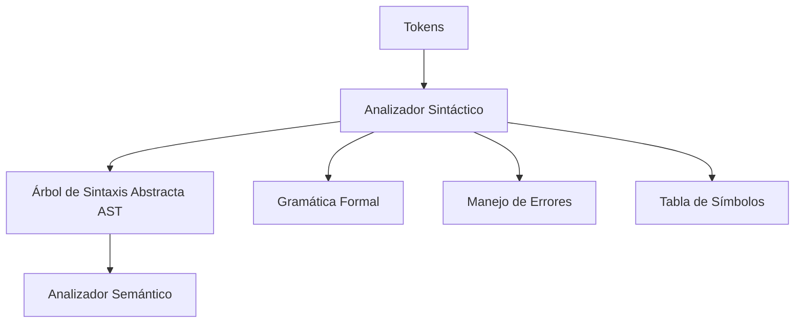
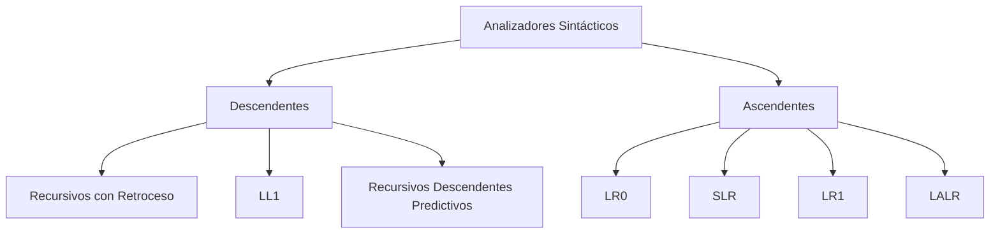

# Modelado y Programación - Emulación de máquinas virtuales
## 7.6 Construcción del analizador sintáctico.

---

El **analizador sintáctico** (parser) es la fase del proceso de compilación que verifica si la secuencia de tokens generada por el analizador léxico cumple con las reglas gramaticales del lenguaje, construyendo una estructura jerárquica (árbol sintáctico) que representa la sintaxis del programa.

### Definición Fundamental

Un analizador sintáctico es **un proceso que toma una secuencia de tokens y produce un árbol de sintaxis abstracta (AST)** verificando que la secuencia cumple con la gramática formal del lenguaje.

$$
\text{Parser}: \text{Token}^* \rightarrow \text{AST} \cup \{\text{Error}\}
$$

### Componentes del Analizador Sintáctico

#### 1. Arquitectura General



#### 2. Estructura del Árbol de Sintaxis Abstracta (AST)

```cpp
// Nodo base del AST
class ASTNode {
public:
    enum Type {
        PROGRAM,
        INSTRUCTION,
        OPERAND,
        DIRECTIVE,
        LABEL_DEF,
        LABEL_REF,
        EXPRESSION
    };
    
    Type type;
    uint32_t line;
    uint32_t column;
    virtual ~ASTNode() = default;
};

// Programa completo
class ProgramNode : public ASTNode {
public:
    std::vector<std::unique_ptr<ASTNode>> statements;
};

// Instrucción individual
class InstructionNode : public ASTNode {
public:
    std::string mnemonic;
    std::vector<std::unique_ptr<ASTNode>> operands;
    uint8_t opcode;
    uint32_t size;
};

// Operandos
class OperandNode : public ASTNode {
public:
    enum OperandType {
        REGISTER,
        IMMEDIATE,
        MEMORY,
        LABEL
    };
    
    OperandType operandType;
    std::string value;
    uint32_t numericValue;
};
```

### Gramáticas Formales para Ensamblador

#### 1. Gramática Libre de Contexto (CFG)

**Gramática para lenguaje ensamblador de VM:**

```
      Program → Statement*
    Statement → LabelDef | Instruction | Directive | Comment
     LabelDef → IDENTIFIER :
  Instruction → MNEMONICOperand*
      Operand → REGISTER | IMMEDIATE | MEMORY_REF | LABEL_REF
   MEMORY_REF → [Expression]
   Expression → Term ((+ | −) Term)*
         Term → Factor ((* | /) Factor)*
       Factor → IDENTIFIER | NUMBER | (Expression)
    Directive → .IDENTIFIEROperand*
```

#### 2. Tipos de Analizadores Sintácticos



### Implementación de Parser Predictivo Recursivo

#### 1. Clase Principal del Parser

```cpp
class Parser {
private:
    Lexer& lexer;
    Token currentToken;
    SymbolTable& symbolTable;
    std::unique_ptr<ProgramNode> ast;
    
public:
    Parser(Lexer& lex, SymbolTable& symTab) 
        : lexer(lex), symbolTable(symTab) {
        currentToken = lexer.getNextToken();
        ast = std::make_unique<ProgramNode>();
    }
    
    std::unique_ptr<ProgramNode> parse();
    
private:
    void advance();
    void match(Token::Type expectedType);
    void parseProgram();
    std::unique_ptr<ASTNode> parseStatement();
    std::unique_ptr<InstructionNode> parseInstruction();
    std::unique_ptr<OperandNode> parseOperand();
    std::unique_ptr<ASTNode> parseExpression();
    std::unique_ptr<ASTNode> parseDirective();
};

void Parser::advance() {
    currentToken = lexer.getNextToken();
}

void Parser::match(Token::Type expectedType) {
    if (currentToken.type == expectedType) {
        advance();
    } else {
        throw SyntaxError("Token inesperado", currentToken.line, currentToken.column);
    }
}
```

#### 2. Análisis de Programa y Sentencias

```cpp
std::unique_ptr<ProgramNode> Parser::parse() {
    parseProgram();
    return std::move(ast);
}

void Parser::parseProgram() {
    while (currentToken.type != Token::END_OF_FILE) {
        try {
            auto statement = parseStatement();
            if (statement) {
                ast->statements.push_back(std::move(statement));
            }
        } catch (const SyntaxError& error) {
            // Recuperación de errores: saltar hasta siguiente línea
            skipToNextLine();
        }
    }
}

std::unique_ptr<ASTNode> Parser::parseStatement() {
    switch (currentToken.type) {
        case Token::IDENTIFIER:
            // Puede ser etiqueta o instrucción
            return parseLabelOrInstruction();
        case Token::KEYWORD:
            return parseInstruction();
        case Token::DIRECTIVE:
            return parseDirective();
        case Token::COMMENT:
            advance(); // Ignorar comentarios
            return nullptr;
        default:
            throw SyntaxError("Declaración inválida", currentToken.line, currentToken.column);
    }
}
```

#### 3. Análisis de Instrucciones y Operandos

```cpp
std::unique_ptr<InstructionNode> Parser::parseInstruction() {
    auto instruction = std::make_unique<InstructionNode>();
    instruction->line = currentToken.line;
    instruction->column = currentToken.column;
    instruction->mnemonic = currentToken.value;
    
    // Buscar opcode en tabla
    auto opcodeIt = opcodeTable.find(instruction->mnemonic);
    if (opcodeIt == opcodeTable.end()) {
        throw SyntaxError("Instrucción no válida", currentToken.line, currentToken.column);
    }
    
    instruction->opcode = opcodeIt->second;
    advance();
    
    // Parsear operandos
    while (currentToken.type != Token::END_OF_FILE && 
           currentToken.type != Token::COMMENT) {
        instruction->operands.push_back(parseOperand());
        
        // Verificar coma separadora
        if (currentToken.type == Token::PUNCTUATION && 
            currentToken.value == ",") {
            advance();
        } else {
            break;
        }
    }
    
    return instruction;
}

std::unique_ptr<OperandNode> Parser::parseOperand() {
    auto operand = std::make_unique<OperandNode>();
    operand->line = currentToken.line;
    operand->column = currentToken.column;
    
    if (currentToken.type == Token::REGISTER) {
        operand->operandType = OperandNode::REGISTER;
        operand->value = currentToken.value;
        advance();
    } else if (currentToken.type == Token::LITERAL_NUMBER) {
        operand->operandType = OperandNode::IMMEDIATE;
        operand->value = currentToken.value;
        operand->numericValue = currentToken.numericValue;
        advance();
    } else if (currentToken.type == Token::IDENTIFIER) {
        operand->operandType = OperandNode::LABEL;
        operand->value = currentToken.value;
        advance();
    } else if (currentToken.type == Token::PUNCTUATION && 
               currentToken.value == "[") {
        // Direccionamiento indirecto [expr]
        advance();
        operand->operandType = OperandNode::MEMORY;
        operand->value = parseExpression()->toString();
        match(Token::PUNCTUATION); // Esperar "]"
    } else {
        throw SyntaxError("Operando no válido", currentToken.line, currentToken.column);
    }
    
    return operand;
}
```

### Análisis de Expresiones

#### 1. Jerarquía de Precedencia de Operadores

```cpp
enum Precedence {
    PREC_NONE = 0,
    PREC_ASSIGNMENT = 1,
    PREC_OR = 2,
    PREC_AND = 3,
    PREC_EQUALITY = 4,
    PREC_COMPARISON = 5,
    PREC_TERM = 6,
    PREC_FACTOR = 7,
    PREC_UNARY = 8,
    PREC_CALL = 9,
    PREC_PRIMARY = 10
};

std::unordered_map<std::string, Precedence> operatorPrecedence = {
    {"=", PREC_ASSIGNMENT},
    {"||", PREC_OR},
    {"&&", PREC_AND},
    {"==", PREC_EQUALITY}, {"!=", PREC_EQUALITY},
    {"<", PREC_COMPARISON}, {"<=", PREC_COMPARISON},
    {">", PREC_COMPARISON}, {">=", PREC_COMPARISON},
    {"+", PREC_TERM}, {"-", PREC_TERM},
    {"*", PREC_FACTOR}, {"/", PREC_FACTOR},
    {"!", PREC_UNARY}, {"-", PREC_UNARY} // Unario
};
```

#### 2. Algoritmo de Pratt para Expresiones

```cpp
std::unique_ptr<ASTNode> Parser::parseExpression(Precedence precedence = PREC_NONE) {
    std::unique_ptr<ASTNode> left = parsePrefix();
    
    while (precedence < getCurrentPrecedence()) {
        left = parseInfix(std::move(left), getCurrentPrecedence());
    }
    
    return left;
}

std::unique_ptr<ASTNode> Parser::parsePrefix() {
    switch (currentToken.type) {
        case Token::LITERAL_NUMBER:
            return parseNumberLiteral();
        case Token::IDENTIFIER:
            return parseIdentifier();
        case Token::PUNCTUATION:
            if (currentToken.value == "(") {
                return parseGroupedExpression();
            } else if (currentToken.value == "-" || currentToken.value == "!") {
                return parsePrefixOperator();
            }
            // fallthrough
        default:
            throw SyntaxError("Expresión inválida", currentToken.line, currentToken.column);
    }
}

std::unique_ptr<ASTNode> Parser::parseInfix(std::unique_ptr<ASTNode> left, Precedence precedence) {
    auto node = std::make_unique<BinaryExpressionNode>();
    node->left = std::move(left);
    node->operator_ = currentToken.value;
    node->precedence = precedence;
    
    advance();
    node->right = parseExpression(precedence);
    
    return node;
}
```

### Manejo de Errores Sintácticos

#### 1. Estrategias de Recuperación de Errores

```cpp
class SyntaxError : public std::exception {
private:
    std::string message;
    uint32_t line;
    uint32_t column;
    
public:
    SyntaxError(const std::string& msg, uint32_t ln, uint32_t col)
        : message(msg), line(ln), column(col) {}
    
    const char* what() const noexcept override {
        return message.c_str();
    }
    
    std::string getFullMessage() const {
        return "Error sintáctico en línea " + std::to_string(line) + 
               ", columna " + std::to_string(column) + ": " + message;
    }
};

void Parser::skipToNextLine() {
    while (currentToken.type != Token::END_OF_FILE && 
           currentToken.type != Token::NEWLINE) {
        advance();
    }
    if (currentToken.type == Token::NEWLINE) {
        advance();
    }
}
```

#### 2. Modo Pánico para Recuperación

```cpp
void Parser::panicModeRecovery(const std::set<Token::Type>& synchronizeTokens) {
    // Avanzar hasta encontrar token de sincronización
    while (currentToken.type != Token::END_OF_FILE) {
        if (synchronizeTokens.find(currentToken.type) != synchronizeTokens.end()) {
            return;
        }
        advance();
    }
}
```

### Generación del Árbol de Sintaxis Abstracta

#### 1. Estructuras del AST para Ensamblador

```cpp
// Expresión binaria
class BinaryExpressionNode : public ASTNode {
public:
    std::unique_ptr<ASTNode> left;
    std::string operator_;
    std::unique_ptr<ASTNode> right;
    Precedence precedence;
};

// Literal numérico
class NumberLiteralNode : public ASTNode {
public:
    uint32_t value;
    uint32_t base; // 10, 16, 8, 2
};

// Referencia a etiqueta
class LabelReferenceNode : public ASTNode {
public:
    std::string labelName;
    bool isResolved;
    uint32_t resolvedAddress;
};

// Directiva del assembler
class DirectiveNode : public ASTNode {
public:
    std::string directiveName;
    std::vector<std::unique_ptr<ASTNode>> operands;
};
```

#### 2. Visitor para el AST

```cpp
class ASTVisitor {
public:
    virtual ~ASTVisitor() = default;
    virtual void visitProgram(ProgramNode* node) = 0;
    virtual void visitInstruction(InstructionNode* node) = 0;
    virtual void visitOperand(OperandNode* node) = 0;
    virtual void visitBinaryExpression(BinaryExpressionNode* node) = 0;
    virtual void visitNumberLiteral(NumberLiteralNode* node) = 0;
    virtual void visitLabelReference(LabelReferenceNode* node) = 0;
};

class CodeGenerationVisitor : public ASTVisitor {
public:
    void visitProgram(ProgramNode* node) override {
        for (auto& statement : node->statements) {
            statement->accept(this);
        }
    }
    
    void visitInstruction(InstructionNode* node) override {
        // Generar código para instrucción
        generateOpcode(node->opcode);
        for (auto& operand : node->operands) {
            operand->accept(this);
        }
    }
    // ... más métodos de visita
};
```

### Ejercicios Propuestos

#### Ejercicio 1: Implementar Parser para Subconjunto de Ensamblador
Implementa un parser para un subconjunto del lenguaje ensamblador de la VM.

**Requerimientos:**
- 10 instrucciones básicas
- 3 modos de direccionamiento
- Expresiones aritméticas simples
- Manejo de errores básico

```cpp
// Esqueleto de solución
class BasicParser : public Parser {
public:
    BasicParser(Lexer& lex, SymbolTable& symTab) : Parser(lex, symTab) {}
    
    std::unique_ptr<ASTNode> parseExpression() override {
        // Implementación específica para expresiones básicas
    }
};
```

#### Ejercicio 2: Analizador Sintáctico LR(1)
Implementa un analizador sintáctico usando tablas LR(1).

```cpp
class LRParser {
private:
    std::vector<LRState> states;
    std::vector<LRAction> actionTable;
    std::vector<LRGoto> gotoTable;
    std::stack<LRState> stateStack;
    std::stack<ASTNode*> valueStack;
    
public:
    std::unique_ptr<ASTNode> parse(const std::vector<Token>& tokens) {
        stateStack.push(0); // Estado inicial
        
        for (const auto& token : tokens) {
            while (true) {
                LRAction action = actionTable[stateStack.top()][token.type];
                switch (action.type) {
                    case SHIFT:
                        shift(action.value, token);
                        break;
                    case REDUCE:
                        reduce(action.value);
                        break;
                    case ACCEPT:
                        return std::unique_ptr<ASTNode>(valueStack.top());
                    case ERROR:
                        handleError(token);
                        break;
                }
            }
        }
    }
};
```

#### Ejercicio 3: Generador de Parsers
Crea un generador de analizadores sintácticos similar a Yacc/Bison.

**Pseudocódigo:**
```
FUNCIÓN generar_parser(gramatica, acciones_semanticas):
    CALcular conjuntos FIRST y FOLLOW
    CONSTRUIR tabla de parsing LL1/LR
    GENERAR código del parser
    INCORPORAR acciones semánticas
    RETORNAR parser generado
```

### Pruebas y Verificación

#### 1. Suite de Pruebas para el Parser

```cpp
class ParserTestSuite {
public:
    static void runAllTests() {
        testInstructionParsing();
        testExpressionParsing();
        testErrorRecovery();
        testDirectiveParsing();
        testLabelProcessing();
    }
    
    static void testInstructionParsing() {
        std::string source = "mov R1, 42\nadd R2, R1, R3";
        Lexer lexer(source, symbolTable);
        Parser parser(lexer, symbolTable);
        
        auto ast = parser.parse();
        assert(ast->statements.size() == 2);
        assert(ast->statements[0]->type == ASTNode::INSTRUCTION);
    }
    
    // ... más tests
};
```

#### 2. Pruebas de Gramática Específica

```cpp
void testGrammarRules() {
    // Probar producciones gramaticales individuales
    testProduction("Operand -> REGISTER", "R1");
    testProduction("Operand -> IMMEDIATE", "42");
    testProduction("Operand -> [ Expression ]", "[R1 + 2]");
    testProduction("Expression -> Term + Term", "a + b");
    testProduction("Expression -> Term * Factor", "x * 10");
}
```

### Referencias y Bibliografía

1. **"Compilers: Principles, Techniques, and Tools"** - Alfred V. Aho, Monica S. Lam, Ravi Sethi, Jeffrey D. Ullman
2. **"Modern Compiler Implementation in C"** - Andrew W. Appel
3. **"The Yacc/Bison Manual"** - GNU Project
4. **"Parsing Techniques: A Practical Guide"** - Dick Grune and Ceriel J.H. Jacobs
5. **"Engineering a Compiler"** - Keith D. Cooper and Linda Torczon

### Ejercicio Final: Parser Completo para Ensamblador de VM

Desarrolla un analizador sintáctico completo para el lenguaje ensamblador de la máquina virtual que incluya:

1. Análisis de todas las construcciones del lenguaje
2. Generación de AST completo y bien estructurado
3. Manejo robusto de errores con recuperación
4. Soporte para expresiones complejas
5. Integración con tabla de símbolos
6. Suite completa de pruebas

**Criterios de evaluación:**
- Correcto análisis de programas complejos
- Calidad y estructura del AST generado
- Eficiencia en el análisis
- Robustez en el manejo de errores
- Documentación completa

### Conclusión

El analizador sintáctico es un componente crucial en el proceso de ensamblaje para máquinas virtuales, responsable de verificar la estructura gramatical del código fuente y construir una representación intermedia (AST) que facilite las fases posteriores de análisis semántico y generación de código. Un parser bien diseñado contribuye significativamente a la confiabilidad y usabilidad del ensamblador.

**Palabras clave:** Parser, Árbol de Sintaxis Abstracta, Gramática, Análisis Descendente, Análisis Ascendente, Precedencia de Operadores, Recuperación de Errores.
