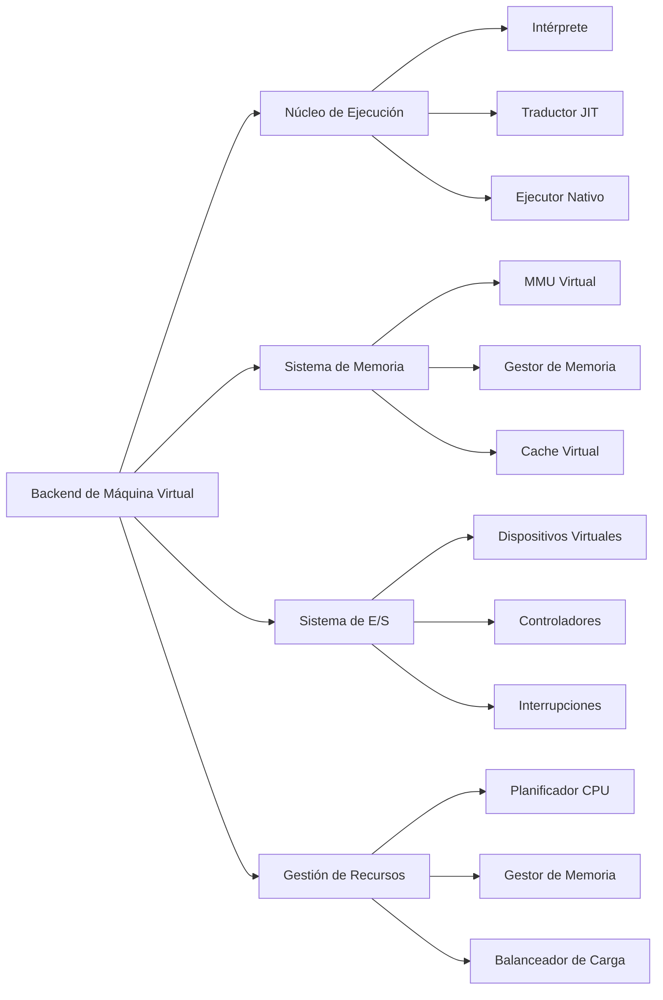
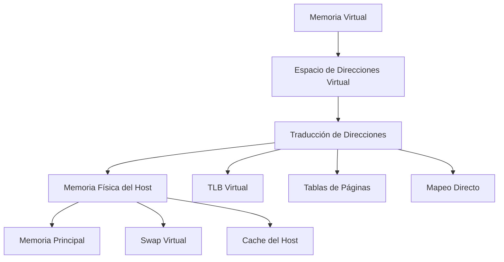

# Modelado y Programación - Emulación de máquinas virtuales

## 7.7 Construcción del back End.

---

El **backend** de una máquina virtual es el componente responsable de ejecutar el código compilado o interpretado, gestionar los recursos virtualizados y proporcionar la interfaz entre el código guest y el hardware host. Es el núcleo ejecutor de la máquina virtual.

### Definición Fundamental

El backend de una máquina virtual es **el conjunto de componentes que implementan la ejecución de instrucciones, gestión de memoria, manejo de dispositivos y administración de recursos** que permiten la emulación de un sistema computacional completo.

$$ \text{Backend} = \{\text{Executor}, \text{GestorMemoria}, \text{ControladorE/S}, \text{Planificador}\} $$

En la cadena de herramientas de los temas anteriores, el *front end* es el lexer y el parser (temas 7.5 y 7.6), que entienden el código fuente y producen un AST. El término *back end* tiene dos lados: en el **ensamblador**, es la generación de código, que recorre el AST, resuelve los símbolos y codifica cada instrucción en bytes (tema 7.4); en la **máquina virtual**, es todo lo que ejecuta esos bytes. Este tema trata el segundo: cómo organizar la ejecución, la memoria, los dispositivos y las interrupciones, y cómo acelerarla con compilación JIT.

### Arquitectura del Backend

#### 1. Componentes Principales



### Núcleo de Ejecución

#### 1. Módulo de Ejecución de Instrucciones

```cpp
class ExecutionCore {
private:
    VMState& state;
    MemoryManager& memory;
    DeviceManager& devices;
    
    // Configuración de ejecución
    ExecutionMode mode;
    uint64_t instructionsExecuted;
    uint64_t cyclesExecuted;
    
public:
    ExecutionCore(VMState& s, MemoryManager& m, DeviceManager& d)
        : state(s), memory(m), devices(d), mode(INTERPRET), 
          instructionsExecuted(0), cyclesExecuted(0) {}
    
    void executeInstruction();
    void run();
    void step();
    void pause();
    void reset();
    
    // Diferentes modos de ejecución
    void interpretInstruction();
    void executeNativeBlock();
    void translateAndExecute();
    
    // Métricas de performance
    double getIPS() const; // Instructions per second
    double getCPI() const; // Cycles per instruction
};
```

#### 2. Ciclo de Ejecución Principal

```cpp
void ExecutionCore::run() {
    while (state.isRunning()) {
        executeInstruction();
        
        // Verificar interrupciones cada cierto número de instrucciones.
        // Con CHECK_INTERVAL = 1 la emulación es exacta; con valores mayores
        // es más rápida, pero las interrupciones se atienden con retraso.
        if (instructionsExecuted % CHECK_INTERVAL == 0) {
            checkInterrupts();
        }
        
        // Actualizar dispositivos virtuales
        devices.updateDevices();
    }
}

void ExecutionCore::executeInstruction() {
    switch (mode) {
        case INTERPRET:
            interpretInstruction();
            break;
        case JIT:
            translateAndExecute();
            break;
        case NATIVE:
            executeNativeBlock();
            break;
    }
    
    instructionsExecuted++;
    cyclesExecuted += calculateCycles(state.currentInstruction);
}
```

### Sistema de Gestión de Memoria

#### 1. Jerarquía de Memoria Virtual



#### 2. Implementación de MMU Virtual

```cpp
class VirtualMMU {
private:
    MemoryManager& memory;
    std::unordered_map<uint64_t, uint64_t> tlb; // TLB virtual
    PageTable* pageTable;
    uint64_t pageSize;
    uint64_t tlbHits;
    uint64_t tlbMisses;
    
public:
    VirtualMMU(MemoryManager& mem, uint64_t pSize = 4096)
        : memory(mem), pageSize(pSize), tlbHits(0), tlbMisses(0) {
        pageTable = new PageTable(mem.getSize() / pSize);
    }
    
    uint64_t translateAddress(uint64_t virtualAddress, bool isWrite = false) {
        uint64_t pageNumber = virtualAddress / pageSize;
        uint64_t offset = virtualAddress % pageSize;
        
        // Consultar TLB primero
        auto tlbIt = tlb.find(pageNumber);
        if (tlbIt != tlb.end()) {
            tlbHits++;
            return tlbIt->second * pageSize + offset;
        }
        
        tlbMisses++;
        // Consultar tabla de páginas
        if (!pageTable->isPresent(pageNumber)) {
            handlePageFault(pageNumber, isWrite);
        }
        
        uint64_t frame = pageTable->getFrame(pageNumber);
        // Actualizar TLB
        tlb[pageNumber] = frame;
        
        return frame * pageSize + offset;
    }
    
    double getTLBHitRate() const {
        return static_cast<double>(tlbHits) / (tlbHits + tlbMisses);
    }
};
```

Esta TLB es un `unordered_map` sin límite de tamaño, así que en realidad es una caché completa de la tabla de páginas; una TLB real tiene pocas entradas y una política de reemplazo (ejercicio 1). Además, cuando el sistema invitado cambia una entrada de la tabla de páginas o cambia de proceso, la TLB debe **invalidarse**, por completo o la entrada afectada; si no, seguiría devolviendo traducciones viejas.

### Sistema de Entrada/Salida Virtual

#### 1. Framework de Dispositivos Virtuales

```cpp
class VirtualDevice {
public:
    virtual ~VirtualDevice() = default;
    
    virtual uint32_t read(uint32_t address, uint32_t size) = 0;
    virtual void write(uint32_t address, uint32_t value, uint32_t size) = 0;
    virtual void reset() = 0;
    virtual void update() = 0;
    virtual std::string getName() const = 0;
    
    // DMA virtual
    virtual void dmaRead(uint64_t hostAddress, uint32_t deviceAddress, uint32_t size) = 0;
    virtual void dmaWrite(uint64_t hostAddress, uint32_t deviceAddress, uint32_t size) = 0;
};

class DeviceManager {
private:
    std::vector<std::unique_ptr<VirtualDevice>> devices;
    std::unordered_map<uint32_t, VirtualDevice*> addressMap;
    InterruptController& interruptController;
    
public:
    void mapDevice(uint32_t baseAddress, uint32_t size, VirtualDevice* device) {
        for (uint32_t i = 0; i < size; i++) {
            addressMap[baseAddress + i] = device;
        }
        devices.push_back(std::unique_ptr<VirtualDevice>(device));
    }
    
    uint32_t readIO(uint32_t address, uint32_t size) {
        auto [device, base] = getDevice(address);   // dispositivo y base de su región
        return device->read(address - base, size);
    }
    
    void writeIO(uint32_t address, uint32_t value, uint32_t size) {
        auto [device, base] = getDevice(address);
        device->write(address - base, value, size);
    }
    
    void updateAllDevices() {
        for (auto& device : devices) {
            device->update();
        }
    }
};
```

`getDevice` debe devolver también la dirección base de la región, porque la interfaz `VirtualDevice` no la conoce: un mismo tipo de dispositivo puede mapearse en distintas direcciones. La forma eficiente de implementarlo, con un mapa ordenado de regiones y `upper_bound`, está en el tema 7.3; crear una entrada por cada byte, como en `mapDevice`, gasta memoria proporcional al tamaño de las regiones.

#### 2. Implementación de Dispositivos Específicos

**Controlador de Video Virtual:**

```cpp
class VirtualGPU : public VirtualDevice {
private:
    std::vector<uint32_t> framebuffer;
    uint32_t width;
    uint32_t height;
    uint32_t baseAddress;
    
public:
    VirtualGPU(uint32_t w, uint32_t h, uint32_t base)
        : width(w), height(h), baseAddress(base) {
        framebuffer.resize(w * h);
        reset();
    }
    
    uint32_t read(uint32_t address, uint32_t size) override {
        if (address >= framebuffer.size() * sizeof(uint32_t)) {
            return 0;
        }
        
        uint32_t index = address / sizeof(uint32_t);
        return framebuffer[index];
    }
    
    void write(uint32_t address, uint32_t value, uint32_t size) override {
        if (address >= framebuffer.size() * sizeof(uint32_t)) {
            return;
        }
        
        uint32_t index = address / sizeof(uint32_t);
        framebuffer[index] = value;
        
        // Actualizar pantalla virtual
        updateDisplay();
    }
    
    void updateDisplay() {
        // Implementar renderizado en ventana o textura
    }
    
    void dmaRead(uint64_t hostAddress, uint32_t deviceAddress, uint32_t size) override {
        // Implementar DMA de dispositivo a memoria
    }
    
    void dmaWrite(uint64_t hostAddress, uint32_t deviceAddress, uint32_t size) override {
        // Implementar DMA de memoria a dispositivo
    }
};
```

### Sistema de Interrupciones Virtuales

#### 1. Controlador de Interrupciones Programable (PIC)

```cpp
class VirtualPIC : public VirtualDevice {
private:
    std::vector<bool> irqLines;
    std::vector<bool> irqMask;
    std::vector<uint8_t> irqPriorities;
    uint8_t currentIrq;
    bool interruptsEnabled;
    
public:
    VirtualPIC(uint8_t numIrqs = 16) 
        : irqLines(numIrqs, false), irqMask(numIrqs, false),
          irqPriorities(numIrqs), currentIrq(0), interruptsEnabled(false) {
        // Prioridad por omisión: la línea 0 es la más prioritaria
        for (uint8_t i = 0; i < numIrqs; ++i) irqPriorities[i] = numIrqs - i;
    }
    
    void raiseInterrupt(uint8_t irq) {
        if (irq < irqLines.size()) {
            irqLines[irq] = true;
            updateCurrentIrq();
        }
    }
    
    void lowerInterrupt(uint8_t irq) {
        if (irq < irqLines.size()) {
            irqLines[irq] = false;
            updateCurrentIrq();
        }
    }
    
    void updateCurrentIrq() {
        uint8_t highestPriority = 0;
        uint8_t selectedIrq = 0;
        bool found = false;
        
        for (uint8_t i = 0; i < irqLines.size(); ++i) {
            if (irqLines[i] && !irqMask[i] && irqPriorities[i] > highestPriority) {
                highestPriority = irqPriorities[i];
                selectedIrq = i;
                found = true;
            }
        }
        
        if (found) {
            currentIrq = selectedIrq;
        }
    }
    // Si todas las prioridades fueran 0, la comparación estricta "> highestPriority"
    // nunca se cumpliría y ninguna interrupción se seleccionaría: por eso el
    // constructor asigna prioridades positivas.
    
    uint8_t getCurrentIrq() const {
        return currentIrq;
    }
    
    bool hasPendingInterrupts() const {
        for (bool line : irqLines) {
            if (line) return true;
        }
        return false;
    }
};
```

### Compilación JIT (Just-In-Time)

#### 1. Sistema de Traducción Dinámica

```cpp
class JITCompiler {
private:
    ExecutionCore& core;
    MemoryManager& memory;
    std::unordered_map<uint64_t, NativeCodeBlock> codeCache;
    size_t cacheSize;
    size_t maxCacheSize;
    
public:
    JITCompiler(ExecutionCore& c, MemoryManager& m, size_t maxCache = 65536)
        : core(c), memory(m), maxCacheSize(maxCache), cacheSize(0) {}
    
    NativeCodeBlock* compileBlock(uint64_t startAddress) {
        // Verificar si ya está en cache
        auto it = codeCache.find(startAddress);
        if (it != codeCache.end()) {
            return &it->second;
        }
        
        // Compilar nuevo bloque
        NativeCodeBlock block = translateBlock(startAddress);
        size_t blockSize = block.size;      // guardarlo ANTES de mover el bloque
        
        // Gestionar tamaño de cache
        if (cacheSize + blockSize > maxCacheSize) {
            evictOldBlocks();
        }
        
        codeCache[startAddress] = std::move(block);
        cacheSize += blockSize;
        
        return &codeCache[startAddress];
    }
    
    NativeCodeBlock translateBlock(uint64_t startAddress) {
        NativeCodeBlock block;
        block.startAddress = startAddress;
        
        uint64_t currentAddress = startAddress;
        bool endOfBlock = false;
        
        while (!endOfBlock && currentAddress < memory.getSize()) {
            Instruction instr = decodeInstruction(memory.read(currentAddress));
            NativeInstruction native = translateInstruction(instr);
            
            block.nativeCode.insert(block.nativeCode.end(),
                                  native.code.begin(), native.code.end());
            block.size += native.code.size();
            
            currentAddress += instr.size;
            
            // Detectar fin de bloque (saltos, retornos, etc.)
            if (instr.isBranch() || instr.isReturn()) {
                endOfBlock = true;
            }
        }
        
        return block;
    }
};
```

Un bloque termina en el primer salto o retorno porque después de él la ejecución puede seguir en otro lugar; así cada bloque traducido se ejecuta completo de principio a fin. Dos detalles hacen funcionar un JIT real: el código generado se escribe en memoria que luego se marca como **ejecutable** (con `mmap` y `mprotect` en Linux), y si el programa invitado escribe sobre su propio código, los bloques afectados deben **invalidarse** para no ejecutar una traducción vieja. Otra mejora importante es el **encadenamiento de bloques**: cuando un bloque termina saltando a otro ya traducido, se parcha el salto para ir directo, sin volver al despachador.

### Gestión de Recursos y Performance

#### 1. Monitor de Performance

```cpp
class PerformanceMonitor {
private:
    std::unordered_map<std::string, PerformanceCounter> counters;
    uint64_t startTime;
    uint64_t lastUpdate;
    
public:
    struct PerformanceCounter {
        uint64_t value;
        uint64_t lastValue;
        double rate;
        double average;
        uint64_t samples;
    };
    
    void update() {
        uint64_t currentTime = getCurrentTime();
        double delta = static_cast<double>(currentTime - lastUpdate) / 1e9;
        
        for (auto& [name, counter] : counters) {
            counter.rate = (counter.value - counter.lastValue) / delta;
            counter.average = (counter.average * counter.samples + counter.rate) 
                            / (counter.samples + 1);
            counter.lastValue = counter.value;
            counter.samples++;
        }
        
        lastUpdate = currentTime;
    }
    
    void incrementCounter(const std::string& name, uint64_t amount = 1) {
        counters[name].value += amount;
    }
    
    double getCounterRate(const std::string& name) const {
        auto it = counters.find(name);
        if (it != counters.end()) {
            return it->second.rate;
        }
        return 0.0;
    }
};
```

#### 2. Métricas Clave de Performance

**Fórmulas de performance:**

$$ \text{IPS} = \frac{\text{instrucciones ejecutadas}}{\text{tiempo transcurrido}}, \qquad \text{CPI} = \frac{\text{ciclos totales}}{\text{instrucciones ejecutadas}} $$

$$ \text{TLB Hit Rate} = \frac{\text{TLB hits}}{\text{TLB hits} + \text{TLB misses}}, \qquad \text{Cache Hit Rate} = \frac{\text{cache hits}}{\text{cache hits} + \text{cache misses}} $$

$$ \text{Utilización} = \frac{\text{tiempo ejecutando}}{\text{tiempo total}} \times 100\% $$

Para comparar un intérprete con un JIT conviene una métrica adicional: el **factor de desaceleración**, el tiempo en la VM dividido entre el tiempo del mismo programa compilado de forma nativa. Un buen intérprete por `switch` suele ser de 10 a 50 veces más lento que el código nativo; un buen JIT, de 1 a 3 veces.

### Ejercicios Propuestos

#### Ejercicio 1: Implementar MMU Virtual con Paginación
Implementa un sistema de memoria virtual con paginación de dos niveles.

**Requerimientos:**
- Tablas de páginas de dos niveles
- TLB con política LRU
- Manejo de page faults
- Estadísticas de performance

**Solución.** La traducción de dos niveles está resuelta en el tema 7.2 (ejercicio 2) y la TLB con LRU en el tema 7.3. Falta el reemplazo de páginas cuando la memoria física se llena. El algoritmo del **reloj** (CLOCK) aproxima LRU con un solo bit por marco: cada acceso enciende el bit de **referencia** de su marco; para elegir víctima, una manecilla recorre los marcos en círculo, apaga los bits encendidos y se detiene en el primer marco con el bit apagado, que no se ha usado desde la última vuelta.

```cpp
#include <cstdint>
#include <iostream>
#include <unordered_map>
#include <vector>

class MMUConReloj {
    struct Marco { int64_t pagina = -1; bool referencia = false; bool sucia = false; };
    std::vector<Marco> marcos;
    std::unordered_map<uint64_t, size_t> tabla;      // página -> marco (solo las presentes)
    size_t manecilla = 0;
public:
    long fallos = 0, escriturasADisco = 0;
    explicit MMUConReloj(size_t n) : marcos(n) {}

    size_t acceder(uint64_t pagina, bool escritura) {
        auto it = tabla.find(pagina);
        if (it == tabla.end()) {                       // fallo de página
            ++fallos;
            size_t m = victima();
            if (marcos[m].pagina >= 0) {
                if (marcos[m].sucia) ++escriturasADisco;   // page out solo si cambió
                tabla.erase(uint64_t(marcos[m].pagina));
            }
            marcos[m] = {int64_t(pagina), false, false};   // page in
            it = tabla.emplace(pagina, m).first;
        }
        Marco& mc = marcos[it->second];
        mc.referencia = true;
        mc.sucia |= escritura;
        return it->second;
    }
private:
    size_t victima() {
        while (true) {
            Marco& m = marcos[manecilla];
            size_t actual = manecilla;
            manecilla = (manecilla + 1) % marcos.size();
            if (m.pagina < 0 || !m.referencia) return actual;   // libre o sin uso reciente
            m.referencia = false;                               // segunda oportunidad
        }
    }
};

int main() {
    MMUConReloj mmu(3);
    for (uint64_t p : {1, 2, 3, 1, 4, 1, 5, 2, 1, 3}) mmu.acceder(p, p == 1);
    std::cout << "fallos: " << mmu.fallos << ", escrituras a disco: " << mmu.escriturasADisco << "\n";
}
```

El programa imprime `fallos: 8, escrituras a disco: 1`. Con 3 marcos y 5 páginas distintas, los 3 primeros accesos son fallos inevitables; después, cada página que vuelve a usarse se gana una "segunda oportunidad" con su bit de referencia. Si todos los bits están encendidos, la manecilla da una vuelta completa apagándolos y el reloj se comporta como FIFO, que es lo que pasa en el acceso a la página 4. De las páginas expulsadas, solo la página 1 estaba **sucia** (modificada) y se escribió a disco; las limpias se descartan sin escribirlas, porque su contenido ya está en el disco.

#### Ejercicio 2: Sistema de Dispositivos con DMA
Implementa un sistema DMA para dispositivos virtuales.

**Solución.** Con DMA (*Direct Memory Access*), la CPU solo programa la transferencia (origen, destino, tamaño) y sigue ejecutando; el controlador copia los datos por su cuenta y, al terminar, levanta una interrupción. En una VM, el controlador de DMA avanza un poco en cada llamada a `update()`, intercalado con la ejecución de instrucciones, lo que reproduce que la transferencia toma tiempo:

```cpp
#include <cstdint>
#include <functional>
#include <iostream>
#include <vector>

struct CanalDMA {
    bool activo = false;
    uint32_t origen = 0, destino = 0, restantes = 0;
    bool haciaDispositivo = false;
};

class VirtualDMA {
    std::vector<uint8_t>& ram;
    std::vector<uint8_t>& bufferDispositivo;
    std::function<void(int)> interrupcion;          // callback al PIC
    std::vector<CanalDMA> canales;
    static constexpr uint32_t BYTES_POR_CICLO = 4;
public:
    VirtualDMA(std::vector<uint8_t>& r, std::vector<uint8_t>& d, std::function<void(int)> irq, int n = 4)
        : ram(r), bufferDispositivo(d), interrupcion(std::move(irq)), canales(n) {}

    void transfer(int c, uint32_t memAddr, uint32_t devAddr, uint32_t size, bool toDevice) {
        canales[c] = {true, toDevice ? memAddr : devAddr, toDevice ? devAddr : memAddr, size, toDevice};
    }

    void update() {                                   // se llama una vez por ciclo de la VM
        for (size_t c = 0; c < canales.size(); ++c) {
            CanalDMA& k = canales[c];
            if (!k.activo) continue;
            for (uint32_t i = 0; i < BYTES_POR_CICLO && k.restantes > 0; ++i, --k.restantes) {
                uint8_t b = k.haciaDispositivo ? ram.at(k.origen++) : bufferDispositivo.at(k.origen++);
                (k.haciaDispositivo ? bufferDispositivo : ram).at(k.destino++) = b;
            }
            if (k.restantes == 0) { k.activo = false; interrupcion(int(c)); }
        }
    }
};

int main() {
    std::vector<uint8_t> ram(256, 0), disco(64, 0);
    for (int i = 0; i < 10; ++i) disco[i] = uint8_t('A' + i);
    int ciclos = 0; bool listo = false;
    VirtualDMA dma(ram, disco, [&](int canal) { listo = true; std::cout << "IRQ del canal " << canal << "\n"; });
    dma.transfer(0, /*memoria*/ 0x80, /*dispositivo*/ 0, 10, /*hacia dispositivo*/ false);
    while (!listo) { dma.update(); ++ciclos; }        // mientras, la CPU seguiría ejecutando
    std::cout << std::string(ram.begin() + 0x80, ram.begin() + 0x8A) << " en " << ciclos << " ciclos\n";
}
```

La CPU queda libre durante los ciclos que dura la copia, que es la razón de ser del DMA. El precio es que la memoria puede cambiar "sola" bajo la CPU: el sistema invitado no debe leer el búfer de destino hasta recibir la interrupción.

#### Ejercicio 3: Optimizador JIT
Implementa un optimizador para el compilador JIT.

**Solución.** Las optimizaciones no se aplican sobre los bytes de código nativo, sino sobre una **representación intermedia** (IR) del bloque, antes de generar el código. Con una IR de tres direcciones (`destino = a op b`) se implementan fácilmente dos de las optimizaciones más rentables:

- **Propagación de constantes**: si se sabe que un registro vale una constante, se sustituye y, si todos los operandos son constantes, se calcula en tiempo de traducción (*constant folding*).
- **Eliminación de código muerto**: recorriendo el bloque de atrás hacia adelante, una instrucción cuyo destino no se usa después (y que no tiene efectos secundarios) se elimina.

```cpp
#include <iostream>
#include <map>
#include <optional>
#include <set>
#include <string>
#include <vector>

struct IR { std::string dst, op, a, b; };   // op: "const", "add", "mul", "mov", "store"

bool esNumero(const std::string& s) { return !s.empty() && (isdigit(s[0]) || s[0] == '-'); }

std::vector<IR> propagarConstantes(const std::vector<IR>& code) {
    std::map<std::string, long> valor;          // registro -> constante conocida
    std::vector<IR> out;
    auto sust = [&](const std::string& x) { return valor.count(x) ? std::to_string(valor[x]) : x; };
    for (IR i : code) {
        i.a = sust(i.a); i.b = sust(i.b);
        if (i.op == "const" || (i.op == "mov" && esNumero(i.a))) { valor[i.dst] = std::stol(i.a); i.op = "const"; }
        else if ((i.op == "add" || i.op == "mul") && esNumero(i.a) && esNumero(i.b)) {
            long r = i.op == "add" ? std::stol(i.a) + std::stol(i.b) : std::stol(i.a) * std::stol(i.b);
            i = {i.dst, "const", std::to_string(r), ""};
            valor[i.dst] = r;
        } else if (i.op != "store") valor.erase(i.dst);   // ya no es constante
        out.push_back(i);
    }
    return out;
}

std::vector<IR> eliminarCodigoMuerto(const std::vector<IR>& code, std::set<std::string> vivos) {
    std::vector<IR> out;
    for (auto it = code.rbegin(); it != code.rend(); ++it) {
        bool efecto = it->op == "store";              // escribir memoria no se puede quitar
        if (efecto || vivos.count(it->dst)) {
            vivos.erase(it->dst);
            if (!esNumero(it->a)) vivos.insert(it->a);
            if (!it->b.empty() && !esNumero(it->b)) vivos.insert(it->b);
            out.insert(out.begin(), *it);
        }
    }
    return out;
}

int main() {
    std::vector<IR> bloque = {
        {"r1", "const", "4", ""},
        {"r2", "const", "10", ""},
        {"r3", "mul", "r1", "r2"},      // 40, calculable en tiempo de traducción
        {"r4", "add", "r3", "r9"},      // r9 es desconocido
        {"r5", "add", "r1", "r1"},      // nunca se usa
        {"",   "store", "r4", "0x100"},
    };
    auto opt = eliminarCodigoMuerto(propagarConstantes(bloque), {});
    for (auto& i : opt)
        std::cout << (i.dst.empty() ? "" : i.dst + " = ") << i.op << " " << i.a << (i.b.empty() ? "" : ", " + i.b) << "\n";
    // r4 = add 40, r9
    // store r4, 0x100
}
```

De seis instrucciones quedan dos: la multiplicación se hizo durante la traducción y las instrucciones cuyo resultado nadie usa desaparecieron. El conjunto inicial de registros vivos se deja vacío porque en este ejemplo nada sale del bloque salvo lo que se escribe en memoria; en un JIT real son vivos al final los registros que el código invitado puede leer después del bloque. La **planificación de instrucciones**, la cuarta optimización del esqueleto, reordena instrucciones independientes para que el procesador real no se detenga esperando resultados; en procesadores modernos con ejecución fuera de orden aporta menos.

### Técnicas de Optimización Avanzadas

#### 1. Profile-Guided Optimization

```cpp
class ProfileGuidedOptimizer {
private:
    std::unordered_map<uint64_t, ExecutionProfile> profiles;
    ExecutionCore& core;
    
public:
    struct ExecutionProfile {
        uint64_t executionCount;
        uint64_t totalCycles;
        std::vector<uint64_t> hotPaths;
        std::set<uint64_t> frequentlyAccessedAddresses;
    };
    
    void collectProfileData() {
        uint64_t currentAddress = core.getPC();
        profiles[currentAddress].executionCount++;
        
        // Identificar caminos calientes
        if (profiles[currentAddress].executionCount > HOT_THRESHOLD) {
            optimizeHotPath(currentAddress);
        }
    }
    
    void optimizeHotPath(uint64_t address) {
        ExecutionProfile& profile = profiles[address];
        NativeCodeBlock optimized = recompileWithProfile(address, profile);
        core.getJITCompiler().updateCodeBlock(address, optimized);
    }
};
```

#### 2. Memory Prefetching Virtual

```cpp
class PrefetchEngine {
private:
    MemoryManager& memory;
    MMU& mmu;
    std::vector<PrefetchBuffer> buffers;
    
public:
    void analyzeAccessPattern(uint64_t address, bool isWrite) {
        // Analizar patrones de acceso y predecir siguientes accesos
        uint64_t nextAddress = predictNextAddress(address, isWrite);
        if (nextAddress != 0) {
            prefetch(nextAddress);
        }
    }
    
    void prefetch(uint64_t address) {
        // Cargar página a buffer de prefetch
        uint64_t physical = mmu.translateAddress(address, false);
        memory.prefetchPage(physical);
    }
};
```

### Pruebas y Benchmarking

#### 1. Suite de Pruebas de Performance

```cpp
class BenchmarkSuite {
public:
    static void runAllBenchmarks(ExecutionCore& core) {
        benchmarkIntegerPerformance(core);
        benchmarkFloatingPointPerformance(core);
        benchmarkMemoryPerformance(core);
        benchmarkIOPerformance(core);
        benchmarkOverallPerformance(core);
    }
    
    static void benchmarkIntegerPerformance(ExecutionCore& core) {
        // Ejecutar código de prueba de operaciones enteras
        std::vector<uint8_t> integerTest = generateIntegerTestCode();
        core.loadCode(integerTest);
        
        auto start = std::chrono::high_resolution_clock::now();
        core.run();
        auto end = std::chrono::high_resolution_clock::now();
        
        double seconds = std::chrono::duration<double>(end - start).count();
        // MIPS = millones de INSTRUCCIONES por segundo: se usa el contador de
        // instrucciones ejecutadas, no el tamaño en bytes del programa
        double mips = (core.getInstructionsExecuted() / seconds) / 1e6;
        
        std::cout << "Integer Performance: " << mips << " MIPS" << std::endl;
    }
};
```

#### 2. Herramientas de Profiling

```cpp
class ProfilingTool {
private:
    ExecutionCore& core;
    std::ofstream profileLog;
    SamplingRate rate;
    
public:
    void startProfiling() {
        profileLog.open("profile.json");
        profileLog << "{\"traceEvents\":[";
        
        setupSamplingTimer(rate);
    }
    
    void sampleProfile() {
        uint64_t pc = core.getPC();
        uint64_t cycles = core.getCycles();
        
        profileLog << fmt::format(   // biblioteca {fmt}, o std::format en C++20
            R"({{"name": "instruction", "ph": "P", "ts": {}, "pid": 0, "tid": 0, "args": {{"pc": "0x{:x}"}}}})",
            cycles, pc
        );
    }
    
    void stopProfiling() {
        profileLog << "]}";
        profileLog.close();
    }
};
```

### Referencias y Bibliografía

1. **"Virtual Machine Design and Implementation in C/C++"** - Bill Blunden
2. **"Advanced Programming in the UNIX Environment"** - W. Richard Stevens
3. **"Computer Architecture: A Quantitative Approach"** - John L. Hennessy and David A. Patterson
4. **"The Implementation of Functional Programming Languages"** - Simon Peyton Jones
5. **"Modern Processor Design: Fundamentals of Superscalar Processors"** - John Paul Shen and Mikko H. Lipasti

### Ejercicio Final: Backend Completo para Máquina Virtual

Implementa un backend completo para la máquina virtual que incluya:

1. Núcleo de ejecución con múltiples modos (interpretado, JIT, nativo)
2. Sistema de memoria virtual con MMU y TLB
3. Sistema de E/S con dispositivos virtuales y DMA
4. Sistema de interrupciones virtuales
5. Monitor de performance y profiling
6. Optimizaciones JIT y prefetching

**Criterios de evaluación:**
- Correcta ejecución de programas complejos
- Performance y eficiencia del sistema
- Robustez y manejo de errores
- Calidad del código y documentación
- Metricas de performance y optimizaciones

### Conclusión

El backend de una máquina virtual es el componente más crítico para el rendimiento y la funcionalidad del sistema. Un diseño cuidadoso que incorpore técnicas avanzadas de ejecución, gestión de memoria y E/S puede resultar en mejoras significativas de performance. Las optimizaciones JIT, el prefetching inteligente y el profiling continuo son esenciales para alcanzar niveles de performance cercanos al hardware nativo.

**Palabras clave:** Backend, Execution Core, Virtual MMU, JIT Compilation, Virtual Devices, DMA, Interrupt Handling, Performance Optimization, Profiling.
