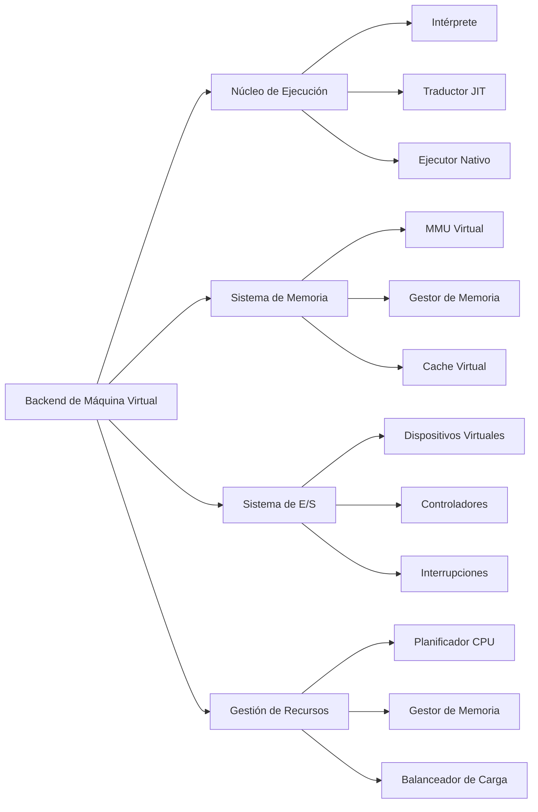
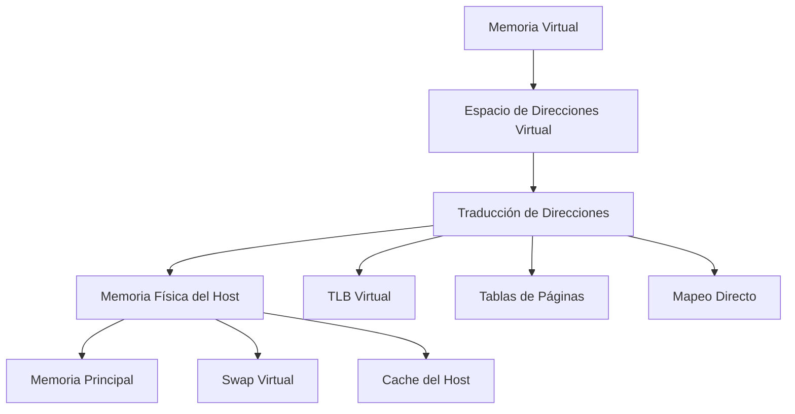

# Modelado y Programación - Emulación de máquinas virtuales
## 7.7 Construcción del back End.

---

El **backend** de una máquina virtual es el componente responsable de ejecutar el código compilado o interpretado, gestionar los recursos virtualizados y proporcionar la interfaz entre el código guest y el hardware host. Es el núcleo ejecutor de la máquina virtual.

### Definición Fundamental

El backend de una máquina virtual es **el conjunto de componentes que implementan la ejecución de instrucciones, gestión de memoria, manejo de dispositivos y administración de recursos** que permiten la emulación de un sistema computacional completo.

$$
\text{Backend} = \{\text{Executor}, \text{GestorMemoria}, \text{ControladorE/S}, \text{Planificador}\}
$$

### Arquitectura del Backend

#### 1. Componentes Principales



### Núcleo de Ejecución

#### 1. Módulo de Ejecución de Instrucciones

```cpp
class ExecutionCore {
private:
    VMState& state;
    MemoryManager& memory;
    DeviceManager& devices;
    
    // Configuración de ejecución
    ExecutionMode mode;
    uint64_t instructionsExecuted;
    uint64_t cyclesExecuted;
    
public:
    ExecutionCore(VMState& s, MemoryManager& m, DeviceManager& d)
        : state(s), memory(m), devices(d), mode(INTERPRET), 
          instructionsExecuted(0), cyclesExecuted(0) {}
    
    void executeInstruction();
    void run();
    void step();
    void pause();
    void reset();
    
    // Diferentes modos de ejecución
    void interpretInstruction();
    void executeNativeBlock();
    void translateAndExecute();
    
    // Métricas de performance
    double getIPS() const; // Instructions per second
    double getCPI() const; // Cycles per instruction
};
```

#### 2. Ciclo de Ejecución Principal

```cpp
void ExecutionCore::run() {
    while (state.isRunning()) {
        executeInstruction();
        
        // Verificar interrupciones cada cierto número de instrucciones
        if (instructionsExecuted % CHECK_INTERVAL == 0) {
            checkInterrupts();
        }
        
        // Actualizar dispositivos virtuales
        devices.updateDevices();
    }
}

void ExecutionCore::executeInstruction() {
    switch (mode) {
        case INTERPRET:
            interpretInstruction();
            break;
        case JIT:
            translateAndExecute();
            break;
        case NATIVE:
            executeNativeBlock();
            break;
    }
    
    instructionsExecuted++;
    cyclesExecuted += calculateCycles(state.currentInstruction);
}
```

### Sistema de Gestión de Memoria

#### 1. Jerarquía de Memoria Virtual



#### 2. Implementación de MMU Virtual

```cpp
class VirtualMMU {
private:
    MemoryManager& memory;
    std::unordered_map<uint64_t, uint64_t> tlb; // TLB virtual
    PageTable* pageTable;
    uint64_t pageSize;
    uint64_t tlbHits;
    uint64_t tlbMisses;
    
public:
    VirtualMMU(MemoryManager& mem, uint64_t pSize = 4096)
        : memory(mem), pageSize(pSize), tlbHits(0), tlbMisses(0) {
        pageTable = new PageTable(mem.getSize() / pSize);
    }
    
    uint64_t translateAddress(uint64_t virtualAddress, bool isWrite = false) {
        uint64_t pageNumber = virtualAddress / pageSize;
        uint64_t offset = virtualAddress % pageSize;
        
        // Consultar TLB primero
        auto tlbIt = tlb.find(pageNumber);
        if (tlbIt != tlb.end()) {
            tlbHits++;
            return tlbIt->second * pageSize + offset;
        }
        
        tlbMisses++;
        // Consultar tabla de páginas
        if (!pageTable->isPresent(pageNumber)) {
            handlePageFault(pageNumber, isWrite);
        }
        
        uint64_t frame = pageTable->getFrame(pageNumber);
        // Actualizar TLB
        tlb[pageNumber] = frame;
        
        return frame * pageSize + offset;
    }
    
    double getTLBHitRate() const {
        return static_cast<double>(tlbHits) / (tlbHits + tlbMisses);
    }
};
```

### Sistema de Entrada/Salida Virtual

#### 1. Framework de Dispositivos Virtuales

```cpp
class VirtualDevice {
public:
    virtual ~VirtualDevice() = default;
    
    virtual uint32_t read(uint32_t address, uint32_t size) = 0;
    virtual void write(uint32_t address, uint32_t value, uint32_t size) = 0;
    virtual void reset() = 0;
    virtual void update() = 0;
    virtual std::string getName() const = 0;
    
    // DMA virtual
    virtual void dmaRead(uint64_t hostAddress, uint32_t deviceAddress, uint32_t size) = 0;
    virtual void dmaWrite(uint64_t hostAddress, uint32_t deviceAddress, uint32_t size) = 0;
};

class DeviceManager {
private:
    std::vector<std::unique_ptr<VirtualDevice>> devices;
    std::unordered_map<uint32_t, VirtualDevice*> addressMap;
    InterruptController& interruptController;
    
public:
    void mapDevice(uint32_t baseAddress, uint32_t size, VirtualDevice* device) {
        for (uint32_t i = 0; i < size; i++) {
            addressMap[baseAddress + i] = device;
        }
        devices.push_back(std::unique_ptr<VirtualDevice>(device));
    }
    
    uint32_t readIO(uint32_t address, uint32_t size) {
        auto device = getDevice(address);
        return device->read(address - device->baseAddress, size);
    }
    
    void writeIO(uint32_t address, uint32_t value, uint32_t size) {
        auto device = getDevice(address);
        device->write(address - device->baseAddress, value, size);
    }
    
    void updateAllDevices() {
        for (auto& device : devices) {
            device->update();
        }
    }
};
```

#### 2. Implementación de Dispositivos Específicos

**Controlador de Video Virtual:**

```cpp
class VirtualGPU : public VirtualDevice {
private:
    std::vector<uint32_t> framebuffer;
    uint32_t width;
    uint32_t height;
    uint32_t baseAddress;
    
public:
    VirtualGPU(uint32_t w, uint32_t h, uint32_t base)
        : width(w), height(h), baseAddress(base) {
        framebuffer.resize(w * h);
        reset();
    }
    
    uint32_t read(uint32_t address, uint32_t size) override {
        if (address >= framebuffer.size() * sizeof(uint32_t)) {
            return 0;
        }
        
        uint32_t index = address / sizeof(uint32_t);
        return framebuffer[index];
    }
    
    void write(uint32_t address, uint32_t value, uint32_t size) override {
        if (address >= framebuffer.size() * sizeof(uint32_t)) {
            return;
        }
        
        uint32_t index = address / sizeof(uint32_t);
        framebuffer[index] = value;
        
        // Actualizar pantalla virtual
        updateDisplay();
    }
    
    void updateDisplay() {
        // Implementar renderizado en ventana o textura
    }
    
    void dmaRead(uint64_t hostAddress, uint32_t deviceAddress, uint32_t size) override {
        // Implementar DMA de dispositivo a memoria
    }
    
    void dmaWrite(uint64_t hostAddress, uint32_t deviceAddress, uint32_t size) override {
        // Implementar DMA de memoria a dispositivo
    }
};
```

### Sistema de Interrupciones Virtuales

#### 1. Controlador de Interrupciones Programable (PIC)

```cpp
class VirtualPIC : public VirtualDevice {
private:
    std::vector<bool> irqLines;
    std::vector<bool> irqMask;
    std::vector<uint8_t> irqPriorities;
    uint8_t currentIrq;
    bool interruptsEnabled;
    
public:
    VirtualPIC(uint8_t numIrqs = 16) 
        : irqLines(numIrqs, false), irqMask(numIrqs, false),
          irqPriorities(numIrqs, 0), currentIrq(0), interruptsEnabled(false) {}
    
    void raiseInterrupt(uint8_t irq) {
        if (irq < irqLines.size()) {
            irqLines[irq] = true;
            updateCurrentIrq();
        }
    }
    
    void lowerInterrupt(uint8_t irq) {
        if (irq < irqLines.size()) {
            irqLines[irq] = false;
            updateCurrentIrq();
        }
    }
    
    void updateCurrentIrq() {
        uint8_t highestPriority = 0;
        uint8_t selectedIrq = 0;
        bool found = false;
        
        for (uint8_t i = 0; i < irqLines.size(); ++i) {
            if (irqLines[i] && !irqMask[i] && irqPriorities[i] > highestPriority) {
                highestPriority = irqPriorities[i];
                selectedIrq = i;
                found = true;
            }
        }
        
        if (found) {
            currentIrq = selectedIrq;
        }
    }
    
    uint8_t getCurrentIrq() const {
        return currentIrq;
    }
    
    bool hasPendingInterrupts() const {
        for (bool line : irqLines) {
            if (line) return true;
        }
        return false;
    }
};
```

### Compilación JIT (Just-In-Time)

#### 1. Sistema de Traducción Dinámica

```cpp
class JITCompiler {
private:
    ExecutionCore& core;
    MemoryManager& memory;
    std::unordered_map<uint64_t, NativeCodeBlock> codeCache;
    size_t cacheSize;
    size_t maxCacheSize;
    
public:
    JITCompiler(ExecutionCore& c, MemoryManager& m, size_t maxCache = 65536)
        : core(c), memory(m), maxCacheSize(maxCache), cacheSize(0) {}
    
    NativeCodeBlock* compileBlock(uint64_t startAddress) {
        // Verificar si ya está en cache
        auto it = codeCache.find(startAddress);
        if (it != codeCache.end()) {
            return &it->second;
        }
        
        // Compilar nuevo bloque
        NativeCodeBlock block = translateBlock(startAddress);
        
        // Gestionar tamaño de cache
        if (cacheSize + block.size > maxCacheSize) {
            evictOldBlocks();
        }
        
        codeCache[startAddress] = std::move(block);
        cacheSize += block.size;
        
        return &codeCache[startAddress];
    }
    
    NativeCodeBlock translateBlock(uint64_t startAddress) {
        NativeCodeBlock block;
        block.startAddress = startAddress;
        
        uint64_t currentAddress = startAddress;
        bool endOfBlock = false;
        
        while (!endOfBlock && currentAddress < memory.getSize()) {
            Instruction instr = decodeInstruction(memory.read(currentAddress));
            NativeInstruction native = translateInstruction(instr);
            
            block.nativeCode.insert(block.nativeCode.end(),
                                  native.code.begin(), native.code.end());
            block.size += native.code.size();
            
            currentAddress += instr.size;
            
            // Detectar fin de bloque (saltos, retornos, etc.)
            if (instr.isBranch() || instr.isReturn()) {
                endOfBlock = true;
            }
        }
        
        return block;
    }
};
```

### Gestión de Recursos y Performance

#### 1. Monitor de Performance

```cpp
class PerformanceMonitor {
private:
    std::unordered_map<std::string, PerformanceCounter> counters;
    uint64_t startTime;
    uint64_t lastUpdate;
    
public:
    struct PerformanceCounter {
        uint64_t value;
        uint64_t lastValue;
        double rate;
        double average;
        uint64_t samples;
    };
    
    void update() {
        uint64_t currentTime = getCurrentTime();
        double delta = static_cast<double>(currentTime - lastUpdate) / 1e9;
        
        for (auto& [name, counter] : counters) {
            counter.rate = (counter.value - counter.lastValue) / delta;
            counter.average = (counter.average * counter.samples + counter.rate) 
                            / (counter.samples + 1);
            counter.lastValue = counter.value;
            counter.samples++;
        }
        
        lastUpdate = currentTime;
    }
    
    void incrementCounter(const std::string& name, uint64_t amount = 1) {
        counters[name].value += amount;
    }
    
    double getCounterRate(const std::string& name) const {
        auto it = counters.find(name);
        if (it != counters.end()) {
            return it->second.rate;
        }
        return 0.0;
    }
};
```

#### 2. Métricas Clave de Performance

**Fórmulas de performance:**

```
             IPS = Instrucciones ejecutadas / Tiempo transcurrido
             CPI = Ciclos totales / Instrucciones ejecutadas
    TLB Hit Rate = TLB Hits / (TLB Hits + TLB Misses)
  Cache Hit Rate = Cache Hits / (Cache Hits + Cache Misses)
     Utilización = (Tiempo ejecutando / Tiempo total) × 100%
```

### Ejercicios Propuestos

#### Ejercicio 1: Implementar MMU Virtual con Paginación
Implementa un sistema de memoria virtual con paginación de dos niveles.

**Requerimientos:**
- Tablas de páginas de dos niveles
- TLB con política LRU
- Manejo de page faults
- Estadísticas de performance

```cpp
class AdvancedMMU : public VirtualMMU {
public:
    AdvancedMMU(MemoryManager& mem) : VirtualMMU(mem) {}
    
    void handlePageFault(uint64_t pageNumber, bool isWrite) override {
        // Implementar algoritmo de reemplazo de páginas
        uint64_t victimPage = selectVictimPage();
        pageOut(victimPage);
        pageIn(pageNumber, isWrite);
    }
    
    uint64_t selectVictimPage() {
        // Implementar política LRU o CLOCK
    }
};
```

#### Ejercicio 2: Sistema de Dispositivos con DMA
Implementa un sistema DMA para dispositivos virtuales.

```cpp
class VirtualDMA {
private:
    MemoryManager& memory;
    DeviceManager& devices;
    std::vector<DMAController> channels;
    
public:
    void transfer(uint8_t channel, uint64_t hostAddr, 
                 uint32_t deviceAddr, uint32_t size, bool toDevice) {
        DMAController& dma = channels[channel];
        dma.startTransfer(hostAddr, deviceAddr, size, toDevice);
    }
    
    void update() {
        for (auto& channel : channels) {
            if (channel.isActive()) {
                channel.continueTransfer();
            }
        }
    }
};
```

#### Ejercicio 3: Optimizador JIT
Implementa un optimizador para el compilador JIT.

```cpp
class JITOptimizer {
public:
    static NativeCodeBlock optimize(const NativeCodeBlock& block) {
        NativeCodeBlock optimized = block;
        
        // Aplicar optimizaciones
        eliminateRedundantInstructions(optimized);
        constantPropagation(optimized);
        deadCodeElimination(optimized);
        instructionScheduling(optimized);
        
        return optimized;
    }
    
private:
    static void eliminateRedundantInstructions(NativeCodeBlock& block);
    static void constantPropagation(NativeCodeBlock& block);
    static void deadCodeElimination(NativeCodeBlock& block);
    static void instructionScheduling(NativeCodeBlock& block);
};
```

### Técnicas de Optimización Avanzadas

#### 1. Profile-Guided Optimization

```cpp
class ProfileGuidedOptimizer {
private:
    std::unordered_map<uint64_t, ExecutionProfile> profiles;
    ExecutionCore& core;
    
public:
    struct ExecutionProfile {
        uint64_t executionCount;
        uint64_t totalCycles;
        std::vector<uint64_t> hotPaths;
        std::set<uint64_t> frequentlyAccessedAddresses;
    };
    
    void collectProfileData() {
        uint64_t currentAddress = core.getPC();
        profiles[currentAddress].executionCount++;
        
        // Identificar caminos calientes
        if (profiles[currentAddress].executionCount > HOT_THRESHOLD) {
            optimizeHotPath(currentAddress);
        }
    }
    
    void optimizeHotPath(uint64_t address) {
        ExecutionProfile& profile = profiles[address];
        NativeCodeBlock optimized = recompileWithProfile(address, profile);
        core.getJITCompiler().updateCodeBlock(address, optimized);
    }
};
```

#### 2. Memory Prefetching Virtual

```cpp
class PrefetchEngine {
private:
    MemoryManager& memory;
    MMU& mmu;
    std::vector<PrefetchBuffer> buffers;
    
public:
    void analyzeAccessPattern(uint64_t address, bool isWrite) {
        // Analizar patrones de acceso y predecir siguientes accesos
        uint64_t nextAddress = predictNextAddress(address, isWrite);
        if (nextAddress != 0) {
            prefetch(nextAddress);
        }
    }
    
    void prefetch(uint64_t address) {
        // Cargar página a buffer de prefetch
        uint64_t physical = mmu.translateAddress(address, false);
        memory.prefetchPage(physical);
    }
};
```

### Pruebas y Benchmarking

#### 1. Suite de Pruebas de Performance

```cpp
class BenchmarkSuite {
public:
    static void runAllBenchmarks(ExecutionCore& core) {
        benchmarkIntegerPerformance(core);
        benchmarkFloatingPointPerformance(core);
        benchmarkMemoryPerformance(core);
        benchmarkIOPerformance(core);
        benchmarkOverallPerformance(core);
    }
    
    static void benchmarkIntegerPerformance(ExecutionCore& core) {
        // Ejecutar código de prueba de operaciones enteras
        std::vector<uint8_t> integerTest = generateIntegerTestCode();
        core.loadCode(integerTest);
        
        auto start = std::chrono::high_resolution_clock::now();
        core.run();
        auto end = std::chrono::high_resolution_clock::now();
        
        double seconds = std::chrono::duration<double>(end - start).count();
        double mips = (integerTest.size() / seconds) / 1e6;
        
        std::cout << "Integer Performance: " << mips << " MIPS" << std::endl;
    }
};
```

#### 2. Herramientas de Profiling

```cpp
class ProfilingTool {
private:
    ExecutionCore& core;
    std::ofstream profileLog;
    SamplingRate rate;
    
public:
    void startProfiling() {
        profileLog.open("profile.json");
        profileLog << "{\"traceEvents\":[";
        
        setupSamplingTimer(rate);
    }
    
    void sampleProfile() {
        uint64_t pc = core.getPC();
        uint64_t cycles = core.getCycles();
        
        profileLog << fmt::format(
            R"({{"name": "instruction", "ph": "P", "ts": {}, "pid": 0, "tid": 0, "args": {{"pc": "0x{:x}"}}}})",
            cycles, pc
        );
    }
    
    void stopProfiling() {
        profileLog << "]}";
        profileLog.close();
    }
};
```

### Referencias y Bibliografía

1. **"Virtual Machine Design and Implementation in C/C++"** - Bill Blunden
2. **"Advanced Programming in the UNIX Environment"** - W. Richard Stevens
3. **"Computer Architecture: A Quantitative Approach"** - John L. Hennessy and David A. Patterson
4. **"The Implementation of Functional Programming Languages"** - Simon Peyton Jones
5. **"Modern Processor Design: Fundamentals of Superscalar Processors"** - John Paul Shen and Mikko H. Lipasti

### Ejercicio Final: Backend Completo para Máquina Virtual

Implementa un backend completo para la máquina virtual que incluya:

1. Núcleo de ejecución con múltiples modos (interpretado, JIT, nativo)
2. Sistema de memoria virtual con MMU y TLB
3. Sistema de E/S con dispositivos virtuales y DMA
4. Sistema de interrupciones virtuales
5. Monitor de performance y profiling
6. Optimizaciones JIT y prefetching

**Criterios de evaluación:**
- Correcta ejecución de programas complejos
- Performance y eficiencia del sistema
- Robustez y manejo de errores
- Calidad del código y documentación
- Metricas de performance y optimizaciones

### Conclusión

El backend de una máquina virtual es el componente más crítico para el rendimiento y la funcionalidad del sistema. Un diseño cuidadoso que incorpore técnicas avanzadas de ejecución, gestión de memoria y E/S puede resultar en mejoras significativas de performance. Las optimizaciones JIT, el prefetching inteligente y el profiling continuo son esenciales para alcanzar niveles de performance cercanos al hardware nativo.

**Palabras clave:** Backend, Execution Core, Virtual MMU, JIT Compilation, Virtual Devices, DMA, Interrupt Handling, Performance Optimization, Profiling.
