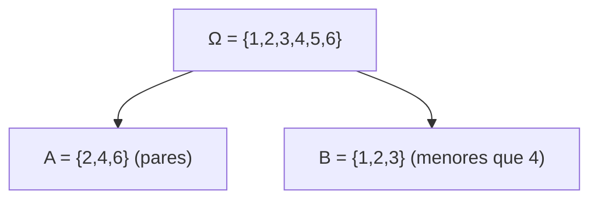

# Probabilidad I - Espacio de Probabilidad

## 1.1 Espacio muestral, eventos y su interpretación.

---

### 1. Introducción

La probabilidad es la rama de las matemáticas que estudia los fenómenos aleatorios. El **espacio de probabilidad** constituye la base formal sobre la cual se definen los eventos y sus probabilidades.

En este subtema, se estudian tres conceptos fundamentales:

1. **Espacio muestral $(\Omega)$**: el conjunto de todos los resultados posibles de un experimento aleatorio.
2. **Eventos $(A, B, C, \dots)$**: subconjuntos del espacio muestral.
3. **Interpretación probabilística**: cómo asignamos valores de probabilidad a los eventos y cómo se interpretan en la práctica.

### 2. Definiciones Fundamentales

#### 2.1 Experimento aleatorio

Un **experimento aleatorio** es aquel cuyo resultado no puede predecirse con certeza antes de realizarlo, aunque se conocen todos los posibles resultados.

Ejemplo: lanzar un dado, lanzar una moneda, medir la altura de una persona.

#### 2.2 Espacio muestral $(\Omega)$

El **espacio muestral** es el conjunto de todos los posibles resultados de un experimento aleatorio.

$$
\Omega = \{ \omega_1, \omega_2, \dots, \omega_n \}
$$

Ejemplos:

- Moneda: $\Omega = {C, S}$
- Dado: $\Omega = {1,2,3,4,5,6}$
- Lanzar dos monedas: $\Omega = {CC, CS, SC, SS}$

#### 2.3 Evento $(A)$

Un **evento** es cualquier subconjunto del espacio muestral.

- **Evento elemental**: un único resultado ${\omega\_i}$.
- **Evento compuesto**: conjunto de varios resultados.

Si $\Omega = {1,2,3,4,5,6}$ (dado), entonces:

- $A = {2,4,6}$ = “sacar un número par”.
- $B = {1}$ = “sacar el 1”.

#### 2.4 Probabilidad de un evento

La probabilidad de un evento $A \subseteq \Omega$ está dada por:

$$ P(A) = \frac{|A|}{|\Omega|} $$

si todos los resultados son **equiprobables**.

Ejemplo: en un dado, $P(\text{par}) = \frac{3}{6} = \frac{1}{2}$.

### 3. Operaciones con eventos

Los eventos se comportan como conjuntos.

- **Unión:** $A \cup B$ = " ocurre $A$ o $B$ "
- **Intersección:** $A \cap B$ = " ocurre $A$ y $B$ ".
- **Complemento:** $A^c = \Omega - A$ = " no ocurre $A$ ".
- **Evento imposible:** $\emptyset$
- **Evento seguro:** $\Omega$

#### Diagrama de Venn



### 4. Interpretación de los eventos

1. **Clásica (Laplace):** todos los resultados son equiprobables.
   Ejemplo: $P(A) = \frac{|A|}{|\Omega|}$.

2. **Frecuentista:** probabilidad como límite de frecuencias relativas:

   $$ P(A) = \lim_{n \to \infty} \frac{\# \text { de veces que ocurre } A}{n} $$

3. **Subjetiva:** probabilidad como medida de creencia personal (aplicada en estadística bayesiana).

### 5. Ejemplos

#### Ejemplo 1: Dado

Sea $\Omega = {1,2,3,4,5,6}$.

- Evento $A$: sacar un número par = ${2,4,6}$
- Evento $B$: sacar mayor que 4 = ${5,6}$
- Unión: $A \cup B = {2,4,5,6}$
- Intersección: $A \cap B = {6}$
- Complemento: $A^c = {1,3,5}$

Probabilidades:

- $P(A) = 3/6 = 1/2$
- $P(B) = 2/6 = 1/3$
- $P(A \cap B) = 1/6$

#### Ejemplo 2: Lanzar dos monedas

$\Omega = {CC, CS, SC, SS}$

- Evento $A$: obtener una cara = ${CS, SC}$
- Evento $B$: obtener dos iguales = ${CC, SS}$

$P(A) = 2/4 = 1/2$
$P(B) = 2/4 = 1/2$
$P(A \cap B) = 0$

### 6. Ejercicios Propuestos

1. Se lanza un dado:

   - Define $\Omega$.
   - Calcula $P(\text{número impar})$.
   - Calcula $P(\text{número mayor que 4})$.

2. Se lanzan dos monedas:

   - Escribe el espacio muestral.
   - Calcula la probabilidad de obtener al menos una cara.

3. De una baraja de 52 cartas:

   - Define el espacio muestral.
   - Calcula $P(\text{obtener una carta de corazones})$.
   - Calcula $P(\text{obtener un As})$.

### 7. Código de apoyo (Python)

```python
import itertools

# Espacio muestral de dos monedas
Omega = ["CC", "CS", "SC", "SS"]

# Definición de eventos
A = [o for o in Omega if "C" in o]   # Al menos una cara
B = [o for o in Omega if o[0] == o[1]] # Dos iguales

# Probabilidades
P_A = len(A) / len(Omega)
P_B = len(B) / len(Omega)
P_inter = len(set(A) & set(B)) / len(Omega)

print("P(A) =", P_A)
print("P(B) =", P_B)
print("P(A ∩ B) =", P_inter)
```

### 8. Referencias

- Feller, W. (1968). _An Introduction to Probability Theory and Its Applications_. Wiley.
- Ross, S. (2010). _A First Course in Probability_. Pearson.
- Grinstead, C. & Snell, J. (1997). _Introduction to Probability_. AMS.
- Papoulis, A. (1991). _Probability, Random Variables and Stochastic Processes_. McGraw-Hill.
