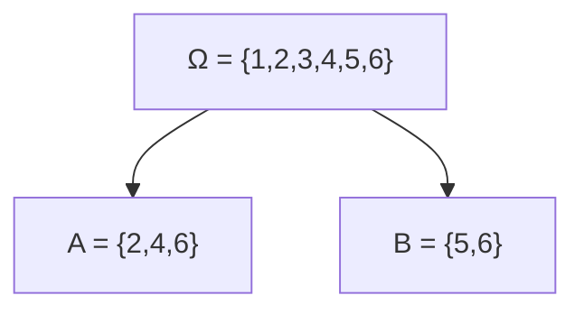

# Probabilidad I - Espacio de Probabilidad
## 1.3 Definición axiomática de probabilidad (sin énfasis en sigma-álgebras).

---

### 1. Introducción

La definición clásica de Laplace funciona bien cuando los resultados son finitos y equiprobables, pero no es suficiente para:

* Casos con resultados infinitos ( ej. elegir un número real en $[0,1]$ ).
* Experimentos donde los resultados no son equiprobables.

Por eso, **Andrey Kolmogórov** en 1933 formuló la **definición axiomática de la probabilidad**, que constituye la base moderna de la teoría de la probabilidad.


### 2. Espacio de probabilidad (versión simplificada)

Un **espacio de probabilidad** es una terna:

$$ (\Omega, \mathcal{A}, P) $$

donde:

* $\Omega$ = espacio muestral (conjunto de todos los resultados posibles).
* $\mathcal{A}$ = colección de eventos ( subconjuntos de $\Omega$ ) sobre los cuales se define la probabilidad.
* $P$ = función de probabilidad.

No entraremos en detalle con $\mathcal{A}$ (sigma-álgebras), solo asumiremos que **cualquier evento de interés es un subconjunto de $\Omega$**.


### 3. Axiomas de Kolmogórov

La probabilidad $P$ es una función que asigna a cada evento $A \subseteq \Omega$ un número real $P(A)$ que cumple:

#### **Axioma 1: No negatividad**

$$
P(A) \geq 0 \quad \text{para todo } A \subseteq \Omega
$$

#### **Axioma 2: Normalización**

$$
P(\Omega) = 1
$$

#### **Axioma 3: Aditividad finita**

Si $A$ y $B$ son eventos mutuamente excluyentes (disjuntos), entonces:

$$
P(A \cup B) = P(A) + P(B)
$$


### 4. Consecuencias importantes de los axiomas

De estos tres axiomas se pueden deducir propiedades fundamentales:

1. **Probabilidad del evento imposible:**

$$
P(\emptyset) = 0
$$

2. **Cota superior:**

$$
P(A) \leq 1
$$

3. **Complemento:**

$$
P(A^c) = 1 - P(A)
$$

4. **Aditividad general (para más de dos eventos disjuntos):**

$$
P(A_1 \cup A_2 \cup \dots \cup A_n) = \sum_{i=1}^n P(A_i)
$$


### 5. Ejemplos

#### Ejemplo 1: Dado justo

Sea $\Omega = {1,2,3,4,5,6}$ y definimos $P({\omega}) = 1/6$ para cada cara.

* $A = {2,4,6}$ → “sacar número par”

$$
P(A) = P(\{2\}) + P(\{4\}) + P(\{6\}) = \frac{1}{6} + \frac{1}{6} + \frac{1}{6} = \frac{1}{2}
$$

* $B = {5,6}$ → “sacar número mayor a 4”

$$
P(B) = \frac{1}{6} + \frac{1}{6} = \frac{1}{3}
$$


#### Ejemplo 2: Moneda no justa

Sea $\Omega = {C,S}$ y supongamos:

* $P(C) = 0.7$

* $P(S) = 0.3$

* Evento $A = {C}$ → “sale cara”:

$$
P(A) = 0.7
$$

* Evento $B = {S}$ → “sale sello”:

$$
P(B) = 0.3
$$

Aquí la **definición clásica** no aplica, pero la **axiomática sí** (✓).


### 6. Representación gráfica




### 7. Ejercicios propuestos

1. Una urna contiene 3 bolas rojas, 2 verdes y 5 azules. Se extrae una al azar.

   * Define el espacio muestral.
   * Calcula la probabilidad de sacar:
     a) una bola roja
     b) una bola azul
     c) una bola que no sea verde

2. Una moneda no balanceada tiene $P(\text{cara}) = 0.6$ y $P(\text{sello}) = 0.4$.

   * Verifica que los axiomas se cumplen.
   * Calcula la probabilidad de obtener “sello” en dos lanzamientos consecutivos.

3. Sea $\Omega = {1,2,3,4,5,6}$. Define $P({i}) = i/21$ para $i=1,2,\dots,6$.

   * Verifica que $P$ es una función de probabilidad.
   * Calcula $P(\text{número par})$.


### 8. Código de apoyo (Python)

```python
import random

# Ejemplo: Moneda no justa
p_cara = 0.7
p_sello = 0.3

# Simulación de 10000 lanzamientos
n = 10000
caras = sum(1 for _ in range(n) if random.random() < p_cara)
sello = n - caras

print("Frecuencia cara ≈", caras/n)
print("Frecuencia sello ≈", sello/n)
print("Teórico: P(C) =", p_cara, "P(S) =", p_sello)
```

### 9. Referencias

* Kolmogorov, A. N. (1933). *Foundations of the Theory of Probability*. Springer.
* Ross, S. (2010). *A First Course in Probability*. Pearson.
* Feller, W. (1968). *An Introduction to Probability Theory and Its Applications*. Wiley.
* Grinstead, C. & Snell, J. (1997). *Introduction to Probability*. AMS.
