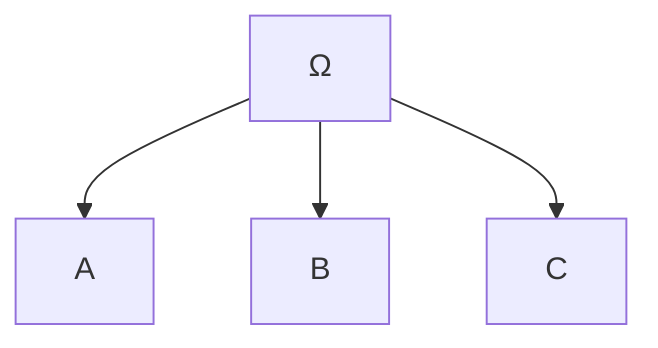

# Probabilidad I - Espacio de Probabilidad

## 1.4 Propiedades de la probabilidad.

---

### 1. Introducción

Partiendo de los **axiomas de Kolmogórov**, es posible deducir un conjunto de propiedades que son esenciales en el cálculo de probabilidades. Estas propiedades permiten:

- Simplificar cálculos.
- Relacionar probabilidades de distintos eventos.
- Resolver problemas complejos a partir de casos más simples.

### 2. Propiedades fundamentales de la probabilidad

Sea $(\Omega, P)$ un espacio de probabilidad. Para cualquier evento $A, B \subseteq \Omega$:

#### **Propiedad 1: Evento imposible**

$$
P(\emptyset) = 0
$$

#### **Propiedad 2: Cotas**

$$
0 \leq P(A) \leq 1
$$

#### **Propiedad 3: Evento seguro**

$$
P(\Omega) = 1
$$

#### **Propiedad 4: Complemento**

Si $A^c = \Omega - A$, entonces:

$$
P(A^c) = 1 - P(A)
$$

#### **Propiedad 5: Monotonía**

Si $A \subseteq B$, entonces:

$$
P(A) \leq P(B)
$$

#### **Propiedad 6: Aditividad**

Si $A$ y $B$ son disjuntos ( $A \cap B = \emptyset$ ), entonces:

$$
P(A \cup B) = P(A) + P(B)
$$

#### **Propiedad 7: Inclusión-Exclusión (2 eventos)**

$$
P(A \cup B) = P(A) + P(B) - P(A \cap B)
$$

Generalización para tres eventos:

$$
P(A \cup B \cup C) = P(A) + P(B) + P(C) - P(A \cap B) - P(A \cap C) - P(B \cap C) + P(A \cap B \cap C)
$$

#### **Propiedad 8: Probabilidad de la diferencia**

$$
P(A - B) = P(A) - P(A \cap B)
$$

#### **Propiedad 9: Subaditividad**

Para cualquier familia de eventos $A\_1, A\_2, \dots, A\_n$:

$$
P\left(\bigcup_{i=1}^n A_i \right) \leq \sum_{i=1}^n P(A_i)
$$

### 3. Ejemplos

#### Ejemplo 1: Dado justo

Sea $\Omega = {1,2,3,4,5,6}$.

- $A = {\text{números pares}} = {2,4,6}$
- $B = {\text{números mayores que 3}} = {4,5,6}$

Cálculos:

- $P(A) = 3/6 = 1/2$
- $P(B) = 3/6 = 1/2$
- $P(A \cup B) = P(A) + P(B) - P(A \cap B)$

donde $A \cap B = {4,6}$, entonces:

$$
P(A \cup B) = \frac{1}{2} + \frac{1}{2} - \frac{2}{6} = \frac{2}{3}
$$

#### Ejemplo 2: Moneda no justa

Sea $\Omega = {C, S}$, con $P(C) = 0.7$ y $P(S) = 0.3$.

- $A = {C}$
- $A^c = {S}$

Entonces:

$$
P(A^c) = 1 - P(A) = 1 - 0.7 = 0.3
$$

#### Ejemplo 3: Inclusión-Exclusión en tres eventos

En una clase de 30 estudiantes:

- 12 estudian Matemáticas $(M)$.
- 10 estudian Física $(F)$.
- 8 estudian Química $(Q)$.
- 4 estudian Matemáticas y Física.
- 3 estudian Matemáticas y Química.
- 2 estudian Física y Química.
- 1 estudia las tres materias.

¿Cuál es la probabilidad de que un estudiante elegido al azar estudie al menos una de las materias?

$$
P(M \cup F \cup Q) = P(M) + P(F) + P(Q) - P(M \cap F) - P(M \cap Q) - P(F \cap Q) + P(M \cap F \cap Q)
$$

Sustituyendo:

$$
\frac{12}{30} + \frac{10}{30} + \frac{8}{30} - \frac{4}{30} - \frac{3}{30} - \frac{2}{30} + \frac{1}{30} = \frac{22}{30}
$$

### 4. Representación gráfica (Venn en Mermaid)



### 5. Ejercicios propuestos

1. Una urna tiene 4 bolas rojas, 3 verdes y 5 azules.

   - Define el espacio muestral.
   - Calcula la probabilidad de:
     a) sacar una bola roja
     b) no sacar una bola verde
     c) sacar una bola roja o azul

2. Un dado se lanza dos veces. Sea $A$ = “suma igual a 7”, $B$ = “el primer lanzamiento es par”.

   - Calcula $P(A)$, $P(B)$, $P(A \cap B)$ y $P(A \cup B)$.

3. En un grupo de 100 estudiantes:

   - 40 practican fútbol.
   - 30 practican básquetbol.
   - 20 practican ambos.
   - Calcula la probabilidad de que un estudiante elegido practique:
     a) solo fútbol
     b) solo básquetbol
     c) al menos uno de los dos deportes

### 6. Código de apoyo (Python)

```python
# Ejemplo con dado: A=pares, B=mayores que 3
import itertools

Omega = [1,2,3,4,5,6]
A = {2,4,6}
B = {4,5,6}

P = lambda event: len(event) / len(Omega)

P_A = P(A)
P_B = P(B)
P_A_union_B = P_A + P_B - P(A & B)

print("P(A) =", P_A)
print("P(B) =", P_B)
print("P(A ∪ B) =", P_A_union_B)
```

### 7. Referencias

- Kolmogorov, A. N. (1933). _Foundations of the Theory of Probability_. Springer.
- Ross, S. (2010). _A First Course in Probability_. Pearson.
- Feller, W. (1968). _An Introduction to Probability Theory and Its Applications_. Wiley.
- Grinstead, C. & Snell, J. (1997). _Introduction to Probability_. AMS.
