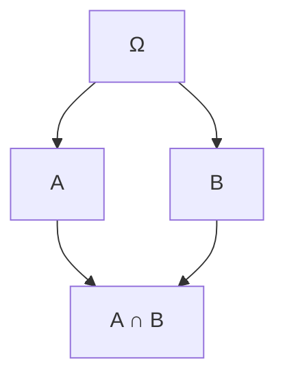

# Probabilidad I - Espacio de Probabilidad

## 1.5 Probabilidad condicional e independencia.

---

### 1. Introducción

En muchos experimentos aleatorios, el conocimiento de que un evento ocurrió **modifica la probabilidad de otros eventos**. Esto nos lleva al concepto de **probabilidad condicional**.

Asimismo, algunos eventos **no se afectan entre sí**, y en ese caso se dice que son **independientes**.

Estos dos conceptos son fundamentales en:

- Cálculo de probabilidades compuestas.
- Estadística bayesiana.
- Procesos estocásticos.
- Modelos de aprendizaje automático.

### 2. Probabilidad condicional

#### Definición

La **probabilidad condicional** de un evento $A$, dado que ocurrió $B$, se define como:

$$
P(A \mid B) = \frac{P(A \cap B)}{P(B)}, \quad \text{si } P(B) > 0
$$

Interpretación: restringimos el espacio muestral a los casos donde ocurre $B$.

#### Propiedades de la probabilidad condicional

1. $P(A \mid B) \geq 0$
2. $P(\Omega \mid B) = 1$
3. Si $A \subseteq B$, entonces $P(A \mid B) = \frac{P(A)}{P(B)}$
4. **Regla del producto:**

$$
P(A \cap B) = P(A \mid B) \, P(B) = P(B \mid A) \, P(A)
$$

### 3. Independencia de eventos

Dos eventos $A$ y $B$ son **independientes** si:

$$
P(A \cap B) = P(A) \cdot P(B)
$$

Equivalente a decir:

$$
P(A \mid B) = P(A) \quad \text{y} \quad P(B \mid A) = P(B)
$$

La ocurrencia de un evento **no afecta** la probabilidad del otro.

### 4. Regla de Bayes

La probabilidad condicional también conduce a la **regla de Bayes**, muy usada en inferencia estadística:

$$
P(A \mid B) = \frac{P(B \mid A) \, P(A)}{P(B)}, \quad P(B) > 0
$$

Donde:

- $P(A)$ = probabilidad a priori.
- $P(B \mid A)$ = verosimilitud.
- $P(A \mid B)$ = probabilidad a posteriori.

### 5. Ejemplos

#### Ejemplo 1: Dado

Sea $\Omega = {1,2,3,4,5,6}$.

- $A =$ “sacar un número par” = ${2,4,6}$

- $B =$ “sacar un número mayor que 3” = ${4,5,6}$

- $P(A) = 3/6 = 1/2$

- $P(B) = 3/6 = 1/2$

- $P(A \cap B) = {4,6} = 2/6 = 1/3$

Entonces:

$$
P(A \mid B) = \frac{P(A \cap B)}{P(B)} = \frac{1/3}{1/2} = \frac{2}{3}
$$

#### Ejemplo 2: Independencia en moneda justa

- $A =$ “sale cara en lanzamiento 1”
- $B =$ “sale cara en lanzamiento 2”

Como los lanzamientos son independientes:

$$
P(A \cap B) = P(A) \cdot P(B) = \tfrac{1}{2} \cdot \tfrac{1}{2} = \tfrac{1}{4}
$$

#### Ejemplo 3: Aplicación de Bayes

En una población:

- 1% tiene cierta enfermedad $(P(E) = 0.01)$.
- Una prueba da positivo al enfermo con $P(+ \mid E) = 0.99$.
- La prueba da un falso positivo con $P(+ \mid E^c) = 0.05$.

¿Cuál es la probabilidad de estar enfermo dado que la prueba fue positiva?

1. Probabilidad de positivo:

$$
P(+) = P(+ \mid E) P(E) + P(+ \mid E^c) P(E^c)
$$

$$
P(+) = (0.99)(0.01) + (0.05)(0.99) = 0.0594
$$

2. Aplicamos Bayes:

$$
P(E \mid +) = \frac{P(+ \mid E) P(E)}{P(+)} = \frac{0.99 \cdot 0.01}{0.0594} \approx 0.167
$$

Aunque la prueba es bastante precisa, la probabilidad real de estar enfermo es solo **16.7%**.

### 6. Diagramas de apoyo

#### Diagrama de intersección (Venn – Mermaid)



### 7. Ejercicios propuestos

1. Un dado se lanza. Sea $A =$ “resultado par” y $B =$ “resultado mayor a 4”.

   - Calcula $P(A)$, $P(B)$, $P(A \cap B)$, $P(A \mid B)$ y verifica si $A$ y $B$ son independientes.

2. Una urna contiene 3 bolas rojas y 2 negras. Se extrae una al azar sin reemplazo.

   - Calcula la probabilidad de que la segunda bola sea roja dado que la primera fue negra.

3. En un examen médico, la tasa de prevalencia de cierta enfermedad es 2%. La prueba detecta la enfermedad con 95% de precisión y da falsos positivos con 10%.

   - Calcula la probabilidad de que una persona esté enferma dado que la prueba salió positiva.

### 8. Código de apoyo (Python)

```python
# Ejemplo: Dado
Omega = [1,2,3,4,5,6]
A = {2,4,6}  # par
B = {4,5,6}  # mayor que 3

P = lambda E: len(E)/len(Omega)
P_inter = P(A & B)

P_A = P(A)
P_B = P(B)
P_A_given_B = P_inter / P_B

print("P(A) =", P_A)
print("P(B) =", P_B)
print("P(A ∩ B) =", P_inter)
print("P(A | B) =", P_A_given_B)
print("Independencia?", "Sí" if P_inter == P_A * P_B else "No")
```

### 9. Referencias

- Kolmogorov, A. N. (1933). _Foundations of the Theory of Probability_. Springer.
- Ross, S. (2010). _A First Course in Probability_. Pearson.
- Feller, W. (1968). _An Introduction to Probability Theory and Its Applications_. Wiley.
- Grinstead, C. & Snell, J. (1997). _Introduction to Probability_. AMS.
